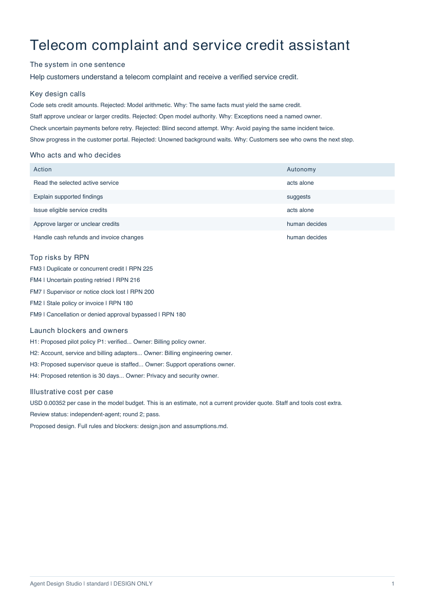
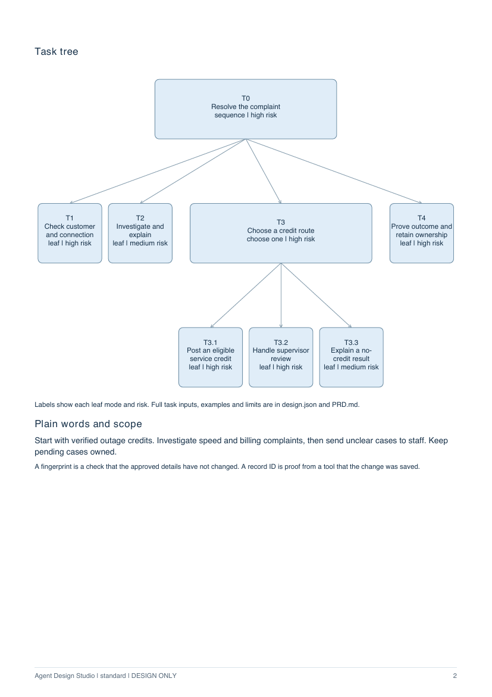
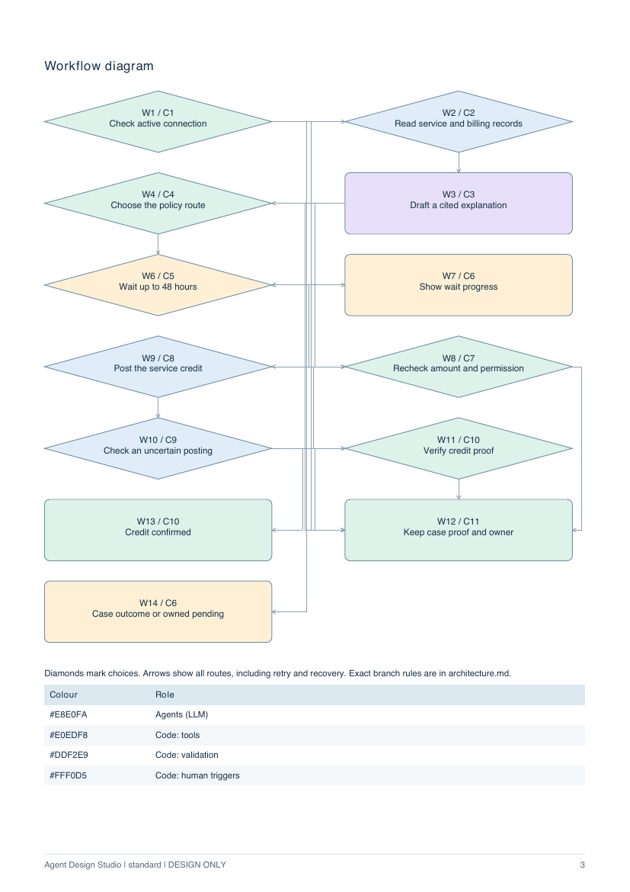

# Agent Design Studio

**One brief → a decision brief, a compact PDF and a milestone coding handoff.**

<p>



</p>

An installable skill and skills-only plugin. The host assistant expands a short brief into the PRD, task map, component contracts, workflow, model budget, risk register, evaluation fixtures and rollout. It uses the host model; no extra LLM API key, account or server is required. Normal host usage limits still apply.

**v1.1.0 is a local review candidate. It has not been published or tagged.** See the [measured scorecard](evals/v1.1-scorecard.md), [iteration record](evals/iterations.md) and [known limits](CHANGELOG.md).

## Use it

```text
Use $agent-design-studio.
Brief: Help staff triage support requests and draft replies.
Staff must review every reply before sending.
```

The brief is sufficient. Unknown facts become proposed assumptions with owners and launch blockers. Code-only systems do not acquire an unnecessary model.

| Mode | PDF | Companion detail |
| --- | --- | --- |
| `lite` | Four pages | Complete design JSON, review and check evidence |
| `standard` (default) | At most 12 pages | Full contracts, fixtures and milestone build files |
| `full` | Complete report and appendices | Full machine artifacts and selected build context |

Page 1 puts the system, chosen/rejected options, autonomy, top risks, blockers, illustrative cost and one-line review status before technical detail. Actual vector diagrams show tasks and workflow; standard/full also include risk heat and evaluation coverage tables. Exact internal names stay in contracts, with a glossary for readers.

For co-design, add `interactive: true`. The assistant pauses after the task map and after components for edits or removal. Default brief-only mode has no checkpoints. Task edits invalidate downstream work before rebuilding; they do not approve a live business action.

PDF is primary. After delivering it the assistant asks: **“Would you also like a visual HTML version in the same ten-stage structure as the app?”** HTML is opt-in and read-only.

## Install the checked-out skill

Copy the self-contained skill folder from this checkout into the host's personal skills directory. Back up an existing installation before replacing it.

```sh
mkdir -p ~/.codex/skills
cp -R skills/agent-design-studio ~/.codex/skills/
```

Refresh skills or start a fresh chat, then invoke `$agent-design-studio`. The repository also contains plugin manifests and a local marketplace. GitHub publication is separate from a plugin-directory listing. This review branch has not changed the public release.

## Outputs and control boundary

- `DESIGN.pdf`: decision-first reader report.
- `design.json`: one exact source, including assumptions and all ten stages.
- `PRD.md`, `architecture.md`: readable summary and exact architecture contracts.
- `build/00-overview.md` and milestone files: selected contracts, branch rules, indexed tests and acceptance criteria. Standard limits: 25,000 bytes/file; 100,000 total.
- `eval-set.json`, `fmea-register.csv`, `assumptions.md`: full fixtures, scored risks and verification owners.
- `review.json`, preserved failed reviews, `validation.json`, `run-report.json`: actual review method, checks, sizes, pages, timing and available token evidence.

Code owns money, identity, dates and limits. Models recommend, explain or abstain; they never hold write authority. A design run does not provision infrastructure, connect accounts, change access, send messages, make payments or deploy the proposed system.

Separate reviewers are used when the host supports them. The D1–D12 threshold remains 3/4 in every dimension with no unresolved major/critical finding; a high total cannot hide one failed dimension. Reviews inspect fixtures and contracts, not just shared IDs. A review pass is a bounded design judgment, not measured accuracy, compliance or an executed business control.

## Validate, export and render

Requires Python 3.10+; the validator, exporter and optional HTML use the standard library. PDF uses ReportLab and pypdf.

```sh
python3 -m pip install -r skills/agent-design-studio/requirements-pdf.txt
python3 skills/agent-design-studio/scripts/design_io.py validate /path/to/design.json
python3 skills/agent-design-studio/scripts/design_io.py export /path/to/design.json \
  --review /path/to/review.json --out /path/to/output --mode standard
python3 skills/agent-design-studio/scripts/design_pdf.py /path/to/design.json \
  --review /path/to/review.json --out /path/to/output/DESIGN.pdf --mode standard
```

Schema 1.1 adds seven semantic checks: all-path validation before writes; requester notice during long waits; real positive/negative write assertions; complete/versioned fixtures; protected write-field provenance; reconciliation before repeat writes; and trusted record-ID guards before confirmation. Declarations must match actual graph edges and fixtures. Schema 1.0 remains readable but is explicitly marked semantically unverified.

The helper cannot prove that a declared adapter is real, an author supplied truthful provenance, a role has actual authority or a future implementation enforces the contract. Large graphs may require extending the drawing layout; density errors stop rendering rather than silently dropping nodes or shrinking text. Unknown total host token usage stays null, so artifact size reductions never masquerade as token savings.

## Examples and development

Standard examples: [Civic](examples/civic/DESIGN.pdf), [CSV report](examples/csv-report/DESIGN.pdf), [Telecom](examples/telecom/DESIGN.pdf), [Health claims](examples/health-claims/DESIGN.pdf). Each includes a first-page PNG and source companions. Civic/CSV preserve legacy schema 1.0 designs with unverified semantic coverage; the new cases exercise 1.1. Independent and self-review are labelled separately.

```sh
python3 -m pip install -r requirements-eval.txt
python3 -m unittest discover -s tests -v
python3 scripts/score_run.py /path/to/run --brief telecom --baseline evals/baseline/telecom
python3 scripts/package_plugin.py --output dist
```

The scorer reports every S1–S12 target as pass/fail, with unmeasured items explicitly identified. S3/S8 require independent, source-bound grading; S11 needs comparable host usage, not file-size proxies. Historical faulty seeds and failed runs remain intact. Corrected active seed fixtures are versioned alongside their provenance.

The ZIP excludes generated user designs and evaluation runs. There is no background server, network relay or credential store. Workflow adapted from [Agent Design Studio](https://agent-design-studio-xi.vercel.app/). MIT licensed.
