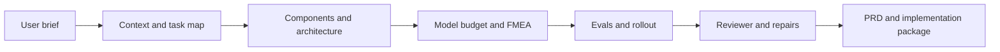

# Agent Design Studio

**One brief → a complete PDF system design and coding-agent handoff.**

An installable skill and skills-only Codex plugin. It turns a short business brief into a readable PDF covering the PRD, task map, architecture, typed tool contracts, model budget, risk register, evaluation plan and rollout. Eleven logical personas draft, review and repair the design. Missing details become explicit assumptions with safe defaults and verification owners.

No extra LLM API key, account or server is required. The host assistant does the reasoning using its existing model; the included Python helper validates references and renders the files. Normal host usage limits/billing still apply.

## Use it

```text
Use $agent-design-studio.

Brief: Help our support team triage requests, identify duplicate issues,
and draft replies. A human must review every reply before sending.
```

The PDF is delivered first. The agent then asks: **“Would you also like a visual HTML version in the same ten-stage structure as the app?”** HTML is generated only after opt-in, unless already requested.

That brief is sufficient. The skill supplies the detail and records assumptions instead of running a questionnaire. It supports deterministic systems too: it does not force an LLM into a task that needs only code.



## Install as a standalone skill

Clone the repository and copy its self-contained skill folder into your personal skills directory:

```sh
git clone https://github.com/APareek89/agent-design-studio-skill.git
mkdir -p ~/.codex/skills
cp -R agent-design-studio-skill/skills/agent-design-studio ~/.codex/skills/
```

If your host uses a different skills directory, copy the same folder there. If already installed, replace that skill folder deliberately rather than copying it inside itself. Start a fresh chat or refresh skills, then invoke `$agent-design-studio` with your brief.

The package also includes a portable root `plugin.json`, a Codex compatibility manifest, and a repo-local marketplace at `.agents/plugins/marketplace.json`. For local plugin testing, open this repository as a project and follow the [official local-plugin installation instructions](https://developers.openai.com/plugins/build/plugins#install-a-local-plugin-manually). Public GitHub publication is not an OpenAI Plugins Directory listing.

## What you receive

**DESIGN.pdf** is the primary final deliverable, organized in the same ten-stage order as the studio. It presents the decisions and contracts without dumping repeated machine packets. These companion files support implementation and audit:

- **PRD.md** — scope, business case, complete ten-stage design and acceptance criteria.
- **architecture.md** — Mermaid task/workflow maps, components, contracts, permissions and data choices.
- **build-prompt.md** — concrete implementation instructions for a coding agent.
- **eval-set.json** — golden, offline, online and release test specifications.
- **fmea-register.csv** — scored risks, controls, business KPIs and evaluation links.
- **assumptions.md** — proposed defaults, unknowns, verification owners and launch blockers.
- **design.json**, **review.json**, **validation.json** — canonical source and review/check evidence.

All outputs are proposed designs. Review is bounded to three revision rounds. Remaining major findings are delivered as `needs-work`, never hidden behind a passing aggregate score. Tests are specifications until a business test harness implements and executes them. The skill does not deploy systems, connect accounts, send messages or execute business actions by default.

## Validation and rendering

Requires Python 3.10+ for the helpers. Canonical validation, companion exports and optional HTML use only the standard library. PDF generation uses ReportLab; use the host’s existing PDF runtime or install the small declared PDF dependency in an isolated environment. No extra model credentials or business-system access are needed. Use your actual skill path:

```sh
python3 skills/agent-design-studio/scripts/design_io.py validate /path/to/design.json
python3 skills/agent-design-studio/scripts/design_io.py export /path/to/design.json \
  --out /path/to/output --review /path/to/review.json
python3 skills/agent-design-studio/scripts/design_pdf.py /path/to/design.json \
  --review /path/to/review.json --out /path/to/output/DESIGN.pdf
```

Synthetic examples: [municipal repair intake PDF](https://github.com/APareek89/agent-design-studio-skill/blob/main/examples/civic/DESIGN.pdf) and [deterministic CSV report PDF](https://github.com/APareek89/agent-design-studio-skill/blob/main/examples/csv-report/DESIGN.pdf). Their canonical designs, companions and failed review rounds are included beside the PDFs.

The assistant normally runs these commands itself, renders the PDF pages and checks layout. The final handoff asks about optional HTML, whose standalone renderer is bundled but does not run by default. The validator checks the bundled schema subset, IDs, reachability, risk/evaluation reciprocity, golden coverage and one model plan per judgement component. It does not prove semantic correctness, actual API behavior, legal compliance or provider performance. Source fields and review evidence still need scrutiny. If a host cannot generate PDF, it must disclose the concrete blocker and provide sources without claiming PDF completion.

## Develop and package

```sh
python3 -m unittest discover -s tests -v
python3 scripts/package_plugin.py --output dist
```

The ZIP contains only the plugin, skill, README and license; generated user designs and local evaluation outputs are excluded. The host loads skill instructions; no background process or network relay is installed. The optional HTML has the same ten-stage navigation, cards and risk/evaluation structure, works offline and has no API-key or approval controls. See [evals](https://github.com/APareek89/agent-design-studio-skill/blob/main/evals/README.md) for behavioral test scope and limitations.

The design workflow is adapted from [Agent Design Studio](https://agent-design-studio-xi.vercel.app/). The skill replaces the app's manual stage gates and provider-key UI with host-model execution and explicit assumptions. Skill package version 1.0.0; workflow lineage v2.1. MIT licensed.
