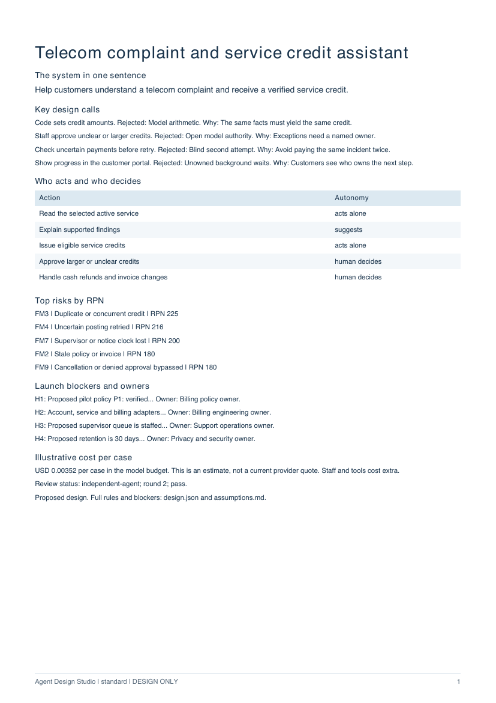
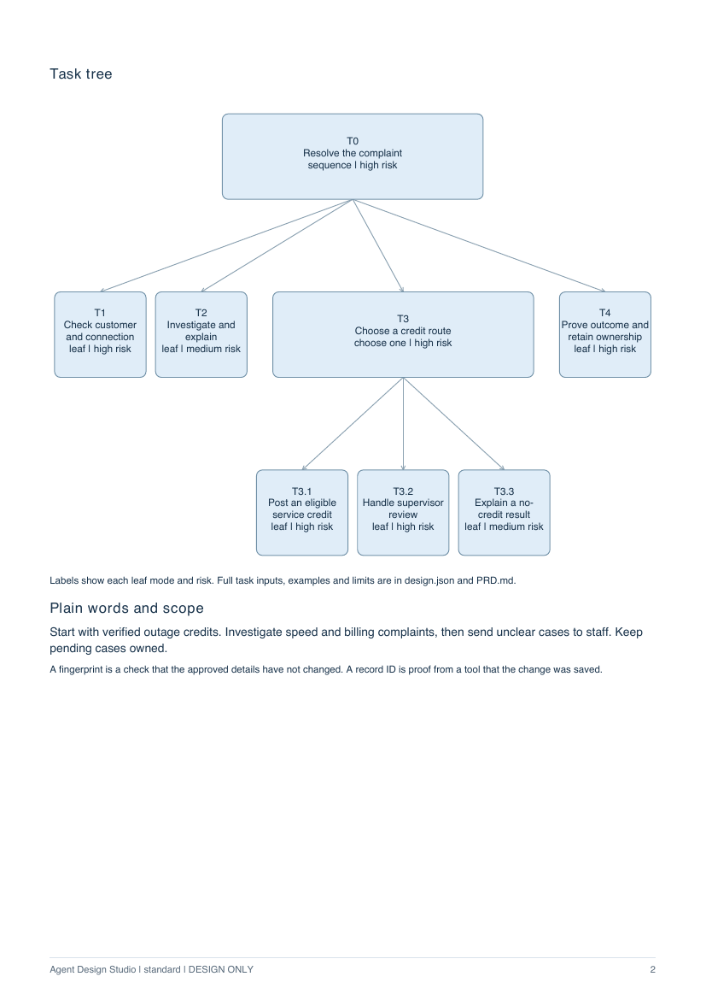
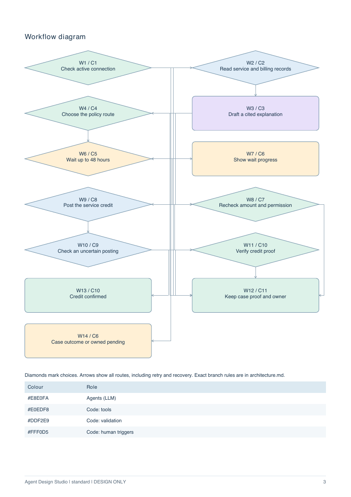

# Agent Design Studio

**One brief → a decision brief, a clickable read-only HTML design, a compact PDF and a milestone coding handoff.**

<p>



</p>

An installable skill and skills-only plugin. The host assistant expands a short brief into the PRD, task map, component contracts, workflow, model budget, risk register, evaluation fixtures and rollout. It uses the host model; no extra LLM API key, account or server is required. Normal host usage limits still apply.

**v1.2.0 is a local review candidate. It has not been published or tagged.** An independent grader scored all 26 HTML views of the two seed examples at 3 or above against the reference pages. See the [HTML design spec](docs/html-design-spec.md), the [visual QA captures, grader report and scorecards](evals/html-qa/2026-11-04/), the [v1.1 measured scorecard](evals/v1.1-scorecard.md), the [iteration record](evals/iterations.md) and [known limits](CHANGELOG.md).

## Use it

```text
Use $agent-design-studio.
Brief: Help staff triage support requests and draft replies.
Staff must review every reply before sending.
```

The brief is sufficient. Unknown facts become proposed assumptions with owners and launch blockers. Code-only systems do not acquire an unnecessary model.

| Mode | DESIGN.html | DESIGN.pdf | Companion detail |
| --- | --- | --- | --- |
| `lite` | Decision brief, Task map, Flow, Risks | Four pages | Complete design JSON, review and check evidence |
| `standard` (default) | All twelve views | At most 12 pages | README, milestone build files, `_evidence/` contracts and fixtures |
| `full` | All twelve views | Complete report and appendices | Full machine artifacts and selected build context |

Both artifacts open on the same decision brief: the system in one sentence, chosen and rejected options, autonomy, top risks, blockers, illustrative cost and one-line review status. The steps follow one naming table: Brief and scope, Task map, Building blocks, Flow, Stack and permissions, Models and cost, Risks, Tests, Measure and roll out, Handoff, then Assumptions and Review as evidence. The HTML draws a clickable task tree, an SVG flow with labelled conditions and handoff notes, a risk heat table, coverage tables and a cost calculator from `design.json`; it is read-only, self-contained and loads nothing from the network. The PDF draws vector task and workflow diagrams plus risk heat and evaluation coverage tables.

If the brief leaves out key information (which actions may run alone, systems of record, volume, regulation, users, channels, success measures, industry, platform, languages), the skill asks at most four optional questions once, through the host's question dialog (`AskUserQuestion` in Claude Code, `request_user_input` in Codex); skipped answers become labelled assumptions and a host that cannot ask proceeds without asking. Before review, `design_io.py validate --strict-coverage` checks that the design carries the information a reader expects (COV1 to COV15) and lists any gap for the author to fix or justify.

When the host has web search, the skill first researches the industry and the tools for each capability the brief needs (voice, guardrails and PII, search, embeddings and vector stores, knowledge graphs, document AI and more, listed in the skill's tool catalog), records each finding with its URL and date in `design.json`, and shows them in the Brief and scope and Stack and permissions views. Findings inform the design; the user's own policies and systems stay labelled assumptions.

For co-design, add `interactive: true`. The assistant pauses after the task map and after components for edits or removal. Default brief-only mode has no checkpoints. Task edits invalidate downstream work before rebuilding; they do not approve a live business action.

## Install

The skill is one self-contained folder, `skills/agent-design-studio`, in the Agent Skills format (`SKILL.md` plus `references/` and `scripts/`). Install it by copying that folder into the host's skills directory, or use the script, which also backs up an existing copy:

```sh
sh scripts/install_skill.sh claude
```

```sh
sh scripts/install_skill.sh claude codex cursor copilot gemini opencode
```

```sh
sh scripts/install_skill.sh --project claude
```

| Host | Personal folder | Project folder | How to invoke |
| --- | --- | --- | --- |
| Claude Code | `~/.claude/skills/` | `.claude/skills/` | `/agent-design-studio` or "use the agent-design-studio skill" |
| Codex | `~/.codex/skills/` | `.codex/skills/` | `$agent-design-studio` |
| GitHub Copilot | `~/.copilot/skills/` | `.github/skills/` | ask for the skill by name |
| Cursor | `~/.cursor/skills/` | `.cursor/skills/` | ask for the skill by name |
| Gemini CLI | `~/.gemini/skills/` | `.gemini/skills/` | ask for the skill by name |
| OpenCode | `~/.config/opencode/skills/` | `.opencode/skills/` | ask for the skill by name |
| Any other Agent Skills host | `~/.agents/skills/` or `--dir <path>` | `.agents/skills/` | per the host's docs |

Folders follow each tool's Agent Skills documentation as of November 2026; if your version uses another folder, pass `--dir <path>`. Manual copy for Claude Code:

```sh
mkdir -p ~/.claude/skills && cp -R skills/agent-design-studio ~/.claude/skills/
```

Claude Code can also load the repository as a plugin (manifests in `.claude-plugin/`): in Claude Code run `/plugin marketplace add APareek89/agent-design-studio-skill`, then `/plugin install agent-design-studio@agent-design-studio-skill`. Codex plugin manifests are in `.codex-plugin/` and `.agents/plugins/`. PDF output needs `python3 -m pip install -r skills/agent-design-studio/requirements-pdf.txt` in the Python the host uses. GitHub publication is separate from a plugin-directory listing. This review branch has not changed the public release.

## Outputs and control boundary

- `DESIGN.html`: read-only visual view of the whole design; no approval, upload or edit controls.
- `DESIGN.pdf`: decision-first reader report.
- `README.md`: what each delivered file is and what to open first.
- `design.json`: one exact source, including assumptions and all ten stages.
- `build/00-overview.md` and milestone files: selected contracts, branch rules, indexed tests and acceptance criteria. Standard limits: 25,000 bytes/file; 100,000 total.
- `_evidence/PRD.md`, `_evidence/architecture.md`, `_evidence/eval-set.json`, `_evidence/fmea-register.csv`, `_evidence/assumptions.md`: readable summary, exact contracts, full fixtures, scored risks and verification owners.
- `review.json`, preserved failed reviews, `validation.json`, `run-report.json`: actual review method, checks, generated-file hashes, sizes, pages, timing and available token evidence.

Code owns money, identity, dates and limits. Models recommend, explain or abstain; they never hold write authority. A design run does not provision infrastructure, connect accounts, change access, send messages, make payments or deploy the proposed system.

Separate reviewers are used when the host supports them. The D1–D12 threshold remains 3/4 in every dimension with no unresolved major/critical finding; a high total cannot hide one failed dimension. Reviews inspect fixtures and contracts, not just shared IDs. A review pass is a bounded design judgment, not measured accuracy, compliance or an executed business control.

## Validate, export and render

Requires Python 3.10+; the validator, exporter and HTML renderer use the standard library. PDF uses ReportLab and pypdf. The optional browser check uses Node with Playwright and a Chromium it can launch.

```sh
python3 -m pip install -r skills/agent-design-studio/requirements-pdf.txt
python3 skills/agent-design-studio/scripts/design_io.py validate /path/to/design.json
python3 skills/agent-design-studio/scripts/design_io.py export /path/to/design.json \
  --review /path/to/review.json --out /path/to/output --mode standard
python3 skills/agent-design-studio/scripts/design_pdf.py /path/to/design.json \
  --review /path/to/review.json --out /path/to/output/DESIGN.pdf --mode standard
node scripts/html_qa.js /path/to/output/DESIGN.html /path/to/qa --jpeg
```

`export` writes `DESIGN.html` in every mode; add `--no-html` for a host that cannot write it. `html_qa.js` opens the page offline, screenshots every view at 1440 px and 400 px, and fails on console errors, external requests or page-level horizontal scroll.

Schema 1.1 adds seven semantic checks: all-path validation before writes; requester notice during long waits; real positive/negative write assertions; complete/versioned fixtures; protected write-field provenance; reconciliation before repeat writes; and trusted record-ID guards before confirmation. Declarations must match actual graph edges and fixtures. Schema 1.0 remains readable but is explicitly marked semantically unverified.

The helper cannot prove that a declared adapter is real, an author supplied truthful provenance, a role has actual authority or a future implementation enforces the contract. Large PDF graphs may require extending the drawing layout; density errors stop rendering rather than silently dropping nodes or shrinking text. Unknown total host token usage stays null, so artifact size reductions never masquerade as token savings.

## Examples and development

Standard examples: [Civic](examples/civic/), [CSV report](examples/csv-report/), [Telecom](examples/telecom/), [Health claims](examples/health-claims/). Each includes `DESIGN.html`, `DESIGN.pdf`, a first-page PNG and source companions in the historical flat layout. Civic/CSV preserve legacy schema 1.0 designs with unverified semantic coverage; the new cases exercise 1.1. Independent and self-review are labelled separately. The reference pages the HTML must match are in [evals/target/](evals/target/).

```sh
python3 -m pip install -r requirements-eval.txt
python3 -m unittest discover -s tests -v
python3 scripts/score_run.py /path/to/run --brief telecom --baseline evals/baseline/telecom
python3 scripts/package_plugin.py --output dist
```

`design_io.py coverage <design.json>` prints the expected-information report and exits 1 on an unjustified required gap; `validate --strict-coverage` does the same inside validation. The scorer reports every S1–S13 target as pass/fail, with unmeasured items explicitly identified. S3/S8/S13 require independent, source-bound grading; S13 needs `html-grader.json` with a score of at least 3 for every view and a DESIGN.html that renders in every mode without a renderer refusal. S11 needs comparable host usage, not file-size proxies. Historical faulty seeds and failed runs remain intact. Corrected active seed fixtures are versioned alongside their provenance.

The ZIP excludes generated user designs and evaluation runs. There is no background server, network relay or credential store. Workflow adapted from [Agent Design Studio](https://agent-design-studio-xi.vercel.app/). MIT licensed.
