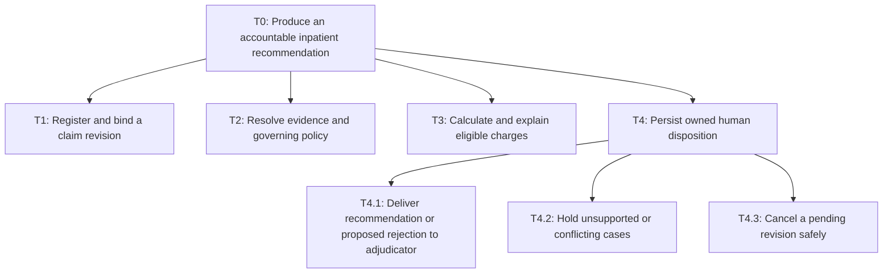
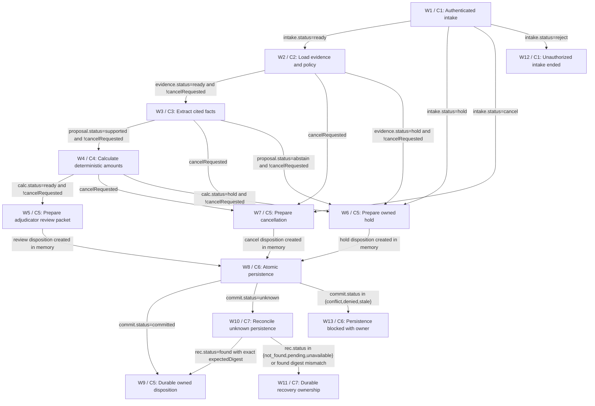

# Inpatient claim evidence and adjudication assistance

> PASS · DESIGN ONLY. Review is a design judgement; no business controls or provider reliability were executed.

Review method: self-review; round 3.

Review dimensions (supplied scores):

- D1: 3/4 — CTX1–CTX6/T0–T4.3 completely bound supported intake through review/hold/cancel; all final insurer decisions remain human.
- D2: 3/4 — Every high-risk leaf has reachable W coverage and substantive golden. FM/EV reciprocal links derived once; EV26 is included in FM10 and EV25 manifest.
- D3: 3/4 — W1–W13 enumerate ready/hold/cancel/reject and commit/error/unknown paths. Cancellation precedence, CAS and digest readback prevent conflicting resubmission; W11 retains recovery owner.
- D4: 3/4 — C1–C7 declare typed inputs/outputs, read and internal write logical contracts, temporal parser, human-event reentry and SLA roles. Real adapters remain verification dependencies.
- D5: 3/4 — C4 owns integer arithmetic/dates/limits; C6 checks identity/resource/version/full payload at API. C3 has no tools; F3/F4 isolate medical evidence and redacted inference.
- D6: 4/4 — H1–H9 identify every unprovided policy/volume/price/threshold/owner as hypothesis. Sources preserve brief and exact H statements; no clinical/legal claims.
- D7: 3/4 — F1–F5 choose code state machine and bounded single judgement over multi-agent/open-ended adjudication; data candidates labelled unverified against common criteria.
- D8: 3/4 — M1 cost formula .84*$0.0384=$0.032256/case and 2-call worst budget reproducible. Input overflow holds; tier selection requires held-out evidence and fine-tune gates.
- D9: 3/4 — FM1–FM10 contain concrete inpatient-specific effects, causes, S/O/D rationale, owner release gates, control and reciprocal golden coverage. No risk accepted.
- D10: 3/4 — 23 self-contained golden fixtures (EV1–EV22,EV26) plus EV23 offline/EV24 online/EV25 release. Exact payload hashes locally checked; EV17 intentionally fails. Actual citation mutation, room cap controls, stale policy, cancellation and callback fixtures inspected. Planned harness remains unexecuted.
- D11: 3/4 — R1–R6 specify unknown-baseline collection, proposed quality/time targets, causal measures, cluster experiment and noncircular shadow/assist/scale gates. Safety event overrides benefits.
- D12: 3/4 — X1 follows canonical C/W/EV IDs; exports generated from same canonical design after frozen validation. Launch blockers remain explicit, no business control execution claimed.

Review findings:

- ISSUE5 [major, resolved] evals/EV7: Citation validity was only mocked false although actual model span remained valid; must corrupt a concrete span to isolate guard. Repaired in final canonical version and re-inspected.
- ISSUE6 [major, resolved] evals/EV26: Generic fixture augmentation cited last document (policy clause) for admission dates. Correct dates to discharge span and include actual line trace in persist packet. Repaired in final canonical version and re-inspected.
- ISSUE7 [major, resolved] evals/EV18: Timer fixture runs at 48h without a clear preexisting committed review record; make event action and prior receipt explicit. Repaired in final canonical version and re-inspected.

## Task tree



## Workflow



## tasks

### T0 · Produce an accountable inpatient recommendation

T1 intake precedes T2 evidence and policy validation, then T3 calculation, then T4 disposition; early failure goes directly to owned hold or cancellation.

Reasoning: Preserve evidence and owned dispositions at each step.

Assumptions:

- H1: Release one recommends eligible amounts and routes all decisions to authorized insurer adjudicators; it cannot issue payment, deny coverage or notify claimants.

- H9: Scope is one insurer product, one currency per claim and machine-readable or supported scanned inpatient reimbursement claims. Appeals, fraud decisions, outpatient, multi-currency and medical necessity decisions are human-only.

Data:

```json
{
  "parentId": "",
  "mode": "sequence",
  "basis": [
    "T1 intake precedes T2 evidence and policy validation, then T3 calculation, then T4 disposition; early failure goes directly to owned hold or cancellation."
  ],
  "examples": [
    "Authenticated reimbursement submission"
  ],
  "autonomy": "Code or human only; model cannot authorize business actions.",
  "frequency": "Per submitted revision; H7 illustrative 1000 cases/month.",
  "risk": "high"
}
```


Sources:

- hypothesis / H1: Release one recommends eligible amounts and routes all decisions to authorized insurer adjudicators; it cannot issue payment, deny coverage or notify claimants.

- hypothesis / H9: Scope is one insurer product, one currency per claim and machine-readable or supported scanned inpatient reimbursement claims. Appeals, fraud decisions, outpatient, multi-currency and medical necessity decisions are human-only.

### T1 · Register and bind a claim revision

Authenticate tenant/member, accept provisional evidence manifest, deduplicate exact submissions, detect semantic duplicate candidates without merging.

Reasoning: Preserve evidence and owned dispositions at each step.

Assumptions:

- H1: Release one recommends eligible amounts and routes all decisions to authorized insurer adjudicators; it cannot issue payment, deny coverage or notify claimants.

- H9: Scope is one insurer product, one currency per claim and machine-readable or supported scanned inpatient reimbursement claims. Appeals, fraud decisions, outpatient, multi-currency and medical necessity decisions are human-only.

Data:

```json
{
  "parentId": "T0",
  "mode": "leaf",
  "basis": [
    "Authenticate tenant/member, accept provisional evidence manifest, deduplicate exact submissions, detect semantic duplicate candidates without merging."
  ],
  "examples": [
    "Missing discharge summary creates awaiting-evidence case"
  ],
  "autonomy": "Code or human only; model cannot authorize business actions.",
  "frequency": "Per submitted revision; H7 illustrative 1000 cases/month.",
  "risk": "high"
}
```


Sources:

- hypothesis / H1: Release one recommends eligible amounts and routes all decisions to authorized insurer adjudicators; it cannot issue payment, deny coverage or notify claimants.

- hypothesis / H9: Scope is one insurer product, one currency per claim and machine-readable or supported scanned inpatient reimbursement claims. Appeals, fraud decisions, outpatient, multi-currency and medical necessity decisions are human-only.

### T2 · Resolve evidence and governing policy

Read tenant-bound evidence; extract cited facts; resolve coverage interval and endorsements from registry; discrepancies or missing rules are holds.

Reasoning: Preserve evidence and owned dispositions at each step.

Assumptions:

- H1: Release one recommends eligible amounts and routes all decisions to authorized insurer adjudicators; it cannot issue payment, deny coverage or notify claimants.

- H9: Scope is one insurer product, one currency per claim and machine-readable or supported scanned inpatient reimbursement claims. Appeals, fraud decisions, outpatient, multi-currency and medical necessity decisions are human-only.

Data:

```json
{
  "parentId": "T0",
  "mode": "leaf",
  "basis": [
    "Read tenant-bound evidence; extract cited facts; resolve coverage interval and endorsements from registry; discrepancies or missing rules are holds."
  ],
  "examples": [
    "Admission precedes renewal so select historical version only if configured basis says admission"
  ],
  "autonomy": "Code or human only; model cannot authorize business actions.",
  "frequency": "Per submitted revision; H7 illustrative 1000 cases/month.",
  "risk": "high"
}
```


Sources:

- hypothesis / H1: Release one recommends eligible amounts and routes all decisions to authorized insurer adjudicators; it cannot issue payment, deny coverage or notify claimants.

- hypothesis / H9: Scope is one insurer product, one currency per claim and machine-readable or supported scanned inpatient reimbursement claims. Appeals, fraud decisions, outpatient, multi-currency and medical necessity decisions are human-only.

### T3 · Calculate and explain eligible charges

Code checks dates, member status, remaining benefits, line totals and limits from approved rule pack. Model drafts only evidence grounded recommendation.

Reasoning: Preserve evidence and owned dispositions at each step.

Assumptions:

- H1: Release one recommends eligible amounts and routes all decisions to authorized insurer adjudicators; it cannot issue payment, deny coverage or notify claimants.

- H9: Scope is one insurer product, one currency per claim and machine-readable or supported scanned inpatient reimbursement claims. Appeals, fraud decisions, outpatient, multi-currency and medical necessity decisions are human-only.

Data:

```json
{
  "parentId": "T0",
  "mode": "leaf",
  "basis": [
    "Code checks dates, member status, remaining benefits, line totals and limits from approved rule pack. Model drafts only evidence grounded recommendation."
  ],
  "examples": [
    "INR 6000 room charge against INR 5000 daily cap becomes INR 5000 eligible, not inferred proportional treatment deduction"
  ],
  "autonomy": "Code or human only; model cannot authorize business actions.",
  "frequency": "Per submitted revision; H7 illustrative 1000 cases/month.",
  "risk": "high"
}
```


Sources:

- hypothesis / H1: Release one recommends eligible amounts and routes all decisions to authorized insurer adjudicators; it cannot issue payment, deny coverage or notify claimants.

- hypothesis / H9: Scope is one insurer product, one currency per claim and machine-readable or supported scanned inpatient reimbursement claims. Appeals, fraud decisions, outpatient, multi-currency and medical necessity decisions are human-only.

### T4 · Persist owned human disposition

Exactly one outcome for a revision: T4.1 review, T4.2 hold, T4.3 cancel. Cancel wins before persistence; uncertain persistence remains owned until reconciled.

Reasoning: Preserve evidence and owned dispositions at each step.

Assumptions:

- H1: Release one recommends eligible amounts and routes all decisions to authorized insurer adjudicators; it cannot issue payment, deny coverage or notify claimants.

- H9: Scope is one insurer product, one currency per claim and machine-readable or supported scanned inpatient reimbursement claims. Appeals, fraud decisions, outpatient, multi-currency and medical necessity decisions are human-only.

Data:

```json
{
  "parentId": "T0",
  "mode": "choose one",
  "basis": [
    "Exactly one outcome for a revision: T4.1 review, T4.2 hold, T4.3 cancel. Cancel wins before persistence; uncertain persistence remains owned until reconciled."
  ],
  "examples": [
    "Adjudicator receives supported eligible recommendation"
  ],
  "autonomy": "Code or human only; model cannot authorize business actions.",
  "frequency": "Per submitted revision; H7 illustrative 1000 cases/month.",
  "risk": "high"
}
```


Sources:

- hypothesis / H1: Release one recommends eligible amounts and routes all decisions to authorized insurer adjudicators; it cannot issue payment, deny coverage or notify claimants.

- hypothesis / H9: Scope is one insurer product, one currency per claim and machine-readable or supported scanned inpatient reimbursement claims. Appeals, fraud decisions, outpatient, multi-currency and medical necessity decisions are human-only.

### T4.1 · Deliver recommendation or proposed rejection to adjudicator

All supported recommendations including zero eligible amount are human-reviewed. Record durable review packet only.

Reasoning: Preserve evidence and owned dispositions at each step.

Assumptions:

- H1: Release one recommends eligible amounts and routes all decisions to authorized insurer adjudicators; it cannot issue payment, deny coverage or notify claimants.

- H9: Scope is one insurer product, one currency per claim and machine-readable or supported scanned inpatient reimbursement claims. Appeals, fraud decisions, outpatient, multi-currency and medical necessity decisions are human-only.

Data:

```json
{
  "parentId": "T4",
  "mode": "leaf",
  "basis": [
    "All supported recommendations including zero eligible amount are human-reviewed. Record durable review packet only."
  ],
  "examples": [
    "Coverage exclusion cites clause and proposes rejection; reviewer decides"
  ],
  "autonomy": "Code or human only; model cannot authorize business actions.",
  "frequency": "Per submitted revision; H7 illustrative 1000 cases/month.",
  "risk": "high"
}
```


Sources:

- hypothesis / H1: Release one recommends eligible amounts and routes all decisions to authorized insurer adjudicators; it cannot issue payment, deny coverage or notify claimants.

- hypothesis / H9: Scope is one insurer product, one currency per claim and machine-readable or supported scanned inpatient reimbursement claims. Appeals, fraud decisions, outpatient, multi-currency and medical necessity decisions are human-only.

### T4.2 · Hold unsupported or conflicting cases

Missing evidence, ambiguity, stale policy, potential duplicate, tool failure or unsupported scope receives reason and assigned owner; never infer denial.

Reasoning: Preserve evidence and owned dispositions at each step.

Assumptions:

- H1: Release one recommends eligible amounts and routes all decisions to authorized insurer adjudicators; it cannot issue payment, deny coverage or notify claimants.

- H9: Scope is one insurer product, one currency per claim and machine-readable or supported scanned inpatient reimbursement claims. Appeals, fraud decisions, outpatient, multi-currency and medical necessity decisions are human-only.

Data:

```json
{
  "parentId": "T4",
  "mode": "leaf",
  "basis": [
    "Missing evidence, ambiguity, stale policy, potential duplicate, tool failure or unsupported scope receives reason and assigned owner; never infer denial."
  ],
  "examples": [
    "Unclear room category or proportional deduction language goes to policy reviewer"
  ],
  "autonomy": "Code or human only; model cannot authorize business actions.",
  "frequency": "Per submitted revision; H7 illustrative 1000 cases/month.",
  "risk": "high"
}
```


Sources:

- hypothesis / H1: Release one recommends eligible amounts and routes all decisions to authorized insurer adjudicators; it cannot issue payment, deny coverage or notify claimants.

- hypothesis / H9: Scope is one insurer product, one currency per claim and machine-readable or supported scanned inpatient reimbursement claims. Appeals, fraud decisions, outpatient, multi-currency and medical necessity decisions are human-only.

### T4.3 · Cancel a pending revision safely

Authenticated cancellation stops further model work; atomic persistence cancels only unfinalized local revision. Previously delivered records remain auditable and marked superseded; cancellation does not reverse insurer decision.

Reasoning: Preserve evidence and owned dispositions at each step.

Assumptions:

- H1: Release one recommends eligible amounts and routes all decisions to authorized insurer adjudicators; it cannot issue payment, deny coverage or notify claimants.

- H9: Scope is one insurer product, one currency per claim and machine-readable or supported scanned inpatient reimbursement claims. Appeals, fraud decisions, outpatient, multi-currency and medical necessity decisions are human-only.

Data:

```json
{
  "parentId": "T4",
  "mode": "leaf",
  "basis": [
    "Authenticated cancellation stops further model work; atomic persistence cancels only unfinalized local revision. Previously delivered records remain auditable and marked superseded; cancellation does not reverse insurer decision."
  ],
  "examples": [
    "Member withdraws before packet delivery"
  ],
  "autonomy": "Code or human only; model cannot authorize business actions.",
  "frequency": "Per submitted revision; H7 illustrative 1000 cases/month.",
  "risk": "high"
}
```


Sources:

- hypothesis / H1: Release one recommends eligible amounts and routes all decisions to authorized insurer adjudicators; it cannot issue payment, deny coverage or notify claimants.

- hypothesis / H9: Scope is one insurer product, one currency per claim and machine-readable or supported scanned inpatient reimbursement claims. Appeals, fraud decisions, outpatient, multi-currency and medical necessity decisions are human-only.

### A1 · Bound identity

Identity gateway: tenantId/memberId/principal/scopes and authenticated cancellation events; do not accept identity from uploaded text.

Reasoning: Load only data needed for this step.

Assumptions:

- H4: Internal case store supports tenant scoped transactions, optimistic versions, immutable evidence hashes, durable outbox and operation lookup. All external adapters remain unverified.

- H5: Use restricted medical evidence storage, encrypted transport and storage, tenant keys, no provider training, no raw content in logs; proposed 30-day working-copy deletion after case close subject to insurer approved retention/legal holds.

Data:

```json
{
  "taskIds": [
    "T1",
    "T2",
    "T3",
    "T4.1",
    "T4.2",
    "T4.3"
  ],
  "sourceSystem": "Identity gateway: tenantId/memberId/principal/scopes and authenticated cancellation events; do not accept identity from uploaded text.",
  "loaded": "on demand"
}
```


Sources:

- hypothesis / H4: Internal case store supports tenant scoped transactions, optimistic versions, immutable evidence hashes, durable outbox and operation lookup. All external adapters remain unverified.

- hypothesis / H5: Use restricted medical evidence storage, encrypted transport and storage, tenant keys, no provider training, no raw content in logs; proposed 30-day working-copy deletion after case close subject to insurer approved retention/legal holds.

### A2 · Immutable evidence

Evidence vault: docId/version/hash/page/span/media type/subject binding; upload content is untrusted.

Reasoning: Load only data needed for this step.

Assumptions:

- H4: Internal case store supports tenant scoped transactions, optimistic versions, immutable evidence hashes, durable outbox and operation lookup. All external adapters remain unverified.

- H5: Use restricted medical evidence storage, encrypted transport and storage, tenant keys, no provider training, no raw content in logs; proposed 30-day working-copy deletion after case close subject to insurer approved retention/legal holds.

Data:

```json
{
  "taskIds": [
    "T1",
    "T2",
    "T3"
  ],
  "sourceSystem": "Evidence vault: docId/version/hash/page/span/media type/subject binding; upload content is untrusted.",
  "loaded": "on demand"
}
```


Sources:

- hypothesis / H4: Internal case store supports tenant scoped transactions, optimistic versions, immutable evidence hashes, durable outbox and operation lookup. All external adapters remain unverified.

- hypothesis / H5: Use restricted medical evidence storage, encrypted transport and storage, tenant keys, no provider training, no raw content in logs; proposed 30-day working-copy deletion after case close subject to insurer approved retention/legal holds.

### A3 · Governing policy and remaining cover

Versioned policy registry plus member claims ledger: effective intervals, temporal basis, rule hash, remaining benefit as-of sequence; verify again at delivery.

Reasoning: Load only data needed for this step.

Assumptions:

- H4: Internal case store supports tenant scoped transactions, optimistic versions, immutable evidence hashes, durable outbox and operation lookup. All external adapters remain unverified.

- H5: Use restricted medical evidence storage, encrypted transport and storage, tenant keys, no provider training, no raw content in logs; proposed 30-day working-copy deletion after case close subject to insurer approved retention/legal holds.

Data:

```json
{
  "taskIds": [
    "T2",
    "T3",
    "T4.1"
  ],
  "sourceSystem": "Versioned policy registry plus member claims ledger: effective intervals, temporal basis, rule hash, remaining benefit as-of sequence; verify again at delivery.",
  "loaded": "on demand"
}
```


Sources:

- hypothesis / H4: Internal case store supports tenant scoped transactions, optimistic versions, immutable evidence hashes, durable outbox and operation lookup. All external adapters remain unverified.

- hypothesis / H5: Use restricted medical evidence storage, encrypted transport and storage, tenant keys, no provider training, no raw content in logs; proposed 30-day working-copy deletion after case close subject to insurer approved retention/legal holds.

### A4 · Revision and owned operation

Case store: caseId/revision/status/opId/requestDigest/recordId/owner/ackAt/dueAt/outbox; use CAS on current revision.

Reasoning: Load only data needed for this step.

Assumptions:

- H4: Internal case store supports tenant scoped transactions, optimistic versions, immutable evidence hashes, durable outbox and operation lookup. All external adapters remain unverified.

- H5: Use restricted medical evidence storage, encrypted transport and storage, tenant keys, no provider training, no raw content in logs; proposed 30-day working-copy deletion after case close subject to insurer approved retention/legal holds.

Data:

```json
{
  "taskIds": [
    "T1",
    "T4.1",
    "T4.2",
    "T4.3"
  ],
  "sourceSystem": "Case store: caseId/revision/status/opId/requestDigest/recordId/owner/ackAt/dueAt/outbox; use CAS on current revision.",
  "loaded": "on demand"
}
```


Sources:

- hypothesis / H4: Internal case store supports tenant scoped transactions, optimistic versions, immutable evidence hashes, durable outbox and operation lookup. All external adapters remain unverified.

- hypothesis / H5: Use restricted medical evidence storage, encrypted transport and storage, tenant keys, no provider training, no raw content in logs; proposed 30-day working-copy deletion after case close subject to insurer approved retention/legal holds.


## components

### C1 · Intake and identity gate

Reject unauthorized requests before reading medical data. Exact key tenant+requestId has a unique digest; same key/different payload is CONFLICT. Semantic match on member/admission/provider/bill number is candidate only, held for human correlation. Cancellation must own member and expected revision. Intake creates no external claim action.

Reasoning: Bound each responsibility with typed outcomes.

Assumptions:

- H1: Release one recommends eligible amounts and routes all decisions to authorized insurer adjudicators; it cannot issue payment, deny coverage or notify claimants.

- H4: Internal case store supports tenant scoped transactions, optimistic versions, immutable evidence hashes, durable outbox and operation lookup. All external adapters remain unverified.

Data:

```json
{
  "group": "Code: validation",
  "taskIds": [
    "T1",
    "T4.3"
  ],
  "inputs": [
    "principal:{tenantId,memberId,scopes:string[],active:bool}; required, server authenticated",
    "command:{type:submit|cancel,caseId?:uuid,expectedRevision?:int,requestId:uuid}; submit requires policyId,docIds[] (may be empty); cancel requires caseId and expectedRevision",
    "manifest:DocumentRef[]; each tenantId/memberId/docId/version/hash required"
  ],
  "outputs": [
    "intake:{status:ready|hold|cancel|reject,caseId:uuid?,revision:int?,reason:enum,duplicateOf:uuid?}",
    "reason:OK|MISSING_DOCS|IDENTITY|DUPLICATE_CANDIDATE|EXACT_REPLAY|UNSUPPORTED|CONFLICT|CANCELLED; exact replay returns original record"
  ],
  "whyCode": "Deterministic identity, policy arithmetic and durable state must remain inspectable and cannot be delegated to model judgement.",
  "approvalRule": "Authenticated submitter has case:create or case:cancel scope limited to own tenant/member; revision conflicts do not overwrite."
}
```


Sources:

- hypothesis / H1: Release one recommends eligible amounts and routes all decisions to authorized insurer adjudicators; it cannot issue payment, deny coverage or notify claimants.

- hypothesis / H4: Internal case store supports tenant scoped transactions, optimistic versions, immutable evidence hashes, durable outbox and operation lookup. All external adapters remain unverified.

### C2 · Evidence and temporal policy reader

Logical readEvidence and readPolicy APIs filter tenant/member at repository boundary; 10-second timeout, one retry for unavailable, no retry for subject mismatch. Governing policy is selected using approved date basis from H2, not automatically latest. Missing basis, overlapping intervals, conflicting endorsements or unreadable dates produce hold. Effective date boundaries are half-open. Admission/discharge exact dates must be confirmed against cited spans before calculation. Before version selection, a deterministic supported-format parser reads explicit Admission YYYY-MM-DD and Discharge YYYY-MM-DD labels and verifies document subject. It emits date values and exact spans; missing, non-ISO or contradictory date labels hold with MISSING or UNREADABLE/FACT_CONFLICT through C4, without a model deciding temporal applicability. C2 retrieves full authoritative version list then selects half-open interval using that confirmed date. Unsupported language/date forms route to intake operator. This narrow parsing support is part of H9, not a claimed OCR capability.

Reasoning: Bound each responsibility with typed outcomes.

Assumptions:

- H1: Release one recommends eligible amounts and routes all decisions to authorized insurer adjudicators; it cannot issue payment, deny coverage or notify claimants.

- H4: Internal case store supports tenant scoped transactions, optimistic versions, immutable evidence hashes, durable outbox and operation lookup. All external adapters remain unverified.

Data:

```json
{
  "group": "Code: tools",
  "taskIds": [
    "T2"
  ],
  "inputs": [
    "bound:{tenantId,memberId,caseId,revision}; required",
    "docRefs:DocumentRef[]; policyId:string; admissionDate:date?; sourceDocs contain page text and OCR confidence",
    "registry:{versions:[{id,hash,effectiveFrom,effectiveTo,selectionBasis,memberBinding,rulePack}],endorsements:[]}; required authoritative reader"
  ],
  "outputs": [
    "evidence:{status:ready|hold,reason:OK|MISSING|UNREADABLE|SUBJECT|AMBIGUOUS_POLICY|UNAVAILABLE,policyVersion?:string,policyHash?:sha256,documents:Span[],rules?:RulePack,ledgerSequence?:int}",
    "Span:{docId,version,page:int,start:int,end:int,text:string,hash:sha256}; all references tenant/member bound",
    "confirmedDates:{admissionDate:ISO date,dischargeDate:ISO date,citations:SpanRef[]}; optional only when hold; required ready. Normalized parser must have exactly one consistent pair."
  ],
  "whyCode": "Deterministic identity, policy arithmetic and durable state must remain inspectable and cannot be delegated to model judgement.",
  "approvalRule": "Read-only scoped service with documented medical-data purpose. Never fetch by unscoped docId."
}
```


Sources:

- hypothesis / H1: Release one recommends eligible amounts and routes all decisions to authorized insurer adjudicators; it cannot issue payment, deny coverage or notify claimants.

- hypothesis / H4: Internal case store supports tenant scoped transactions, optimistic versions, immutable evidence hashes, durable outbox and operation lookup. All external adapters remain unverified.

### C3 · Structured fact extraction and explanation

Single bounded extraction call with advisory coverage rationale. Documents are data, never instructions; no tools, no network, no writes. One schema repair retry with same snapshot is allowed; timeout/unavailable abstains. Code checks every required citation and never uses model confidence as approval. Final narrative combines immutable cited clause text and C4 amounts; model cannot invent rules. Inference input hard maximum is 12000 estimated tokenizer tokens including instructions/schema/evidence. If full evidence cannot fit, hold with INSUFFICIENT_EVIDENCE; never truncate bill lines or select a convenient subset. The 50-page/200-line cap is additional, not an assurance of token fit.

Reasoning: Bound each responsibility with typed outcomes.

Assumptions:

- H1: Release one recommends eligible amounts and routes all decisions to authorized insurer adjudicators; it cannot issue payment, deny coverage or notify claimants.

- H4: Internal case store supports tenant scoped transactions, optimistic versions, immutable evidence hashes, durable outbox and operation lookup. All external adapters remain unverified.

Data:

```json
{
  "group": "Agents (LLM)",
  "taskIds": [
    "T2",
    "T3"
  ],
  "inputs": [
    "evidence:Span[]; confirmed policy/rules immutable hash; required",
    "phase:extract_and_explain; max 50 pages and 200 bill lines (H9 proposed support limit), remove direct identifiers before inference",
    "approvedFields:{admissionDate,dischargeDate,diagnosisText,roomClass,billLines:[lineId,category,amountMinor,serviceDate,quantity],coverageClauses}; schema only"
  ],
  "outputs": [
    "proposal:{status:supported|abstain,facts:Fact[],coverage:recommend_eligible|recommend_reject|review,evidenceRefs:SpanRef[],uncertainties:string[],explanation:string}",
    "Fact:{field,value,citation:{docId,version,page,start,end}}; coverage is advisory; monetary results must come from C4",
    "modelError:SCHEMA|TIMEOUT|UNAVAILABLE; any uncited/conflicting material fact becomes abstain",
    "EvidenceRef is discriminated: document span {docId,version,page,start,end} or approved policy clause {policyVersion,policyHash,ruleId}; facts use source type matching responsibility. No cross-type citation substitutes for actual dates or amounts."
  ],
  "whyCode": "",
  "approvalRule": "No business action permission; human resolves coverage interpretation and clinical/necessity disputes."
}
```


Sources:

- hypothesis / H1: Release one recommends eligible amounts and routes all decisions to authorized insurer adjudicators; it cannot issue payment, deny coverage or notify claimants.

- hypothesis / H4: Internal case store supports tenant scoped transactions, optimistic versions, immutable evidence hashes, durable outbox and operation lookup. All external adapters remain unverified.

### C4 · Rules and money verifier

Reconcile bill totals exactly, duplicate line IDs reject to hold; missing categories/negative amounts/currency mismatches hold. Day count follows pack; HC1 inclusive days. Room cap min(room charge, cap*covered days) applies only to room lines in HC1. Never infer proportional reductions on related charges. Sub-limits, deductible, coinsurance and remaining cover order must be explicit approved rule program; unknown rule or ambiguity holds. C4 validates extracted numeric/date facts against normalized source values and flags contradictory originals. HC1 synthetic eligibility requires inpatient=true, bound active member interval covering selected admission and diagnosis coverageFlag=covered explicitly established by approved rule pack; excluded flag proposes rejection with zero eligible amount for human review, never final denial. Unknown clinical interpretation goes to policy/adjudicator hold. No medical necessity inference is supported.

Reasoning: Bound each responsibility with typed outcomes.

Assumptions:

- H1: Release one recommends eligible amounts and routes all decisions to authorized insurer adjudicators; it cannot issue payment, deny coverage or notify claimants.

- H4: Internal case store supports tenant scoped transactions, optimistic versions, immutable evidence hashes, durable outbox and operation lookup. All external adapters remain unverified.

Data:

```json
{
  "group": "Code: validation",
  "taskIds": [
    "T3"
  ],
  "inputs": [
    "proposal:typed C3 output; evidence and policy snapshot required",
    "rulePack:{version,currency,selectionBasis,dayCount,roomCapMinorPerDay,proportionalRule:explicit_none|explicit_formula|unspecified,deductibleMinor,coinsuranceBps,benefitCaps,rounding,remainingCoverMinor}; all approved required",
    "ledgerSequence:int; dates:ISO dates, amounts:int>=0; no floating point money"
  ],
  "outputs": [
    "calculation:{status:ready|hold,reason:OK|FACT_CONFLICT|RULE_MISSING|BILL_MISMATCH|DATE|STALE|INSUFFICIENT_EVIDENCE,lines:[{lineId,billedMinor,eligibleMinor,deductionMinor,ruleId,evidenceRefs}],totalEligibleMinor:int?,currency:string,policyHash:sha256,ledgerSequence:int}",
    "verified:{factCitationsValid:bool,totalsReconciled:bool,rulesComplete:bool}; explanation has arithmetic trace"
  ],
  "whyCode": "Deterministic identity, policy arithmetic and durable state must remain inspectable and cannot be delegated to model judgement.",
  "approvalRule": "Read-only calculation; no reserve or payment authorization."
}
```


Sources:

- hypothesis / H1: Release one recommends eligible amounts and routes all decisions to authorized insurer adjudicators; it cannot issue payment, deny coverage or notify claimants.

- hypothesis / H4: Internal case store supports tenant scoped transactions, optimistic versions, immutable evidence hashes, durable outbox and operation lookup. All external adapters remain unverified.

### C5 · Review queue and timer owner

Create assigned queue record atomically with packet. Proposed H6 uses elapsed UTC 4h ack/48h resolution; overdue escalates at deadlines and stays visible, never auto-closes/denies. Human acknowledgment and resolution require scoped role checks and revision CAS. Request-evidence opens a new revision on new upload. Reviewer signs off outside insurer APIs; no notifications are sent by design. Durable queue assignment and timers are part of C6 transaction/outbox, not a separate best-effort action. Acknowledgment/resolution APIs use command kind human_event with actorId, tenant/member/case, expectedRevision, eventId, eventType ack|reviewed|request_evidence, notesRef and UTC time; fresh role checks are required, rejected events never change status. Accepted events are processed through W8–W11 with opId=eventId and full digest, preserving queue assignment for request_evidence; reviewed records only internal completion. Human updates never write insurer decisions. C5 has no independent database writer.

Reasoning: Bound each responsibility with typed outcomes.

Assumptions:

- H1: Release one recommends eligible amounts and routes all decisions to authorized insurer adjudicators; it cannot issue payment, deny coverage or notify claimants.

- H4: Internal case store supports tenant scoped transactions, optimistic versions, immutable evidence hashes, durable outbox and operation lookup. All external adapters remain unverified.

Data:

```json
{
  "group": "Code: human triggers",
  "taskIds": [
    "T4.1",
    "T4.2",
    "T4.3"
  ],
  "inputs": [
    "caseId/revision/tenantId/memberId; reasonCode and immutable packetRef required",
    "trigger:recommendation|exception|cancel|overdue; ownerRole:adjudicator|policy_reviewer|intake_operator|duty_manager",
    "events:{type:ack|resolve|cancel,actorId,scope,expectedRevision,at:UTC}; resolve outcome:reviewed|request_evidence,decisionNotesRef required"
  ],
  "outputs": [
    "disposition:{kind:review_pending|hold_owned|cancelled,ownerRole,ackDueAt:UTC,resolveDueAt:UTC,reasonCode,packetRef?}",
    "timer:{at:UTC,eventId,escalateTo}; queue receipts are durable store outbox entries, no email/Slack sends",
    "humanResolution:{status:reviewed|request_evidence|overdue,actorId,at,notesRef}; records outside insurer decision ledger"
  ],
  "whyCode": "Deterministic identity, policy arithmetic and durable state must remain inspectable and cannot be delegated to model judgement.",
  "approvalRule": "Queue writes internal only; authenticated reviewers restricted by tenant, caseload and medical-data role."
}
```


Sources:

- hypothesis / H1: Release one recommends eligible amounts and routes all decisions to authorized insurer adjudicators; it cannot issue payment, deny coverage or notify claimants.

- hypothesis / H4: Internal case store supports tenant scoped transactions, optimistic versions, immutable evidence hashes, durable outbox and operation lookup. All external adapters remain unverified.

### C6 · Case record and audit writer

Internal logical persistDisposition API performs fresh principal scope/tenant/member checks and CAS in transaction; checks document hashes, policy registry current governing version and ledger sequence for recommendations; version changes require new revision not overwriting. OpId replay with same digest returns same receipt; changed digest is conflict. Durable proof covers record/audit/outbox before committed. Transaction failure is all-or-nothing. No insurer writes exist. Blocked metadata audit uses a separately scoped service identity allowed only requestId/caseId/reason/owner/UTC/opId, no medical content or new recommendation. It never reuses revoked actor scope. Durable ingress receipt exists before work begins; if blocked-event update fails, platform recovery owns original ingress receipt and never reports completion. The service identity cannot change claim disposition or review payload.

Reasoning: Bound each responsibility with typed outcomes.

Assumptions:

- H1: Release one recommends eligible amounts and routes all decisions to authorized insurer adjudicators; it cannot issue payment, deny coverage or notify claimants.

- H4: Internal case store supports tenant scoped transactions, optimistic versions, immutable evidence hashes, durable outbox and operation lookup. All external adapters remain unverified.

Data:

```json
{
  "group": "Code: tools",
  "taskIds": [
    "T1",
    "T4.1",
    "T4.2",
    "T4.3"
  ],
  "inputs": [
    "persist:{tenantId,memberId,caseId,expectedRevision:int,opId:uuid,payload:{kind:review_pending|hold_owned|cancelled,reasonCode,ownerRole,packet?,policyVersion?,policyHash?,ledgerSequence?,evidenceHashes:string[]},digest:sha256}; required",
    "Canonical payload is UTF-8 JSON sorted keys/no whitespace; digest SHA256 covers all fields except digest; request identity binds opId and canonical payload",
    "freshIdentityActive:bool from gateway; currentPolicyHash and ledgerSequence read at commit for review_pending; cancel/hold need no policy snapshot",
    "persist discriminator: disposition|human_event; human_event requires eventId,eventType:ack|reviewed|request_evidence,actorId,notesRef and expectedRevision; action-specific medical fields are absent. All fields are digest-bound; fresh reviewer role required."
  ],
  "outputs": [
    "commit:{status:committed|conflict|denied|stale|unknown,recordId?:uuid,revision?:int,opId,digest}; committed requires durable case row+audit+outbox IDs",
    "error:VERSION|AUTH|POLICY_STALE|TIMEOUT_UNKNOWN; known failure returns conflict/denied/stale; transport timeout is unknown"
  ],
  "whyCode": "Deterministic identity, policy arithmetic and durable state must remain inspectable and cannot be delegated to model judgement.",
  "approvalRule": "Fresh API enforcement permits only internal disposition persistence by workflow identity bound to case; no external finality or money scope."
}
```


Sources:

- hypothesis / H1: Release one recommends eligible amounts and routes all decisions to authorized insurer adjudicators; it cannot issue payment, deny coverage or notify claimants.

- hypothesis / H4: Internal case store supports tenant scoped transactions, optimistic versions, immutable evidence hashes, durable outbox and operation lookup. All external adapters remain unverified.

### C7 · Read-only operation reconciler

Read operation ledger at 1/5/30 minutes, then place durable recovery hold and hourly read until operator resolution. Never blindly resubmit after timeout. not_found is not proof no delayed commit until store reports transaction definitively aborted; service guarantees must be verified H4. Freeze changed revisions/cancellation writes until result known, record intent, then separately authorize new revision. No successful completion without found receipt.

Reasoning: Bound each responsibility with typed outcomes.

Assumptions:

- H1: Release one recommends eligible amounts and routes all decisions to authorized insurer adjudicators; it cannot issue payment, deny coverage or notify claimants.

- H4: Internal case store supports tenant scoped transactions, optimistic versions, immutable evidence hashes, durable outbox and operation lookup. All external adapters remain unverified.

Data:

```json
{
  "group": "Code: tools",
  "taskIds": [
    "T4.1",
    "T4.2",
    "T4.3"
  ],
  "inputs": [
    "lookup:{tenantId,memberId,caseId,opId,expectedDigest}; required",
    "durable recovery identity limited to operation:read and queue escalation after caller session expires"
  ],
  "outputs": [
    "reconcile:{status:found|not_found|pending|unavailable,recordId?:uuid,digest?:sha256,revision?:int}; found requires exact digest and identity",
    "recoveryOwner:platform_on_call; nextPollAt:UTC; callback:{eventId,opId,digest,recordId} deduplicated"
  ],
  "whyCode": "Deterministic identity, policy arithmetic and durable state must remain inspectable and cannot be delegated to model judgement.",
  "approvalRule": "Separate durable read authority; no write or compensation permission."
}
```


Sources:

- hypothesis / H1: Release one recommends eligible amounts and routes all decisions to authorized insurer adjudicators; it cannot issue payment, deny coverage or notify claimants.

- hypothesis / H4: Internal case store supports tenant scoped transactions, optimistic versions, immutable evidence hashes, durable outbox and operation lookup. All external adapters remain unverified.


## workflow

### W1 · Authenticated intake

{"state": "Authenticated intake", "transitions": [{"to": "W2", "when": "intake.status=ready", "mode": "exclusive; first matching predicate; exhaustive enum/default error routes"}, {"to": "W6", "when": "intake.status=hold", "mode": "exclusive; first matching predicate; exhaustive enum/default error routes"}, {"to": "W7", "when": "intake.status=cancel", "mode": "exclusive; first matching predicate; exhaustive enum/default error routes"}, {"to": "W12", "when": "intake.status=reject", "mode": "exclusive; first matching predicate; exhaustive enum/default error routes"}], "failureDisposition": "Unauthorized requests end at W12 without exposing PHI; service unavailability retains ingress receipt in owned intake queue.", "timeout": "30 seconds", "retryPolicy": "No retry; failures produce owned hold.", "terminalDisposition": "", "guardBindings": {"intake.status": "C1.intake.status enum ready|hold|cancel|reject", "evidence.status": "C2.evidence.status enum ready|hold", "proposal.status": "C3.proposal.status enum supported|abstain, including exhausted model errors", "calc.status": "C4.calculation.status enum ready|hold", "commit.status": "C6.commit.status enum committed|conflict|denied|stale|unknown", "rec.status": "C7.reconcile.status enum found|not_found|pending|unavailable", "cancelRequested": "bool from authenticated C1 cancel event, read atomically at C6; default false"}, "precedence": "Cancellation first at each work boundary; listed enum guards are mutually exclusive; unknown internal errors map to hold. At W1 status is C1 sole enum. W8 uses atomic cancel override before commit."}

Reasoning: All state progress is durable and resume-safe.

Assumptions:

- H1: Release one recommends eligible amounts and routes all decisions to authorized insurer adjudicators; it cannot issue payment, deny coverage or notify claimants.

- H4: Internal case store supports tenant scoped transactions, optimistic versions, immutable evidence hashes, durable outbox and operation lookup. All external adapters remain unverified.

- H6: Human queues are staffed by claims operations: acknowledge in 4 elapsed hours, review in 2 elapsed days; overdue goes to duty manager at 4h and head of claims at 48h. Timers run UTC 24x7.

Data:

```json
{
  "componentId": "C1",
  "taskIds": [
    "T1",
    "T4.3"
  ],
  "next": [
    "W2",
    "W6",
    "W7",
    "W12"
  ],
  "decision": true,
  "example": "submit missing summary -> W6"
}
```


Sources:

- hypothesis / H1: Release one recommends eligible amounts and routes all decisions to authorized insurer adjudicators; it cannot issue payment, deny coverage or notify claimants.

- hypothesis / H4: Internal case store supports tenant scoped transactions, optimistic versions, immutable evidence hashes, durable outbox and operation lookup. All external adapters remain unverified.

- hypothesis / H6: Human queues are staffed by claims operations: acknowledge in 4 elapsed hours, review in 2 elapsed days; overdue goes to duty manager at 4h and head of claims at 48h. Timers run UTC 24x7.

### W2 · Load evidence and policy

{"state": "Load evidence and policy", "transitions": [{"to": "W3", "when": "evidence.status=ready and !cancelRequested", "mode": "exclusive; first matching predicate; exhaustive enum/default error routes"}, {"to": "W7", "when": "cancelRequested", "mode": "exclusive; first matching predicate; exhaustive enum/default error routes"}, {"to": "W6", "when": "evidence.status=hold and !cancelRequested", "mode": "exclusive; first matching predicate; exhaustive enum/default error routes"}], "failureDisposition": "Any unavailable/ambiguous/subject outcome maps to hold with exact reason.", "timeout": "10 seconds per read", "retryPolicy": "One retry only for unavailable; exhausted -> W6.", "terminalDisposition": "", "guardBindings": {"intake.status": "C1.intake.status enum ready|hold|cancel|reject", "evidence.status": "C2.evidence.status enum ready|hold", "proposal.status": "C3.proposal.status enum supported|abstain, including exhausted model errors", "calc.status": "C4.calculation.status enum ready|hold", "commit.status": "C6.commit.status enum committed|conflict|denied|stale|unknown", "rec.status": "C7.reconcile.status enum found|not_found|pending|unavailable", "cancelRequested": "bool from authenticated C1 cancel event, read atomically at C6; default false"}, "precedence": "Cancellation first at each work boundary; listed enum guards are mutually exclusive; unknown internal errors map to hold. At W1 status is C1 sole enum. W8 uses atomic cancel override before commit."}

Reasoning: All state progress is durable and resume-safe.

Assumptions:

- H1: Release one recommends eligible amounts and routes all decisions to authorized insurer adjudicators; it cannot issue payment, deny coverage or notify claimants.

- H4: Internal case store supports tenant scoped transactions, optimistic versions, immutable evidence hashes, durable outbox and operation lookup. All external adapters remain unverified.

- H6: Human queues are staffed by claims operations: acknowledge in 4 elapsed hours, review in 2 elapsed days; overdue goes to duty manager at 4h and head of claims at 48h. Timers run UTC 24x7.

Data:

```json
{
  "componentId": "C2",
  "taskIds": [
    "T2"
  ],
  "next": [
    "W3",
    "W7",
    "W6"
  ],
  "decision": true,
  "example": "old admission selects immutable previous policy -> W3"
}
```


Sources:

- hypothesis / H1: Release one recommends eligible amounts and routes all decisions to authorized insurer adjudicators; it cannot issue payment, deny coverage or notify claimants.

- hypothesis / H4: Internal case store supports tenant scoped transactions, optimistic versions, immutable evidence hashes, durable outbox and operation lookup. All external adapters remain unverified.

- hypothesis / H6: Human queues are staffed by claims operations: acknowledge in 4 elapsed hours, review in 2 elapsed days; overdue goes to duty manager at 4h and head of claims at 48h. Timers run UTC 24x7.

### W3 · Extract cited facts

{"state": "Extract cited facts", "transitions": [{"to": "W4", "when": "proposal.status=supported and !cancelRequested", "mode": "exclusive; first matching predicate; exhaustive enum/default error routes"}, {"to": "W7", "when": "cancelRequested", "mode": "exclusive; first matching predicate; exhaustive enum/default error routes"}, {"to": "W6", "when": "proposal.status=abstain and !cancelRequested", "mode": "exclusive; first matching predicate; exhaustive enum/default error routes"}], "failureDisposition": "Schema failure gets one repair; model error exhausted becomes abstain. Untrusted instructions are ignored and flagged.", "timeout": "45 seconds each attempt", "retryPolicy": "At most two total calls for schema repair; no timeout retry.", "terminalDisposition": "", "guardBindings": {"intake.status": "C1.intake.status enum ready|hold|cancel|reject", "evidence.status": "C2.evidence.status enum ready|hold", "proposal.status": "C3.proposal.status enum supported|abstain, including exhausted model errors", "calc.status": "C4.calculation.status enum ready|hold", "commit.status": "C6.commit.status enum committed|conflict|denied|stale|unknown", "rec.status": "C7.reconcile.status enum found|not_found|pending|unavailable", "cancelRequested": "bool from authenticated C1 cancel event, read atomically at C6; default false"}, "precedence": "Cancellation first at each work boundary; listed enum guards are mutually exclusive; unknown internal errors map to hold. At W1 status is C1 sole enum. W8 uses atomic cancel override before commit."}

Reasoning: All state progress is durable and resume-safe.

Assumptions:

- H1: Release one recommends eligible amounts and routes all decisions to authorized insurer adjudicators; it cannot issue payment, deny coverage or notify claimants.

- H4: Internal case store supports tenant scoped transactions, optimistic versions, immutable evidence hashes, durable outbox and operation lookup. All external adapters remain unverified.

- H6: Human queues are staffed by claims operations: acknowledge in 4 elapsed hours, review in 2 elapsed days; overdue goes to duty manager at 4h and head of claims at 48h. Timers run UTC 24x7.

Data:

```json
{
  "componentId": "C3",
  "taskIds": [
    "T2",
    "T3"
  ],
  "next": [
    "W4",
    "W7",
    "W6"
  ],
  "decision": true,
  "example": "bill facts cited then verify -> W4"
}
```


Sources:

- hypothesis / H1: Release one recommends eligible amounts and routes all decisions to authorized insurer adjudicators; it cannot issue payment, deny coverage or notify claimants.

- hypothesis / H4: Internal case store supports tenant scoped transactions, optimistic versions, immutable evidence hashes, durable outbox and operation lookup. All external adapters remain unverified.

- hypothesis / H6: Human queues are staffed by claims operations: acknowledge in 4 elapsed hours, review in 2 elapsed days; overdue goes to duty manager at 4h and head of claims at 48h. Timers run UTC 24x7.

### W4 · Calculate deterministic amounts

{"state": "Calculate deterministic amounts", "transitions": [{"to": "W5", "when": "calc.status=ready and !cancelRequested", "mode": "exclusive; first matching predicate; exhaustive enum/default error routes"}, {"to": "W7", "when": "cancelRequested", "mode": "exclusive; first matching predicate; exhaustive enum/default error routes"}, {"to": "W6", "when": "calc.status=hold and !cancelRequested", "mode": "exclusive; first matching predicate; exhaustive enum/default error routes"}], "failureDisposition": "Missing rules and ambiguous proportional deductions never become zero eligible amounts.", "timeout": "5 seconds", "retryPolicy": "No retry; failures produce owned hold.", "terminalDisposition": "", "guardBindings": {"intake.status": "C1.intake.status enum ready|hold|cancel|reject", "evidence.status": "C2.evidence.status enum ready|hold", "proposal.status": "C3.proposal.status enum supported|abstain, including exhausted model errors", "calc.status": "C4.calculation.status enum ready|hold", "commit.status": "C6.commit.status enum committed|conflict|denied|stale|unknown", "rec.status": "C7.reconcile.status enum found|not_found|pending|unavailable", "cancelRequested": "bool from authenticated C1 cancel event, read atomically at C6; default false"}, "precedence": "Cancellation first at each work boundary; listed enum guards are mutually exclusive; unknown internal errors map to hold. At W1 status is C1 sole enum. W8 uses atomic cancel override before commit."}

Reasoning: All state progress is durable and resume-safe.

Assumptions:

- H1: Release one recommends eligible amounts and routes all decisions to authorized insurer adjudicators; it cannot issue payment, deny coverage or notify claimants.

- H4: Internal case store supports tenant scoped transactions, optimistic versions, immutable evidence hashes, durable outbox and operation lookup. All external adapters remain unverified.

- H6: Human queues are staffed by claims operations: acknowledge in 4 elapsed hours, review in 2 elapsed days; overdue goes to duty manager at 4h and head of claims at 48h. Timers run UTC 24x7.

Data:

```json
{
  "componentId": "C4",
  "taskIds": [
    "T3"
  ],
  "next": [
    "W5",
    "W7",
    "W6"
  ],
  "decision": true,
  "example": "room 6000, cap 5000 -> total 25000"
}
```


Sources:

- hypothesis / H1: Release one recommends eligible amounts and routes all decisions to authorized insurer adjudicators; it cannot issue payment, deny coverage or notify claimants.

- hypothesis / H4: Internal case store supports tenant scoped transactions, optimistic versions, immutable evidence hashes, durable outbox and operation lookup. All external adapters remain unverified.

- hypothesis / H6: Human queues are staffed by claims operations: acknowledge in 4 elapsed hours, review in 2 elapsed days; overdue goes to duty manager at 4h and head of claims at 48h. Timers run UTC 24x7.

### W5 · Prepare adjudicator review packet

{"state": "Prepare adjudicator review packet", "transitions": [{"to": "W8", "when": "review disposition created in memory", "mode": "exclusive; first matching predicate; exhaustive enum/default error routes"}], "failureDisposition": "No claimant decision. Packet includes all line amounts, citations, version and unresolved interpretive warnings.", "timeout": "30 seconds", "retryPolicy": "No retry; failures produce owned hold.", "terminalDisposition": "", "guardBindings": {"intake.status": "C1.intake.status enum ready|hold|cancel|reject", "evidence.status": "C2.evidence.status enum ready|hold", "proposal.status": "C3.proposal.status enum supported|abstain, including exhausted model errors", "calc.status": "C4.calculation.status enum ready|hold", "commit.status": "C6.commit.status enum committed|conflict|denied|stale|unknown", "rec.status": "C7.reconcile.status enum found|not_found|pending|unavailable", "cancelRequested": "bool from authenticated C1 cancel event, read atomically at C6; default false"}, "precedence": "Cancellation first at each work boundary; listed enum guards are mutually exclusive; unknown internal errors map to hold. At W1 status is C1 sole enum. W8 uses atomic cancel override before commit."}

Reasoning: All state progress is durable and resume-safe.

Assumptions:

- H1: Release one recommends eligible amounts and routes all decisions to authorized insurer adjudicators; it cannot issue payment, deny coverage or notify claimants.

- H4: Internal case store supports tenant scoped transactions, optimistic versions, immutable evidence hashes, durable outbox and operation lookup. All external adapters remain unverified.

- H6: Human queues are staffed by claims operations: acknowledge in 4 elapsed hours, review in 2 elapsed days; overdue goes to duty manager at 4h and head of claims at 48h. Timers run UTC 24x7.

Data:

```json
{
  "componentId": "C5",
  "taskIds": [
    "T4.1"
  ],
  "next": [
    "W8"
  ],
  "decision": false,
  "example": "supported amount -> internal review queue"
}
```


Sources:

- hypothesis / H1: Release one recommends eligible amounts and routes all decisions to authorized insurer adjudicators; it cannot issue payment, deny coverage or notify claimants.

- hypothesis / H4: Internal case store supports tenant scoped transactions, optimistic versions, immutable evidence hashes, durable outbox and operation lookup. All external adapters remain unverified.

- hypothesis / H6: Human queues are staffed by claims operations: acknowledge in 4 elapsed hours, review in 2 elapsed days; overdue goes to duty manager at 4h and head of claims at 48h. Timers run UTC 24x7.

### W6 · Prepare owned hold

{"state": "Prepare owned hold", "transitions": [{"to": "W8", "when": "hold disposition created in memory", "mode": "exclusive; first matching predicate; exhaustive enum/default error routes"}], "failureDisposition": "Reason assigns intake operator for missing docs; policy reviewer for policy conflict; duty manager for dependency failure; adjudicator for duplicate candidate.", "timeout": "30 seconds", "retryPolicy": "No retry; failures produce owned hold.", "terminalDisposition": "", "guardBindings": {"intake.status": "C1.intake.status enum ready|hold|cancel|reject", "evidence.status": "C2.evidence.status enum ready|hold", "proposal.status": "C3.proposal.status enum supported|abstain, including exhausted model errors", "calc.status": "C4.calculation.status enum ready|hold", "commit.status": "C6.commit.status enum committed|conflict|denied|stale|unknown", "rec.status": "C7.reconcile.status enum found|not_found|pending|unavailable", "cancelRequested": "bool from authenticated C1 cancel event, read atomically at C6; default false"}, "precedence": "Cancellation first at each work boundary; listed enum guards are mutually exclusive; unknown internal errors map to hold. At W1 status is C1 sole enum. W8 uses atomic cancel override before commit."}

Reasoning: All state progress is durable and resume-safe.

Assumptions:

- H1: Release one recommends eligible amounts and routes all decisions to authorized insurer adjudicators; it cannot issue payment, deny coverage or notify claimants.

- H4: Internal case store supports tenant scoped transactions, optimistic versions, immutable evidence hashes, durable outbox and operation lookup. All external adapters remain unverified.

- H6: Human queues are staffed by claims operations: acknowledge in 4 elapsed hours, review in 2 elapsed days; overdue goes to duty manager at 4h and head of claims at 48h. Timers run UTC 24x7.

Data:

```json
{
  "componentId": "C5",
  "taskIds": [
    "T4.2"
  ],
  "next": [
    "W8"
  ],
  "decision": false,
  "example": "ambiguous endorsement -> policy reviewer"
}
```


Sources:

- hypothesis / H1: Release one recommends eligible amounts and routes all decisions to authorized insurer adjudicators; it cannot issue payment, deny coverage or notify claimants.

- hypothesis / H4: Internal case store supports tenant scoped transactions, optimistic versions, immutable evidence hashes, durable outbox and operation lookup. All external adapters remain unverified.

- hypothesis / H6: Human queues are staffed by claims operations: acknowledge in 4 elapsed hours, review in 2 elapsed days; overdue goes to duty manager at 4h and head of claims at 48h. Timers run UTC 24x7.

### W7 · Prepare cancellation

{"state": "Prepare cancellation", "transitions": [{"to": "W8", "when": "cancel disposition created in memory", "mode": "exclusive; first matching predicate; exhaustive enum/default error routes"}], "failureDisposition": "Cancellation creates durable local tombstone; no reversal of prior insurer action.", "timeout": "30 seconds", "retryPolicy": "No retry; failures produce owned hold.", "terminalDisposition": "", "guardBindings": {"intake.status": "C1.intake.status enum ready|hold|cancel|reject", "evidence.status": "C2.evidence.status enum ready|hold", "proposal.status": "C3.proposal.status enum supported|abstain, including exhausted model errors", "calc.status": "C4.calculation.status enum ready|hold", "commit.status": "C6.commit.status enum committed|conflict|denied|stale|unknown", "rec.status": "C7.reconcile.status enum found|not_found|pending|unavailable", "cancelRequested": "bool from authenticated C1 cancel event, read atomically at C6; default false"}, "precedence": "Cancellation first at each work boundary; listed enum guards are mutually exclusive; unknown internal errors map to hold. At W1 status is C1 sole enum. W8 uses atomic cancel override before commit."}

Reasoning: All state progress is durable and resume-safe.

Assumptions:

- H1: Release one recommends eligible amounts and routes all decisions to authorized insurer adjudicators; it cannot issue payment, deny coverage or notify claimants.

- H4: Internal case store supports tenant scoped transactions, optimistic versions, immutable evidence hashes, durable outbox and operation lookup. All external adapters remain unverified.

- H6: Human queues are staffed by claims operations: acknowledge in 4 elapsed hours, review in 2 elapsed days; overdue goes to duty manager at 4h and head of claims at 48h. Timers run UTC 24x7.

Data:

```json
{
  "componentId": "C5",
  "taskIds": [
    "T4.3"
  ],
  "next": [
    "W8"
  ],
  "decision": false,
  "example": "withdraw before final persistence -> cancelled"
}
```


Sources:

- hypothesis / H1: Release one recommends eligible amounts and routes all decisions to authorized insurer adjudicators; it cannot issue payment, deny coverage or notify claimants.

- hypothesis / H4: Internal case store supports tenant scoped transactions, optimistic versions, immutable evidence hashes, durable outbox and operation lookup. All external adapters remain unverified.

- hypothesis / H6: Human queues are staffed by claims operations: acknowledge in 4 elapsed hours, review in 2 elapsed days; overdue goes to duty manager at 4h and head of claims at 48h. Timers run UTC 24x7.

### W8 · Atomic persistence

{"state": "Atomic persistence", "transitions": [{"to": "W9", "when": "commit.status=committed", "mode": "exclusive; first matching predicate; exhaustive enum/default error routes"}, {"to": "W10", "when": "commit.status=unknown", "mode": "exclusive; first matching predicate; exhaustive enum/default error routes"}, {"to": "W13", "when": "commit.status in {conflict,denied,stale}", "mode": "exclusive; first matching predicate; exhaustive enum/default error routes"}], "failureDisposition": "Atomic cancelRequested guard supersedes review packet with cancellation only when same subject authorized. Conflict/auth/staleness freezes revision and requires human revalidation.", "timeout": "5 seconds", "retryPolicy": "No write retry after unknown; known conflict/denied/stale never retried in revision.", "terminalDisposition": "", "guardBindings": {"intake.status": "C1.intake.status enum ready|hold|cancel|reject", "evidence.status": "C2.evidence.status enum ready|hold", "proposal.status": "C3.proposal.status enum supported|abstain, including exhausted model errors", "calc.status": "C4.calculation.status enum ready|hold", "commit.status": "C6.commit.status enum committed|conflict|denied|stale|unknown", "rec.status": "C7.reconcile.status enum found|not_found|pending|unavailable", "cancelRequested": "bool from authenticated C1 cancel event, read atomically at C6; default false"}, "precedence": "Cancellation first at each work boundary; listed enum guards are mutually exclusive; unknown internal errors map to hold. At W1 status is C1 sole enum. W8 uses atomic cancel override before commit."}

Reasoning: All state progress is durable and resume-safe.

Assumptions:

- H1: Release one recommends eligible amounts and routes all decisions to authorized insurer adjudicators; it cannot issue payment, deny coverage or notify claimants.

- H4: Internal case store supports tenant scoped transactions, optimistic versions, immutable evidence hashes, durable outbox and operation lookup. All external adapters remain unverified.

- H6: Human queues are staffed by claims operations: acknowledge in 4 elapsed hours, review in 2 elapsed days; overdue goes to duty manager at 4h and head of claims at 48h. Timers run UTC 24x7.

Data:

```json
{
  "componentId": "C6",
  "taskIds": [
    "T4.1",
    "T4.2",
    "T4.3"
  ],
  "next": [
    "W9",
    "W10",
    "W13"
  ],
  "decision": true,
  "example": "CAS success -> record proof -> W9"
}
```


Sources:

- hypothesis / H1: Release one recommends eligible amounts and routes all decisions to authorized insurer adjudicators; it cannot issue payment, deny coverage or notify claimants.

- hypothesis / H4: Internal case store supports tenant scoped transactions, optimistic versions, immutable evidence hashes, durable outbox and operation lookup. All external adapters remain unverified.

- hypothesis / H6: Human queues are staffed by claims operations: acknowledge in 4 elapsed hours, review in 2 elapsed days; overdue goes to duty manager at 4h and head of claims at 48h. Timers run UTC 24x7.

### W9 · Durable owned disposition

{"state": "Durable owned disposition", "transitions": [], "failureDisposition": "Continue H6 timers for review_pending/hold_owned; a human resolution is recorded as a new event with CAS.", "timeout": "30 seconds", "retryPolicy": "No retry; failures produce owned hold.", "terminalDisposition": "Durable recordId, auditId and outboxId; local status review_pending|hold_owned|cancelled. Never claim payment, approval or rejection finalized.", "guardBindings": {"intake.status": "C1.intake.status enum ready|hold|cancel|reject", "evidence.status": "C2.evidence.status enum ready|hold", "proposal.status": "C3.proposal.status enum supported|abstain, including exhausted model errors", "calc.status": "C4.calculation.status enum ready|hold", "commit.status": "C6.commit.status enum committed|conflict|denied|stale|unknown", "rec.status": "C7.reconcile.status enum found|not_found|pending|unavailable", "cancelRequested": "bool from authenticated C1 cancel event, read atomically at C6; default false"}, "precedence": "Cancellation first at each work boundary; listed enum guards are mutually exclusive; unknown internal errors map to hold. At W1 status is C1 sole enum. W8 uses atomic cancel override before commit."}

Reasoning: All state progress is durable and resume-safe.

Assumptions:

- H1: Release one recommends eligible amounts and routes all decisions to authorized insurer adjudicators; it cannot issue payment, deny coverage or notify claimants.

- H4: Internal case store supports tenant scoped transactions, optimistic versions, immutable evidence hashes, durable outbox and operation lookup. All external adapters remain unverified.

- H6: Human queues are staffed by claims operations: acknowledge in 4 elapsed hours, review in 2 elapsed days; overdue goes to duty manager at 4h and head of claims at 48h. Timers run UTC 24x7.

Data:

```json
{
  "componentId": "C5",
  "taskIds": [
    "T4.1",
    "T4.2",
    "T4.3"
  ],
  "next": [],
  "decision": false,
  "example": "committed review receipt -> review_pending"
}
```


Sources:

- hypothesis / H1: Release one recommends eligible amounts and routes all decisions to authorized insurer adjudicators; it cannot issue payment, deny coverage or notify claimants.

- hypothesis / H4: Internal case store supports tenant scoped transactions, optimistic versions, immutable evidence hashes, durable outbox and operation lookup. All external adapters remain unverified.

- hypothesis / H6: Human queues are staffed by claims operations: acknowledge in 4 elapsed hours, review in 2 elapsed days; overdue goes to duty manager at 4h and head of claims at 48h. Timers run UTC 24x7.

### W10 · Reconcile unknown persistence

{"state": "Reconcile unknown persistence", "transitions": [{"to": "W9", "when": "rec.status=found with exact expectedDigest", "mode": "exclusive; first matching predicate; exhaustive enum/default error routes"}, {"to": "W11", "when": "rec.status in {not_found,pending,unavailable} or found digest mismatch", "mode": "exclusive; first matching predicate; exhaustive enum/default error routes"}], "failureDisposition": "Read-only recovery continues independently of caller lifetime; no conflicting resubmission until definitive result.", "timeout": "30 minute initial recovery window", "retryPolicy": "Reads at 1/5/30 minutes, no writer calls.", "terminalDisposition": "", "guardBindings": {"intake.status": "C1.intake.status enum ready|hold|cancel|reject", "evidence.status": "C2.evidence.status enum ready|hold", "proposal.status": "C3.proposal.status enum supported|abstain, including exhausted model errors", "calc.status": "C4.calculation.status enum ready|hold", "commit.status": "C6.commit.status enum committed|conflict|denied|stale|unknown", "rec.status": "C7.reconcile.status enum found|not_found|pending|unavailable", "cancelRequested": "bool from authenticated C1 cancel event, read atomically at C6; default false"}, "precedence": "Cancellation first at each work boundary; listed enum guards are mutually exclusive; unknown internal errors map to hold. At W1 status is C1 sole enum. W8 uses atomic cancel override before commit."}

Reasoning: All state progress is durable and resume-safe.

Assumptions:

- H1: Release one recommends eligible amounts and routes all decisions to authorized insurer adjudicators; it cannot issue payment, deny coverage or notify claimants.

- H4: Internal case store supports tenant scoped transactions, optimistic versions, immutable evidence hashes, durable outbox and operation lookup. All external adapters remain unverified.

- H6: Human queues are staffed by claims operations: acknowledge in 4 elapsed hours, review in 2 elapsed days; overdue goes to duty manager at 4h and head of claims at 48h. Timers run UTC 24x7.

Data:

```json
{
  "componentId": "C7",
  "taskIds": [
    "T4.1",
    "T4.2",
    "T4.3"
  ],
  "next": [
    "W9",
    "W11"
  ],
  "decision": true,
  "example": "timeout after commit -> lookup finds same record -> W9"
}
```


Sources:

- hypothesis / H1: Release one recommends eligible amounts and routes all decisions to authorized insurer adjudicators; it cannot issue payment, deny coverage or notify claimants.

- hypothesis / H4: Internal case store supports tenant scoped transactions, optimistic versions, immutable evidence hashes, durable outbox and operation lookup. All external adapters remain unverified.

- hypothesis / H6: Human queues are staffed by claims operations: acknowledge in 4 elapsed hours, review in 2 elapsed days; overdue goes to duty manager at 4h and head of claims at 48h. Timers run UTC 24x7.

### W11 · Durable recovery ownership

{"state": "Durable recovery ownership", "transitions": [], "failureDisposition": "Platform on-call retains unknown operation; hourly reads continue under operation:read service identity. Alert at 30 minutes, handoff requires receipt or proven abort; cancellation intent waits.", "timeout": "30 seconds", "retryPolicy": "No retry; failures produce owned hold.", "terminalDisposition": "recovery_pending with opId, digest, recoveryOwner and nextPollAt; no completion or duplicate write.", "guardBindings": {"intake.status": "C1.intake.status enum ready|hold|cancel|reject", "evidence.status": "C2.evidence.status enum ready|hold", "proposal.status": "C3.proposal.status enum supported|abstain, including exhausted model errors", "calc.status": "C4.calculation.status enum ready|hold", "commit.status": "C6.commit.status enum committed|conflict|denied|stale|unknown", "rec.status": "C7.reconcile.status enum found|not_found|pending|unavailable", "cancelRequested": "bool from authenticated C1 cancel event, read atomically at C6; default false"}, "precedence": "Cancellation first at each work boundary; listed enum guards are mutually exclusive; unknown internal errors map to hold. At W1 status is C1 sole enum. W8 uses atomic cancel override before commit."}

Reasoning: All state progress is durable and resume-safe.

Assumptions:

- H1: Release one recommends eligible amounts and routes all decisions to authorized insurer adjudicators; it cannot issue payment, deny coverage or notify claimants.

- H4: Internal case store supports tenant scoped transactions, optimistic versions, immutable evidence hashes, durable outbox and operation lookup. All external adapters remain unverified.

- H6: Human queues are staffed by claims operations: acknowledge in 4 elapsed hours, review in 2 elapsed days; overdue goes to duty manager at 4h and head of claims at 48h. Timers run UTC 24x7.

Data:

```json
{
  "componentId": "C7",
  "taskIds": [
    "T4.1",
    "T4.2",
    "T4.3"
  ],
  "next": [],
  "decision": false,
  "example": "no lookup available -> recovery_pending"
}
```


Sources:

- hypothesis / H1: Release one recommends eligible amounts and routes all decisions to authorized insurer adjudicators; it cannot issue payment, deny coverage or notify claimants.

- hypothesis / H4: Internal case store supports tenant scoped transactions, optimistic versions, immutable evidence hashes, durable outbox and operation lookup. All external adapters remain unverified.

- hypothesis / H6: Human queues are staffed by claims operations: acknowledge in 4 elapsed hours, review in 2 elapsed days; overdue goes to duty manager at 4h and head of claims at 48h. Timers run UTC 24x7.

### W12 · Unauthorized intake ended

{"state": "Unauthorized intake ended", "transitions": [], "failureDisposition": "Return opaque denial to requester; audit non-sensitive request ID.", "timeout": "30 seconds", "retryPolicy": "No retry; failures produce owned hold.", "terminalDisposition": "intake_rejected; no PHI fetched and no claim disposition written.", "guardBindings": {"intake.status": "C1.intake.status enum ready|hold|cancel|reject", "evidence.status": "C2.evidence.status enum ready|hold", "proposal.status": "C3.proposal.status enum supported|abstain, including exhausted model errors", "calc.status": "C4.calculation.status enum ready|hold", "commit.status": "C6.commit.status enum committed|conflict|denied|stale|unknown", "rec.status": "C7.reconcile.status enum found|not_found|pending|unavailable", "cancelRequested": "bool from authenticated C1 cancel event, read atomically at C6; default false"}, "precedence": "Cancellation first at each work boundary; listed enum guards are mutually exclusive; unknown internal errors map to hold. At W1 status is C1 sole enum. W8 uses atomic cancel override before commit."}

Reasoning: All state progress is durable and resume-safe.

Assumptions:

- H1: Release one recommends eligible amounts and routes all decisions to authorized insurer adjudicators; it cannot issue payment, deny coverage or notify claimants.

- H4: Internal case store supports tenant scoped transactions, optimistic versions, immutable evidence hashes, durable outbox and operation lookup. All external adapters remain unverified.

- H6: Human queues are staffed by claims operations: acknowledge in 4 elapsed hours, review in 2 elapsed days; overdue goes to duty manager at 4h and head of claims at 48h. Timers run UTC 24x7.

Data:

```json
{
  "componentId": "C1",
  "taskIds": [
    "T1"
  ],
  "next": [],
  "decision": false,
  "example": "wrong tenant scope -> no medical read"
}
```


Sources:

- hypothesis / H1: Release one recommends eligible amounts and routes all decisions to authorized insurer adjudicators; it cannot issue payment, deny coverage or notify claimants.

- hypothesis / H4: Internal case store supports tenant scoped transactions, optimistic versions, immutable evidence hashes, durable outbox and operation lookup. All external adapters remain unverified.

- hypothesis / H6: Human queues are staffed by claims operations: acknowledge in 4 elapsed hours, review in 2 elapsed days; overdue goes to duty manager at 4h and head of claims at 48h. Timers run UTC 24x7.

### W13 · Persistence blocked with owner

{"state": "Persistence blocked with owner", "transitions": [], "failureDisposition": "C6 blocked-event service identity writes minimal operational metadata only under separately scoped append:blocked authority; revoked requester never gets a write. On event-store failure, durable original ingress receipt remains assigned platform recovery and status is blocked_owned; no successful recommendation. New revision needs fresh actor authority.", "timeout": "30 seconds", "retryPolicy": "No retry; failures produce owned hold.", "terminalDisposition": "blocked_owned; original record preserved, reason and next-review owner visible, no new successful recommendation.", "guardBindings": {"intake.status": "C1.intake.status enum ready|hold|cancel|reject", "evidence.status": "C2.evidence.status enum ready|hold", "proposal.status": "C3.proposal.status enum supported|abstain, including exhausted model errors", "calc.status": "C4.calculation.status enum ready|hold", "commit.status": "C6.commit.status enum committed|conflict|denied|stale|unknown", "rec.status": "C7.reconcile.status enum found|not_found|pending|unavailable", "cancelRequested": "bool from authenticated C1 cancel event, read atomically at C6; default false"}, "precedence": "Cancellation first at each work boundary; listed enum guards are mutually exclusive; unknown internal errors map to hold. At W1 status is C1 sole enum. W8 uses atomic cancel override before commit."}

Reasoning: All state progress is durable and resume-safe.

Assumptions:

- H1: Release one recommends eligible amounts and routes all decisions to authorized insurer adjudicators; it cannot issue payment, deny coverage or notify claimants.

- H4: Internal case store supports tenant scoped transactions, optimistic versions, immutable evidence hashes, durable outbox and operation lookup. All external adapters remain unverified.

- H6: Human queues are staffed by claims operations: acknowledge in 4 elapsed hours, review in 2 elapsed days; overdue goes to duty manager at 4h and head of claims at 48h. Timers run UTC 24x7.

Data:

```json
{
  "componentId": "C6",
  "taskIds": [
    "T4.1",
    "T4.2",
    "T4.3"
  ],
  "next": [],
  "decision": false,
  "example": "policy hash changes between calculation and persist -> blocked"
}
```


Sources:

- hypothesis / H1: Release one recommends eligible amounts and routes all decisions to authorized insurer adjudicators; it cannot issue payment, deny coverage or notify claimants.

- hypothesis / H4: Internal case store supports tenant scoped transactions, optimistic versions, immutable evidence hashes, durable outbox and operation lookup. All external adapters remain unverified.

- hypothesis / H6: Human queues are staffed by claims operations: acknowledge in 4 elapsed hours, review in 2 elapsed days; overdue goes to duty manager at 4h and head of claims at 48h. Timers run UTC 24x7.


## framework

### F1 · Single bounded model inside durable code workflow

Use one schema-constrained evidence judgement step C3 with code C1/C2/C4/C6/C7 and human queue C5.

Reasoning: Choose operational simplicity without inventing provider support.

Assumptions:

- H1: Release one recommends eligible amounts and routes all decisions to authorized insurer adjudicators; it cannot issue payment, deny coverage or notify claimants.

- H4: Internal case store supports tenant scoped transactions, optimistic versions, immutable evidence hashes, durable outbox and operation lookup. All external adapters remain unverified.

- H5: Use restricted medical evidence storage, encrypted transport and storage, tenant keys, no provider training, no raw content in logs; proposed 30-day working-copy deletion after case close subject to insurer approved retention/legal holds.

Data:

```json
{
  "category": "fit",
  "taskIds": [
    "T0"
  ],
  "choice": "Use one schema-constrained evidence judgement step C3 with code C1/C2/C4/C6/C7 and human queue C5.",
  "alternatives": [
    "Rejected open-ended multi-agent adjudication: unclear authority and harder provenance."
  ],
  "tradeoffs": "Predictable retries, policy arithmetic and human waits outweigh agent flexibility.",
  "permission": "none",
  "blastRadius": "One tenant/member/case revision; inference outage causes holds; no insurer financial mutations.",
  "approvalRule": "Scope H1; fresh service and reviewer roles at APIs. Live adapters and policies require H2/H4/H5 sign-off.",
  "leastPrivilege": "Tenant/member row filters; no wildcard medical read; isolated model identity without tools; operation-read recovery identity.",
  "aws": "Unverified candidate: AWS object storage + relational DB + key management in approved region; assess isolation, residency, recovery and deletion.",
  "gcp": "Unverified candidate: Google Cloud object storage + relational DB + key management; same isolation, residency, recovery and deletion criteria.",
  "azure": "Unverified candidate: Azure object storage + relational DB + key management; same isolation, residency, recovery and deletion criteria.",
  "openSource": "Proposed self-managed encrypted object store + PostgreSQL + workers; same criteria, greater patch/backup/key-management burden."
}
```


Sources:

- hypothesis / H1: Release one recommends eligible amounts and routes all decisions to authorized insurer adjudicators; it cannot issue payment, deny coverage or notify claimants.

- hypothesis / H4: Internal case store supports tenant scoped transactions, optimistic versions, immutable evidence hashes, durable outbox and operation lookup. All external adapters remain unverified.

- hypothesis / H5: Use restricted medical evidence storage, encrypted transport and storage, tenant keys, no provider training, no raw content in logs; proposed 30-day working-copy deletion after case close subject to insurer approved retention/legal holds.

### F2 · Database state machine and outbox

Persist workflow state per revision in transactional case DB, enqueue idempotent workers via outbox; restart by opId.

Reasoning: Choose operational simplicity without inventing provider support.

Assumptions:

- H1: Release one recommends eligible amounts and routes all decisions to authorized insurer adjudicators; it cannot issue payment, deny coverage or notify claimants.

- H4: Internal case store supports tenant scoped transactions, optimistic versions, immutable evidence hashes, durable outbox and operation lookup. All external adapters remain unverified.

- H5: Use restricted medical evidence storage, encrypted transport and storage, tenant keys, no provider training, no raw content in logs; proposed 30-day working-copy deletion after case close subject to insurer approved retention/legal holds.

Data:

```json
{
  "category": "orchestration",
  "taskIds": [
    "T1",
    "T4.1",
    "T4.2",
    "T4.3"
  ],
  "choice": "Persist workflow state per revision in transactional case DB, enqueue idempotent workers via outbox; restart by opId.",
  "alternatives": [
    "Rejected in-memory chat chain: cannot survive human waits or reconcile timeout. Temporal-like durable orchestrator remains unverified option."
  ],
  "tradeoffs": "Compare DB workers vs durable orchestrator on persisted waits, replay, CAS, timers, audit and operations. DB workers selected for narrow bounded flow; timer/recovery ownership costs remain. Verify choice via crash/replay spike before use.",
  "permission": "write",
  "blastRadius": "One tenant/member/case revision; inference outage causes holds; no insurer financial mutations.",
  "approvalRule": "Scope H1; fresh service and reviewer roles at APIs. Live adapters and policies require H2/H4/H5 sign-off.",
  "leastPrivilege": "Tenant/member row filters; no wildcard medical read; isolated model identity without tools; operation-read recovery identity.",
  "aws": "Unverified candidate: AWS object storage + relational DB + key management in approved region; assess isolation, residency, recovery and deletion.",
  "gcp": "Unverified candidate: Google Cloud object storage + relational DB + key management; same isolation, residency, recovery and deletion criteria.",
  "azure": "Unverified candidate: Azure object storage + relational DB + key management; same isolation, residency, recovery and deletion criteria.",
  "openSource": "Proposed self-managed encrypted object store + PostgreSQL + workers; same criteria, greater patch/backup/key-management burden."
}
```


Sources:

- hypothesis / H1: Release one recommends eligible amounts and routes all decisions to authorized insurer adjudicators; it cannot issue payment, deny coverage or notify claimants.

- hypothesis / H4: Internal case store supports tenant scoped transactions, optimistic versions, immutable evidence hashes, durable outbox and operation lookup. All external adapters remain unverified.

- hypothesis / H5: Use restricted medical evidence storage, encrypted transport and storage, tenant keys, no provider training, no raw content in logs; proposed 30-day working-copy deletion after case close subject to insurer approved retention/legal holds.

### F3 · Separate readers and internal record writer

Medical readers scoped tenant/member/case; C3 receives redacted spans and no tools; C6 can only write local dispositions; no insurer credentials.

Reasoning: Choose operational simplicity without inventing provider support.

Assumptions:

- H1: Release one recommends eligible amounts and routes all decisions to authorized insurer adjudicators; it cannot issue payment, deny coverage or notify claimants.

- H4: Internal case store supports tenant scoped transactions, optimistic versions, immutable evidence hashes, durable outbox and operation lookup. All external adapters remain unverified.

- H5: Use restricted medical evidence storage, encrypted transport and storage, tenant keys, no provider training, no raw content in logs; proposed 30-day working-copy deletion after case close subject to insurer approved retention/legal holds.

Data:

```json
{
  "category": "permission",
  "taskIds": [
    "T1",
    "T2",
    "T3",
    "T4.1",
    "T4.2",
    "T4.3"
  ],
  "choice": "Medical readers scoped tenant/member/case; C3 receives redacted spans and no tools; C6 can only write local dispositions; no insurer credentials.",
  "alternatives": [
    "Rejected sharing broad insurer API credentials with agent: unnecessary payment/denial blast radius."
  ],
  "tradeoffs": "Fresh authorization and digest checks add latency but prevent cross-member and stale packet writes.",
  "permission": "write",
  "blastRadius": "One tenant/member/case revision; inference outage causes holds; no insurer financial mutations.",
  "approvalRule": "Scope H1; fresh service and reviewer roles at APIs. Live adapters and policies require H2/H4/H5 sign-off.",
  "leastPrivilege": "Tenant/member row filters; no wildcard medical read; isolated model identity without tools; operation-read recovery identity.",
  "aws": "Unverified candidate: AWS object storage + relational DB + key management in approved region; assess isolation, residency, recovery and deletion.",
  "gcp": "Unverified candidate: Google Cloud object storage + relational DB + key management; same isolation, residency, recovery and deletion criteria.",
  "azure": "Unverified candidate: Azure object storage + relational DB + key management; same isolation, residency, recovery and deletion criteria.",
  "openSource": "Proposed self-managed encrypted object store + PostgreSQL + workers; same criteria, greater patch/backup/key-management burden."
}
```


Sources:

- hypothesis / H1: Release one recommends eligible amounts and routes all decisions to authorized insurer adjudicators; it cannot issue payment, deny coverage or notify claimants.

- hypothesis / H4: Internal case store supports tenant scoped transactions, optimistic versions, immutable evidence hashes, durable outbox and operation lookup. All external adapters remain unverified.

- hypothesis / H5: Use restricted medical evidence storage, encrypted transport and storage, tenant keys, no provider training, no raw content in logs; proposed 30-day working-copy deletion after case close subject to insurer approved retention/legal holds.

### F4 · Medical vault and authoritative registry

Separate encrypted original evidence, approved rules registry, case ledger, redacted inference snapshot and non-content telemetry. Retrieval is evidence index, never policy authority.

Reasoning: Choose operational simplicity without inventing provider support.

Assumptions:

- H1: Release one recommends eligible amounts and routes all decisions to authorized insurer adjudicators; it cannot issue payment, deny coverage or notify claimants.

- H4: Internal case store supports tenant scoped transactions, optimistic versions, immutable evidence hashes, durable outbox and operation lookup. All external adapters remain unverified.

- H5: Use restricted medical evidence storage, encrypted transport and storage, tenant keys, no provider training, no raw content in logs; proposed 30-day working-copy deletion after case close subject to insurer approved retention/legal holds.

Data:

```json
{
  "category": "data",
  "taskIds": [
    "T2",
    "T3"
  ],
  "choice": "Separate encrypted original evidence, approved rules registry, case ledger, redacted inference snapshot and non-content telemetry. Retrieval is evidence index, never policy authority.",
  "alternatives": [
    "Rejected single unversioned vector store for all documents and policy: cannot prove effective coverage or identity."
  ],
  "tradeoffs": "Tenant keys, purpose-bound access, immutable references, hash manifests and deletion/hold jobs increase operating burden. Retention/residency/provider contract remain launch blockers H5.",
  "permission": "read",
  "blastRadius": "One tenant/member/case revision; inference outage causes holds; no insurer financial mutations.",
  "approvalRule": "Scope H1; fresh service and reviewer roles at APIs. Live adapters and policies require H2/H4/H5 sign-off.",
  "leastPrivilege": "Tenant/member row filters; no wildcard medical read; isolated model identity without tools; operation-read recovery identity.",
  "aws": "Unverified candidate: AWS object storage + relational DB + key management in approved region; assess isolation, residency, recovery and deletion.",
  "gcp": "Unverified candidate: Google Cloud object storage + relational DB + key management; same isolation, residency, recovery and deletion criteria.",
  "azure": "Unverified candidate: Azure object storage + relational DB + key management; same isolation, residency, recovery and deletion criteria.",
  "openSource": "Proposed self-managed encrypted object store + PostgreSQL + workers; same criteria, greater patch/backup/key-management burden."
}
```


Sources:

- hypothesis / H1: Release one recommends eligible amounts and routes all decisions to authorized insurer adjudicators; it cannot issue payment, deny coverage or notify claimants.

- hypothesis / H4: Internal case store supports tenant scoped transactions, optimistic versions, immutable evidence hashes, durable outbox and operation lookup. All external adapters remain unverified.

- hypothesis / H5: Use restricted medical evidence storage, encrypted transport and storage, tenant keys, no provider training, no raw content in logs; proposed 30-day working-copy deletion after case close subject to insurer approved retention/legal holds.

### F5 · Audit-first human review

All outputs including proposed rejection remain internal assigned review packets; final insurer adjudication and appeals stay with existing authorized workflow.

Reasoning: Choose operational simplicity without inventing provider support.

Assumptions:

- H1: Release one recommends eligible amounts and routes all decisions to authorized insurer adjudicators; it cannot issue payment, deny coverage or notify claimants.

- H4: Internal case store supports tenant scoped transactions, optimistic versions, immutable evidence hashes, durable outbox and operation lookup. All external adapters remain unverified.

- H5: Use restricted medical evidence storage, encrypted transport and storage, tenant keys, no provider training, no raw content in logs; proposed 30-day working-copy deletion after case close subject to insurer approved retention/legal holds.

Data:

```json
{
  "category": "architecture",
  "taskIds": [
    "T4.1",
    "T4.2"
  ],
  "choice": "All outputs including proposed rejection remain internal assigned review packets; final insurer adjudication and appeals stay with existing authorized workflow.",
  "alternatives": [
    "Rejected auto-processing eligible claims in first release: benefit-reservation atomicity and authority remain unknown."
  ],
  "tradeoffs": "Captures time savings on evidence preparation while avoiding money autonomy; adoption depends on adjudicator trust and clear visual distinction between recommendation and decision.",
  "permission": "none",
  "blastRadius": "One tenant/member/case revision; inference outage causes holds; no insurer financial mutations.",
  "approvalRule": "Scope H1; fresh service and reviewer roles at APIs. Live adapters and policies require H2/H4/H5 sign-off.",
  "leastPrivilege": "Tenant/member row filters; no wildcard medical read; isolated model identity without tools; operation-read recovery identity.",
  "aws": "Unverified candidate: AWS object storage + relational DB + key management in approved region; assess isolation, residency, recovery and deletion.",
  "gcp": "Unverified candidate: Google Cloud object storage + relational DB + key management; same isolation, residency, recovery and deletion criteria.",
  "azure": "Unverified candidate: Azure object storage + relational DB + key management; same isolation, residency, recovery and deletion criteria.",
  "openSource": "Proposed self-managed encrypted object store + PostgreSQL + workers; same criteria, greater patch/backup/key-management burden."
}
```


Sources:

- hypothesis / H1: Release one recommends eligible amounts and routes all decisions to authorized insurer adjudicators; it cannot issue payment, deny coverage or notify claimants.

- hypothesis / H4: Internal case store supports tenant scoped transactions, optimistic versions, immutable evidence hashes, durable outbox and operation lookup. All external adapters remain unverified.

- hypothesis / H5: Use restricted medical evidence storage, encrypted transport and storage, tenant keys, no provider training, no raw content in logs; proposed 30-day working-copy deletion after case close subject to insurer approved retention/legal holds.


## models

### M1 · Standard evidence judgement, bounded budget

W3 invokes C3 once for 80% of cases; 5% of reached cases need one schema repair. Expected calls 0.8*(1+0.05)=0.84 per submitted case, max 2. 12000 input and 1800 output tokens per call are illustrative capped budgets. At $2/$8 per million, cost/call=(12000*2+1800*8)/1e6=$0.0384; expected $0.032256/case, worst $0.0768/case, $32.256 per 1000 cases. Peak serial inference 90s; no silent truncation beyond 50 pages/200 lines, route hold. Excludes OCR, storage, orchestration, human review and taxes.

Reasoning: Illustrative prices H7, not vendor quotes or observed consumption.

Assumptions:

- H7: Illustrative volume is 1000 cases/month; 80% reach the model and 5% of reached cases need one schema repair retry. Synthetic standard model prices are USD 2 input and USD 8 output per million tokens.

- H8: Proposed release quality gates are zero safety failures in fixed synthetic guard suite, 99% line arithmetic agreement, 98% supported evidence precision and 20% median handling-time reduction.

Data:

```json
{
  "componentId": "C3",
  "tier": "standard",
  "rationale": "Standard tier is starting hypothesis for cited long evidence and structured output. Small rejected initially for extraction risk; reasoning rejected initially for cost/latency without demonstrated gain. Compare held-out evidence precision, abstention, numeric extraction and 45s p95 on the same dataset before selecting any model. Larger models never change authority.",
  "fineTuneWhen": "Only after prompt/schema/retrieval improvements fail on recurrent labelled errors; require held-out safety nonregression, improved citation/extraction performance, privacy-approved training basis and net quality/cost benefit.",
  "callsPerCase": 0.84,
  "inputTokens": 12000,
  "outputTokens": 1800,
  "inputPrice": 2,
  "outputPrice": 8
}
```


Sources:

- hypothesis / H7: Illustrative volume is 1000 cases/month; 80% reach the model and 5% of reached cases need one schema repair retry. Synthetic standard model prices are USD 2 input and USD 8 output per million tokens.

- hypothesis / H8: Proposed release quality gates are zero safety failures in fixed synthetic guard suite, 99% line arithmetic agreement, 98% supported evidence precision and 20% median handling-time reduction.


