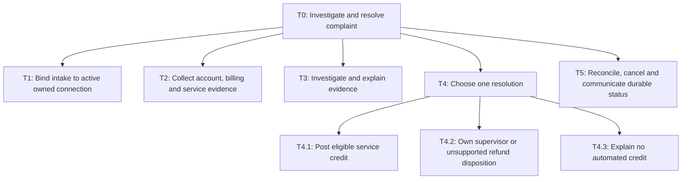
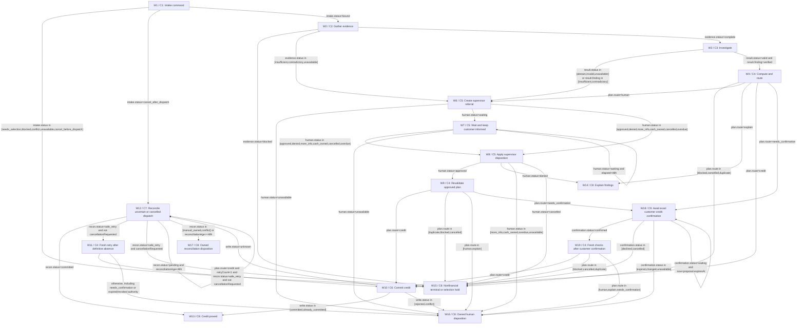

# Telecom complaint investigation and controlled service credits

> PASS · DESIGN ONLY. Review is a design judgement; no business controls or provider reliability were executed.

Review method: self-review; round 2.

Review dimensions (supplied scores):

- D1: 3/4 — CTX1-CTX7 and T0-T5 bound intake, evidence, three resolution outcomes, cancellation and owned holds; scope excludes autonomous cash refund.
- D2: 3/4 — All stage links pass v1 structural validation; H1-H8 distinguish proposals and exact brief quotes; FM/EV links derived reciprocally.
- D3: 3/4 — W18-W19 add signed exact-quote confirmation with 24h bound, deny/expiry/changed-intent owned exits and fresh recheck; W10-W12 reconcile unknowns; W7 retains original 48h deadline.
- D4: 3/4 — C9 typed portal confirm_credit/decline_credit events, proposal/receipt/digest/subject/expiry fields and bounded reminder; C1 remains intake router; C4/C6 repeat exact action checks.
- D5: 3/4 — C4/C6 bind positive integer CREDIT payload, tenant/subject/active connection, policy/approval version, digest, entitlement key and durable proof; C7 read-only recovery survives session loss.
- D6: 3/4 — H1-H8 label policies, APIs, timing, cost and retention; C2/C3 contradiction and unavailable states route human; no live service assertions.
- D7: 3/4 — F1-F5 choose bounded judgement in durable code workflow; compare common persistence/timer/audit/ownership criteria and reject synchronous and autonomous alternatives.
- D8: 3/4 — M1 maps only C3; W3 allows one retry; 0.88 expected calls, 2 worst-case, illustrative price/token arithmetic and excluded costs explicit.
- D9: 3/4 — FM1-FM10 cover subject, staleness, duplicates, unknown commits, injection, queue, cancellation, amount and false completion with owners and release gates.
- D10: 3/4 — EV1-EV28 plus EV32-EV34 are complete self-contained synthetic fixtures; EV3/EV19 explicitly enter prepared W10; EV29/EV31 enumerate new confirmation fixtures. Planned harness has strict unexpected calls; tests not executed.
- D11: 3/4 — R1 metrics have denominators/windows; R2-R5 distinct entry/exit gates; R6 customer clustering, baseline power calculation, spillover and maturation; zero safety tolerance separate.
- D12: 3/4 — X1 propagates C9/W18-W19, quote/confirmation records and distinct business/state revisions. Exports will derive from this canonical version; H1-H8 remain explicit launch blockers.

Review findings:

- ISSUE1 [major, resolved] workflow/W4: Credit path lacks explicit confirmation interaction and timeout even though authority requires consent. Add typed confirmation command/receipt owner, immutable payload binding, bounded wait and fresh recheck; preserve no-write denial/expiry. Repaired in round 2: C9/W18-W19, EV3/EV19, EV32-EV34, H2/C4 and X1 updated; reciprocal links and release manifest propagated.
- ISSUE2 [major, resolved] evals/EV3: Writer-time deactivation and cancellation fixtures can reject earlier at W1 without exercising intended guard. Bind entryState W10 and existing prepared authorized operation; reject unexpected write effects. Add confirmation fixtures. Repaired in round 2: C9/W18-W19, EV3/EV19, EV32-EV34, H2/C4 and X1 updated; reciprocal links and release manifest propagated.
- ISSUE3 [major, resolved] context/CTX2: H2 describes cap while EV22 requires supervisor routing for uncapped amounts above it; state explicitly that larger customer entitlement is not silently reduced and closed automatically. Repaired in round 2: C9/W18-W19, EV3/EV19, EV32-EV34, H2/C4 and X1 updated; reciprocal links and release manifest propagated.

## Task tree



## Workflow



## tasks

### T0 · Investigate and resolve complaint

Ordered job: bind connection, gather evidence, interpret, select outcome, execute eligible credit or supervisor referral, communicate durable status.

Reasoning: Tasks follow intake, evidence, resolution and owned completion; branch outcomes are exclusive.

Assumptions:

- H1

- H2

Data:

```json
{
  "parentId": "",
  "mode": "sequence",
  "basis": [
    "Intake before protected reads; evidence before decision; fresh action guards before write"
  ],
  "examples": [
    "Outage complaint ends in proved credit or owned case"
  ],
  "autonomy": "Code controls; model advice is non-authoritative.",
  "frequency": "Per complaint; branch frequencies unknown, H6 is planning only.",
  "risk": "medium"
}
```


Sources:

- context / user-brief: Design a complaint assistant for a telecom provider.

- hypothesis / H1: Proposed v1 serves authenticated consumer postpaid active connections in one tenant and currency; prepaid, enterprise, closed-service and cash-refund execution use an owned supervisor case.

- hypothesis / H2: Illustrative policy P1 allows outage credits only: verified outage overlap of at least 60 minutes; credit=floor(monthly base fee minor units * affected minutes / billing-cycle minutes), limited by remaining eligible base fee. If the computed entitlement before the 1000-minor-unit automatic cap exceeds that cap, route the whole claim to a supervisor; do not silently cap and close it. Automatic credit is at most 1000 minor units per incident. Billing errors, poor speed without verified outage, larger amounts and uncertainty require supervisor review.

### T1 · Bind intake to active owned connection

Create provisional case with authenticated tenant/customer; choose exactly one active owned connection. Reject supplied foreign IDs; multi-connection ambiguity asks customer to select in portal, then resumes new revision.

Reasoning: Tasks follow intake, evidence, resolution and owned completion; branch outcomes are exclusive.

Assumptions:

- H1

- H2

Data:

```json
{
  "parentId": "T0",
  "mode": "leaf",
  "basis": [
    "Session identity and authoritative registry"
  ],
  "examples": [
    "Two active mobile lines: require explicit selection"
  ],
  "autonomy": "Code controls; model advice is non-authoritative.",
  "frequency": "Per complaint; branch frequencies unknown, H6 is planning only.",
  "risk": "high"
}
```


Sources:

- context / user-brief: Design a complaint assistant for a telecom provider.

- hypothesis / H1: Proposed v1 serves authenticated consumer postpaid active connections in one tenant and currency; prepaid, enterprise, closed-service and cash-refund execution use an owned supervisor case.

- hypothesis / H2: Illustrative policy P1 allows outage credits only: verified outage overlap of at least 60 minutes; credit=floor(monthly base fee minor units * affected minutes / billing-cycle minutes), limited by remaining eligible base fee. If the computed entitlement before the 1000-minor-unit automatic cap exceeds that cap, route the whole claim to a supervisor; do not silently cap and close it. Automatic credit is at most 1000 minor units per incident. Billing errors, poor speed without verified outage, larger amounts and uncertainty require supervisor review.

### T2 · Collect account, billing and service evidence

Read only selected active connection and claimed time window; retain source IDs, versions and acquisition time. Missing, conflicting and unavailable records remain explicit.

Reasoning: Tasks follow intake, evidence, resolution and owned completion; branch outcomes are exclusive.

Assumptions:

- H1

- H2

Data:

```json
{
  "parentId": "T0",
  "mode": "leaf",
  "basis": [
    "Account owner, invoice line, incident interval and policy version"
  ],
  "examples": [
    "No matching outage for a speed report: evidence insufficient"
  ],
  "autonomy": "Code controls; model advice is non-authoritative.",
  "frequency": "Per complaint; branch frequencies unknown, H6 is planning only.",
  "risk": "medium"
}
```


Sources:

- context / user-brief: Design a complaint assistant for a telecom provider.

- hypothesis / H1: Proposed v1 serves authenticated consumer postpaid active connections in one tenant and currency; prepaid, enterprise, closed-service and cash-refund execution use an owned supervisor case.

- hypothesis / H2: Illustrative policy P1 allows outage credits only: verified outage overlap of at least 60 minutes; credit=floor(monthly base fee minor units * affected minutes / billing-cycle minutes), limited by remaining eligible base fee. If the computed entitlement before the 1000-minor-unit automatic cap exceeds that cap, route the whole claim to a supervisor; do not silently cap and close it. Automatic credit is at most 1000 minor units per incident. Billing errors, poor speed without verified outage, larger amounts and uncertainty require supervisor review.

### T3 · Investigate and explain evidence

Classify outage/speed/billing/unsupported; cite records and distinguish customer report from verified cause; abstain on contradiction.

Reasoning: Tasks follow intake, evidence, resolution and owned completion; branch outcomes are exclusive.

Assumptions:

- H1

- H2

Data:

```json
{
  "parentId": "T0",
  "mode": "leaf",
  "basis": [
    "LLM structure validated; no monetary authority"
  ],
  "examples": [
    "Network record and bill disagree on incident dates"
  ],
  "autonomy": "Code controls; model advice is non-authoritative.",
  "frequency": "Per complaint; branch frequencies unknown, H6 is planning only.",
  "risk": "medium"
}
```


Sources:

- context / user-brief: Design a complaint assistant for a telecom provider.

- hypothesis / H1: Proposed v1 serves authenticated consumer postpaid active connections in one tenant and currency; prepaid, enterprise, closed-service and cash-refund execution use an owned supervisor case.

- hypothesis / H2: Illustrative policy P1 allows outage credits only: verified outage overlap of at least 60 minutes; credit=floor(monthly base fee minor units * affected minutes / billing-cycle minutes), limited by remaining eligible base fee. If the computed entitlement before the 1000-minor-unit automatic cap exceeds that cap, route the whole claim to a supervisor; do not silently cap and close it. Automatic credit is at most 1000 minor units per incident. Billing errors, poor speed without verified outage, larger amounts and uncertainty require supervisor review.

### T4 · Choose one resolution

Exclusive precedence: cancellation/blocked identity; existing operation; uncertain or larger/unsupported monetary request; eligible credit; else evidence-grounded explanation.

Reasoning: Tasks follow intake, evidence, resolution and owned completion; branch outcomes are exclusive.

Assumptions:

- H1

- H2

Data:

```json
{
  "parentId": "T0",
  "mode": "choose one",
  "basis": [
    "Deterministic precedence, not model confidence"
  ],
  "examples": [
    "Verified 120-minute outage may qualify"
  ],
  "autonomy": "Code controls; model advice is non-authoritative.",
  "frequency": "Per complaint; branch frequencies unknown, H6 is planning only.",
  "risk": "medium"
}
```


Sources:

- context / user-brief: Design a complaint assistant for a telecom provider.

- hypothesis / H1: Proposed v1 serves authenticated consumer postpaid active connections in one tenant and currency; prepaid, enterprise, closed-service and cash-refund execution use an owned supervisor case.

- hypothesis / H2: Illustrative policy P1 allows outage credits only: verified outage overlap of at least 60 minutes; credit=floor(monthly base fee minor units * affected minutes / billing-cycle minutes), limited by remaining eligible base fee. If the computed entitlement before the 1000-minor-unit automatic cap exceeds that cap, route the whole claim to a supervisor; do not silently cap and close it. Automatic credit is at most 1000 minor units per incident. Billing errors, poor speed without verified outage, larger amounts and uncertainty require supervisor review.

### T4.1 · Post eligible service credit

Compute policy amount in minor units, obtain bound authority and customer confirmation, atomically reserve incident entitlement and post ledger credit once; require record proof.

Reasoning: Tasks follow intake, evidence, resolution and owned completion; branch outcomes are exclusive.

Assumptions:

- H1

- H2

Data:

```json
{
  "parentId": "T4",
  "mode": "leaf",
  "basis": [
    "Current active service and policy; original invoice line; cap; exact operation identity"
  ],
  "examples": [
    "10000 minor-unit fee * 120 / 43200 = 27 minor-unit credit"
  ],
  "autonomy": "Code controls; model advice is non-authoritative.",
  "frequency": "Per complaint; branch frequencies unknown, H6 is planning only.",
  "risk": "high"
}
```


Sources:

- context / user-brief: Design a complaint assistant for a telecom provider.

- hypothesis / H1: Proposed v1 serves authenticated consumer postpaid active connections in one tenant and currency; prepaid, enterprise, closed-service and cash-refund execution use an owned supervisor case.

- hypothesis / H2: Illustrative policy P1 allows outage credits only: verified outage overlap of at least 60 minutes; credit=floor(monthly base fee minor units * affected minutes / billing-cycle minutes), limited by remaining eligible base fee. If the computed entitlement before the 1000-minor-unit automatic cap exceeds that cap, route the whole claim to a supervisor; do not silently cap and close it. Automatic credit is at most 1000 minor units per incident. Billing errors, poor speed without verified outage, larger amounts and uncertainty require supervisor review.

### T4.2 · Own supervisor or unsupported refund disposition

Queue larger/unclear credits, billing corrections, unsupported service and cash refunds; durable receipt, deadline, updates and escalation. Approved credit uses same validator/writer; cash refund remains named human process with receipt.

Reasoning: Tasks follow intake, evidence, resolution and owned completion; branch outcomes are exclusive.

Assumptions:

- H1

- H2

Data:

```json
{
  "parentId": "T4",
  "mode": "leaf",
  "basis": [
    "48 elapsed-hour decision clock; no silent approval"
  ],
  "examples": [
    "Billing dispute requires finance evidence; no auto-credit"
  ],
  "autonomy": "Code controls; model advice is non-authoritative.",
  "frequency": "Per complaint; branch frequencies unknown, H6 is planning only.",
  "risk": "high"
}
```


Sources:

- context / user-brief: Design a complaint assistant for a telecom provider.

- hypothesis / H1: Proposed v1 serves authenticated consumer postpaid active connections in one tenant and currency; prepaid, enterprise, closed-service and cash-refund execution use an owned supervisor case.

- hypothesis / H2: Illustrative policy P1 allows outage credits only: verified outage overlap of at least 60 minutes; credit=floor(monthly base fee minor units * affected minutes / billing-cycle minutes), limited by remaining eligible base fee. If the computed entitlement before the 1000-minor-unit automatic cap exceeds that cap, route the whole claim to a supervisor; do not silently cap and close it. Automatic credit is at most 1000 minor units per incident. Billing errors, poor speed without verified outage, larger amounts and uncertainty require supervisor review.

### T4.3 · Explain no automated credit

Explain verified facts and limitations; customer can appeal to supervisor; insufficient evidence never means proven ineligibility.

Reasoning: Tasks follow intake, evidence, resolution and owned completion; branch outcomes are exclusive.

Assumptions:

- H1

- H2

Data:

```json
{
  "parentId": "T4",
  "mode": "leaf",
  "basis": [
    "No write; cite evidence and next step"
  ],
  "examples": [
    "Poor speed without verifiable incident routes on appeal"
  ],
  "autonomy": "Code controls; model advice is non-authoritative.",
  "frequency": "Per complaint; branch frequencies unknown, H6 is planning only.",
  "risk": "medium"
}
```


Sources:

- context / user-brief: Design a complaint assistant for a telecom provider.

- hypothesis / H1: Proposed v1 serves authenticated consumer postpaid active connections in one tenant and currency; prepaid, enterprise, closed-service and cash-refund execution use an owned supervisor case.

- hypothesis / H2: Illustrative policy P1 allows outage credits only: verified outage overlap of at least 60 minutes; credit=floor(monthly base fee minor units * affected minutes / billing-cycle minutes), limited by remaining eligible base fee. If the computed entitlement before the 1000-minor-unit automatic cap exceeds that cap, route the whole claim to a supervisor; do not silently cap and close it. Automatic credit is at most 1000 minor units per incident. Billing errors, poor speed without verified outage, larger amounts and uncertainty require supervisor review.

### T5 · Reconcile, cancel and communicate durable status

Track exact duplicates and semantic candidates, recover unknown commits independently of chat lifetime, process cancel safely, issue status updates and close only with proof or owned handoff.

Reasoning: Tasks follow intake, evidence, resolution and owned completion; branch outcomes are exclusive.

Assumptions:

- H1

- H2

Data:

```json
{
  "parentId": "T0",
  "mode": "leaf",
  "basis": [
    "Durable case/operation versions and owner"
  ],
  "examples": [
    "Timeout after posting: read by operation ID before any resend"
  ],
  "autonomy": "Code controls; model advice is non-authoritative.",
  "frequency": "Per complaint; branch frequencies unknown, H6 is planning only.",
  "risk": "high"
}
```


Sources:

- context / user-brief: Design a complaint assistant for a telecom provider.

- hypothesis / H1: Proposed v1 serves authenticated consumer postpaid active connections in one tenant and currency; prepaid, enterprise, closed-service and cash-refund execution use an owned supervisor case.

- hypothesis / H2: Illustrative policy P1 allows outage credits only: verified outage overlap of at least 60 minutes; credit=floor(monthly base fee minor units * affected minutes / billing-cycle minutes), limited by remaining eligible base fee. If the computed entitlement before the 1000-minor-unit automatic cap exceeds that cap, route the whole claim to a supervisor; do not silently cap and close it. Automatic credit is at most 1000 minor units per incident. Billing errors, poor speed without verified outage, larger amounts and uncertainty require supervisor review.

### A1 · Authenticated connection binding

tenantId/customerId from session; connectionId selected from authorized list; ownerId,status,connectionVersion,observedAt.

Reasoning: Load only fields needed for the current stage and invalidate stale versions before action.

Assumptions:

- H3

- H4

- H5

Data:

```json
{
  "taskIds": [
    "T1",
    "T2",
    "T4.1",
    "T5"
  ],
  "sourceSystem": "Identity and active service registry",
  "loaded": "session start"
}
```


Sources:

- context / user-brief: Design a complaint assistant for a telecom provider.

- hypothesis / H3: Proposed APIs support tenant/customer/connection scoping, active-state versions, immutable policy versions, atomic incident credit uniqueness, durable operation lookup and fresh authorization at the billing writer.

- hypothesis / H4: Proposed supervisor queue has a 48 elapsed-hour decision deadline from initial referral, acknowledgement within 15 minutes, updates at receipt and every 12 hours, escalation to duty lead at 36 hours and overdue transfer at 48 hours without approval by silence.

- hypothesis / H5: Proposed privacy defaults keep full case evidence for 30 days and minimized financial audit references for 365 days, encrypted in tenant-resident storage; no raw payment details or entire bills in model prompts.

### A2 · Bounded evidence packet

Invoice line and cycle, fee minor units/currency, incident interval in UTC, policyVersion and record versions; no unrelated account records.

Reasoning: Load only fields needed for the current stage and invalidate stale versions before action.

Assumptions:

- H3

- H4

- H5

Data:

```json
{
  "taskIds": [
    "T2",
    "T3",
    "T4.1",
    "T4.2",
    "T4.3"
  ],
  "sourceSystem": "Billing, service incident and policy APIs",
  "loaded": "on demand"
}
```


Sources:

- context / user-brief: Design a complaint assistant for a telecom provider.

- hypothesis / H3: Proposed APIs support tenant/customer/connection scoping, active-state versions, immutable policy versions, atomic incident credit uniqueness, durable operation lookup and fresh authorization at the billing writer.

- hypothesis / H4: Proposed supervisor queue has a 48 elapsed-hour decision deadline from initial referral, acknowledgement within 15 minutes, updates at receipt and every 12 hours, escalation to duty lead at 36 hours and overdue transfer at 48 hours without approval by silence.

- hypothesis / H5: Proposed privacy defaults keep full case evidence for 30 days and minimized financial audit references for 365 days, encrypted in tenant-resident storage; no raw payment details or entire bills in model prompts.

### A3 · Case and immutable operation

caseId/revision; canonical payload bytes/digest; entitlementKey,operationId; approval subject/action/expiry; ledger posting proof and event sequence.

Reasoning: Load only fields needed for the current stage and invalidate stale versions before action.

Assumptions:

- H3

- H4

- H5

Data:

```json
{
  "taskIds": [
    "T4.1",
    "T4.2",
    "T5"
  ],
  "sourceSystem": "Case store, approval store and financial ledger",
  "loaded": "on demand"
}
```


Sources:

- context / user-brief: Design a complaint assistant for a telecom provider.

- hypothesis / H3: Proposed APIs support tenant/customer/connection scoping, active-state versions, immutable policy versions, atomic incident credit uniqueness, durable operation lookup and fresh authorization at the billing writer.

- hypothesis / H4: Proposed supervisor queue has a 48 elapsed-hour decision deadline from initial referral, acknowledgement within 15 minutes, updates at receipt and every 12 hours, escalation to duty lead at 36 hours and overdue transfer at 48 hours without approval by silence.

- hypothesis / H5: Proposed privacy defaults keep full case evidence for 30 days and minimized financial audit references for 365 days, encrypted in tenant-resident storage; no raw payment details or entire bills in model prompts.

### A4 · Human and communication lifecycle

queue receipt, assigned role, referredAt/dueAt/ackAt, escalation event IDs; channel consent/version, template outbox delivery IDs.

Reasoning: Load only fields needed for the current stage and invalidate stale versions before action.

Assumptions:

- H3

- H4

- H5

Data:

```json
{
  "taskIds": [
    "T4.2",
    "T5"
  ],
  "sourceSystem": "Supervisor queue and consent registry",
  "loaded": "on demand"
}
```


Sources:

- context / user-brief: Design a complaint assistant for a telecom provider.

- hypothesis / H3: Proposed APIs support tenant/customer/connection scoping, active-state versions, immutable policy versions, atomic incident credit uniqueness, durable operation lookup and fresh authorization at the billing writer.

- hypothesis / H4: Proposed supervisor queue has a 48 elapsed-hour decision deadline from initial referral, acknowledgement within 15 minutes, updates at receipt and every 12 hours, escalation to duty lead at 36 hours and overdue transfer at 48 hours without approval by silence.

- hypothesis / H5: Proposed privacy defaults keep full case evidence for 30 days and minimized financial audit references for 365 days, encrypted in tenant-resident storage; no raw payment details or entire bills in model prompts.

Stage assumptions:

- All content is proposed design. Relevant H IDs are centralized above; no company policy, API capability or operational evidence has been verified.

## components

### C1 · Authenticated intake and case command router

API accepts submit/resume/cancel commands. Tenant/customer always taken from authenticated session. Registry list precedes selection. Repeated clientCommandId returns same case. CAS case revision serializes commands; no case closure can erase a live operation.

Reasoning: A single bounded responsibility has typed outcomes and an owned fallback.

Assumptions:

- H1

- H3

Data:

```json
{
  "group": "Code: validation",
  "taskIds": [
    "T1",
    "T5"
  ],
  "inputs": [
    "command: required discriminated {type:submit|resume|cancel, clientCommandId:string, expectedCaseRevision:int?}; submit requires complaintText<=4000 chars, issueStart/End UTC or unknown, selectedConnectionId?; resume/cancel require caseId.",
    "session: required {tenantId,customerId,authEpoch,expiresAt}; registry: list {connectionId,ownerId,status:active|inactive,version}; case: current revision/operationId?"
  ],
  "outputs": [
    "intake: {status:bound|needs_selection|blocked|cancel_before_dispatch|cancel_after_dispatch|conflict|unavailable, caseId,revision,tenantId,customerId,connectionId?,connectionVersion?,operationId?}",
    "blockReason: wrong_subject|inactive|auth_expired|unsupported|none; selectionDueAt:UTC?; cancellationRecorded:bool"
  ],
  "whyCode": "Identity, revision and cancellation precedence are exact invariants.",
  "approvalRule": "Session-bound read/case-write only; no financial permission. One safe read retry on unavailable; selection expires after 24h to owned case."
}
```


Sources:

- context / user-brief: Design a complaint assistant for a telecom provider.

- hypothesis / H1: Proposed v1 serves authenticated consumer postpaid active connections in one tenant and currency; prepaid, enterprise, closed-service and cash-refund execution use an owned supervisor case.

- hypothesis / H3: Proposed APIs support tenant/customer/connection scoping, active-state versions, immutable policy versions, atomic incident credit uniqueness, durable operation lookup and fresh authorization at the billing writer.

### C2 · Scoped evidence adapter

Proposed readEvidence(tenantId,customerId,connectionId,window,caseId) queries account/billing/service records and policy with server scope. Each call 5s, one retry with jitter; missing/contradictory records are not synthesized. Endpoint errors are mapped to the result enum.

Reasoning: A single bounded responsibility has typed outcomes and an owned fallback.

Assumptions:

- H3

- H5

Data:

```json
{
  "group": "Code: tools",
  "taskIds": [
    "T2"
  ],
  "inputs": [
    "boundCase: required {tenantId,customerId,connectionId,connectionVersion,caseId,revision}; complaintWindow: {start:UTC?,end:UTC?}; allowed systems: account,billing,network,policy"
  ],
  "outputs": [
    "evidence: {status:complete|insufficient|contradictory|blocked|unavailable, evidenceId, records:[{id,kind,version,observedAt,fields}], policyVersion?, retrievedAt:UTC, scopedBinding:{tenantId,customerId,connectionId}}",
    "facts: {incidentId?,outageStart?,outageEnd?,monthlyBaseMinor?,cycleStart?,cycleEnd?,invoiceId?,lineId?,currency?}; errors never return cross-subject record bodies"
  ],
  "whyCode": "Records, scope and timestamps must be checked without language inference.",
  "approvalRule": "Read-only service role constrained to selected subject; registry mismatch blocks even if customer typed a known account."
}
```


Sources:

- context / user-brief: Design a complaint assistant for a telecom provider.

- hypothesis / H3: Proposed APIs support tenant/customer/connection scoping, active-state versions, immutable policy versions, atomic incident credit uniqueness, durable operation lookup and fresh authorization at the billing writer.

- hypothesis / H5: Proposed privacy defaults keep full case evidence for 30 days and minimized financial audit references for 365 days, encrypted in tenant-resident storage; no raw payment details or entire bills in model prompts.

### C3 · Evidence investigator and explanation drafter

One model analyzes only minimized facts and customer report as untrusted data. Cite evidence IDs for every factual claim. Detect contradictory evidence and distinguish report from confirmed incident. No tool access, authority token or monetary calculation.

Reasoning: A single bounded responsibility has typed outcomes and an owned fallback.

Assumptions:

- H2

- H5

- H6

Data:

```json
{
  "group": "Agents (LLM)",
  "taskIds": [
    "T3"
  ],
  "inputs": [
    "evidence: required C2 packet with redacted relevant fields; complaintText:string untrusted; allowedIssueTypes:[outage,speed,billing,unsupported]; schemaVersion:string"
  ],
  "outputs": [
    "result: {status:valid|abstain|invalid|unavailable, issueType:outage|speed|billing|unsupported, finding:verified|insufficient|contradictory, evidenceRefs:string[], explanation:string, uncertainty:string[], suggestedDisposition:policy_check|human|explain}",
    "No amount, approval token or tool command allowed; validator rejects unexpected fields and citations absent from packet"
  ],
  "whyCode": "",
  "approvalRule": "Read-only advisory; schema/citation validator and deterministic C4 decide disposition."
}
```


Sources:

- context / user-brief: Design a complaint assistant for a telecom provider.

- hypothesis / H2: Illustrative policy P1 allows outage credits only: verified outage overlap of at least 60 minutes; credit=floor(monthly base fee minor units * affected minutes / billing-cycle minutes), limited by remaining eligible base fee. If the computed entitlement before the 1000-minor-unit automatic cap exceeds that cap, route the whole claim to a supervisor; do not silently cap and close it. Automatic credit is at most 1000 minor units per incident. Billing errors, poor speed without verified outage, larger amounts and uncertainty require supervisor review.

- hypothesis / H5: Proposed privacy defaults keep full case evidence for 30 days and minimized financial audit references for 365 days, encrypted in tenant-resident storage; no raw payment details or entire bills in model prompts.

- hypothesis / H6: Illustrative planning assumptions are 10000 complaints/month, 80% reaching model investigation, 10% of those needing one schema retry; model budget prices are $2/input million and $8/output million tokens, not a vendor quote.

### C4 · Policy, entitlement and immutable plan validator

Computes outage eligibility from source records, never model arithmetic. Exact duplicates keyed by tenant/connection/incident/invoiceLine/creditKind; overlapping incident aliases form semantic candidates for supervisor correlation without merge or second action. Prepares immutable canonical action record. Guards re-run after every supervisor wait and immediately at writer. Before confirmation, reserve a confirmationId in immutable payload and return needs_confirmation. The case business revision changes on intent/target/amount/evidence changes; workflow-state revision and receipt events do not mutate that business revision. Auto authority is issued only after a current matching confirmation. A pending proposal has no write authority. Compute uncapped entitlement first. If above automatic cap, route entire claim to supervisor. SupervisorCapMinor must be provided in approved policy; no default supervisor unlimited amount. Supervisors cannot approve beyond that cap. For EV27 synthetic policy defines 2000 minor-unit supervisor cap.

Reasoning: A single bounded responsibility has typed outcomes and an owned fallback.

Assumptions:

- H2

- H3

- H7

Data:

```json
{
  "group": "Code: validation",
  "taskIds": [
    "T4.1",
    "T4.2",
    "T4.3",
    "T5"
  ],
  "inputs": [
    "case/evidence/modelResult: required versions; policy: {id,version,effectiveAt,expiry,autoCapMinor,currency,minMinutes,rounding:floor,scope}; current ledger entitlements and active registry",
    "approval: optional {approvalId,actorId,role,tenantId,customerId,connectionId,action:post_credit,payloadDigest,caseRevision,policyVersion,issuedAt,expiresAt,revoked:bool}; customer confirmation bound to same digest; clock:UTC",
    "confirmationReceipt: optional {confirmationId,caseId,caseRevision,payloadRecordId,payloadDigest,customerId,connectionId,decision:confirm|decline,issuedAt,expiresAt,signature}; C9 validates and persists. Amount above auto cap routes supervisor without silent reduction."
  ],
  "outputs": [
    "plan: {route:credit|needs_confirmation|human|explain|duplicate|blocked|cancelled, reason:eligible|large|unclear|semantic_candidate|billing|cash_refund|no_evidence|no_eligible_credit|already_posted|stale|revoked|inactive|cancelled|scope, payloadRecordId?,digest?,operationId?,entitlementKey?,existingOperationId?}",
    "CreditPayload v1 required fields: tenantId,customerId,connectionId,connectionVersion,caseId,caseRevision,operationId,entitlementKey,incidentId,invoiceId,lineId,kind:CREDIT,amountMinor:positive int,currency,periodStart:UTC,periodEnd:UTC,policyVersion,evidenceVersionSet,customerConfirmationId; no optional fields. Digest=SHA256 UTF-8 JSON sorted keys compact separators, no floats; persisted bytes immutable."
  ],
  "whyCode": "Money, time overlap, caps, versions and duplicate identity require deterministic checks.",
  "approvalRule": "Auto actor has P1-limited post_credit authority only after customer confirmation; supervisor may approve policy-permitted larger credit bound to full digest with 30-minute proposed expiry. Missing/changed authority routes human, never enlarges cap."
}
```


Sources:

- context / user-brief: Design a complaint assistant for a telecom provider.

- hypothesis / H2: Illustrative policy P1 allows outage credits only: verified outage overlap of at least 60 minutes; credit=floor(monthly base fee minor units * affected minutes / billing-cycle minutes), limited by remaining eligible base fee. If the computed entitlement before the 1000-minor-unit automatic cap exceeds that cap, route the whole claim to a supervisor; do not silently cap and close it. Automatic credit is at most 1000 minor units per incident. Billing errors, poor speed without verified outage, larger amounts and uncertainty require supervisor review.

- hypothesis / H3: Proposed APIs support tenant/customer/connection scoping, active-state versions, immutable policy versions, atomic incident credit uniqueness, durable operation lookup and fresh authorization at the billing writer.

- hypothesis / H7: Proposed credit API posts positive integer minor units as a CREDIT against a named original invoice line and incident; supervisor cannot override active-connection, subject, duplicate or freshness checks. A separate human process owns cash refunds and compensation.

### C5 · Durable supervisor queue and timer owner

refer(caseId,revision,reason,evidenceRefs,payloadRecordId?) creates queue item atomically with case outbox. Customer operations owns until acknowledged; duty lead owns after overdue. Approval is a signed decision event referencing immutable payload; deny/more_info/handoff events cannot imply credit. Cash refund receipt belongs to finance team, not financial API here.

Reasoning: A single bounded responsibility has typed outcomes and an owned fallback.

Assumptions:

- H4

- H7

- H8

Data:

```json
{
  "group": "Code: human triggers",
  "taskIds": [
    "T4.2",
    "T5"
  ],
  "inputs": [
    "case: required {caseId,revision,tenantId,customerId,connectionId,reason}; optional payloadRecordId/digest for credit review; events: {eventId,sequence,caseId,queueId,type:ack|approve_credit|deny|more_info|cash_handoff|cancel|timer,actorRole,createdAt,signature,payloadDigest?}",
    "UTC clock; original referredAt immutable; dueAt=referredAt+48h; timers at 15m,12h,24h,36h,48h; consent/template outbox"
  ],
  "outputs": [
    "human: {status:waiting|approved|denied|more_info|cash_owned|cancelled|overdue|unavailable, queueId,receiptId,ownerRole,ackAt?,dueAt,nextUpdateAt,approval?,externalCaseReceipt?}",
    "Update outbox: {messageKey:caseId/stateRevision/template,template:waiting|more_info|overdue|handoff}; duplicates ignored by eventId and monotonically increasing sequence; late approval after overdue requires new review and cannot revive old payload."
  ],
  "whyCode": "Durable timers survive session expiry; deadlines and event verification cannot depend on model memory.",
  "approvalRule": "Proposed supervisor only; role and signature verified server-side. At 48h stop automatic execution and transfer to duty lead with overdue status, never auto-approve."
}
```


Sources:

- context / user-brief: Design a complaint assistant for a telecom provider.

- hypothesis / H4: Proposed supervisor queue has a 48 elapsed-hour decision deadline from initial referral, acknowledgement within 15 minutes, updates at receipt and every 12 hours, escalation to duty lead at 36 hours and overdue transfer at 48 hours without approval by silence.

- hypothesis / H7: Proposed credit API posts positive integer minor units as a CREDIT against a named original invoice line and incident; supervisor cannot override active-connection, subject, duplicate or freshness checks. A separate human process owns cash refunds and compensation.

- hypothesis / H8: Proposed authenticated case portal plus consented service notifications use template outbox messages; case status remains accessible if delivery fails.

### C6 · Atomic credit action adapter

postCredit(payloadRecordId,digest,approvalId,operationId) is a proposed server action API. Fetch immutable payload, verify digest and actor authority; check current tenant/subject/active version, policy/version/cap, confirmation, ledger allocation, case cancellation/revision, approval expiry/revocation. In a transaction reserve entitlement unique key and operation, then post positive CREDIT minor units to original invoice line. API must prevent overlapping resolved incident aliases from separate entitlement keys. 5-second caller timeout becomes unknown, never failure proof.

Reasoning: A single bounded responsibility has typed outcomes and an owned fallback.

Assumptions:

- H2

- H3

- H7

Data:

```json
{
  "group": "Code: tools",
  "taskIds": [
    "T4.1"
  ],
  "inputs": [
    "required immutable CreditPayload v1 C4; action authority {actorId,role,authEpoch,approvalId,expiresAt}; tenant-scoped operationId and exact entitlementKey; expected versions; no caller-supplied mutable amount"
  ],
  "outputs": [
    "write: {status:committed|already_committed|rejected|conflict|unknown, operationId, postingId?, ledgerVersion?, amountMinor?,currency?,committedAt?,reason:stale|revoked|inactive|cancelled|duplicate|cap|payload_mismatch|scope|none}; committed/already_committed require durable readback matching all financial fields",
    "Journal: {operationId,payloadDigest,state:prepared|dispatched|unknown|committed|rejected,attempts:int,ownerRole}; no automatic compensation endpoint"
  ],
  "whyCode": "Only authoritative transaction/ledger can prove credit or reject concurrency.",
  "approvalRule": "Billing role is scoped to approved tenant/subject/action and P1 or signed supervisor payload; recheck at commit, not only intake. HTTP auth/validation/known conflict maps rejected/conflict; transport/5xx with possible dispatch maps unknown."
}
```


Sources:

- context / user-brief: Design a complaint assistant for a telecom provider.

- hypothesis / H2: Illustrative policy P1 allows outage credits only: verified outage overlap of at least 60 minutes; credit=floor(monthly base fee minor units * affected minutes / billing-cycle minutes), limited by remaining eligible base fee. If the computed entitlement before the 1000-minor-unit automatic cap exceeds that cap, route the whole claim to a supervisor; do not silently cap and close it. Automatic credit is at most 1000 minor units per incident. Billing errors, poor speed without verified outage, larger amounts and uncertainty require supervisor review.

- hypothesis / H3: Proposed APIs support tenant/customer/connection scoping, active-state versions, immutable policy versions, atomic incident credit uniqueness, durable operation lookup and fresh authorization at the billing writer.

- hypothesis / H7: Proposed credit API posts positive integer minor units as a CREDIT against a named original invoice line and incident; supervisor cannot override active-connection, subject, duplicate or freshness checks. A separate human process owns cash refunds and compensation.

### C7 · Read-only unknown-operation reconciler

lookupOperation(tenantId,operationId,entitlementKey,digest) uses a durable reconciliation service identity independent of customer session. Query ledger and operation journal every minute for 15m then every 15m up to 48h. A definitive not-dispatched/rejected proof permits resubmission only through C4 with fresh authority; unknown never permits another operation. At 48h assign finance incident ownership, continue daily lookup until resolved.

Reasoning: A single bounded responsibility has typed outcomes and an owned fallback.

Assumptions:

- H3

- H4

- H7

Data:

```json
{
  "group": "Code: tools",
  "taskIds": [
    "T5"
  ],
  "inputs": [
    "required operationId,tenantId,caseId,entitlementKey,payloadDigest; cancellationRequested:bool; persisted dispatch authorization proof; lookup {status:committed|definitive_absent|pending|conflict|unavailable,postingId?,payloadDigest?,proofId?}"
  ],
  "outputs": [
    "recon: {status:committed|safe_retry|pending|manual_owned|conflict, operationId,postingId?,proofId?,ownerRole,nextCheckAt}; committed requires matching customer/connection/payload readback; safe_retry only definitive_absent proof with no possible in-flight commit",
    "Events: dedup callback eventId and postingId, monotonic journal revision; cancel after dispatch freezes future writes and records follow-up, never reverses posting"
  ],
  "whyCode": "Read-only recovery must persist beyond caller identity and never guess outcome.",
  "approvalRule": "Dedicated read-only ledger scope for existing authorized operation; no repost/reverse privilege. Conflicting proof quarantines operation to finance duty lead."
}
```


Sources:

- context / user-brief: Design a complaint assistant for a telecom provider.

- hypothesis / H3: Proposed APIs support tenant/customer/connection scoping, active-state versions, immutable policy versions, atomic incident credit uniqueness, durable operation lookup and fresh authorization at the billing writer.

- hypothesis / H4: Proposed supervisor queue has a 48 elapsed-hour decision deadline from initial referral, acknowledgement within 15 minutes, updates at receipt and every 12 hours, escalation to duty lead at 36 hours and overdue transfer at 48 hours without approval by silence.

- hypothesis / H7: Proposed credit API posts positive integer minor units as a CREDIT against a named original invoice line and incident; supervisor cannot override active-connection, subject, duplicate or freshness checks. A separate human process owns cash refunds and compensation.

### C8 · Status, notification and durable completion

Write case state and template outbox transactionally; portal read is authoritative. notify only consented case channel and minimized findings. Use model draft only if cited and consistent, otherwise deterministic template. Status includes queue owner/dueAt and never labels pending as refunded. Notification send 5s, at most 3 attempts then delivery_failed marker; portal still accessible and operations alerted.

Reasoning: A single bounded responsibility has typed outcomes and an owned fallback.

Assumptions:

- H3

- H4

- H8

Data:

```json
{
  "group": "Code: tools",
  "taskIds": [
    "T1",
    "T4.2",
    "T4.3",
    "T5"
  ],
  "inputs": [
    "caseId/revision; disposition:needs_selection|blocked|explained|credited|duplicate_linked|cancelled|human_owned|recon_owned; evidenceRefs; postingProof? required credited; queueReceipt? required human_owned; operationId/owner? required recon_owned; customer channel consent/version"
  ],
  "outputs": [
    "completion: {caseId,stateRevision,disposition,recordId,postingId?,queueId?,operationId?,nextUpdateAt?,deliveryStatus:queued|delivered|failed|portal_only}; credited cannot exist without matching ledger proof",
    "outbox: {messageId,idempotencyKey,template,recipientCustomerId,channel,consentVersion,createdAt,deliveryReceipt?}; callback dedup messageId"
  ],
  "whyCode": "Completion and customer promises are checked against records, not prose.",
  "approvalRule": "Only case writes and consented notification; recipient bound to authenticated customer; no marketing/external recipients. Case-storage failure leaves prior durable state and operational retry; never emits success before persistence."
}
```


Sources:

- context / user-brief: Design a complaint assistant for a telecom provider.

- hypothesis / H3: Proposed APIs support tenant/customer/connection scoping, active-state versions, immutable policy versions, atomic incident credit uniqueness, durable operation lookup and fresh authorization at the billing writer.

- hypothesis / H4: Proposed supervisor queue has a 48 elapsed-hour decision deadline from initial referral, acknowledgement within 15 minutes, updates at receipt and every 12 hours, escalation to duty lead at 36 hours and overdue transfer at 48 hours without approval by silence.

- hypothesis / H8: Proposed authenticated case portal plus consented service notifications use template outbox messages; case status remains accessible if delivery fails.

### C9 · Bound customer credit confirmation

Present immutable credit quote to the authenticated customer in the case portal with amount/currency/period/invoice line and evidence. confirm_credit or decline_credit must supply proposalId, confirmationId, digest, business case revision and clientCommandId; session tenant/customer/connection checked against case. Receipt persisted with server signature. Wait at most 24 elapsed hours; send one reminder at 12h. Intent changes invalidate proposal and require new C4 plan. No financial action in this component.

Reasoning: Customer consent is a typed durable event and bounded wait; natural language cannot stand in for confirmation.

Assumptions:

- H2

- H3

- H8

Data:

```json
{
  "group": "Code: human triggers",
  "taskIds": [
    "T4.1",
    "T5"
  ],
  "inputs": [
    "proposal: required {proposalId,payloadRecordId,digest,confirmationId,caseId,caseRevision,customerId,connectionId,amountMinor,currency,expiresAt}; TTL=24h from proposal, UTC.",
    "event: {type:confirm_credit|decline_credit|cancel|timer|intent_changed,clientCommandId,eventId,proposalId,digest,expectedCaseRevision,sessionBinding}; scoped portal re-authentication required, not an email link alone."
  ],
  "outputs": [
    "confirmation: {status:confirmed|declined|cancelled|expired|changed|unavailable|waiting,receiptId?,confirmationId,caseId,caseRevision,payloadDigest,customerId,connectionId,issuedAt?,expiresAt,signature?}; confirmed requires all fields and matching authenticated subject.",
    "Pending quote record and portal-only/reminder outbox use caseId/proposalId/template uniqueness; operation not dispatched until fresh C4 then C6."
  ],
  "whyCode": "Exact subject/amount binding, deadlines, event deduplication and signatures need deterministic checks.",
  "approvalRule": "Only same authenticated customer may confirm the exact immutable quote; C9 grants no credit permission. Signed receipt consumed by C4 then writer fresh guards; expired/replayed mismatched receipt rejected."
}
```


Sources:

- context / user-brief: Design a complaint assistant for a telecom provider.

- hypothesis / H2: Illustrative policy P1 allows outage credits only: verified outage overlap of at least 60 minutes; credit=floor(monthly base fee minor units * affected minutes / billing-cycle minutes), limited by remaining eligible base fee. If the computed entitlement before the 1000-minor-unit automatic cap exceeds that cap, route the whole claim to a supervisor; do not silently cap and close it. Automatic credit is at most 1000 minor units per incident. Billing errors, poor speed without verified outage, larger amounts and uncertainty require supervisor review.

- hypothesis / H3: Proposed APIs support tenant/customer/connection scoping, active-state versions, immutable policy versions, atomic incident credit uniqueness, durable operation lookup and fresh authorization at the billing writer.

- hypothesis / H7: Proposed credit API posts positive integer minor units as a CREDIT against a named original invoice line and incident; supervisor cannot override active-connection, subject, duplicate or freshness checks. A separate human process owns cash refunds and compensation.

Stage assumptions:

- All content is proposed design. Relevant H IDs are centralized above; no company policy, API capability or operational evidence has been verified.

## workflow

### W1 · Intake command

{"state": "intake", "guardBindings": {"intake": "C1.intake typed status and identity; cancel_after_dispatch carries persisted operationId"}, "precedence": "Transitions evaluated in order; first true wins. Last predicate is explicit exhaustive fallback.", "transitions": [{"to": "W15", "when": "intake.status in [needs_selection,blocked,conflict,unavailable,cancel_before_dispatch]", "mode": "exclusive"}, {"to": "W12", "when": "intake.status=cancel_after_dispatch", "mode": "exclusive"}, {"to": "W2", "when": "intake.status=bound", "mode": "exclusive"}], "failureDisposition": "Persist provisional case or return retryable unavailable if no case can be persisted; no financial action.", "timeout": "2s target; unavailable after one retry", "retryPolicy": "No implicit retries; use component-specific bounded policy.", "terminalDisposition": ""}

Reasoning: Durable case state and typed producer outcomes drive routing; chat text cannot skip nodes.

Assumptions:

- H3

- H4

Data:

```json
{
  "componentId": "C1",
  "taskIds": [
    "T1",
    "T5"
  ],
  "next": [
    "W15",
    "W12",
    "W2"
  ],
  "decision": true,
  "example": "Customer selects active S1; W2. Cancel with operation O1 already dispatched goes W12."
}
```


Sources:

- context / user-brief: Design a complaint assistant for a telecom provider.

- hypothesis / H3: Proposed APIs support tenant/customer/connection scoping, active-state versions, immutable policy versions, atomic incident credit uniqueness, durable operation lookup and fresh authorization at the billing writer.

- hypothesis / H4: Proposed supervisor queue has a 48 elapsed-hour decision deadline from initial referral, acknowledgement within 15 minutes, updates at receipt and every 12 hours, escalation to duty lead at 36 hours and overdue transfer at 48 hours without approval by silence.

### W2 · Gather evidence

{"state": "evidence", "guardBindings": {"evidence": "C2.evidence status; binding mismatch always blocked"}, "precedence": "Transitions evaluated in order; first true wins. Last predicate is explicit exhaustive fallback.", "transitions": [{"to": "W15", "when": "evidence.status=blocked", "mode": "exclusive"}, {"to": "W6", "when": "evidence.status in [insufficient,contradictory,unavailable]", "mode": "exclusive"}, {"to": "W3", "when": "evidence.status=complete", "mode": "exclusive"}], "failureDisposition": "Persist last known state and route to named operations owner; never assert a credit without proof.", "timeout": "Per API 5s; max one retry; aggregate target 15s", "retryPolicy": "No implicit retries; use component-specific bounded policy.", "terminalDisposition": ""}

Reasoning: Durable case state and typed producer outcomes drive routing; chat text cannot skip nodes.

Assumptions:

- H3

- H4

Data:

```json
{
  "componentId": "C2",
  "taskIds": [
    "T2"
  ],
  "next": [
    "W15",
    "W6",
    "W3"
  ],
  "decision": true,
  "example": "S1 read returns incident I1 and invoice L1; W3."
}
```


Sources:

- context / user-brief: Design a complaint assistant for a telecom provider.

- hypothesis / H3: Proposed APIs support tenant/customer/connection scoping, active-state versions, immutable policy versions, atomic incident credit uniqueness, durable operation lookup and fresh authorization at the billing writer.

- hypothesis / H4: Proposed supervisor queue has a 48 elapsed-hour decision deadline from initial referral, acknowledgement within 15 minutes, updates at receipt and every 12 hours, escalation to duty lead at 36 hours and overdue transfer at 48 hours without approval by silence.

### W3 · Investigate

{"state": "investigation", "guardBindings": {"result": "C3.result after code schema/citation validation; at most one retry for invalid schema"}, "precedence": "Transitions evaluated in order; first true wins. Last predicate is explicit exhaustive fallback.", "transitions": [{"to": "W6", "when": "result.status in [abstain,invalid,unavailable] or result.finding in [insufficient,contradictory]", "mode": "exclusive"}, {"to": "W4", "when": "result.status=valid and result.finding=verified", "mode": "exclusive"}], "failureDisposition": "Persist last known state and route to named operations owner; never assert a credit without proof.", "timeout": "10s each model call", "retryPolicy": "At most one schema-only retry; no repeated evidence fetch or hidden agent loop.", "terminalDisposition": ""}

Reasoning: Durable case state and typed producer outcomes drive routing; chat text cannot skip nodes.

Assumptions:

- H3

- H4

Data:

```json
{
  "componentId": "C3",
  "taskIds": [
    "T3"
  ],
  "next": [
    "W6",
    "W4"
  ],
  "decision": true,
  "example": "Customer injection to refund all invoices remains data; valid cited finding proceeds W4."
}
```


Sources:

- context / user-brief: Design a complaint assistant for a telecom provider.

- hypothesis / H3: Proposed APIs support tenant/customer/connection scoping, active-state versions, immutable policy versions, atomic incident credit uniqueness, durable operation lookup and fresh authorization at the billing writer.

- hypothesis / H4: Proposed supervisor queue has a 48 elapsed-hour decision deadline from initial referral, acknowledgement within 15 minutes, updates at receipt and every 12 hours, escalation to duty lead at 36 hours and overdue transfer at 48 hours without approval by silence.

### W4 · Compute and route

{"state": "plan", "guardBindings": {"plan": "C4.plan route; C4 reads current case cancellation and ledger before precedence checks"}, "precedence": "Transitions evaluated in order; first true wins. Last predicate is explicit exhaustive fallback.", "transitions": [{"to": "W15", "when": "plan.route in [blocked,cancelled,duplicate]", "mode": "exclusive"}, {"to": "W6", "when": "plan.route=human", "mode": "exclusive"}, {"to": "W14", "when": "plan.route=explain", "mode": "exclusive"}, {"to": "W10", "when": "plan.route=credit", "mode": "exclusive"}, {"to": "W18", "when": "plan.route=needs_confirmation", "mode": "exclusive"}], "failureDisposition": "Unavailability or stale versions yields owned human case, no credit.", "timeout": "5s", "retryPolicy": "No implicit retries; use component-specific bounded policy.", "terminalDisposition": ""}

Reasoning: Durable case state and typed producer outcomes drive routing; chat text cannot skip nodes.

Assumptions:

- H3

- H4

Data:

```json
{
  "componentId": "C4",
  "taskIds": [
    "T4.1",
    "T4.2",
    "T4.3",
    "T5"
  ],
  "next": [
    "W15",
    "W6",
    "W14",
    "W10",
    "W18"
  ],
  "decision": true,
  "example": "120/43200 cycle fraction yields 27 minor units; C4 prepares payload P1; customer confirmation for P1 required before dispatch."
}
```


Sources:

- context / user-brief: Design a complaint assistant for a telecom provider.

- hypothesis / H3: Proposed APIs support tenant/customer/connection scoping, active-state versions, immutable policy versions, atomic incident credit uniqueness, durable operation lookup and fresh authorization at the billing writer.

- hypothesis / H4: Proposed supervisor queue has a 48 elapsed-hour decision deadline from initial referral, acknowledgement within 15 minutes, updates at receipt and every 12 hours, escalation to duty lead at 36 hours and overdue transfer at 48 hours without approval by silence.

### W6 · Create supervisor referral

{"state": "referral", "guardBindings": {"human": "C5.human persisted queue receipt; existing refer command returns current status"}, "precedence": "Transitions evaluated in order; first true wins. Last predicate is explicit exhaustive fallback.", "transitions": [{"to": "W16", "when": "human.status=unavailable", "mode": "exclusive"}, {"to": "W7", "when": "human.status=waiting", "mode": "exclusive"}, {"to": "W8", "when": "human.status in [approved,denied,more_info,cash_owned,cancelled,overdue]", "mode": "exclusive"}], "failureDisposition": "Local durable referral_pending with customer operations ownership; W16, no false queue acknowledgement.", "timeout": "5s", "retryPolicy": "Two enqueue retries with same referral key, then duty lead incident.", "terminalDisposition": ""}

Reasoning: Durable case state and typed producer outcomes drive routing; chat text cannot skip nodes.

Assumptions:

- H3

- H4

Data:

```json
{
  "componentId": "C5",
  "taskIds": [
    "T4.2",
    "T5"
  ],
  "next": [
    "W16",
    "W7",
    "W8"
  ],
  "decision": true,
  "example": "Unclear bill creates Q1 due in 48 elapsed hours."
}
```


Sources:

- context / user-brief: Design a complaint assistant for a telecom provider.

- hypothesis / H3: Proposed APIs support tenant/customer/connection scoping, active-state versions, immutable policy versions, atomic incident credit uniqueness, durable operation lookup and fresh authorization at the billing writer.

- hypothesis / H4: Proposed supervisor queue has a 48 elapsed-hour decision deadline from initial referral, acknowledgement within 15 minutes, updates at receipt and every 12 hours, escalation to duty lead at 36 hours and overdue transfer at 48 hours without approval by silence.

### W7 · Wait and keep customer informed

{"state": "waiting_supervisor", "guardBindings": {"human": "C5 signed event/clock output; elapsed=UTC now-original referredAt; timer at 48h emits overdue, so waiting predicate false then"}, "precedence": "Transitions evaluated in order; first true wins. Last predicate is explicit exhaustive fallback.", "transitions": [{"to": "W8", "when": "human.status in [approved,denied,more_info,cash_owned,cancelled,overdue]", "mode": "exclusive"}, {"to": "W16", "when": "human.status=unavailable", "mode": "exclusive"}, {"to": "W7", "when": "human.status=waiting and elapsed<48h", "mode": "exclusive"}], "failureDisposition": "Persist last known state and route to named operations owner; never assert a credit without proof.", "timeout": "48 elapsed hours from original referral, not refreshed by retries or more_info", "retryPolicy": "Durable event/timer wakeups only; maximum four periodic updates; storage errors owned by duty lead.", "terminalDisposition": ""}

Reasoning: Durable case state and typed producer outcomes drive routing; chat text cannot skip nodes.

Assumptions:

- H3

- H4

Data:

```json
{
  "componentId": "C5",
  "taskIds": [
    "T4.2",
    "T5"
  ],
  "next": [
    "W8",
    "W16",
    "W7"
  ],
  "decision": true,
  "example": "At 12h send same-case waiting template; at 36h escalate; at 48h route overdue."
}
```


Sources:

- context / user-brief: Design a complaint assistant for a telecom provider.

- hypothesis / H3: Proposed APIs support tenant/customer/connection scoping, active-state versions, immutable policy versions, atomic incident credit uniqueness, durable operation lookup and fresh authorization at the billing writer.

- hypothesis / H4: Proposed supervisor queue has a 48 elapsed-hour decision deadline from initial referral, acknowledgement within 15 minutes, updates at receipt and every 12 hours, escalation to duty lead at 36 hours and overdue transfer at 48 hours without approval by silence.

### W8 · Apply supervisor disposition

{"state": "supervisor_result", "guardBindings": {"human": "C5.human current signed event with queueId, sequence and decision timestamp"}, "precedence": "Transitions evaluated in order; first true wins. Last predicate is explicit exhaustive fallback.", "transitions": [{"to": "W9", "when": "human.status=approved", "mode": "exclusive"}, {"to": "W14", "when": "human.status=denied", "mode": "exclusive"}, {"to": "W16", "when": "human.status in [more_info,cash_owned,overdue,unavailable]", "mode": "exclusive"}, {"to": "W15", "when": "human.status=cancelled", "mode": "exclusive"}], "failureDisposition": "Persist last known state and route to named operations owner; never assert a credit without proof.", "timeout": "30 seconds", "retryPolicy": "No implicit retries; use component-specific bounded policy.", "terminalDisposition": ""}

Reasoning: Durable case state and typed producer outcomes drive routing; chat text cannot skip nodes.

Assumptions:

- H3

- H4

Data:

```json
{
  "componentId": "C5",
  "taskIds": [
    "T4.2",
    "T5"
  ],
  "next": [
    "W9",
    "W14",
    "W16",
    "W15"
  ],
  "decision": true,
  "example": "Approval references digest D1, not a free text amount. More-info is owned human state with original dueAt."
}
```


Sources:

- context / user-brief: Design a complaint assistant for a telecom provider.

- hypothesis / H3: Proposed APIs support tenant/customer/connection scoping, active-state versions, immutable policy versions, atomic incident credit uniqueness, durable operation lookup and fresh authorization at the billing writer.

- hypothesis / H4: Proposed supervisor queue has a 48 elapsed-hour decision deadline from initial referral, acknowledgement within 15 minutes, updates at receipt and every 12 hours, escalation to duty lead at 36 hours and overdue transfer at 48 hours without approval by silence.

### W9 · Revalidate approved plan

{"state": "approved_recheck", "guardBindings": {"plan": "C4.plan using fresh policy, active service, case revision and approval digest/expiry; approval cannot change original immutable payload"}, "precedence": "Transitions evaluated in order; first true wins. Last predicate is explicit exhaustive fallback.", "transitions": [{"to": "W10", "when": "plan.route=credit", "mode": "exclusive"}, {"to": "W15", "when": "plan.route in [duplicate,blocked,cancelled]", "mode": "exclusive"}, {"to": "W16", "when": "plan.route in [human,explain]", "mode": "exclusive"}, {"to": "W18", "when": "plan.route=needs_confirmation", "mode": "exclusive"}], "failureDisposition": "Persist last known state and route to named operations owner; never assert a credit without proof.", "timeout": "5s", "retryPolicy": "No stale plan reuse; changed digest requires new referral, represented by owned case W16.", "terminalDisposition": ""}

Reasoning: Durable case state and typed producer outcomes drive routing; chat text cannot skip nodes.

Assumptions:

- H3

- H4

Data:

```json
{
  "componentId": "C4",
  "taskIds": [
    "T4.1",
    "T4.2",
    "T5"
  ],
  "next": [
    "W10",
    "W15",
    "W16",
    "W18"
  ],
  "decision": true,
  "example": "Service closed during 40-hour wait: inactive -> W15, no write."
}
```


Sources:

- context / user-brief: Design a complaint assistant for a telecom provider.

- hypothesis / H3: Proposed APIs support tenant/customer/connection scoping, active-state versions, immutable policy versions, atomic incident credit uniqueness, durable operation lookup and fresh authorization at the billing writer.

- hypothesis / H4: Proposed supervisor queue has a 48 elapsed-hour decision deadline from initial referral, acknowledgement within 15 minutes, updates at receipt and every 12 hours, escalation to duty lead at 36 hours and overdue transfer at 48 hours without approval by silence.

### W10 · Commit credit

{"state": "credit_dispatch", "guardBindings": {"write": "C6.write and durable dispatch journal; cancellation checked atomically at commit"}, "precedence": "Transitions evaluated in order; first true wins. Last predicate is explicit exhaustive fallback.", "transitions": [{"to": "W13", "when": "write.status in [committed,already_committed]", "mode": "exclusive"}, {"to": "W12", "when": "write.status=unknown", "mode": "exclusive"}, {"to": "W16", "when": "write.status in [rejected,conflict]", "mode": "exclusive"}], "failureDisposition": "Persist last known state and route to named operations owner; never assert a credit without proof.", "timeout": "5s", "retryPolicy": "No automatic write retry after possible dispatch; exact same operation permitted only after W12 safe_retry proof and W11.", "terminalDisposition": ""}

Reasoning: Durable case state and typed producer outcomes drive routing; chat text cannot skip nodes.

Assumptions:

- H3

- H4

Data:

```json
{
  "componentId": "C6",
  "taskIds": [
    "T4.1"
  ],
  "next": [
    "W13",
    "W12",
    "W16"
  ],
  "decision": true,
  "example": "Timeout after posting O1 cannot produce W13; goes W12."
}
```


Sources:

- context / user-brief: Design a complaint assistant for a telecom provider.

- hypothesis / H3: Proposed APIs support tenant/customer/connection scoping, active-state versions, immutable policy versions, atomic incident credit uniqueness, durable operation lookup and fresh authorization at the billing writer.

- hypothesis / H4: Proposed supervisor queue has a 48 elapsed-hour decision deadline from initial referral, acknowledgement within 15 minutes, updates at receipt and every 12 hours, escalation to duty lead at 36 hours and overdue transfer at 48 hours without approval by silence.

### W11 · Fresh retry after definitive absence

{"state": "retry_recheck", "guardBindings": {"plan": "C4.plan fresh checks; retryCount: journal number of safe retries (max1); recon:C7 persisted proof; cancellationRequested:C1 persisted command"}, "precedence": "Transitions evaluated in order; first true wins. Last predicate is explicit exhaustive fallback.", "transitions": [{"to": "W10", "when": "plan.route=credit and retryCount<1 and recon.status=safe_retry and not cancellationRequested", "mode": "exclusive"}, {"to": "W16", "when": "otherwise, including needs_confirmation or expired/revoked authority", "mode": "exclusive"}], "failureDisposition": "Persist last known state and route to named operations owner; never assert a credit without proof.", "timeout": "5s", "retryPolicy": "At most one safe retry per operation; same identity and immutable digest.", "terminalDisposition": ""}

Reasoning: Durable case state and typed producer outcomes drive routing; chat text cannot skip nodes.

Assumptions:

- H3

- H4

Data:

```json
{
  "componentId": "C4",
  "taskIds": [
    "T4.1",
    "T5"
  ],
  "next": [
    "W10",
    "W16"
  ],
  "decision": true,
  "example": "Definitive non-dispatch and still valid P1 allow one retry of O1; expired approval -> owned case."
}
```


Sources:

- context / user-brief: Design a complaint assistant for a telecom provider.

- hypothesis / H3: Proposed APIs support tenant/customer/connection scoping, active-state versions, immutable policy versions, atomic incident credit uniqueness, durable operation lookup and fresh authorization at the billing writer.

- hypothesis / H4: Proposed supervisor queue has a 48 elapsed-hour decision deadline from initial referral, acknowledgement within 15 minutes, updates at receipt and every 12 hours, escalation to duty lead at 36 hours and overdue transfer at 48 hours without approval by silence.

### W12 · Reconcile uncertain or cancelled dispatch

{"state": "reconciling", "guardBindings": {"recon": "C7.recon from read-only operation lookup; cancellationRequested:C1 durable flag; reconciliationAge:UTC now-dispatchedAt"}, "precedence": "Transitions evaluated in order; first true wins. Last predicate is explicit exhaustive fallback.", "transitions": [{"to": "W13", "when": "recon.status=committed", "mode": "exclusive"}, {"to": "W11", "when": "recon.status=safe_retry and not cancellationRequested", "mode": "exclusive"}, {"to": "W15", "when": "recon.status=safe_retry and cancellationRequested", "mode": "exclusive"}, {"to": "W12", "when": "recon.status=pending and reconciliationAge<48h", "mode": "exclusive"}, {"to": "W17", "when": "recon.status in [manual_owned,conflict] or reconciliationAge>=48h", "mode": "exclusive"}], "failureDisposition": "Persist last known state and route to named operations owner; never assert a credit without proof.", "timeout": "48h to owned recon state, daily read-only continuation after terminal", "retryPolicy": "Read lookup at 1m for 15m then 15m; no write on pending/unavailable. C7 maps lookup unavailable to pending before 48h and manual_owned after.", "terminalDisposition": ""}

Reasoning: Durable case state and typed producer outcomes drive routing; chat text cannot skip nodes.

Assumptions:

- H3

- H4

Data:

```json
{
  "componentId": "C7",
  "taskIds": [
    "T5"
  ],
  "next": [
    "W13",
    "W11",
    "W15",
    "W12",
    "W17"
  ],
  "decision": true,
  "example": "O1 times out then session expires; service reconciler reads posting B1 and proves credit. Duplicate callback ignored."
}
```


Sources:

- context / user-brief: Design a complaint assistant for a telecom provider.

- hypothesis / H3: Proposed APIs support tenant/customer/connection scoping, active-state versions, immutable policy versions, atomic incident credit uniqueness, durable operation lookup and fresh authorization at the billing writer.

- hypothesis / H4: Proposed supervisor queue has a 48 elapsed-hour decision deadline from initial referral, acknowledgement within 15 minutes, updates at receipt and every 12 hours, escalation to duty lead at 36 hours and overdue transfer at 48 hours without approval by silence.

### W13 · Credit proved

{"state": "credited", "guardBindings": {"proof": "C6 or C7 matching readback includes postingId,amountMinor,currency,customer/connection/operation/digest; C8 refuses unsupported success"}, "precedence": "Transitions evaluated in order; first true wins. Last predicate is explicit exhaustive fallback.", "transitions": [], "failureDisposition": "Persist last known state and route to named operations owner; never assert a credit without proof.", "timeout": "5s persist plus outbox worker", "retryPolicy": "No implicit retries; use component-specific bounded policy.", "terminalDisposition": "Durable credited case with ledger proof; any post-dispatch cancellation has separately owned follow-up. Notification failure marked and alerted."}

Reasoning: Durable case state and typed producer outcomes drive routing; chat text cannot skip nodes.

Assumptions:

- H3

- H4

Data:

```json
{
  "componentId": "C8",
  "taskIds": [
    "T5"
  ],
  "next": [],
  "decision": false,
  "example": "Portal displays 27 minor units credited with B1; cancellation after commit adds finance follow-up without reversal."
}
```


Sources:

- context / user-brief: Design a complaint assistant for a telecom provider.

- hypothesis / H3: Proposed APIs support tenant/customer/connection scoping, active-state versions, immutable policy versions, atomic incident credit uniqueness, durable operation lookup and fresh authorization at the billing writer.

- hypothesis / H4: Proposed supervisor queue has a 48 elapsed-hour decision deadline from initial referral, acknowledgement within 15 minutes, updates at receipt and every 12 hours, escalation to duty lead at 36 hours and overdue transfer at 48 hours without approval by silence.

### W14 · Explain findings

{"state": "explained", "guardBindings": {"explanation": "C3 validated cited draft or deterministic C2 facts; denial:C5 signed event; customer appeal creates new revision/referral"}, "precedence": "Transitions evaluated in order; first true wins. Last predicate is explicit exhaustive fallback.", "transitions": [], "failureDisposition": "Persist last known state and route to named operations owner; never assert a credit without proof.", "timeout": "30 seconds", "retryPolicy": "No implicit retries; use component-specific bounded policy.", "terminalDisposition": "Durable explained case with evidence IDs and appeal path; no credit claimed."}

Reasoning: Durable case state and typed producer outcomes drive routing; chat text cannot skip nodes.

Assumptions:

- H3

- H4

Data:

```json
{
  "componentId": "C8",
  "taskIds": [
    "T4.3",
    "T5"
  ],
  "next": [],
  "decision": false,
  "example": "No verified outage: explain evidence limitation and supervisor appeal, never claim no fault conclusively."
}
```


Sources:

- context / user-brief: Design a complaint assistant for a telecom provider.

- hypothesis / H3: Proposed APIs support tenant/customer/connection scoping, active-state versions, immutable policy versions, atomic incident credit uniqueness, durable operation lookup and fresh authorization at the billing writer.

- hypothesis / H4: Proposed supervisor queue has a 48 elapsed-hour decision deadline from initial referral, acknowledgement within 15 minutes, updates at receipt and every 12 hours, escalation to duty lead at 36 hours and overdue transfer at 48 hours without approval by silence.

### W15 · Nonfinancial terminal or selection hold

{"state": "bounded_disposition", "guardBindings": {"disposition": "C1/C4/C5/C7 route maps to blocked|cancelled|duplicate_linked|needs_selection; intake conflict/unavailable maps human_owned only with local operations receipt"}, "precedence": "Transitions evaluated in order; first true wins. Last predicate is explicit exhaustive fallback.", "transitions": [], "failureDisposition": "Persist last known state and route to named operations owner; never assert a credit without proof.", "timeout": "30 seconds", "retryPolicy": "No implicit retries; use component-specific bounded policy.", "terminalDisposition": "Durable blocked/cancelled/duplicate_linked or needs_selection; selection hold owned by customer operations, expires after 24h to human_owned. Resume is new entry W1, never unbounded polling."}

Reasoning: Durable case state and typed producer outcomes drive routing; chat text cannot skip nodes.

Assumptions:

- H3

- H4

Data:

```json
{
  "componentId": "C8",
  "taskIds": [
    "T1",
    "T5"
  ],
  "next": [],
  "decision": false,
  "example": "Duplicate O1 returns existing operation status; ambiguous active lines show selection task with 24h owner/timer."
}
```


Sources:

- context / user-brief: Design a complaint assistant for a telecom provider.

- hypothesis / H3: Proposed APIs support tenant/customer/connection scoping, active-state versions, immutable policy versions, atomic incident credit uniqueness, durable operation lookup and fresh authorization at the billing writer.

- hypothesis / H4: Proposed supervisor queue has a 48 elapsed-hour decision deadline from initial referral, acknowledgement within 15 minutes, updates at receipt and every 12 hours, escalation to duty lead at 36 hours and overdue transfer at 48 hours without approval by silence.

### W16 · Owned human disposition

{"state": "human_owned", "guardBindings": {"receipt": "C5 queue receipt or local referral_pending incident receipt; owner, original dueAt, reason, nextUpdateAt required; C6 rejection reason retained"}, "precedence": "Transitions evaluated in order; first true wins. Last predicate is explicit exhaustive fallback.", "transitions": [], "failureDisposition": "Persist last known state and route to named operations owner; never assert a credit without proof.", "timeout": "30 seconds", "retryPolicy": "No implicit retries; use component-specific bounded policy.", "terminalDisposition": "Durable human_owned receipt; original deadline preserved. Customer operations owns decision and updates; any new credit attempt re-enters W1 with fresh evidence/approval."}

Reasoning: Durable case state and typed producer outcomes drive routing; chat text cannot skip nodes.

Assumptions:

- H3

- H4

Data:

```json
{
  "componentId": "C8",
  "taskIds": [
    "T4.2",
    "T5"
  ],
  "next": [],
  "decision": false,
  "example": "At 48h overdue case transferred to duty lead and customer told revised next update, no promised refund."
}
```


Sources:

- context / user-brief: Design a complaint assistant for a telecom provider.

- hypothesis / H3: Proposed APIs support tenant/customer/connection scoping, active-state versions, immutable policy versions, atomic incident credit uniqueness, durable operation lookup and fresh authorization at the billing writer.

- hypothesis / H4: Proposed supervisor queue has a 48 elapsed-hour decision deadline from initial referral, acknowledgement within 15 minutes, updates at receipt and every 12 hours, escalation to duty lead at 36 hours and overdue transfer at 48 hours without approval by silence.

### W17 · Owned reconciliation disposition

{"state": "recon_owned", "guardBindings": {"recon": "C7 manual_owned/conflict with operationId, finance duty lead and next daily lookup"}, "precedence": "Transitions evaluated in order; first true wins. Last predicate is explicit exhaustive fallback.", "transitions": [], "failureDisposition": "Persist last known state and route to named operations owner; never assert a credit without proof.", "timeout": "30 seconds", "retryPolicy": "No implicit retries; use component-specific bounded policy.", "terminalDisposition": "Durable recon_owned with frozen operation, daily read-only reconciliation and customer update; later proof uses same case revision/event log, never a second operation automatically."}

Reasoning: Durable case state and typed producer outcomes drive routing; chat text cannot skip nodes.

Assumptions:

- H3

- H4

Data:

```json
{
  "componentId": "C8",
  "taskIds": [
    "T5"
  ],
  "next": [],
  "decision": false,
  "example": "O1 still uncertain at 48h: finance duty lead owns; customer sees pending investigation, no new credit."
}
```


Sources:

- context / user-brief: Design a complaint assistant for a telecom provider.

- hypothesis / H3: Proposed APIs support tenant/customer/connection scoping, active-state versions, immutable policy versions, atomic incident credit uniqueness, durable operation lookup and fresh authorization at the billing writer.

- hypothesis / H4: Proposed supervisor queue has a 48 elapsed-hour decision deadline from initial referral, acknowledgement within 15 minutes, updates at receipt and every 12 hours, escalation to duty lead at 36 hours and overdue transfer at 48 hours without approval by silence.

### W18 · Await exact customer credit confirmation

{"state": "awaiting_confirmation", "guardBindings": {"confirmation": "C9.confirmation typed signed receipt/status; proposal expiresAt persisted; timer emits expired at boundary, not waiting"}, "precedence": "First true transition wins; enum outcomes exhaustive.", "transitions": [{"to": "W19", "when": "confirmation.status=confirmed", "mode": "exclusive"}, {"to": "W15", "when": "confirmation.status in [declined,cancelled]", "mode": "exclusive"}, {"to": "W16", "when": "confirmation.status in [expired,changed,unavailable]", "mode": "exclusive"}, {"to": "W18", "when": "confirmation.status=waiting and now<proposal.expiresAt", "mode": "exclusive"}], "failureDisposition": "No dispatch; persist pending case and named customer-operations owner.", "timeout": "24h quote lifetime; original expiry never extended by retry.", "retryPolicy": "Idempotent portal receipt by clientCommandId/eventId; no financial retry.", "terminalDisposition": ""}

Reasoning: Confirmation precedes authorization and remains durable across browser/session loss.

Assumptions:

- H2

- H3

- H8

Data:

```json
{
  "componentId": "C9",
  "taskIds": [
    "T4.1",
    "T5"
  ],
  "next": [
    "W19",
    "W15",
    "W16",
    "W18"
  ],
  "decision": true,
  "example": "Quote QP1 for 27 XCU minor units is confirmed by CU1 with digest; fresh checks run before OP1 dispatch."
}
```


Sources:

- context / user-brief: Design a complaint assistant for a telecom provider.

- hypothesis / H2: Illustrative policy P1 allows outage credits only: verified outage overlap of at least 60 minutes; credit=floor(monthly base fee minor units * affected minutes / billing-cycle minutes), limited by remaining eligible base fee. If the computed entitlement before the 1000-minor-unit automatic cap exceeds that cap, route the whole claim to a supervisor; do not silently cap and close it. Automatic credit is at most 1000 minor units per incident. Billing errors, poor speed without verified outage, larger amounts and uncertainty require supervisor review.

- hypothesis / H3: Proposed APIs support tenant/customer/connection scoping, active-state versions, immutable policy versions, atomic incident credit uniqueness, durable operation lookup and fresh authorization at the billing writer.

- hypothesis / H7: Proposed credit API posts positive integer minor units as a CREDIT against a named original invoice line and incident; supervisor cannot override active-connection, subject, duplicate or freshness checks. A separate human process owns cash refunds and compensation.

### W19 · Fresh checks after customer confirmation

{"state": "confirmation_recheck", "guardBindings": {"plan": "C4.plan with validated C9 receipt; same immutable bytes/business caseRevision; fresh active state, policy, ledger, approval. Intent change is human-owned, never silent repost."}, "precedence": "First true transition wins; enum outcomes exhaustive.", "transitions": [{"to": "W10", "when": "plan.route=credit", "mode": "exclusive"}, {"to": "W15", "when": "plan.route in [blocked,cancelled,duplicate]", "mode": "exclusive"}, {"to": "W16", "when": "plan.route in [human,explain,needs_confirmation]", "mode": "exclusive"}], "failureDisposition": "No dispatch; persist pending case and named customer-operations owner.", "timeout": "24h quote lifetime; original expiry never extended by retry.", "retryPolicy": "Idempotent portal receipt by clientCommandId/eventId; no financial retry.", "terminalDisposition": ""}

Reasoning: Confirmation precedes authorization and remains durable across browser/session loss.

Assumptions:

- H2

- H3

- H8

Data:

```json
{
  "componentId": "C4",
  "taskIds": [
    "T4.1",
    "T5"
  ],
  "next": [
    "W10",
    "W15",
    "W16"
  ],
  "decision": true,
  "example": "Quote QP1 for 27 XCU minor units is confirmed by CU1 with digest; fresh checks run before OP1 dispatch."
}
```


Sources:

- context / user-brief: Design a complaint assistant for a telecom provider.

- hypothesis / H2: Illustrative policy P1 allows outage credits only: verified outage overlap of at least 60 minutes; credit=floor(monthly base fee minor units * affected minutes / billing-cycle minutes), limited by remaining eligible base fee. If the computed entitlement before the 1000-minor-unit automatic cap exceeds that cap, route the whole claim to a supervisor; do not silently cap and close it. Automatic credit is at most 1000 minor units per incident. Billing errors, poor speed without verified outage, larger amounts and uncertainty require supervisor review.

- hypothesis / H3: Proposed APIs support tenant/customer/connection scoping, active-state versions, immutable policy versions, atomic incident credit uniqueness, durable operation lookup and fresh authorization at the billing writer.

- hypothesis / H7: Proposed credit API posts positive integer minor units as a CREDIT against a named original invoice line and incident; supervisor cannot override active-connection, subject, duplicate or freshness checks. A separate human process owns cash refunds and compensation.

Stage assumptions:

- All content is proposed design. Relevant H IDs are centralized above; no company policy, API capability or operational evidence has been verified.

## framework

### F1 · Bounded agent inside durable workflow

Code-owned case state machine W1-W19 (W5 unused) with one sandboxed C3 judgement step. Persist case, operation and event state outside model context.

Reasoning: Choose durable deterministic control for money and long human waits; vendors remain candidates needing proof.

Assumptions:

- H3

- H5

Data:

```json
{
  "category": "architecture",
  "taskIds": [
    "T0"
  ],
  "choice": "Code-owned case state machine W1-W19 (W5 unused) with one sandboxed C3 judgement step. Persist case, operation and event state outside model context.",
  "alternatives": [
    "Rejected autonomous multi-agent refund crew: duplicated judgement/state cannot replace ledger transactions; larger tool exposure and hard-to-bound recovery.",
    "Rejected synchronous chatbot-only implementation: session loss would abandon supervisor timers and uncertain credits."
  ],
  "tradeoffs": "One model keeps explanation coherent; durable scheduler adds operational burden but supports 48h waits and unknown commits. No model has action tools.",
  "permission": "none",
  "blastRadius": "C3 can affect draft only; code contains money risk.",
  "approvalRule": "No framework/model can supply financial authority.",
  "leastPrivilege": "Separate investigator role from action adapter and queue roles.",
  "aws": "Unverified candidate: managed workflow/queue + relational ledger/object evidence; verify timers, transactions, residency and operation lookup.",
  "gcp": "Unverified candidate: workflow/queue + relational ledger/object evidence; verify identical timers, transactions, residency and operation lookup.",
  "azure": "Unverified candidate: durable workflow/queue + relational ledger/object evidence; verify identical timers, transactions, residency and operation lookup.",
  "openSource": "Candidate: durable job engine + PostgreSQL ledger/outbox and encrypted object evidence; team owns backups, scheduler recovery and upgrades."
}
```


Sources:

- context / user-brief: Design a complaint assistant for a telecom provider.

- hypothesis / H3: Proposed APIs support tenant/customer/connection scoping, active-state versions, immutable policy versions, atomic incident credit uniqueness, durable operation lookup and fresh authorization at the billing writer.

- hypothesis / H5: Proposed privacy defaults keep full case evidence for 30 days and minimized financial audit references for 365 days, encrypted in tenant-resident storage; no raw payment details or entire bills in model prompts.

### F2 · Orchestration selection

Use a durable worker/SQL outbox with explicit states for v1; evaluate a managed workflow engine if scheduler reliability/capacity exceeds team capability.

Reasoning: Choose durable deterministic control for money and long human waits; vendors remain candidates needing proof.

Assumptions:

- H3

- H5

Data:

```json
{
  "category": "orchestration",
  "taskIds": [
    "T5",
    "T4.2"
  ],
  "choice": "Use a durable worker/SQL outbox with explicit states for v1; evaluate a managed workflow engine if scheduler reliability/capacity exceeds team capability.",
  "alternatives": [
    "Durable workflow framework candidate: compare replay determinism, timer recovery, transaction boundaries, operational ownership and migration cost; unverified until spike.",
    "In-memory graph orchestration rejected: graph routing alone does not establish durable waits or action idempotency."
  ],
  "tradeoffs": "Same criteria: persistence under crash, timer recovery, version upgrades, audit replay, ownership cost. Simple code workflow minimizes framework dependency; operating timers is a real obligation.",
  "permission": "none",
  "blastRadius": "All cases if scheduler fails; ledger uniqueness still prevents duplicate funds.",
  "approvalRule": "Expansion requires operations lead release gate.",
  "leastPrivilege": "Worker roles only receive state-specific commands.",
  "aws": "Unverified candidate: managed workflow/queue + relational ledger/object evidence; verify timers, transactions, residency and operation lookup.",
  "gcp": "Unverified candidate: workflow/queue + relational ledger/object evidence; verify identical timers, transactions, residency and operation lookup.",
  "azure": "Unverified candidate: durable workflow/queue + relational ledger/object evidence; verify identical timers, transactions, residency and operation lookup.",
  "openSource": "Candidate: durable job engine + PostgreSQL ledger/outbox and encrypted object evidence; team owns backups, scheduler recovery and upgrades."
}
```


Sources:

- context / user-brief: Design a complaint assistant for a telecom provider.

- hypothesis / H3: Proposed APIs support tenant/customer/connection scoping, active-state versions, immutable policy versions, atomic incident credit uniqueness, durable operation lookup and fresh authorization at the billing writer.

- hypothesis / H5: Proposed privacy defaults keep full case evidence for 30 days and minimized financial audit references for 365 days, encrypted in tenant-resident storage; no raw payment details or entire bills in model prompts.

### F3 · Action permissions and blast radius

Read roles scope to tenant/customer/connection; writer scope to one immutable credit; supervisor may authorize a policy-permitted larger amount but cannot override subject/active/duplicate controls.

Reasoning: Choose durable deterministic control for money and long human waits; vendors remain candidates needing proof.

Assumptions:

- H3

- H5

Data:

```json
{
  "category": "permission",
  "taskIds": [
    "T1",
    "T4.1",
    "T4.2",
    "T5"
  ],
  "choice": "Read roles scope to tenant/customer/connection; writer scope to one immutable credit; supervisor may authorize a policy-permitted larger amount but cannot override subject/active/duplicate controls.",
  "alternatives": [
    "Rejected account-wide service token in model context; leakage would expose unrelated customers."
  ],
  "tradeoffs": "Fresh authority at API raises latency; required to prevent revoked or stale approvals.",
  "permission": "write",
  "blastRadius": "One incident invoice-line credit; global kill switch disables new dispatch without disabling lookup.",
  "approvalRule": "Customer confirms exact amount/digest; policy service signs auto authority or supervisor signs immutable payload.",
  "leastPrivilege": "Credentials held only by adapters; recon role read-only; separate notification role; no cash refund/reversal credentials.",
  "aws": "Unverified candidate: managed workflow/queue + relational ledger/object evidence; verify timers, transactions, residency and operation lookup.",
  "gcp": "Unverified candidate: workflow/queue + relational ledger/object evidence; verify identical timers, transactions, residency and operation lookup.",
  "azure": "Unverified candidate: durable workflow/queue + relational ledger/object evidence; verify identical timers, transactions, residency and operation lookup.",
  "openSource": "Candidate: durable job engine + PostgreSQL ledger/outbox and encrypted object evidence; team owns backups, scheduler recovery and upgrades."
}
```


Sources:

- context / user-brief: Design a complaint assistant for a telecom provider.

- hypothesis / H3: Proposed APIs support tenant/customer/connection scoping, active-state versions, immutable policy versions, atomic incident credit uniqueness, durable operation lookup and fresh authorization at the billing writer.

- hypothesis / H5: Proposed privacy defaults keep full case evidence for 30 days and minimized financial audit references for 365 days, encrypted in tenant-resident storage; no raw payment details or entire bills in model prompts.

### F4 · Evidence versus authoritative financial state

Relational case/operation/approval/outbox records; encrypted evidence objects addressed by ID/version; financial ledger remains authoritative. Retrieval index, if later added, cannot decide ownership or balances.

Reasoning: Choose durable deterministic control for money and long human waits; vendors remain candidates needing proof.

Assumptions:

- H3

- H5

Data:

```json
{
  "category": "data",
  "taskIds": [
    "T2",
    "T3",
    "T4.1",
    "T5"
  ],
  "choice": "Relational case/operation/approval/outbox records; encrypted evidence objects addressed by ID/version; financial ledger remains authoritative. Retrieval index, if later added, cannot decide ownership or balances.",
  "alternatives": [
    "Rejected vector search as financial system of record: approximate retrieval cannot enforce uniqueness or current ownership."
  ],
  "tradeoffs": "Case snapshots aid audit but increase privacy surface; minimize fields and apply H5 retention with financial legal holds only after privacy approval.",
  "permission": "read",
  "blastRadius": "Relevant invoice and incident only; no whole-account exports.",
  "approvalRule": "Approved adapters enforce scope before loading and before posting.",
  "leastPrivilege": "Encrypt at rest/in transit, tenant keys/row filters, secret vault, redacted logs; audit access plus transitions and policy digests.",
  "aws": "Unverified candidate: managed workflow/queue + relational ledger/object evidence; verify timers, transactions, residency and operation lookup.",
  "gcp": "Unverified candidate: workflow/queue + relational ledger/object evidence; verify identical timers, transactions, residency and operation lookup.",
  "azure": "Unverified candidate: durable workflow/queue + relational ledger/object evidence; verify identical timers, transactions, residency and operation lookup.",
  "openSource": "Candidate: durable job engine + PostgreSQL ledger/outbox and encrypted object evidence; team owns backups, scheduler recovery and upgrades."
}
```


Sources:

- context / user-brief: Design a complaint assistant for a telecom provider.

- hypothesis / H3: Proposed APIs support tenant/customer/connection scoping, active-state versions, immutable policy versions, atomic incident credit uniqueness, durable operation lookup and fresh authorization at the billing writer.

- hypothesis / H5: Proposed privacy defaults keep full case evidence for 30 days and minimized financial audit references for 365 days, encrypted in tenant-resident storage; no raw payment details or entire bills in model prompts.

### F5 · Recovery and ownership boundary

No real adapters are assumed proven. H3 sandbox spike is launch blocker; if atomic uniqueness or authoritative unknown lookup is unavailable, ship assist-only investigation and human credit processing.

Reasoning: Choose durable deterministic control for money and long human waits; vendors remain candidates needing proof.

Assumptions:

- H3

- H5

Data:

```json
{
  "category": "fit",
  "taskIds": [
    "T4.1",
    "T4.2",
    "T5"
  ],
  "choice": "No real adapters are assumed proven. H3 sandbox spike is launch blocker; if atomic uniqueness or authoritative unknown lookup is unavailable, ship assist-only investigation and human credit processing.",
  "alternatives": [
    "Rejected client-side retry around non-idempotent billing API: timeout could duplicate credit."
  ],
  "tradeoffs": "Assist-only sacrifices automation benefit while preserving useful investigation; no claim of production readiness.",
  "permission": "none",
  "blastRadius": "Uncertain operation freezes same incident credit across all sessions until resolved.",
  "approvalRule": "Finance lead accepts operating process and residual risk explicitly before pilot; no acceptance claimed here.",
  "leastPrivilege": "Persistent recon service identity survives customer session expiry without new write rights.",
  "aws": "Unverified candidate: managed workflow/queue + relational ledger/object evidence; verify timers, transactions, residency and operation lookup.",
  "gcp": "Unverified candidate: workflow/queue + relational ledger/object evidence; verify identical timers, transactions, residency and operation lookup.",
  "azure": "Unverified candidate: durable workflow/queue + relational ledger/object evidence; verify identical timers, transactions, residency and operation lookup.",
  "openSource": "Candidate: durable job engine + PostgreSQL ledger/outbox and encrypted object evidence; team owns backups, scheduler recovery and upgrades."
}
```


Sources:

- context / user-brief: Design a complaint assistant for a telecom provider.

- hypothesis / H3: Proposed APIs support tenant/customer/connection scoping, active-state versions, immutable policy versions, atomic incident credit uniqueness, durable operation lookup and fresh authorization at the billing writer.

- hypothesis / H5: Proposed privacy defaults keep full case evidence for 30 days and minimized financial audit references for 365 days, encrypted in tenant-resident storage; no raw payment details or entire bills in model prompts.

Stage assumptions:

- All content is proposed design. Relevant H IDs are centralized above; no company policy, API capability or operational evidence has been verified.

## models

### M1 · Single investigator budget

C3 called once at W3, with at most one schema retry; evidence insufficiency at W2 bypasses it. H6: 80% reach W3, 10% of those retry -> 0.8*(1+0.1)=0.88 calls/intake; worst case 2. Each call illustrative 4000 input and 600 output tokens; $2/$8 per million => $0.0128/call; $0.011264/intake, $112.64/10000 intakes; worst $0.0256/intake. W13/W14/W15/W16/W17 use templates, no extra LLM calls.

Reasoning: Standard tier proposed for evidence citation and plain language. Small tier rejected until contradiction/citation parity; reasoning tier rejected absent measured benefit on bounded task. Compare all on goldens, abstention, latency p95 10s/call and token cost. 4000-token input cap truncates by excluding irrelevant records, never partial financial records; oversized packet routes human.

Assumptions:

- H6

Data:

```json
{
  "componentId": "C3",
  "tier": "standard",
  "rationale": "Illustrative budget above; unknown vendor prices. One schema retry only; unavailable/invalid -> C5. Prices exclude tools, hosting, storage, human review, notifications and evaluation; peak load unknown and must be measured.",
  "fineTuneWhen": "Only after recurring adjudicated evidence/citation failure persists after prompt and packet changes; require held-out quality and safety non-regression plus lower total cost than prompting baseline. Never fine-tune to bypass code guards.",
  "callsPerCase": 0.88,
  "inputTokens": 4000,
  "outputTokens": 600,
  "inputPrice": 2,
  "outputPrice": 8
}
```


Sources:

- context / user-brief: Design a complaint assistant for a telecom provider.

- hypothesis / H6: Illustrative planning assumptions are 10000 complaints/month, 80% reaching model investigation, 10% of those needing one schema retry; model budget prices are $2/input million and $8/output million tokens, not a vendor quote.

Stage assumptions:

- All content is proposed design. Relevant H IDs are centralized above; no company policy, API capability or operational evidence has been verified.

