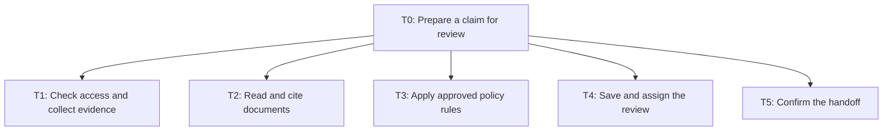
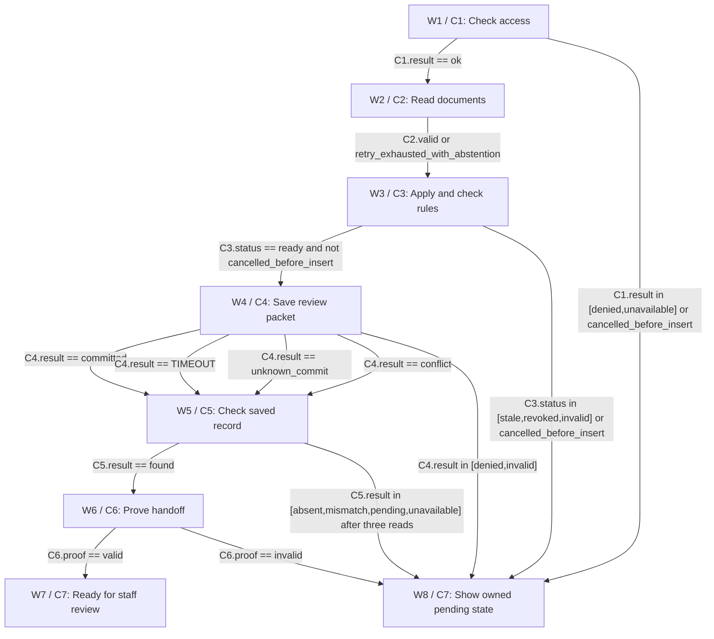

# Architecture

> PASS | DESIGN ONLY. self-review; round 2.

## Task tree



## Workflow



## Exact component and branch contracts

## components

### C1 · Trusted case reader

Resolve session tenant before fetching claim; enforce row-level member scope and document ACLs; 10s timeout, one read retry; unavailable creates no external write. Uploaded policy is evidence only, not authority. Schema rejects cross-subject hospital pages. Malware scan, page limits and redaction precede model access.

Reasoning: Keeps evidence, authority and recovery explicit.

Assumptions:

- H3

Data:

```json
{
  "group": "Code: tools",
  "taskIds": [
    "T1"
  ],
  "inputs": [
    "request: required {sessionId,tenantId,submissionId}; IDs authenticated, not model supplied"
  ],
  "outputs": [
    "case: authorized snapshot {tenantId,memberId,submissionId,claimVersion,documents,verifiedFacts,policyRegistry,authorityVersion}; result=ok|denied|unavailable"
  ],
  "whyCode": "Identity, rule arithmetic, versions, operation keys and durable proof require repeatable code.",
  "approvalRule": "Authenticated claims preparation role may save draft only; no final decision or payment permission."
}
```


Sources:

- context / user-brief: Design a health insurance claim adjudication assistant for inpatient hospital claims. It should read submitted policy and hospital documents, assess coverage and eligible charges, recommend or process eligible claims, and route exceptions and rejections for review. Policies can change over time and bills may include room-rent limits. Protect personal medical data, explain decisions with evidence and propose any missing rules as assumptions, not verified insurance or medical advice.

- hypothesis / H3: Adapters support tenant-scoped reads and an atomic, conditional review-packet insert with unique submission key, immutable body, assigned reviewer and durable record lookup.

### C2 · Evidence reader

Reads untrusted policy and hospital documents as data. Produces no authenticated identities, amounts or effective dates for writes. Prompt injections are quoted as suspicious content; never followed. 30s timeout; malformed or unavailable output gets one retry then a fixed abstention narrative. No diagnosis or medical necessity ruling.

Reasoning: Keeps evidence, authority and recovery explicit.

Assumptions:

- H4

Data:

```json
{
  "group": "Agents (LLM)",
  "taskIds": [
    "T2"
  ],
  "inputs": [
    "pages: required redacted pages with immutable page IDs, max 12000 tokens; excess=>abstain"
  ],
  "outputs": [
    "narrative: required bounded text with citations and recommendation=provisional|abstain; no tool commands",
    "evidence: required [{pageId,quote,confidence,provisionalFacts}]; schema rejects uncited claims"
  ],
  "whyCode": "",
  "approvalRule": "Authenticated claims preparation role may save draft only; no final decision or payment permission."
}
```


Sources:

- context / user-brief: Design a health insurance claim adjudication assistant for inpatient hospital claims. It should read submitted policy and hospital documents, assess coverage and eligible charges, recommend or process eligible claims, and route exceptions and rejections for review. Policies can change over time and bills may include room-rent limits. Protect personal medical data, explain decisions with evidence and propose any missing rules as assumptions, not verified insurance or medical advice.

- hypothesis / H4: Medical documents stay in an approved regional encrypted store. Only minimum redacted pages reach an approved zero-training model endpoint; raw content is excluded from logs. Proposed packet retention is 90 days, subject to insurer approval and legal hold.

### C3 · Rule and packet validator

Approved rule interpreter uses integer minor units, policy-specific rounding order and effective event-date rules. Never infer room-rent linked deductions: explicit charge class rule required, otherwise needs_review. Apply sublimits, exclusions, deductible, copay and remaining sum insured in signed policy order. Missing/ambiguous facts => needs_review amount absent. Missing active policy edition => needs_review. Immediately re-read claim/rule/authority before write; stale or revoked fails without write. No model fact authorizes money. Rules include effective date and timezone boundaries; document amendments do not overwrite historical editions.

Reasoning: Keeps evidence, authority and recovery explicit.

Assumptions:

- H2

Data:

```json
{
  "group": "Code: validation",
  "taskIds": [
    "T3",
    "T4"
  ],
  "inputs": [
    "case: required C1 snapshot",
    "narrative: required C2 narrative or code abstention",
    "evidence: required C2 evidence or []"
  ],
  "outputs": [
    "packet: immutable trusted {tenantId,memberId,submissionId,claimVersion,ruleVersion,decision,amountMinor?,currency?,evidenceIds,queueId,bodyVersion}; amount only for fully verified facts",
    "status: ready|stale|revoked|invalid"
  ],
  "whyCode": "Identity, rule arithmetic, versions, operation keys and durable proof require repeatable code.",
  "approvalRule": "Authenticated claims preparation role may save draft only; no final decision or payment permission."
}
```


Sources:

- context / user-brief: Design a health insurance claim adjudication assistant for inpatient hospital claims. It should read submitted policy and hospital documents, assess coverage and eligible charges, recommend or process eligible claims, and route exceptions and rejections for review. Policies can change over time and bills may include room-rent limits. Protect personal medical data, explain decisions with evidence and propose any missing rules as assumptions, not verified insurance or medical advice.

- hypothesis / H2: Insurer supplies immutable policy editions, endorsements, precedence rules and effective-date selection plus verified structured bill facts. Room-rent proration applies only when the approved policy rule explicitly names affected charge classes.

### C4 · Review packet store

Proposed adapter POST review-packets atomically inserts immutable packet and assignment, notifies staff through the existing queue, and stores operation key under a unique constraint. No payment or final-adjudication capability. Server rechecks authority, claimVersion and ruleVersion inside the transaction; 10s timeout. Exact duplicate returns existing record after body equality; changed intent conflicts. No write retry after timeout. Readback is required even on success.

Reasoning: Keeps evidence, authority and recovery explicit.

Assumptions:

- H3

Data:

```json
{
  "group": "Code: tools",
  "taskIds": [
    "T4"
  ],
  "inputs": [
    "packet: required immutable C3 packet, one claim and one tenant",
    "narrative: required C2 narrative or literal abstention; escaped and stored as untrusted draft",
    "operationKey: required trusted submissionId+claimVersion+bodyVersion"
  ],
  "outputs": [
    "result: committed {recordId,bodyVersion,queueId,reviewerId}|conflict|denied|invalid|TIMEOUT|unknown_commit"
  ],
  "whyCode": "Identity, rule arithmetic, versions, operation keys and durable proof require repeatable code.",
  "approvalRule": "Authenticated claims preparation role may save draft only; no final decision or payment permission."
}
```


Sources:

- context / user-brief: Design a health insurance claim adjudication assistant for inpatient hospital claims. It should read submitted policy and hospital documents, assess coverage and eligible charges, recommend or process eligible claims, and route exceptions and rejections for review. Policies can change over time and bills may include room-rent limits. Protect personal medical data, explain decisions with evidence and propose any missing rules as assumptions, not verified insurance or medical advice.

- hypothesis / H3: Adapters support tenant-scoped reads and an atomic, conditional review-packet insert with unique submission key, immutable body, assigned reviewer and durable record lookup.

### C5 · Readback and reconciliation

GET packet by operation key under tenant-scoped recovery service; compares full body and assigned reviewer, not just status. Read every 10s up to three times. Signed callbacks deduplicated by record ID and event sequence; expired caller session does not remove service recovery authority. Ambiguous commit freezes changed intent and is owned by Platform on-call until lookup resolves. Never insert during recovery. absent/pending/unavailable after bound => unresolved operation retained for manual reconciliation, no completion. Cancellation before insert cancels run; after insert or unknown result records operator intent in operations ledger and cannot revoke a clinical claim decision, since none exists.

Reasoning: Keeps evidence, authority and recovery explicit.

Assumptions:

- H3

Data:

```json
{
  "group": "Code: tools",
  "taskIds": [
    "T4",
    "T5"
  ],
  "inputs": [
    "operationKey: required trusted key",
    "expectedBody: required immutable packet+escaped narrative",
    "recovery: required attempt 0..3 with trusted server clock"
  ],
  "outputs": [
    "result: found {recordId,queueId,reviewerId,bodyVersion}|absent|mismatch|pending|unavailable"
  ],
  "whyCode": "Identity, rule arithmetic, versions, operation keys and durable proof require repeatable code.",
  "approvalRule": "Authenticated claims preparation role may save draft only; no final decision or payment permission."
}
```


Sources:

- context / user-brief: Design a health insurance claim adjudication assistant for inpatient hospital claims. It should read submitted policy and hospital documents, assess coverage and eligible charges, recommend or process eligible claims, and route exceptions and rejections for review. Policies can change over time and bills may include room-rent limits. Protect personal medical data, explain decisions with evidence and propose any missing rules as assumptions, not verified insurance or medical advice.

- hypothesis / H3: Adapters support tenant-scoped reads and an atomic, conditional review-packet insert with unique submission key, immutable body, assigned reviewer and durable record lookup.

### C6 · Record proof check

Require nonempty durable packet record ID, matching tenant/submission/body versions and actual reviewer assignment. A provisional local ID or model phrase cannot prove completion. Existing queue owns acknowledgement and overdue alerts under H5; no person approval is claimed by mere assignment.

Reasoning: Keeps evidence, authority and recovery explicit.

Assumptions:

- H3

Data:

```json
{
  "group": "Code: validation",
  "taskIds": [
    "T5"
  ],
  "inputs": [
    "readback: required C5 found record and expected immutable body"
  ],
  "outputs": [
    "proof: valid {recordId,queueId,reviewerId}|invalid"
  ],
  "whyCode": "Identity, rule arithmetic, versions, operation keys and durable proof require repeatable code.",
  "approvalRule": "Authenticated claims preparation role may save draft only; no final decision or payment permission."
}
```


Sources:

- context / user-brief: Design a health insurance claim adjudication assistant for inpatient hospital claims. It should read submitted policy and hospital documents, assess coverage and eligible charges, recommend or process eligible claims, and route exceptions and rejections for review. Policies can change over time and bills may include room-rent limits. Protect personal medical data, explain decisions with evidence and propose any missing rules as assumptions, not verified insurance or medical advice.

- hypothesis / H3: Adapters support tenant-scoped reads and an atomic, conditional review-packet insert with unique submission key, immutable body, assigned reviewer and durable record lookup.

### C7 · Read-only status view

Renders session UI only; no messages or external writes. completed_review_packet means ready for review, not claim adjudicated. Pending recovery points to operation key and on-call; access denied discloses no member data. Reviewer queue sends existing-system notices under H5, requiring verification before launch.

Reasoning: Keeps evidence, authority and recovery explicit.

Assumptions:

- H3

Data:

```json
{
  "group": "Code: tools",
  "taskIds": [
    "T5"
  ],
  "inputs": [
    "status: required completed_review_packet|blocked|pending_reconciliation",
    "proof: optional required only for completed_review_packet"
  ],
  "outputs": [
    "view: required escaped staff status with existing record link or owned next step"
  ],
  "whyCode": "Identity, rule arithmetic, versions, operation keys and durable proof require repeatable code.",
  "approvalRule": "Authenticated claims preparation role may save draft only; no final decision or payment permission."
}
```


Sources:

- context / user-brief: Design a health insurance claim adjudication assistant for inpatient hospital claims. It should read submitted policy and hospital documents, assess coverage and eligible charges, recommend or process eligible claims, and route exceptions and rejections for review. Policies can change over time and bills may include room-rent limits. Protect personal medical data, explain decisions with evidence and propose any missing rules as assumptions, not verified insurance or medical advice.

- hypothesis / H3: Adapters support tenant-scoped reads and an atomic, conditional review-packet insert with unique submission key, immutable body, assigned reviewer and durable record lookup.


## workflow

### W1 · Check access

{"state": "Check access", "transitions": [{"to": "W2", "when": "C1.result == ok", "mode": "exclusive; result enum has one value; cancellation checked first before insert"}, {"to": "W8", "when": "C1.result in [denied,unavailable] or cancelled_before_insert", "mode": "exclusive; result enum has one value; cancellation checked first before insert"}], "failureDisposition": "W8 is blocked before insert; after uncertain insert it is pending_reconciliation owned by Platform on-call. No final claim outcome.", "timeout": "C2 30s per call; other I/O 10s per call; local validation 2s; status render 2s.", "retryPolicy": "C1 one read retry; C2 one retry then abstain; C4 zero retries; C5 three reads 10s apart, then W8. Local steps zero retries.", "terminalDisposition": "", "guardBindings": {"C1.result": "C1.case.result enum from authenticated API", "C2.valid": "code JSON and citation validator; retry_exhausted_with_abstention code counter <=2", "C3.status": "C3.status enum using fresh registry versions and authority", "C4.result": "typed adapter response or code timeout classification", "C5.result": "C5.result enum after bounded lookup; retry count server durable integer", "C6.proof": "C6.proof enum", "cancelled_before_insert": "authenticated staff cancel event bound to submission; serial transaction cancel check; after uncertain insert remains pending recovery"}}

Reasoning: Keeps evidence, authority and recovery explicit.

Assumptions:

- H1

Data:

```json
{
  "componentId": "C1",
  "taskIds": [
    "T1"
  ],
  "next": [
    "W2",
    "W8"
  ],
  "decision": true,
  "example": "S17: verified capped charges produce draft; saved packet RP17 is read back before ready-for-review status."
}
```


Sources:

- context / user-brief: Design a health insurance claim adjudication assistant for inpatient hospital claims. It should read submitted policy and hospital documents, assess coverage and eligible charges, recommend or process eligible claims, and route exceptions and rejections for review. Policies can change over time and bills may include room-rent limits. Protect personal medical data, explain decisions with evidence and propose any missing rules as assumptions, not verified insurance or medical advice.

- hypothesis / H1: First release creates review packets only. Claims staff approve all eligible recommendations, exceptions and rejection candidates; no settlement, denial notice or payment is automated.

### W2 · Read documents

{"state": "Read documents", "transitions": [{"to": "W3", "when": "C2.valid or retry_exhausted_with_abstention", "mode": "exclusive; result enum has one value; cancellation checked first before insert"}], "failureDisposition": "W8 is blocked before insert; after uncertain insert it is pending_reconciliation owned by Platform on-call. No final claim outcome.", "timeout": "C2 30s per call; other I/O 10s per call; local validation 2s; status render 2s.", "retryPolicy": "C1 one read retry; C2 one retry then abstain; C4 zero retries; C5 three reads 10s apart, then W8. Local steps zero retries.", "terminalDisposition": "", "guardBindings": {"C1.result": "C1.case.result enum from authenticated API", "C2.valid": "code JSON and citation validator; retry_exhausted_with_abstention code counter <=2", "C3.status": "C3.status enum using fresh registry versions and authority", "C4.result": "typed adapter response or code timeout classification", "C5.result": "C5.result enum after bounded lookup; retry count server durable integer", "C6.proof": "C6.proof enum", "cancelled_before_insert": "authenticated staff cancel event bound to submission; serial transaction cancel check; after uncertain insert remains pending recovery"}}

Reasoning: Keeps evidence, authority and recovery explicit.

Assumptions:

- H1

Data:

```json
{
  "componentId": "C2",
  "taskIds": [
    "T2"
  ],
  "next": [
    "W3"
  ],
  "decision": false,
  "example": "S17: verified capped charges produce draft; saved packet RP17 is read back before ready-for-review status."
}
```


Sources:

- context / user-brief: Design a health insurance claim adjudication assistant for inpatient hospital claims. It should read submitted policy and hospital documents, assess coverage and eligible charges, recommend or process eligible claims, and route exceptions and rejections for review. Policies can change over time and bills may include room-rent limits. Protect personal medical data, explain decisions with evidence and propose any missing rules as assumptions, not verified insurance or medical advice.

- hypothesis / H1: First release creates review packets only. Claims staff approve all eligible recommendations, exceptions and rejection candidates; no settlement, denial notice or payment is automated.

### W3 · Apply and check rules

{"state": "Apply and check rules", "transitions": [{"to": "W4", "when": "C3.status == ready and not cancelled_before_insert", "mode": "exclusive; result enum has one value; cancellation checked first before insert"}, {"to": "W8", "when": "C3.status in [stale,revoked,invalid] or cancelled_before_insert", "mode": "exclusive; result enum has one value; cancellation checked first before insert"}], "failureDisposition": "W8 is blocked before insert; after uncertain insert it is pending_reconciliation owned by Platform on-call. No final claim outcome.", "timeout": "C2 30s per call; other I/O 10s per call; local validation 2s; status render 2s.", "retryPolicy": "C1 one read retry; C2 one retry then abstain; C4 zero retries; C5 three reads 10s apart, then W8. Local steps zero retries.", "terminalDisposition": "", "guardBindings": {"C1.result": "C1.case.result enum from authenticated API", "C2.valid": "code JSON and citation validator; retry_exhausted_with_abstention code counter <=2", "C3.status": "C3.status enum using fresh registry versions and authority", "C4.result": "typed adapter response or code timeout classification", "C5.result": "C5.result enum after bounded lookup; retry count server durable integer", "C6.proof": "C6.proof enum", "cancelled_before_insert": "authenticated staff cancel event bound to submission; serial transaction cancel check; after uncertain insert remains pending recovery"}}

Reasoning: Keeps evidence, authority and recovery explicit.

Assumptions:

- H1

Data:

```json
{
  "componentId": "C3",
  "taskIds": [
    "T3",
    "T4"
  ],
  "next": [
    "W4",
    "W8"
  ],
  "decision": true,
  "example": "S17: verified capped charges produce draft; saved packet RP17 is read back before ready-for-review status."
}
```


Sources:

- context / user-brief: Design a health insurance claim adjudication assistant for inpatient hospital claims. It should read submitted policy and hospital documents, assess coverage and eligible charges, recommend or process eligible claims, and route exceptions and rejections for review. Policies can change over time and bills may include room-rent limits. Protect personal medical data, explain decisions with evidence and propose any missing rules as assumptions, not verified insurance or medical advice.

- hypothesis / H1: First release creates review packets only. Claims staff approve all eligible recommendations, exceptions and rejection candidates; no settlement, denial notice or payment is automated.

### W4 · Save review packet

{"state": "Save review packet", "transitions": [{"to": "W5", "when": "C4.result == committed", "mode": "exclusive; result enum has one value; cancellation checked first before insert"}, {"to": "W5", "when": "C4.result == TIMEOUT", "mode": "exclusive; result enum has one value; cancellation checked first before insert"}, {"to": "W5", "when": "C4.result == unknown_commit", "mode": "exclusive; result enum has one value; cancellation checked first before insert"}, {"to": "W5", "when": "C4.result == conflict", "mode": "exclusive; result enum has one value; cancellation checked first before insert"}, {"to": "W8", "when": "C4.result in [denied,invalid]", "mode": "exclusive; result enum has one value; cancellation checked first before insert"}], "failureDisposition": "W8 is blocked before insert; after uncertain insert it is pending_reconciliation owned by Platform on-call. No final claim outcome.", "timeout": "C2 30s per call; other I/O 10s per call; local validation 2s; status render 2s.", "retryPolicy": "C1 one read retry; C2 one retry then abstain; C4 zero retries; C5 three reads 10s apart, then W8. Local steps zero retries.", "terminalDisposition": "", "guardBindings": {"C1.result": "C1.case.result enum from authenticated API", "C2.valid": "code JSON and citation validator; retry_exhausted_with_abstention code counter <=2", "C3.status": "C3.status enum using fresh registry versions and authority", "C4.result": "typed adapter response or code timeout classification", "C5.result": "C5.result enum after bounded lookup; retry count server durable integer", "C6.proof": "C6.proof enum", "cancelled_before_insert": "authenticated staff cancel event bound to submission; serial transaction cancel check; after uncertain insert remains pending recovery"}}

Reasoning: Keeps evidence, authority and recovery explicit.

Assumptions:

- H1

Data:

```json
{
  "componentId": "C4",
  "taskIds": [
    "T4"
  ],
  "next": [
    "W5",
    "W8"
  ],
  "decision": true,
  "example": "S17: verified capped charges produce draft; saved packet RP17 is read back before ready-for-review status."
}
```


Sources:

- context / user-brief: Design a health insurance claim adjudication assistant for inpatient hospital claims. It should read submitted policy and hospital documents, assess coverage and eligible charges, recommend or process eligible claims, and route exceptions and rejections for review. Policies can change over time and bills may include room-rent limits. Protect personal medical data, explain decisions with evidence and propose any missing rules as assumptions, not verified insurance or medical advice.

- hypothesis / H1: First release creates review packets only. Claims staff approve all eligible recommendations, exceptions and rejection candidates; no settlement, denial notice or payment is automated.

### W5 · Check saved record

{"state": "Check saved record", "transitions": [{"to": "W6", "when": "C5.result == found", "mode": "exclusive; result enum has one value; cancellation checked first before insert"}, {"to": "W8", "when": "C5.result in [absent,mismatch,pending,unavailable] after three reads", "mode": "exclusive; result enum has one value; cancellation checked first before insert"}], "failureDisposition": "W8 is blocked before insert; after uncertain insert it is pending_reconciliation owned by Platform on-call. No final claim outcome.", "timeout": "C2 30s per call; other I/O 10s per call; local validation 2s; status render 2s.", "retryPolicy": "C1 one read retry; C2 one retry then abstain; C4 zero retries; C5 three reads 10s apart, then W8. Local steps zero retries.", "terminalDisposition": "", "guardBindings": {"C1.result": "C1.case.result enum from authenticated API", "C2.valid": "code JSON and citation validator; retry_exhausted_with_abstention code counter <=2", "C3.status": "C3.status enum using fresh registry versions and authority", "C4.result": "typed adapter response or code timeout classification", "C5.result": "C5.result enum after bounded lookup; retry count server durable integer", "C6.proof": "C6.proof enum", "cancelled_before_insert": "authenticated staff cancel event bound to submission; serial transaction cancel check; after uncertain insert remains pending recovery"}}

Reasoning: Keeps evidence, authority and recovery explicit.

Assumptions:

- H1

Data:

```json
{
  "componentId": "C5",
  "taskIds": [
    "T4",
    "T5"
  ],
  "next": [
    "W6",
    "W8"
  ],
  "decision": true,
  "example": "S17: verified capped charges produce draft; saved packet RP17 is read back before ready-for-review status."
}
```


Sources:

- context / user-brief: Design a health insurance claim adjudication assistant for inpatient hospital claims. It should read submitted policy and hospital documents, assess coverage and eligible charges, recommend or process eligible claims, and route exceptions and rejections for review. Policies can change over time and bills may include room-rent limits. Protect personal medical data, explain decisions with evidence and propose any missing rules as assumptions, not verified insurance or medical advice.

- hypothesis / H1: First release creates review packets only. Claims staff approve all eligible recommendations, exceptions and rejection candidates; no settlement, denial notice or payment is automated.

### W6 · Prove handoff

{"state": "Prove handoff", "transitions": [{"to": "W7", "when": "C6.proof == valid", "mode": "exclusive; result enum has one value; cancellation checked first before insert"}, {"to": "W8", "when": "C6.proof == invalid", "mode": "exclusive; result enum has one value; cancellation checked first before insert"}], "failureDisposition": "W8 is blocked before insert; after uncertain insert it is pending_reconciliation owned by Platform on-call. No final claim outcome.", "timeout": "C2 30s per call; other I/O 10s per call; local validation 2s; status render 2s.", "retryPolicy": "C1 one read retry; C2 one retry then abstain; C4 zero retries; C5 three reads 10s apart, then W8. Local steps zero retries.", "terminalDisposition": "", "guardBindings": {"C1.result": "C1.case.result enum from authenticated API", "C2.valid": "code JSON and citation validator; retry_exhausted_with_abstention code counter <=2", "C3.status": "C3.status enum using fresh registry versions and authority", "C4.result": "typed adapter response or code timeout classification", "C5.result": "C5.result enum after bounded lookup; retry count server durable integer", "C6.proof": "C6.proof enum", "cancelled_before_insert": "authenticated staff cancel event bound to submission; serial transaction cancel check; after uncertain insert remains pending recovery"}}

Reasoning: Keeps evidence, authority and recovery explicit.

Assumptions:

- H1

Data:

```json
{
  "componentId": "C6",
  "taskIds": [
    "T5"
  ],
  "next": [
    "W7",
    "W8"
  ],
  "decision": true,
  "example": "S17: verified capped charges produce draft; saved packet RP17 is read back before ready-for-review status."
}
```


Sources:

- context / user-brief: Design a health insurance claim adjudication assistant for inpatient hospital claims. It should read submitted policy and hospital documents, assess coverage and eligible charges, recommend or process eligible claims, and route exceptions and rejections for review. Policies can change over time and bills may include room-rent limits. Protect personal medical data, explain decisions with evidence and propose any missing rules as assumptions, not verified insurance or medical advice.

- hypothesis / H1: First release creates review packets only. Claims staff approve all eligible recommendations, exceptions and rejection candidates; no settlement, denial notice or payment is automated.

### W7 · Ready for staff review

{"state": "Ready for staff review", "transitions": [], "failureDisposition": "W8 is blocked before insert; after uncertain insert it is pending_reconciliation owned by Platform on-call. No final claim outcome.", "timeout": "C2 30s per call; other I/O 10s per call; local validation 2s; status render 2s.", "retryPolicy": "C1 one read retry; C2 one retry then abstain; C4 zero retries; C5 three reads 10s apart, then W8. Local steps zero retries.", "terminalDisposition": "Durable review packet and assigned reviewer confirmed; claim pending staff adjudication.", "guardBindings": {"C1.result": "C1.case.result enum from authenticated API", "C2.valid": "code JSON and citation validator; retry_exhausted_with_abstention code counter <=2", "C3.status": "C3.status enum using fresh registry versions and authority", "C4.result": "typed adapter response or code timeout classification", "C5.result": "C5.result enum after bounded lookup; retry count server durable integer", "C6.proof": "C6.proof enum", "cancelled_before_insert": "authenticated staff cancel event bound to submission; serial transaction cancel check; after uncertain insert remains pending recovery"}}

Reasoning: Keeps evidence, authority and recovery explicit.

Assumptions:

- H1

Data:

```json
{
  "componentId": "C7",
  "taskIds": [
    "T5"
  ],
  "next": [],
  "decision": false,
  "example": "S17: verified capped charges produce draft; saved packet RP17 is read back before ready-for-review status."
}
```


Sources:

- context / user-brief: Design a health insurance claim adjudication assistant for inpatient hospital claims. It should read submitted policy and hospital documents, assess coverage and eligible charges, recommend or process eligible claims, and route exceptions and rejections for review. Policies can change over time and bills may include room-rent limits. Protect personal medical data, explain decisions with evidence and propose any missing rules as assumptions, not verified insurance or medical advice.

- hypothesis / H1: First release creates review packets only. Claims staff approve all eligible recommendations, exceptions and rejection candidates; no settlement, denial notice or payment is automated.

### W8 · Show owned pending state

{"state": "Show owned pending state", "transitions": [], "failureDisposition": "W8 is blocked before insert; after uncertain insert it is pending_reconciliation owned by Platform on-call. No final claim outcome.", "timeout": "C2 30s per call; other I/O 10s per call; local validation 2s; status render 2s.", "retryPolicy": "C1 one read retry; C2 one retry then abstain; C4 zero retries; C5 three reads 10s apart, then W8. Local steps zero retries.", "terminalDisposition": "Blocked/pending state, owned next step and operation key if any; never claim processed.", "guardBindings": {"C1.result": "C1.case.result enum from authenticated API", "C2.valid": "code JSON and citation validator; retry_exhausted_with_abstention code counter <=2", "C3.status": "C3.status enum using fresh registry versions and authority", "C4.result": "typed adapter response or code timeout classification", "C5.result": "C5.result enum after bounded lookup; retry count server durable integer", "C6.proof": "C6.proof enum", "cancelled_before_insert": "authenticated staff cancel event bound to submission; serial transaction cancel check; after uncertain insert remains pending recovery"}}

Reasoning: Keeps evidence, authority and recovery explicit.

Assumptions:

- H1

Data:

```json
{
  "componentId": "C7",
  "taskIds": [
    "T5"
  ],
  "next": [],
  "decision": false,
  "example": "S17: verified capped charges produce draft; saved packet RP17 is read back before ready-for-review status."
}
```


Sources:

- context / user-brief: Design a health insurance claim adjudication assistant for inpatient hospital claims. It should read submitted policy and hospital documents, assess coverage and eligible charges, recommend or process eligible claims, and route exceptions and rejections for review. Policies can change over time and bills may include room-rent limits. Protect personal medical data, explain decisions with evidence and propose any missing rules as assumptions, not verified insurance or medical advice.

- hypothesis / H1: First release creates review packets only. Claims staff approve all eligible recommendations, exceptions and rejection candidates; no settlement, denial notice or payment is automated.


## framework

### F1 · Code owns the workflow

Durable code state machine plus one bounded document reader A single evidence reader fits judgement; persistence, rule maths and recovery remain code.

Reasoning: Keeps evidence, authority and recovery explicit.

Assumptions:

- H3

Data:

```json
{
  "category": "fit",
  "taskIds": [
    "T1",
    "T2",
    "T3",
    "T4",
    "T5"
  ],
  "choice": "Durable code state machine plus one bounded document reader",
  "alternatives": [
    "Free-running multi-agent adjudicator: more authority and weaker auditability without a benefit here."
  ],
  "tradeoffs": "A single evidence reader fits judgement; persistence, rule maths and recovery remain code.",
  "permission": "none",
  "blastRadius": "One insurer tenant and one inpatient submission; no payment/final decision rights.",
  "approvalRule": "H1-H5 sign-offs required before live use; scoped reviewer role for drafts.",
  "leastPrivilege": "Separate read, packet-insert and recovery principals; no shared model tool credentials.",
  "aws": "Candidate: regional object store, SQL and key service; verify region, retention and model agreement.",
  "gcp": "Candidate: regional object store, SQL and key service; same privacy and recovery criteria.",
  "azure": "Candidate: regional object store, SQL and key service; same privacy and recovery criteria.",
  "openSource": "Candidate: self-hosted object store, PostgreSQL and secret manager; insurer bears patching, backup and access audit."
}
```


Sources:

- context / user-brief: Design a health insurance claim adjudication assistant for inpatient hospital claims. It should read submitted policy and hospital documents, assess coverage and eligible charges, recommend or process eligible claims, and route exceptions and rejections for review. Policies can change over time and bills may include room-rent limits. Protect personal medical data, explain decisions with evidence and propose any missing rules as assumptions, not verified insurance or medical advice.

- hypothesis / H3: Adapters support tenant-scoped reads and an atomic, conditional review-packet insert with unique submission key, immutable body, assigned reviewer and durable record lookup.

### F2 · Keep long-lived state durable

Database-backed worker with transactional outbox and versioned run state Compare state machine and durable workflow engine on recovery, version migrations, audit and operations; choose code worker for one bounded pipeline. No current vendor capability is asserted.

Reasoning: Keeps evidence, authority and recovery explicit.

Assumptions:

- H3

Data:

```json
{
  "category": "orchestration",
  "taskIds": [
    "T1",
    "T2",
    "T3",
    "T4",
    "T5"
  ],
  "choice": "Database-backed worker with transactional outbox and versioned run state",
  "alternatives": [
    "In-memory chain: cannot survive uncertain save or caller expiry.",
    "Temporal-like durable workflow candidate: stronger workflow tooling but extra operational cost; verify APIs."
  ],
  "tradeoffs": "Compare state machine and durable workflow engine on recovery, version migrations, audit and operations; choose code worker for one bounded pipeline. No current vendor capability is asserted.",
  "permission": "none",
  "blastRadius": "One insurer tenant and one inpatient submission; no payment/final decision rights.",
  "approvalRule": "H1-H5 sign-offs required before live use; scoped reviewer role for drafts.",
  "leastPrivilege": "Separate read, packet-insert and recovery principals; no shared model tool credentials.",
  "aws": "Candidate: regional object store, SQL and key service; verify region, retention and model agreement.",
  "gcp": "Candidate: regional object store, SQL and key service; same privacy and recovery criteria.",
  "azure": "Candidate: regional object store, SQL and key service; same privacy and recovery criteria.",
  "openSource": "Candidate: self-hosted object store, PostgreSQL and secret manager; insurer bears patching, backup and access audit."
}
```


Sources:

- context / user-brief: Design a health insurance claim adjudication assistant for inpatient hospital claims. It should read submitted policy and hospital documents, assess coverage and eligible charges, recommend or process eligible claims, and route exceptions and rejections for review. Policies can change over time and bills may include room-rent limits. Protect personal medical data, explain decisions with evidence and propose any missing rules as assumptions, not verified insurance or medical advice.

- hypothesis / H3: Adapters support tenant-scoped reads and an atomic, conditional review-packet insert with unique submission key, immutable body, assigned reviewer and durable record lookup.

### F3 · Limit service permissions

Reader can read one authorized claim; writer can create one draft packet; recovery can only read operation status Fresh role/version check at server write; model has no credentials; assignment is provisional and does not approve claim.

Reasoning: Keeps evidence, authority and recovery explicit.

Assumptions:

- H3

Data:

```json
{
  "category": "permission",
  "taskIds": [
    "T1",
    "T2",
    "T3",
    "T4",
    "T5"
  ],
  "choice": "Reader can read one authorized claim; writer can create one draft packet; recovery can only read operation status",
  "alternatives": [
    "One claims admin credential: exposes settlement and denial powers."
  ],
  "tradeoffs": "Fresh role/version check at server write; model has no credentials; assignment is provisional and does not approve claim.",
  "permission": "write",
  "blastRadius": "One insurer tenant and one inpatient submission; no payment/final decision rights.",
  "approvalRule": "H1-H5 sign-offs required before live use; scoped reviewer role for drafts.",
  "leastPrivilege": "Separate read, packet-insert and recovery principals; no shared model tool credentials.",
  "aws": "Candidate: regional object store, SQL and key service; verify region, retention and model agreement.",
  "gcp": "Candidate: regional object store, SQL and key service; same privacy and recovery criteria.",
  "azure": "Candidate: regional object store, SQL and key service; same privacy and recovery criteria.",
  "openSource": "Candidate: self-hosted object store, PostgreSQL and secret manager; insurer bears patching, backup and access audit."
}
```


Sources:

- context / user-brief: Design a health insurance claim adjudication assistant for inpatient hospital claims. It should read submitted policy and hospital documents, assess coverage and eligible charges, recommend or process eligible claims, and route exceptions and rejections for review. Policies can change over time and bills may include room-rent limits. Protect personal medical data, explain decisions with evidence and propose any missing rules as assumptions, not verified insurance or medical advice.

- hypothesis / H3: Adapters support tenant-scoped reads and an atomic, conditional review-packet insert with unique submission key, immutable body, assigned reviewer and durable record lookup.

### F4 · Keep medical records separate

Regional encrypted document store plus relational authoritative policy/claim ledger; retrieval index contains redacted citations only Privacy owner approves access/region/retention. Encrypt with scoped keys; audit record IDs and access actors without medical text. Delete model cache immediately; proposed retention 90 days with approved legal-hold exceptions; tombstones propagate to derived indexes and backups per approved schedule.

Reasoning: Keeps evidence, authority and recovery explicit.

Assumptions:

- H4

Data:

```json
{
  "category": "data",
  "taskIds": [
    "T1",
    "T2",
    "T3",
    "T4",
    "T5"
  ],
  "choice": "Regional encrypted document store plus relational authoritative policy/claim ledger; retrieval index contains redacted citations only",
  "alternatives": [
    "Shared global vector store: unnecessary medical-data spread and weak deletion."
  ],
  "tradeoffs": "Privacy owner approves access/region/retention. Encrypt with scoped keys; audit record IDs and access actors without medical text. Delete model cache immediately; proposed retention 90 days with approved legal-hold exceptions; tombstones propagate to derived indexes and backups per approved schedule.",
  "permission": "read",
  "blastRadius": "One insurer tenant and one inpatient submission; no payment/final decision rights.",
  "approvalRule": "H1-H5 sign-offs required before live use; scoped reviewer role for drafts.",
  "leastPrivilege": "Separate read, packet-insert and recovery principals; no shared model tool credentials.",
  "aws": "Candidate: regional object store, SQL and key service; verify region, retention and model agreement.",
  "gcp": "Candidate: regional object store, SQL and key service; same privacy and recovery criteria.",
  "azure": "Candidate: regional object store, SQL and key service; same privacy and recovery criteria.",
  "openSource": "Candidate: self-hosted object store, PostgreSQL and secret manager; insurer bears patching, backup and access audit."
}
```


Sources:

- context / user-brief: Design a health insurance claim adjudication assistant for inpatient hospital claims. It should read submitted policy and hospital documents, assess coverage and eligible charges, recommend or process eligible claims, and route exceptions and rejections for review. Policies can change over time and bills may include room-rent limits. Protect personal medical data, explain decisions with evidence and propose any missing rules as assumptions, not verified insurance or medical advice.

- hypothesis / H4: Medical documents stay in an approved regional encrypted store. Only minimum redacted pages reach an approved zero-training model endpoint; raw content is excluded from logs. Proposed packet retention is 90 days, subject to insurer approval and legal hold.


## models

### M1 · Bounded document reading

Standard tier is an unverified starting hypothesis for long medical-document citations. Small tier rejected until it matches citation/abstention accuracy; reasoning tier rejected for latency/cost unless held-out errors justify it. W2 is the sole invocation: 1 call + H6 5% retry = 1.05 expected, maximum 2 calls; C1 rejection may lower actual average. 12000 input and 1500 output tokens/call: 1.05*(12000*2+1500*8)/1e6 = USD 0.0378/case, USD 37.80 per 1000 cases. Worst case USD 0.072 and 60s model time, up to about 122s whole run with I/O retries/readback. Prices are illustrative, not quoted; exclude OCR, hosting, storage, retrieval, human review and taxes. More than 12000 redacted tokens abstains and routes manual; no hidden chunk calls.

Reasoning: Keeps evidence, authority and recovery explicit.

Assumptions:

- H6

Data:

```json
{
  "componentId": "C2",
  "tier": "standard",
  "rationale": "Standard tier is an unverified starting hypothesis for long medical-document citations. Small tier rejected until it matches citation/abstention accuracy; reasoning tier rejected for latency/cost unless held-out errors justify it. W2 is the sole invocation: 1 call + H6 5% retry = 1.05 expected, maximum 2 calls; C1 rejection may lower actual average. 12000 input and 1500 output tokens/call: 1.05*(12000*2+1500*8)/1e6 = USD 0.0378/case, USD 37.80 per 1000 cases. Worst case USD 0.072 and 60s model time, up to about 122s whole run with I/O retries/readback. Prices are illustrative, not quoted; exclude OCR, hosting, storage, retrieval, human review and taxes. More than 12000 redacted tokens abstains and routes manual; no hidden chunk calls.",
  "fineTuneWhen": "Only after recurring labelled failures persist after prompt/redaction/retrieval fixes, with approved medical-data use, held-out citation/safety improvement and measured total-cost benefit. Larger models never gain permission.",
  "callsPerCase": 1.05,
  "inputTokens": 12000,
  "outputTokens": 1500,
  "inputPrice": 2,
  "outputPrice": 8
}
```


Sources:

- context / user-brief: Design a health insurance claim adjudication assistant for inpatient hospital claims. It should read submitted policy and hospital documents, assess coverage and eligible charges, recommend or process eligible claims, and route exceptions and rejections for review. Policies can change over time and bills may include room-rent limits. Protect personal medical data, explain decisions with evidence and propose any missing rules as assumptions, not verified insurance or medical advice.

- hypothesis / H6: Illustrative budget is 1000 cases/month; one standard model call costs assumed USD 2/M input tokens and USD 8/M output tokens, with 5% single retry.


