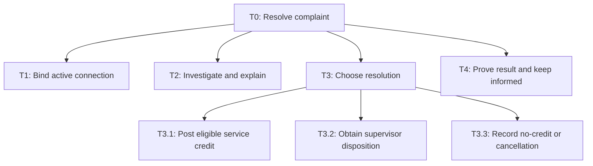
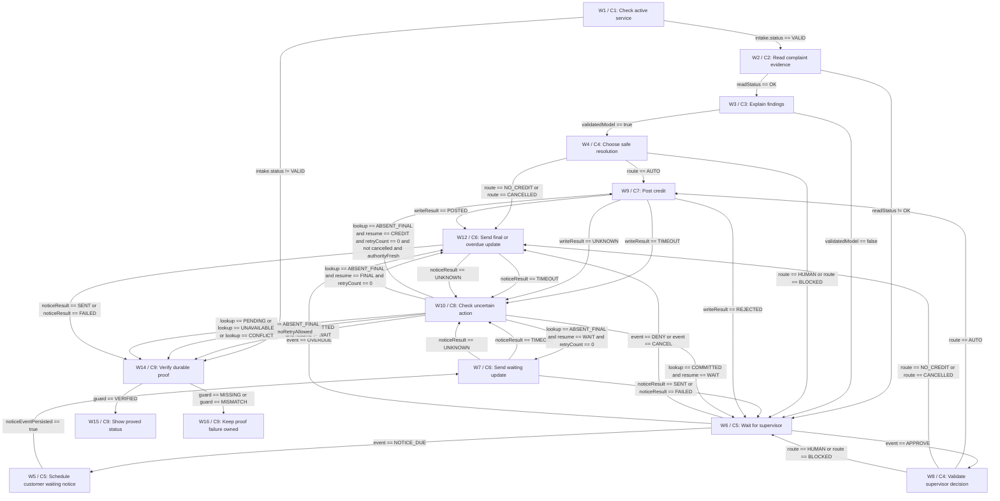

# Architecture

> PASS | DESIGN ONLY. self-review; round 3.

## Task tree



## Workflow



## Exact component and branch contracts

## components

### C1 · Identity and scoped intake

Bind IDs from gateway and account registry, never from text. Refuse any mismatched/inactive selection before private reads. Case persisted transactionally with reason and owner; provisional cases contain no private billing data. GET account timeout 5s, one read retry, then NEED_INFO.

Reasoning: Keeps authority explicit and failures owned.

Data:

```json
{
  "group": "Code: validation",
  "taskIds": [
    "T1"
  ],
  "inputs": [
    "session: authenticated gateway token or absent",
    "selection: connection reference or absent",
    "complaint: untrusted text"
  ],
  "outputs": [
    "scope: tenantId/customerId/connectionId/accountVersion or null",
    "intake: caseId/status(VALID|NEED_INFO|UNAUTHORIZED|CANCELLED)"
  ],
  "whyCode": "Enforce repeatable scope, exact arithmetic, state and durable evidence without probabilistic authority.",
  "approvalRule": "No model authority. Credit requires fresh policy or exact supervisor approval; notices require current scoped case and verified destination."
}
```


Sources:

- context / user-brief: Keep customers informed, avoid duplicate refunds and use only the right customer's active service connection.

### C2 · Scoped evidence reader

Read only exact tenant/customer/active connection. Typed evidence includes observedAt, resourceVersion, allowed fields, source IDs. Timeout 5s per source, one read retry; missing, stale (>5 minutes for active state), conflicting or unavailable fields route to supervisor. Interval union clips to billing-cycle UTC boundaries; never double-count overlapping outages.

Reasoning: Keeps authority explicit and failures owned.

Data:

```json
{
  "group": "Code: tools",
  "taskIds": [
    "T2"
  ],
  "inputs": [
    "scope: C1.scope required",
    "caseId: durable intake ID"
  ],
  "outputs": [
    "evidence: signed policy/version; billing recurring charge and cycle; outage intervals and source IDs; freshness",
    "readStatus: OK|MISSING|CONFLICT|UNAVAILABLE"
  ],
  "whyCode": "Enforce repeatable scope, exact arithmetic, state and durable evidence without probabilistic authority.",
  "approvalRule": "No model authority. Credit requires fresh policy or exact supervisor approval; notices require current scoped case and verified destination."
}
```


Sources:

- context / user-brief: Keep customers informed, avoid duplicate refunds and use only the right customer's active service connection.

### C3 · Evidence-grounded explanation

One call, deadline 12s. May explain service/billing evidence, cannot supply amount, dates or IDs for writes. Code verifies citations against admitted source fields; invalid/unavailable output uses fixed template and human route. Customer and retrieved text are untrusted; no tool execution and no hidden HTML/document layer is admitted.

Reasoning: Keeps authority explicit and failures owned.

Data:

```json
{
  "group": "Agents (LLM)",
  "taskIds": [
    "T2"
  ],
  "inputs": [
    "evidence: minimized C2 evidence and allowed source IDs",
    "complaint: plain text treated as data, max 4000 chars"
  ],
  "outputs": [
    "explanation: plain text",
    "citations: source ID and exact quoted field list",
    "disposition: EXPLAIN|ABSTAIN"
  ],
  "whyCode": "",
  "approvalRule": "No model authority. Credit requires fresh policy or exact supervisor approval; notices require current scoped case and verified destination."
}
```


Sources:

- context / user-brief: Keep customers informed, avoid duplicate refunds and use only the right customer's active service connection.

### C4 · Rule and action validation

P1 in H1 computes integer minor-unit credit: floor(chargeMinor × union outageMinutes / cycleMinutes), then compare raw calculated amount to the 50000 automatic cap. Above cap routes HUMAN. Otherwise use min(calculated,chargeMinor-alreadyCreditedMinor). Requires positive charge/cycle, nonnegative already credited, verified outage minutes 0..cycle length and valid policy. Zero amount is NO_CREDIT. Above automatic cap routes HUMAN before capping, never silently pays a partial amount. Supervisor exception command may specify positive integer amount up to remaining original charge; unsupported cash refunds receive owned manual disposition. Approval binds complete command bytes: tenant/customer/connection, originalChargeId, cycle, outage IDs, amountMinor,currency,reason,allocation,policyVersion,accountVersion,operationId,expiresAt. Any changed field needs new decision. Fresh auth/account/policy/ledger rechecks at writer, including expiry and revocation; missing support BLOCKED.

Reasoning: Keeps authority explicit and failures owned.

Data:

```json
{
  "group": "Code: validation",
  "taskIds": [
    "T3.1",
    "T3.2",
    "T3.3"
  ],
  "inputs": [
    "scope: fresh account binding",
    "evidence: C2 authoritative records",
    "decision: optional supervisor signed immutable command reference",
    "caseState: cancellation/operation/version"
  ],
  "outputs": [
    "route: AUTO|HUMAN|NO_CREDIT|CANCELLED|BLOCKED",
    "commandRef: immutable command record or null",
    "reason: exact policy/guard code"
  ],
  "whyCode": "Enforce repeatable scope, exact arithmetic, state and durable evidence without probabilistic authority.",
  "approvalRule": "No model authority. Credit requires fresh policy or exact supervisor approval; notices require current scoped case and verified destination."
}
```


Sources:

- context / user-brief: Keep customers informed, avoid duplicate refunds and use only the right customer's active service connection.

### C5 · Durable supervisor queue

Internal workflow store owns queue assignment and durable events across session expiry. Proposed owner Support supervisor; independent billing approver for exceptions above P1. ACK within 2 elapsed hours; reminder 24h, escalation 48h to duty manager with owned unresolved case. Server timestamps, deduplicated events, compare-and-swap caseVersion. Approval token is actor-signed, single-use, exact command, 15-minute validity; writer separately verifies authority. Cancel before submit suppresses action; cancellation after uncertain submit freezes conflicting commands until lookup. Missing evidence permits owned provisional investigation.

Reasoning: Keeps authority explicit and failures owned.

Data:

```json
{
  "group": "Code: human triggers",
  "taskIds": [
    "T3.2",
    "T4"
  ],
  "inputs": [
    "caseId: scoped durable ID",
    "commandRef: optional immutable proposal",
    "events: ACK|APPROVE|DENY|CANCEL|OVERDUE with eventId/version/actor/time"
  ],
  "outputs": [
    "queueStatus: WAIT|APPROVED|DENIED|CANCELLED|OVERDUE|MISSING_EVIDENCE",
    "decisionRef: immutable approved command or null",
    "noticeEventPersisted: boolean from durable outbox transaction",
    "noticeEnvelope: verified destinationRef, noticeKey and immutable statusRef with nextUpdateAt"
  ],
  "whyCode": "Enforce repeatable scope, exact arithmetic, state and durable evidence without probabilistic authority.",
  "approvalRule": "No model authority. Credit requires fresh policy or exact supervisor approval; notices require current scoped case and verified destination."
}
```


Sources:

- context / user-brief: Keep customers informed, avoid duplicate refunds and use only the right customer's active service connection.

### C6 · Customer status delivery

Send only minimized status; template says pending, approved-not-posted, credited with proof, overdue or unresolved. Never says refunded on approval alone. 5s timeout; no direct retry after uncertain send. Query by noticeKey; once confirmed absent retry once under same key. Failed channel remains visible in-app and duty manager owns delivery issue. No private account data on unauthenticated channel.

Reasoning: Keeps authority explicit and failures owned.

Data:

```json
{
  "group": "Code: tools",
  "taskIds": [
    "T4"
  ],
  "inputs": [
    "caseId: trusted durable case ID",
    "destinationRef: verified account notification channel",
    "noticeKey: caseId/eventId/channel stable key",
    "statusRef: immutable scoped status text and nextUpdateAt"
  ],
  "outputs": [
    "noticeResult: SENT|FAILED|TIMEOUT|UNKNOWN",
    "noticeId: delivery record ID or null"
  ],
  "whyCode": "Enforce repeatable scope, exact arithmetic, state and durable evidence without probabilistic authority.",
  "approvalRule": "No model authority. Credit requires fresh policy or exact supervisor approval; notices require current scoped case and verified destination."
}
```


Sources:

- context / user-brief: Keep customers informed, avoid duplicate refunds and use only the right customer's active service connection.

### C7 · Service-ledger credit writer

POST credit to exact original charge. Fetch immutable command and verify bytes/approval binding; currency INR, amountMinor integer >0, remaining charge bound, active service, same tenant/customer, current versions, actor authority, expiry and cancellation. Atomic unique semantic key tenant/customer/connection/incident-set/cycle/credit-type blocks cross-case duplicate; operationId deduplicates retries. Concurrent overlapping-interval complaints lock billing-cycle adjustment budget and correlate semantic matches with human before any second operation. POSTED requires durable postingId, amount/currency/originalChargeId and versions matching command. REJECTED has reason and no effect; 5s timeout/unknown require lookup. No generic retry.

Reasoning: Keeps authority explicit and failures owned.

Data:

```json
{
  "group": "Code: tools",
  "taskIds": [
    "T3.1"
  ],
  "inputs": [
    "commandRef: trusted immutable validated command ID",
    "authorityRef: trusted fresh policy authorization or signed supervisor decision",
    "operationId: trusted unique business operation ID"
  ],
  "outputs": [
    "writeResult: POSTED|REJECTED|TIMEOUT|UNKNOWN",
    "postingId: immutable ledger ID or null"
  ],
  "whyCode": "Enforce repeatable scope, exact arithmetic, state and durable evidence without probabilistic authority.",
  "approvalRule": "No model authority. Credit requires fresh policy or exact supervisor approval; notices require current scoped case and verified destination."
}
```


Sources:

- context / user-brief: Keep customers informed, avoid duplicate refunds and use only the right customer's active service connection.

### C8 · Read-only reconciliation

Lookup uses service credential scoped to original tenant and operation, survives user logout. Deduplicate callbacks by eventId+operationId and reject mismatched proof. Poll at 1m,5m,30m,2h; then unresolved with duty manager and no automatic future write. ABSENT_FINAL must prove operation cannot later commit before one resubmission under original key and fresh checks. Session expiry does not revoke lookup; revocation blocks any new action. Cancellation after COMMITTED records posted/cancellation requested; reversal requires separately authorized new case outside first-release scope.

Reasoning: Keeps authority explicit and failures owned.

Data:

```json
{
  "group": "Code: tools",
  "taskIds": [
    "T3.1",
    "T4"
  ],
  "inputs": [
    "operationRef: credit operationId or noticeKey and original scope",
    "attempt: durable lookup counter"
  ],
  "outputs": [
    "lookup: COMMITTED|ABSENT_FINAL|PENDING|UNAVAILABLE|CONFLICT",
    "proof: authoritative matching posting/delivery record or null"
  ],
  "whyCode": "Enforce repeatable scope, exact arithmetic, state and durable evidence without probabilistic authority.",
  "approvalRule": "No model authority. Credit requires fresh policy or exact supervisor approval; notices require current scoped case and verified destination."
}
```


Sources:

- context / user-brief: Keep customers informed, avoid duplicate refunds and use only the right customer's active service connection.

### C9 · Record proof and close

Credit completion requires readback matching all command fields; all other dispositions require persisted case reason/owner/version. Unknown is not completed refund and retains operation lock. Missing/mismatched proof becomes owned unresolved status; no success assertion. Code templates verify LLM explanation citations and all amounts before display.

Reasoning: Keeps authority explicit and failures owned.

Data:

```json
{
  "group": "Code: validation",
  "taskIds": [
    "T3.3",
    "T4"
  ],
  "inputs": [
    "caseId: durable scoped case ID",
    "outcome: CREDITED|NO_CREDIT|CANCELLED|HUMAN_OWNED|UNKNOWN_OWNED",
    "proof: matching posting ID if CREDITED; durable case disposition/version/owner for others"
  ],
  "outputs": [
    "guard: VERIFIED|MISSING|MISMATCH",
    "closure: scoped status with record ID and next update owner",
    "validatedModel: boolean from explanation schema and exact source-field citation verification"
  ],
  "whyCode": "Enforce repeatable scope, exact arithmetic, state and durable evidence without probabilistic authority.",
  "approvalRule": "No model authority. Credit requires fresh policy or exact supervisor approval; notices require current scoped case and verified destination."
}
```


Sources:

- context / user-brief: Keep customers informed, avoid duplicate refunds and use only the right customer's active service connection.


## workflow

### W1 · Check active service

{"state": "C1.intake.status enum and C1.scope are gateway/registry outputs; persist provisional reason for missing/unauthorized, no private reads. Cancelled initial requests create a cancellation disposition.", "transitions": [{"to": "W2", "when": "intake.status == VALID", "mode": "exclusive; first matching predicate wins"}, {"to": "W14", "when": "intake.status != VALID", "mode": "exclusive; first matching predicate wins"}], "failureDisposition": "Persist owned case; no unproved success or blind second action.", "timeout": "Node-specific deadlines in component; server UTC elapsed timers.", "retryPolicy": "Only bounded read retries; no write retry without final absence proof.", "terminalDisposition": ""}

Reasoning: Keeps authority explicit and failures owned.

Data:

```json
{
  "componentId": "C1",
  "taskIds": [
    "T1"
  ],
  "next": [
    "W2",
    "W14"
  ],
  "decision": true,
  "example": "CASE1 follows only recorded component result; guard variables below are authoritative."
}
```


Sources:

- context / user-brief: Keep customers informed, avoid duplicate refunds and use only the right customer's active service connection.

### W2 · Read complaint evidence

{"state": "C2.readStatus and evidence from authoritative sources; non-OK assigns support investigation with provisional case.", "transitions": [{"to": "W3", "when": "readStatus == OK", "mode": "exclusive; first matching predicate wins"}, {"to": "W6", "when": "readStatus != OK", "mode": "exclusive; first matching predicate wins"}], "failureDisposition": "Persist owned case; no unproved success or blind second action.", "timeout": "Node-specific deadlines in component; server UTC elapsed timers.", "retryPolicy": "Only bounded read retries; no write retry without final absence proof.", "terminalDisposition": ""}

Reasoning: Keeps authority explicit and failures owned.

Data:

```json
{
  "componentId": "C2",
  "taskIds": [
    "T2"
  ],
  "next": [
    "W3",
    "W6"
  ],
  "decision": true,
  "example": "CASE1 follows only recorded component result; guard variables below are authoritative."
}
```


Sources:

- context / user-brief: Keep customers informed, avoid duplicate refunds and use only the right customer's active service connection.

### W3 · Explain findings

{"state": "validatedModel:boolean produced by C9 citation/schema checker over C3 outputs; timeout, invalid schema, unknown citation or abstain sets false; fixed explanation template remains available. One invocation, no retry.", "transitions": [{"to": "W4", "when": "validatedModel == true", "mode": "exclusive; first matching predicate wins"}, {"to": "W6", "when": "validatedModel == false", "mode": "exclusive; first matching predicate wins"}], "failureDisposition": "Persist owned case; no unproved success or blind second action.", "timeout": "Node-specific deadlines in component; server UTC elapsed timers.", "retryPolicy": "Only bounded read retries; no write retry without final absence proof.", "terminalDisposition": ""}

Reasoning: Keeps authority explicit and failures owned.

Data:

```json
{
  "componentId": "C3",
  "taskIds": [
    "T2"
  ],
  "next": [
    "W4",
    "W6"
  ],
  "decision": true,
  "example": "CASE1 follows only recorded component result; guard variables below are authoritative."
}
```


Sources:

- context / user-brief: Keep customers informed, avoid duplicate refunds and use only the right customer's active service connection.

### W4 · Choose safe resolution

{"state": "C4.route authoritative; mutually exclusive enum. C4 creates immutable command only from trusted policy/evidence. Unknown command state cannot enter fresh action.", "transitions": [{"to": "W9", "when": "route == AUTO", "mode": "exclusive; first matching predicate wins"}, {"to": "W6", "when": "route == HUMAN or route == BLOCKED", "mode": "exclusive; first matching predicate wins"}, {"to": "W12", "when": "route == NO_CREDIT or route == CANCELLED", "mode": "exclusive; first matching predicate wins"}], "failureDisposition": "Persist owned case; no unproved success or blind second action.", "timeout": "Node-specific deadlines in component; server UTC elapsed timers.", "retryPolicy": "Only bounded read retries; no write retry without final absence proof.", "terminalDisposition": ""}

Reasoning: Keeps authority explicit and failures owned.

Data:

```json
{
  "componentId": "C4",
  "taskIds": [
    "T3.1",
    "T3.2",
    "T3.3"
  ],
  "next": [
    "W9",
    "W6",
    "W12"
  ],
  "decision": true,
  "example": "CASE1 follows only recorded component result; guard variables below are authoritative."
}
```


Sources:

- context / user-brief: Keep customers informed, avoid duplicate refunds and use only the right customer's active service connection.

### W5 · Schedule customer waiting notice

{"state": "C5 reduces NOTICE_DUE event with stable eventId; persist statusRef, verified destinationRef and noticeKey from scoped account and current case. It records nextUpdateAt from server clock. Schedule once; overdue/ack/reminder events never reset original queue clock. External delivery failure never cancels queue ownership.", "transitions": [{"to": "W7", "when": "noticeEventPersisted == true", "mode": "exclusive"}], "failureDisposition": "Durable outbox retries internal persistence once then leaves duty-manager incident and authenticated in-app status; no unowned wait.", "timeout": "Immediate internal transaction, 2 seconds; one persistence retry.", "retryPolicy": "Deduplicate internal event ID; no repeated notice for same event.", "terminalDisposition": ""}

Reasoning: Keeps authority explicit and failures owned.

Data:

```json
{
  "componentId": "C5",
  "taskIds": [
    "T4"
  ],
  "next": [
    "W7"
  ],
  "decision": false,
  "example": "At intake create one queued status notice event before external send."
}
```


Sources:

- context / user-brief: Keep customers informed, avoid duplicate refunds and use only the right customer's active service connection.

### W6 · Wait for supervisor

{"state": "event is C5 durable event reducer: CANCEL before submit, then valid APPROVE/DENY, then timers. WAIT remains parked, not a busy loop. Emit initial queued notice immediately; 2h unacknowledged escalation notice, 24h reminder and 48h overdue notice. Each notice event once. At 48h preserve HUMAN_OWNED and duty manager, never deny automatically. Missing evidence remains investigation-owned; decision must supply trusted command before APPROVE. Late approval is new event requiring W8 validation.", "transitions": [{"to": "W5", "when": "event == NOTICE_DUE", "mode": "exclusive; first matching predicate wins"}, {"to": "W8", "when": "event == APPROVE", "mode": "exclusive; first matching predicate wins"}, {"to": "W12", "when": "event == DENY or event == CANCEL", "mode": "exclusive; first matching predicate wins"}, {"to": "W12", "when": "event == OVERDUE", "mode": "exclusive; first matching predicate wins"}], "failureDisposition": "Persist owned case; no unproved success or blind second action.", "timeout": "Node-specific deadlines in component; server UTC elapsed timers.", "retryPolicy": "Only bounded read retries; no write retry without final absence proof.", "terminalDisposition": ""}

Reasoning: Keeps authority explicit and failures owned.

Data:

```json
{
  "componentId": "C5",
  "taskIds": [
    "T3.2"
  ],
  "next": [
    "W5",
    "W8",
    "W12"
  ],
  "decision": true,
  "example": "CASE1 follows only recorded component result; guard variables below are authoritative."
}
```


Sources:

- context / user-brief: Keep customers informed, avoid duplicate refunds and use only the right customer's active service connection.

### W7 · Send waiting update

{"state": "C6.noticeResult; workflow stores resume=WAIT and notice event key before send. FAILED records delivery issue, in-app status and duty manager. Notice send does not reset wait deadline.", "transitions": [{"to": "W6", "when": "noticeResult == SENT or noticeResult == FAILED", "mode": "exclusive; first matching predicate wins"}, {"to": "W10", "when": "noticeResult == TIMEOUT", "mode": "exclusive; first matching predicate wins"}, {"to": "W10", "when": "noticeResult == UNKNOWN", "mode": "exclusive; first matching predicate wins"}], "failureDisposition": "Persist owned case; no unproved success or blind second action.", "timeout": "Node-specific deadlines in component; server UTC elapsed timers.", "retryPolicy": "Only bounded read retries; no write retry without final absence proof.", "terminalDisposition": ""}

Reasoning: Keeps authority explicit and failures owned.

Data:

```json
{
  "componentId": "C6",
  "taskIds": [
    "T4"
  ],
  "next": [
    "W6",
    "W10"
  ],
  "decision": true,
  "example": "CASE1 follows only recorded component result; guard variables below are authoritative."
}
```


Sources:

- context / user-brief: Keep customers informed, avoid duplicate refunds and use only the right customer's active service connection.

### W8 · Validate supervisor decision

{"state": "C4.route recomputed after C5 approval: AUTO means exact signed command validated and current scope valid. Expired/revoked/changed approval is BLOCKED and human case remains owned. At most one failed approval correction; subsequent failure leaves duty manager disposition via overdue event. Authorized exception amount from signed immutable record, not model text.", "transitions": [{"to": "W9", "when": "route == AUTO", "mode": "exclusive; first matching predicate wins"}, {"to": "W12", "when": "route == NO_CREDIT or route == CANCELLED", "mode": "exclusive; first matching predicate wins"}, {"to": "W6", "when": "route == HUMAN or route == BLOCKED", "mode": "exclusive; first matching predicate wins"}], "failureDisposition": "Persist owned case; no unproved success or blind second action.", "timeout": "Node-specific deadlines in component; server UTC elapsed timers.", "retryPolicy": "Only bounded read retries; no write retry without final absence proof.", "terminalDisposition": ""}

Reasoning: Keeps authority explicit and failures owned.

Data:

```json
{
  "componentId": "C4",
  "taskIds": [
    "T3.2",
    "T3.1"
  ],
  "next": [
    "W9",
    "W12",
    "W6"
  ],
  "decision": true,
  "example": "CASE1 follows only recorded component result; guard variables below are authoritative."
}
```


Sources:

- context / user-brief: Keep customers informed, avoid duplicate refunds and use only the right customer's active service connection.

### W9 · Post credit

{"state": "C7.writeResult authoritative. Persist operation and resume=CREDIT before submission. POSTED includes matching durable postingId. REJECTED clears only conclusively absent operation, preserves human reason. Unknown locks changed intent.", "transitions": [{"to": "W12", "when": "writeResult == POSTED", "mode": "exclusive; first matching predicate wins"}, {"to": "W6", "when": "writeResult == REJECTED", "mode": "exclusive; first matching predicate wins"}, {"to": "W10", "when": "writeResult == TIMEOUT", "mode": "exclusive; first matching predicate wins"}, {"to": "W10", "when": "writeResult == UNKNOWN", "mode": "exclusive; first matching predicate wins"}], "failureDisposition": "Persist owned case; no unproved success or blind second action.", "timeout": "Node-specific deadlines in component; server UTC elapsed timers.", "retryPolicy": "Only bounded read retries; no write retry without final absence proof.", "terminalDisposition": ""}

Reasoning: Keeps authority explicit and failures owned.

Data:

```json
{
  "componentId": "C7",
  "taskIds": [
    "T3.1"
  ],
  "next": [
    "W12",
    "W6",
    "W10"
  ],
  "decision": true,
  "example": "CASE1 follows only recorded component result; guard variables below are authoritative."
}
```


Sources:

- context / user-brief: Keep customers informed, avoid duplicate refunds and use only the right customer's active service connection.

### W10 · Check uncertain action

{"state": "lookup:C8 output after bounded polling. resume:enum CREDIT|WAIT|FINAL, retryCount:int 0..1, cancelled:bool, authorityFresh:bool are persisted server state and fresh C4 checks. noRetryAllowed is complement of three permitted ABSENT_FINAL retry predicates. Increment retryCount before resubmission, same original key, never while unknown. PENDING/UNAVAILABLE/CONFLICT at poll bound record UNKNOWN_OWNED duty manager and operation lock. On COMMITTED credit readback mark CREDITED; on committed final notice preserve prior disposition. Cancellation during unknown prevents resubmit but not lookup. Duplicate callbacks only update once.", "transitions": [{"to": "W9", "when": "lookup == ABSENT_FINAL and resume == CREDIT and retryCount == 0 and not cancelled and authorityFresh", "mode": "exclusive; first matching predicate wins"}, {"to": "W7", "when": "lookup == ABSENT_FINAL and resume == WAIT and retryCount == 0", "mode": "exclusive; first matching predicate wins"}, {"to": "W12", "when": "lookup == ABSENT_FINAL and resume == FINAL and retryCount == 0", "mode": "exclusive; first matching predicate wins"}, {"to": "W6", "when": "lookup == COMMITTED and resume == WAIT", "mode": "exclusive; first matching predicate wins"}, {"to": "W14", "when": "lookup == COMMITTED and resume != WAIT", "mode": "exclusive; first matching predicate wins"}, {"to": "W14", "when": "lookup == ABSENT_FINAL and noRetryAllowed", "mode": "exclusive; first matching predicate wins"}, {"to": "W14", "when": "lookup == PENDING or lookup == UNAVAILABLE or lookup == CONFLICT", "mode": "exclusive; first matching predicate wins"}], "failureDisposition": "Persist owned case; no unproved success or blind second action.", "timeout": "Node-specific deadlines in component; server UTC elapsed timers.", "retryPolicy": "Only bounded read retries; no write retry without final absence proof.", "terminalDisposition": ""}

Reasoning: Keeps authority explicit and failures owned.

Data:

```json
{
  "componentId": "C8",
  "taskIds": [
    "T3.1",
    "T4"
  ],
  "next": [
    "W9",
    "W7",
    "W12",
    "W6",
    "W14"
  ],
  "decision": true,
  "example": "CASE1 follows only recorded component result; guard variables below are authoritative."
}
```


Sources:

- context / user-brief: Keep customers informed, avoid duplicate refunds and use only the right customer's active service connection.

### W12 · Send final or overdue update

{"state": "C6.noticeResult with resume=FINAL. C9 fixed status template uses POSTED proof for CREDITED; supervisor approval alone says pending. NO_CREDIT/CANCELLED/HUMAN_OWNED have durable disposition IDs. Failed notice cannot erase posted credit.", "transitions": [{"to": "W14", "when": "noticeResult == SENT or noticeResult == FAILED", "mode": "exclusive; first matching predicate wins"}, {"to": "W10", "when": "noticeResult == TIMEOUT", "mode": "exclusive; first matching predicate wins"}, {"to": "W10", "when": "noticeResult == UNKNOWN", "mode": "exclusive; first matching predicate wins"}], "failureDisposition": "Persist owned case; no unproved success or blind second action.", "timeout": "Node-specific deadlines in component; server UTC elapsed timers.", "retryPolicy": "Only bounded read retries; no write retry without final absence proof.", "terminalDisposition": ""}

Reasoning: Keeps authority explicit and failures owned.

Data:

```json
{
  "componentId": "C6",
  "taskIds": [
    "T4"
  ],
  "next": [
    "W14",
    "W10"
  ],
  "decision": true,
  "example": "CASE1 follows only recorded component result; guard variables below are authoritative."
}
```


Sources:

- context / user-brief: Keep customers informed, avoid duplicate refunds and use only the right customer's active service connection.

### W14 · Verify durable proof

{"state": "guard:C9 output; requires posting readback matches command for CREDITED, scoped durable case record for every other outcome. Unknown state explicitly retained; never mapped to no-credit or refund success.", "transitions": [{"to": "W15", "when": "guard == VERIFIED", "mode": "exclusive; first matching predicate wins"}, {"to": "W16", "when": "guard == MISSING or guard == MISMATCH", "mode": "exclusive; first matching predicate wins"}], "failureDisposition": "Persist owned case; no unproved success or blind second action.", "timeout": "Node-specific deadlines in component; server UTC elapsed timers.", "retryPolicy": "Only bounded read retries; no write retry without final absence proof.", "terminalDisposition": ""}

Reasoning: Keeps authority explicit and failures owned.

Data:

```json
{
  "componentId": "C9",
  "taskIds": [
    "T3.3",
    "T4"
  ],
  "next": [
    "W15",
    "W16"
  ],
  "decision": true,
  "example": "CASE1 follows only recorded component result; guard variables below are authoritative."
}
```


Sources:

- context / user-brief: Keep customers informed, avoid duplicate refunds and use only the right customer's active service connection.

### W15 · Show proved status

{"state": "C9.closure verified by W14. Customer gets case reference, reason, proof and next update time for owned unresolved cases.", "transitions": [], "failureDisposition": "Persist owned case; no unproved success or blind second action.", "timeout": "Node-specific deadlines in component; server UTC elapsed timers.", "retryPolicy": "Only bounded read retries; no write retry without final absence proof.", "terminalDisposition": "Durable disposition: CREDITED, NO_CREDIT, CANCELLED, HUMAN_OWNED or UNKNOWN_OWNED. Only CREDITED claims a service credit posted."}

Reasoning: Keeps authority explicit and failures owned.

Data:

```json
{
  "componentId": "C9",
  "taskIds": [
    "T4"
  ],
  "next": [],
  "decision": false,
  "example": "CASE1 follows only recorded component result; guard variables below are authoritative."
}
```


Sources:

- context / user-brief: Keep customers informed, avoid duplicate refunds and use only the right customer's active service connection.

### W16 · Keep proof failure owned

{"state": "Missing/mismatched proof creates restricted duty-manager incident with original operation lock; in-app message says result not yet confirmed.", "transitions": [], "failureDisposition": "Persist owned case; no unproved success or blind second action.", "timeout": "Node-specific deadlines in component; server UTC elapsed timers.", "retryPolicy": "Only bounded read retries; no write retry without final absence proof.", "terminalDisposition": "UNKNOWN_OWNED: no claim of resolution; operations owns readback and customer update within 2h. No autonomous re-entry or write."}

Reasoning: Keeps authority explicit and failures owned.

Data:

```json
{
  "componentId": "C9",
  "taskIds": [
    "T4"
  ],
  "next": [],
  "decision": false,
  "example": "CASE1 follows only recorded component result; guard variables below are authoritative."
}
```


Sources:

- context / user-brief: Keep customers informed, avoid duplicate refunds and use only the right customer's active service connection.


## framework

### F1 · Durable code workflow

Transactional case state machine with bounded explanation call; SQL outbox/event log and supervised queue. Rejected: ['Single open-ended tool agent; synchronous chat-only chain.']

Reasoning: Keeps authority explicit and failures owned.

Data:

```json
{
  "category": "architecture",
  "taskIds": [
    "T1",
    "T2",
    "T3.1",
    "T3.2",
    "T3.3",
    "T4"
  ],
  "choice": "Transactional case state machine with bounded explanation call; SQL outbox/event log and supervised queue.",
  "alternatives": [
    "Single open-ended tool agent; synchronous chat-only chain."
  ],
  "tradeoffs": "Durable 48h timers and unknown-action locks matter more than agent flexibility. Compare code workflow, Temporal and LangGraph on persistence, timer delivery, event dedup, exact authorization and recovery; candidates require spike, no current vendor claims.",
  "permission": "none",
  "blastRadius": "One scoped case per transition",
  "approvalRule": "H1-H4,H6 verification and security review before live access; per-action fresh checks.",
  "leastPrivilege": "No model credentials for billing writes; orchestrator cannot bypass adapter.",
  "aws": "Unverified candidate: managed relational store, queue, secret store and object audit storage.",
  "gcp": "Unverified candidate: managed relational store, queue, secret store and object audit storage.",
  "azure": "Unverified candidate: managed relational store, queue, secret store and object audit storage.",
  "openSource": "PostgreSQL, worker queue and encrypted object store candidate; team owns backups, timers, key rotation and availability."
}
```


Sources:

- context / user-brief: Keep customers informed, avoid duplicate refunds and use only the right customer's active service connection.

### F2 · Action scopes

Separate read, credit and notice service principals; writer fetches exact immutable command and rechecks authority. Rejected: ['Shared administrator token.']

Reasoning: Keeps authority explicit and failures owned.

Data:

```json
{
  "category": "permission",
  "taskIds": [
    "T1",
    "T2",
    "T3.1",
    "T3.2",
    "T3.3",
    "T4"
  ],
  "choice": "Separate read, credit and notice service principals; writer fetches exact immutable command and rechecks authority.",
  "alternatives": [
    "Shared administrator token."
  ],
  "tradeoffs": "More adapters to operate; limits damage from model or account compromise.",
  "permission": "write",
  "blastRadius": "One original charge and one active connection; notices one verified channel",
  "approvalRule": "H1-H4,H6 verification and security review before live access; per-action fresh checks.",
  "leastPrivilege": "Deny cross-tenant IDs server-side; credentials in secret store, no prompt access.",
  "aws": "Unverified candidate: managed relational store, queue, secret store and object audit storage.",
  "gcp": "Unverified candidate: managed relational store, queue, secret store and object audit storage.",
  "azure": "Unverified candidate: managed relational store, queue, secret store and object audit storage.",
  "openSource": "PostgreSQL, worker queue and encrypted object store candidate; team owns backups, timers, key rotation and availability."
}
```


Sources:

- context / user-brief: Keep customers informed, avoid duplicate refunds and use only the right customer's active service connection.

### F3 · Authoritative storage

Relational case/operation ledger and immutable evidence snapshots; no vector store is authoritative. Rejected: ['Put all billing/account state in retrieval index.']

Reasoning: Keeps authority explicit and failures owned.

Data:

```json
{
  "category": "data",
  "taskIds": [
    "T1",
    "T2",
    "T3.1",
    "T3.2",
    "T3.3",
    "T4"
  ],
  "choice": "Relational case/operation ledger and immutable evidence snapshots; no vector store is authoritative.",
  "alternatives": [
    "Put all billing/account state in retrieval index."
  ],
  "tradeoffs": "Transactional uniqueness and audits required; minimized evidence stored under H4.",
  "permission": "read",
  "blastRadius": "Tenant-scoped required fields only",
  "approvalRule": "H1-H4,H6 verification and security review before live access; per-action fresh checks.",
  "leastPrivilege": "H4 retention/residency approval; encrypted storage and audit read access.",
  "aws": "Unverified candidate: managed relational store, queue, secret store and object audit storage.",
  "gcp": "Unverified candidate: managed relational store, queue, secret store and object audit storage.",
  "azure": "Unverified candidate: managed relational store, queue, secret store and object audit storage.",
  "openSource": "PostgreSQL, worker queue and encrypted object store candidate; team owns backups, timers, key rotation and availability."
}
```


Sources:

- context / user-brief: Keep customers informed, avoid duplicate refunds and use only the right customer's active service connection.


## models

### M1 · One bounded explanation call

Choose standard tier for conflicting service/billing evidence explanation. Small tier rejected until it passes same evidence/abstention strata; reasoning tier adds latency without write authority. W3 exactly once per identity-valid case; read failure skips it. H5 upper expected calls 0.9/case (assumes all valid reads succeed); worst 1/case, no retries. At 2400/450 tokens and illustrative USD 1/4 per million, call cost = .0024+.0018=.0042; upper expected .00378/case and USD 37.80/10000 monthly cases; worst .0042/case. Human, storage, adapters, notification, tax and hosting excluded. 12s model timeout plus bounded read deadlines; peak load capacity unmeasured, load test is pilot prerequisite.

Reasoning: Keeps authority explicit and failures owned.

Assumptions:

- H5 illustrative, not vendor quote.

Data:

```json
{
  "componentId": "C3",
  "tier": "standard",
  "rationale": "Choose standard tier for conflicting service/billing evidence explanation. Small tier rejected until it passes same evidence/abstention strata; reasoning tier adds latency without write authority. W3 exactly once per identity-valid case; read failure skips it. H5 upper expected calls 0.9/case (assumes all valid reads succeed); worst 1/case, no retries. At 2400/450 tokens and illustrative USD 1/4 per million, call cost = .0024+.0018=.0042; upper expected .00378/case and USD 37.80/10000 monthly cases; worst .0042/case. Human, storage, adapters, notification, tax and hosting excluded. 12s model timeout plus bounded read deadlines; peak load capacity unmeasured, load test is pilot prerequisite.",
  "fineTuneWhen": "Only after recurring labeled citation/abstention failures persist after prompt and evidence filtering changes; require held-out safety no regression, quality improvement and lower total cost.",
  "callsPerCase": 0.9,
  "inputTokens": 2400,
  "outputTokens": 450,
  "inputPrice": 1,
  "outputPrice": 4
}
```


Sources:

- context / user-brief: Keep customers informed, avoid duplicate refunds and use only the right customer's active service connection.


