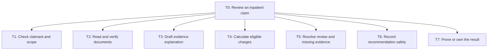
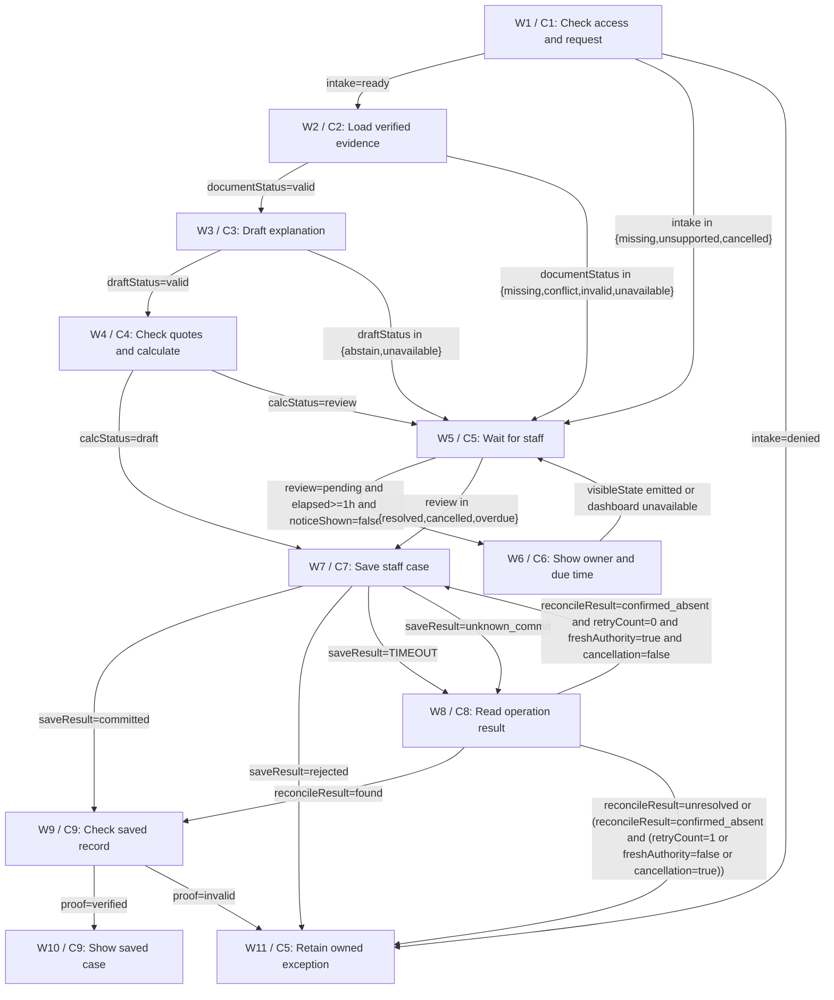

# Architecture

> NEEDS-WORK | DESIGN ONLY. independent-agent; round 1.

## Task tree



## Workflow



## Exact component and branch contracts

## components

### C1 · Authorize intake

Identity, command, correction links and permission are enforced before any medical read. Corrections require originalCaseId and expectedVersion; they open a linked draft only, never change settlement.

Reasoning: Bounded responsibility with an owned safe outcome.

Assumptions:

- H1

- H2

- H3

- H4

Data:

```json
{
  "group": "Code: validation",
  "taskIds": [
    "T1"
  ],
  "inputs": [
    "request: {tenant,member,claim,command: initial|cancel|correction,expectedVersion?,originalCaseId?}",
    "principal: authenticated identity"
  ],
  "outputs": [
    "intake: enum ready|missing|unsupported|denied|cancelled",
    "scope: trusted tenant/member/claim binding",
    "snapshot: versioned authoritative membership and case metadata"
  ],
  "whyCode": "Identity, command, correction links and permission are enforced before any medical read. Corrections require originalCaseId and expectedVersion; they open a linked draft only, never change settlement.",
  "approvalRule": "Draft publication only; no insurer adjudication or settlement authority. Fresh caller role required; staff event bound to exact snapshot where review is needed."
}
```


Sources:

- context / user-brief: Policies can change over time and bills may include room-rent limits.

- hypothesis / H1: First release publishes staff-facing recommendations only; all settlement, denial notices and appeals stay outside this assistant.

- hypothesis / H2: Insurer supplies signed, effective-dated policy rule packs, member linkage, authority and case APIs with version checks and operation readback.

- hypothesis / H3: Privacy owner selects deployment region, role access, lawful processing basis, document retention and model contract; proposed documents TTL 30 days, minimal audit 365 days, legal hold overrides deletion.

- hypothesis / H4: Claims team covers a 24-hour elapsed-time review deadline, four-hour acknowledgement and a one-hour visible waiting status.

### C2 · Verify source evidence

GET vault documents and rule registry by bound IDs, version and service dates, 10s timeout; one read retry then unavailable. Reject cross-subject records. Strip hidden text, scripts and invisible instructions; low OCR confidence or conflicting layers route to staff.

Reasoning: Bounded responsibility with an owned safe outcome.

Assumptions:

- H1

- H2

- H3

- H4

Data:

```json
{
  "group": "Code: tools",
  "taskIds": [
    "T2"
  ],
  "inputs": [
    "scope: authorized tenant/member/claim",
    "snapshot: membership and case version"
  ],
  "outputs": [
    "evidence: page-indexed admitted text with document hash, visible clause spans and OCR verification status",
    "documentStatus: enum valid|missing|conflict|invalid|unavailable"
  ],
  "whyCode": "GET vault documents and rule registry by bound IDs, version and service dates, 10s timeout; one read retry then unavailable. Reject cross-subject records. Strip hidden text, scripts and invisible instructions; low OCR confidence or conflicting layers route to staff.",
  "approvalRule": "Draft publication only; no insurer adjudication or settlement authority. Fresh caller role required; staff event bound to exact snapshot where review is needed."
}
```


Sources:

- context / user-brief: Policies can change over time and bills may include room-rent limits.

- hypothesis / H1: First release publishes staff-facing recommendations only; all settlement, denial notices and appeals stay outside this assistant.

- hypothesis / H2: Insurer supplies signed, effective-dated policy rule packs, member linkage, authority and case APIs with version checks and operation readback.

- hypothesis / H3: Privacy owner selects deployment region, role access, lawful processing basis, document retention and model contract; proposed documents TTL 30 days, minimal audit 365 days, legal hold overrides deletion.

- hypothesis / H4: Claims team covers a 24-hour elapsed-time review deadline, four-hour acknowledgement and a one-hour visible waiting status.

### C3 · Explain evidence

No authority. Context maximum 8000 tokens; longer files route to staff rather than silent truncation. Structured output validation and a single retry; 30s each; no tools or memory.

Reasoning: Bounded responsibility with an owned safe outcome.

Assumptions:

- H1

- H2

- H3

- H4

Data:

```json
{
  "group": "Agents (LLM)",
  "taskIds": [
    "T3"
  ],
  "inputs": [
    "evidence: authorized verified visible text only",
    "ruleSummary: trusted clause descriptions"
  ],
  "outputs": [
    "explanation: structured {claims:[{documentHash,page,clause,quote,interpretation}],disposition: supported|abstain}",
    "draftStatus: enum valid|abstain|unavailable"
  ],
  "whyCode": "",
  "approvalRule": "Draft publication only; no insurer adjudication or settlement authority. Fresh caller role required; staff event bound to exact snapshot where review is needed."
}
```


Sources:

- context / user-brief: Policies can change over time and bills may include room-rent limits.

- hypothesis / H1: First release publishes staff-facing recommendations only; all settlement, denial notices and appeals stay outside this assistant.

- hypothesis / H2: Insurer supplies signed, effective-dated policy rule packs, member linkage, authority and case APIs with version checks and operation readback.

- hypothesis / H3: Privacy owner selects deployment region, role access, lawful processing basis, document retention and model contract; proposed documents TTL 30 days, minimal audit 365 days, legal hold overrides deletion.

- hypothesis / H4: Claims team covers a 24-hour elapsed-time review deadline, four-hour acknowledgement and a one-hour visible waiting status.

### C4 · Validate policy and calculate

Match every quote byte-for-byte after fixed whitespace normalization to admitted document/page/clause; validate policy dates in code. Parse bill quantities into integer minor units via deterministic schema; ambiguous digit or currency needs staff. No model amount accepted. Proposed engine: rule pack explicitly sets admission/service-date applicability, room-day counting, rounding, room-only vs proportional-linked-charge reduction, exclusions, deductibles, copay order and remaining cover. Each must be certified H2. Synthetic rule RV1: 2 counted days, room cap 500000 minor/day; room charge 1200000 => eligible room 1000000. Other eligible charge 2000000 stays whole for room-only rule => 3000000 total. RV2 proportional rule applies 5/6 only to explicitly linked 1800000, unlinked 200000 => 1000000+1500000+200000=2700000. Round each affected line half-up to minor unit; duplicate lines flagged, not dropped silently. Unknown proration, date gaps, endorsements or accumulator freshness => review with no authoritative total. No deductible/copay assumed absent: explicit zero rules required. First release supports only explicit zero deductible and zero copay; nonzero values, mixed currency or service dates spanning rule periods route review. Apply min(calculated eligible, fresh remainingCoverMinor); remaining cover comes from an authoritative accumulator version, not document text. This recommendation reserves no benefits; fresh recheck by insurer is mandatory before settlement. Exclude clinical necessity, fraud and medically coded exclusion judgement from automated calculation; route these to staff. Monetary inputs must be nonnegative signed-64-bit integers in one trusted currency. Reject negative/overflow values. Day count must match certified admission/discharge convention; do not use a model date. Missing accumulator version or staleness => review.

Reasoning: Bounded responsibility with an owned safe outcome.

Assumptions:

- H1

- H2

- H3

- H4

Data:

```json
{
  "group": "Code: validation",
  "taskIds": [
    "T3",
    "T4"
  ],
  "inputs": [
    "snapshot: trusted case/service dates and current rule registry",
    "evidence: verified page and clause spans",
    "explanation: untrusted model explanation"
  ],
  "outputs": [
    "assessment: trusted {status: draft|review,eligibleMinor?,currency?,ruleVersion,lines,reasons,sourceRefs}",
    "calcStatus: enum draft|review"
  ],
  "whyCode": "Match every quote byte-for-byte after fixed whitespace normalization to admitted document/page/clause; validate policy dates in code. Parse bill quantities into integer minor units via deterministic schema; ambiguous digit or currency needs staff. No model amount accepted.",
  "approvalRule": "Draft publication only; no insurer adjudication or settlement authority. Fresh caller role required; staff event bound to exact snapshot where review is needed."
}
```


Sources:

- context / user-brief: Policies can change over time and bills may include room-rent limits.

- hypothesis / H1: First release publishes staff-facing recommendations only; all settlement, denial notices and appeals stay outside this assistant.

- hypothesis / H2: Insurer supplies signed, effective-dated policy rule packs, member linkage, authority and case APIs with version checks and operation readback.

- hypothesis / H3: Privacy owner selects deployment region, role access, lawful processing basis, document retention and model contract; proposed documents TTL 30 days, minimal audit 365 days, legal hold overrides deletion.

- hypothesis / H4: Claims team covers a 24-hour elapsed-time review deadline, four-hour acknowledgement and a one-hour visible waiting status.

### C5 · Own human review

Queue: claims-review; proposed lead H4, ack four elapsed hours, resolve 24 elapsed hours, escalate unacked at four to backup supervisor. Rejections/unknown rules never leave as automated final decisions. Resolution may record manual-review-required; adding rules requires separately certified new registry version. Own W11 unresolved operation tickets across caller expiry and denied security outcomes without revealing medical data. For signed resolution, authenticate examiner identity/role, exact case version and immutable review event before constructing review payload; reject changed snapshot, stale or unsigned events.

Reasoning: Bounded responsibility with an owned safe outcome.

Assumptions:

- H1

- H2

- H3

- H4

Data:

```json
{
  "group": "Code: human triggers",
  "taskIds": [
    "T5",
    "T7"
  ],
  "inputs": [
    "caseContext: bound metadata and optional withheld draft",
    "event: signed ack|resolve|cancel|overdue or server timer"
  ],
  "outputs": [
    "review: enum pending|resolved|cancelled|overdue",
    "reviewRecord: signed actor, snapshotVersion, disposition and rationale"
  ],
  "whyCode": "Queue: claims-review; proposed lead H4, ack four elapsed hours, resolve 24 elapsed hours, escalate unacked at four to backup supervisor. Rejections/unknown rules never leave as automated final decisions. Resolution may record manual-review-required; adding rules requires separately certified new registry version.",
  "approvalRule": "Draft publication only; no insurer adjudication or settlement authority. Fresh caller role required; staff event bound to exact snapshot where review is needed."
}
```


Sources:

- context / user-brief: Policies can change over time and bills may include room-rent limits.

- hypothesis / H1: First release publishes staff-facing recommendations only; all settlement, denial notices and appeals stay outside this assistant.

- hypothesis / H2: Insurer supplies signed, effective-dated policy rule packs, member linkage, authority and case APIs with version checks and operation readback.

- hypothesis / H3: Privacy owner selects deployment region, role access, lawful processing basis, document retention and model contract; proposed documents TTL 30 days, minimal audit 365 days, legal hold overrides deletion.

- hypothesis / H4: Claims team covers a 24-hour elapsed-time review deadline, four-hour acknowledgement and a one-hour visible waiting status.

### C6 · Show waiting status

Render read-only case status through authenticated dashboard pull; no email or external message. One-hour timer does not renew the 24h deadline. UI unavailable raises operations alert and keeps queue ownership.

Reasoning: Bounded responsibility with an owned safe outcome.

Assumptions:

- H1

- H2

- H3

- H4

Data:

```json
{
  "group": "Code: tools",
  "taskIds": [
    "T5"
  ],
  "inputs": [
    "queueState: trusted pending case and deadline"
  ],
  "outputs": [
    "visibleState: waiting; queue owner and next deadline"
  ],
  "whyCode": "Render read-only case status through authenticated dashboard pull; no email or external message. One-hour timer does not renew the 24h deadline. UI unavailable raises operations alert and keeps queue ownership.",
  "approvalRule": "Draft publication only; no insurer adjudication or settlement authority. Fresh caller role required; staff event bound to exact snapshot where review is needed."
}
```


Sources:

- context / user-brief: Policies can change over time and bills may include room-rent limits.

- hypothesis / H1: First release publishes staff-facing recommendations only; all settlement, denial notices and appeals stay outside this assistant.

- hypothesis / H2: Insurer supplies signed, effective-dated policy rule packs, member linkage, authority and case APIs with version checks and operation readback.

- hypothesis / H3: Privacy owner selects deployment region, role access, lawful processing basis, document retention and model contract; proposed documents TTL 30 days, minimal audit 365 days, legal hold overrides deletion.

- hypothesis / H4: Claims team covers a 24-hour elapsed-time review deadline, four-hour acknowledgement and a one-hour visible waiting status.

### C7 · Save staff-facing case

PUT /staff-cases/{claim}/operations/{operationId}; authority case.write only, no payment permission. Verify authenticated scope, fresh role, current claim and rule version, full immutable payload SHA256 from stored bytes, status enum and expectedVersion at API. Unique tenant/claim/submissionRevision prevents exact duplicates; semantic duplicate candidates require human linking, never auto-merge. CAS makes only one concurrent revision succeed. 10s timeout; no blind write retry. Narrative cannot change numeric fields. Internal serialization is UTF-8 JSON with sorted keys, compact separators and no nonfinite numbers; SHA256 stored bytes, not a reserialized model object. Store immutable bytes before authorizing the save. Any payload change requires new operation authorization. Ledger business identity is tenant/claim/submissionRevision. Nonmedical security telemetry remains separate from claim record writes.

Reasoning: Bounded responsibility with an owned safe outcome.

Assumptions:

- H1

- H2

- H3

- H4

Data:

```json
{
  "group": "Code: tools",
  "taskIds": [
    "T6"
  ],
  "inputs": [
    "payload: trusted immutable staff-case {tenant,member,claim,expectedVersion,operationId,status,assessment,review,createdAt}",
    "explanation: validated model narrative with source references or empty"
  ],
  "outputs": [
    "saveResult: enum committed|rejected|TIMEOUT|unknown_commit",
    "record: optional durable caseId,version,operationId",
    "verifiedRecordId:string! on a proven record outcome; explicit projection of existing case/posting record ID, absent on failed or uncertain outcomes"
  ],
  "whyCode": "PUT /staff-cases/{claim}/operations/{operationId}; authority case.write only, no payment permission. Verify authenticated scope, fresh role, current claim and rule version, full immutable payload SHA256 from stored bytes, status enum and expectedVersion at API. Unique tenant/claim/submissionRevision prevents exact duplicates; semantic duplicate candidates require human linking, never auto-merge. CAS makes only one concurrent revision succeed. 10s timeout; no blind write retry. Narrative cannot change numeric fields.",
  "approvalRule": "Draft publication only; no insurer adjudication or settlement authority. Fresh caller role required; staff event bound to exact snapshot where review is needed."
}
```


Sources:

- context / user-brief: Policies can change over time and bills may include room-rent limits.

- hypothesis / H1: First release publishes staff-facing recommendations only; all settlement, denial notices and appeals stay outside this assistant.

- hypothesis / H2: Insurer supplies signed, effective-dated policy rule packs, member linkage, authority and case APIs with version checks and operation readback.

- hypothesis / H3: Privacy owner selects deployment region, role access, lawful processing basis, document retention and model contract; proposed documents TTL 30 days, minimal audit 365 days, legal hold overrides deletion.

- hypothesis / H4: Claims team covers a 24-hour elapsed-time review deadline, four-hour acknowledgement and a one-hour visible waiting status.

### C8 · Reconcile save

GET operation record under service-owned read-only reconciliation scope, independent of expired caller session. Three reads at 10s with server backoff 5/20/60s; require payload bytes match and deduplicate callbacks by eventId. Retry once only after confirmed_absent plus fresh auth/CAS; otherwise owned unresolved. Cancellation during ambiguity freezes follow-up; finish readback, no compensation or new intent.

Reasoning: Bounded responsibility with an owned safe outcome.

Assumptions:

- H1

- H2

- H3

- H4

Data:

```json
{
  "group": "Code: tools",
  "taskIds": [
    "T6",
    "T7"
  ],
  "inputs": [
    "operation: trusted tenant/claim/operationId and stored immutable payload",
    "saveResult: TIMEOUT|unknown_commit"
  ],
  "outputs": [
    "reconcileResult: enum found|confirmed_absent|unresolved",
    "record: optional verified durable caseId/version/operationId",
    "verifiedRecordId:string! on a proven record outcome; explicit projection of existing case/posting record ID, absent on failed or uncertain outcomes"
  ],
  "whyCode": "GET operation record under service-owned read-only reconciliation scope, independent of expired caller session. Three reads at 10s with server backoff 5/20/60s; require payload bytes match and deduplicate callbacks by eventId. Retry once only after confirmed_absent plus fresh auth/CAS; otherwise owned unresolved. Cancellation during ambiguity freezes follow-up; finish readback, no compensation or new intent.",
  "approvalRule": "Draft publication only; no insurer adjudication or settlement authority. Fresh caller role required; staff event bound to exact snapshot where review is needed."
}
```


Sources:

- context / user-brief: Policies can change over time and bills may include room-rent limits.

- hypothesis / H1: First release publishes staff-facing recommendations only; all settlement, denial notices and appeals stay outside this assistant.

- hypothesis / H2: Insurer supplies signed, effective-dated policy rule packs, member linkage, authority and case APIs with version checks and operation readback.

- hypothesis / H3: Privacy owner selects deployment region, role access, lawful processing basis, document retention and model contract; proposed documents TTL 30 days, minimal audit 365 days, legal hold overrides deletion.

- hypothesis / H4: Claims team covers a 24-hour elapsed-time review deadline, four-hour acknowledgement and a one-hour visible waiting status.

### C9 · Guard record proof

Validate record IDs, subject, operation, full stored bytes and version through readback before user sees saved. Invalid/missing proof retains owner and unresolved status. Explicit proof projection: Only a committed writer or matching authoritative readback supplies the saved caseId. Guard compares full stored body, tenant/member/claim, operation and version. Absent/empty/wrong record rejects saved status.

Reasoning: Bounded responsibility with an owned safe outcome.

Assumptions:

- H1

- H2

- H3

- H4

Data:

```json
{
  "group": "Code: validation",
  "taskIds": [
    "T7"
  ],
  "inputs": [
    "record: saved or readback caseId/version/operationId",
    "operation: expected tenant/claim/operationId and payload bytes",
    "verifiedRecordId:string! on a proven outcome; required nonempty trusted record projection, otherwise reject proof"
  ],
  "outputs": [
    "proof: enum verified|invalid"
  ],
  "whyCode": "Validate record IDs, subject, operation, full stored bytes and version through readback before user sees saved. Invalid/missing proof retains owner and unresolved status.",
  "approvalRule": "Draft publication only; no insurer adjudication or settlement authority. Fresh caller role required; staff event bound to exact snapshot where review is needed."
}
```


Sources:

- context / user-brief: Policies can change over time and bills may include room-rent limits.

- hypothesis / H1: First release publishes staff-facing recommendations only; all settlement, denial notices and appeals stay outside this assistant.

- hypothesis / H2: Insurer supplies signed, effective-dated policy rule packs, member linkage, authority and case APIs with version checks and operation readback.

- hypothesis / H3: Privacy owner selects deployment region, role access, lawful processing basis, document retention and model contract; proposed documents TTL 30 days, minimal audit 365 days, legal hold overrides deletion.

- hypothesis / H4: Claims team covers a 24-hour elapsed-time review deadline, four-hour acknowledgement and a one-hour visible waiting status.


## workflow

### W1 · Check access and request

{"state": "Check access and request", "transitions": [{"to": "W2", "when": "intake=ready", "mode": "exclusive"}, {"to": "W5", "when": "intake in {missing,unsupported,cancelled}", "mode": "exclusive"}, {"to": "W11", "when": "intake=denied", "mode": "exclusive"}], "failureDisposition": "Preserve metadata and owned manual-review state; no claim payment or final denial.", "timeout": "10 seconds", "retryPolicy": "No automatic retry", "terminalDisposition": "", "guardBindings": "intake:C1.intake; scope:C1.scope; snapshot:C1.snapshot. Denied terminal logs only nonmedical security telemetry; no case publication."}

Reasoning: Bounded responsibility with an owned safe outcome.

Assumptions:

- H1

- H2

- H4

Data:

```json
{
  "componentId": "C1",
  "taskIds": [
    "T1"
  ],
  "next": [
    "W2",
    "W5",
    "W11"
  ],
  "decision": true,
  "example": "HC-1 follows only the matching output enum."
}
```


Sources:

- context / user-brief: Policies can change over time and bills may include room-rent limits.

- hypothesis / H1: First release publishes staff-facing recommendations only; all settlement, denial notices and appeals stay outside this assistant.

- hypothesis / H2: Insurer supplies signed, effective-dated policy rule packs, member linkage, authority and case APIs with version checks and operation readback.

- hypothesis / H4: Claims team covers a 24-hour elapsed-time review deadline, four-hour acknowledgement and a one-hour visible waiting status.

### W2 · Load verified evidence

{"state": "Load verified evidence", "transitions": [{"to": "W3", "when": "documentStatus=valid", "mode": "exclusive"}, {"to": "W5", "when": "documentStatus in {missing,conflict,invalid,unavailable}", "mode": "exclusive"}], "failureDisposition": "Preserve metadata and owned manual-review state; no claim payment or final denial.", "timeout": "10 seconds", "retryPolicy": "No automatic retry", "terminalDisposition": "", "guardBindings": "Predicates use the named component output enum, updated once on response; precedence follows listed enum cases. No LLM-generated guard is authoritative."}

Reasoning: Bounded responsibility with an owned safe outcome.

Assumptions:

- H1

- H2

- H4

Data:

```json
{
  "componentId": "C2",
  "taskIds": [
    "T2"
  ],
  "next": [
    "W3",
    "W5"
  ],
  "decision": true,
  "example": "HC-1 follows only the matching output enum."
}
```


Sources:

- context / user-brief: Policies can change over time and bills may include room-rent limits.

- hypothesis / H1: First release publishes staff-facing recommendations only; all settlement, denial notices and appeals stay outside this assistant.

- hypothesis / H2: Insurer supplies signed, effective-dated policy rule packs, member linkage, authority and case APIs with version checks and operation readback.

- hypothesis / H4: Claims team covers a 24-hour elapsed-time review deadline, four-hour acknowledgement and a one-hour visible waiting status.

### W3 · Draft explanation

{"state": "Draft explanation", "transitions": [{"to": "W4", "when": "draftStatus=valid", "mode": "exclusive"}, {"to": "W5", "when": "draftStatus in {abstain,unavailable}", "mode": "exclusive"}], "failureDisposition": "Preserve metadata and owned manual-review state; no claim payment or final denial.", "timeout": "30 seconds per call", "retryPolicy": "At most one output/schema retry, total two calls", "terminalDisposition": "", "guardBindings": "Predicates use the named component output enum, updated once on response; precedence follows listed enum cases. No LLM-generated guard is authoritative."}

Reasoning: Bounded responsibility with an owned safe outcome.

Assumptions:

- H1

- H2

- H4

Data:

```json
{
  "componentId": "C3",
  "taskIds": [
    "T3"
  ],
  "next": [
    "W4",
    "W5"
  ],
  "decision": true,
  "example": "HC-1 follows only the matching output enum."
}
```


Sources:

- context / user-brief: Policies can change over time and bills may include room-rent limits.

- hypothesis / H1: First release publishes staff-facing recommendations only; all settlement, denial notices and appeals stay outside this assistant.

- hypothesis / H2: Insurer supplies signed, effective-dated policy rule packs, member linkage, authority and case APIs with version checks and operation readback.

- hypothesis / H4: Claims team covers a 24-hour elapsed-time review deadline, four-hour acknowledgement and a one-hour visible waiting status.

### W4 · Check quotes and calculate

{"state": "Check quotes and calculate", "transitions": [{"to": "W7", "when": "calcStatus=draft", "mode": "exclusive"}, {"to": "W5", "when": "calcStatus=review", "mode": "exclusive"}], "failureDisposition": "Preserve metadata and owned manual-review state; no claim payment or final denial.", "timeout": "10 seconds", "retryPolicy": "No automatic retry", "terminalDisposition": "", "guardBindings": "Predicates use the named component output enum, updated once on response; precedence follows listed enum cases. No LLM-generated guard is authoritative."}

Reasoning: Bounded responsibility with an owned safe outcome.

Assumptions:

- H1

- H2

- H4

Data:

```json
{
  "componentId": "C4",
  "taskIds": [
    "T3",
    "T4"
  ],
  "next": [
    "W7",
    "W5"
  ],
  "decision": true,
  "example": "HC-1 follows only the matching output enum."
}
```


Sources:

- context / user-brief: Policies can change over time and bills may include room-rent limits.

- hypothesis / H1: First release publishes staff-facing recommendations only; all settlement, denial notices and appeals stay outside this assistant.

- hypothesis / H2: Insurer supplies signed, effective-dated policy rule packs, member linkage, authority and case APIs with version checks and operation readback.

- hypothesis / H4: Claims team covers a 24-hour elapsed-time review deadline, four-hour acknowledgement and a one-hour visible waiting status.

### W5 · Wait for staff

{"state": "Wait for staff", "transitions": [{"to": "W6", "when": "review=pending and elapsed>=1h and noticeShown=false", "mode": "exclusive"}, {"to": "W7", "when": "review in {resolved,cancelled,overdue}", "mode": "exclusive"}], "failureDisposition": "Preserve metadata and owned manual-review state; no claim payment or final denial.", "timeout": "24 elapsed hours from initial queue entry, never extended by notice", "retryPolicy": "No automatic retry", "terminalDisposition": "", "guardBindings": "review:C5.review from signed staff event or trusted server clock; elapsed:server clock minus queue enteredAt; noticeShown:C6 visible-state event. Pending without due notice remains durable wait. At 4h unacked escalation stays same queue; at 24h overdue creates manual-review-required payload, no adjudication. Cancellation on pre-save stops computation and records cancelled; cancellation on unknown save is reconciled first."}

Reasoning: Bounded responsibility with an owned safe outcome.

Assumptions:

- H1

- H2

- H4

Data:

```json
{
  "componentId": "C5",
  "taskIds": [
    "T5"
  ],
  "next": [
    "W6",
    "W7"
  ],
  "decision": true,
  "example": "HC-1 follows only the matching output enum."
}
```


Sources:

- context / user-brief: Policies can change over time and bills may include room-rent limits.

- hypothesis / H1: First release publishes staff-facing recommendations only; all settlement, denial notices and appeals stay outside this assistant.

- hypothesis / H2: Insurer supplies signed, effective-dated policy rule packs, member linkage, authority and case APIs with version checks and operation readback.

- hypothesis / H4: Claims team covers a 24-hour elapsed-time review deadline, four-hour acknowledgement and a one-hour visible waiting status.

### W6 · Show owner and due time

{"state": "Show owner and due time", "transitions": [{"to": "W5", "when": "visibleState emitted or dashboard unavailable", "mode": "exclusive"}], "failureDisposition": "Preserve metadata and owned manual-review state; no claim payment or final denial.", "timeout": "10 seconds", "retryPolicy": "One notice projection per queue entry; failure alerts owner, no timer reset", "terminalDisposition": "", "guardBindings": "Predicates use the named component output enum, updated once on response; precedence follows listed enum cases. No LLM-generated guard is authoritative."}

Reasoning: Bounded responsibility with an owned safe outcome.

Assumptions:

- H1

- H2

- H4

Data:

```json
{
  "componentId": "C6",
  "taskIds": [
    "T5"
  ],
  "next": [
    "W5"
  ],
  "decision": false,
  "example": "HC-1 follows only the matching output enum."
}
```


Sources:

- context / user-brief: Policies can change over time and bills may include room-rent limits.

- hypothesis / H1: First release publishes staff-facing recommendations only; all settlement, denial notices and appeals stay outside this assistant.

- hypothesis / H2: Insurer supplies signed, effective-dated policy rule packs, member linkage, authority and case APIs with version checks and operation readback.

- hypothesis / H4: Claims team covers a 24-hour elapsed-time review deadline, four-hour acknowledgement and a one-hour visible waiting status.

### W7 · Save staff case

{"state": "Save staff case", "transitions": [{"to": "W9", "when": "saveResult=committed", "mode": "exclusive"}, {"to": "W11", "when": "saveResult=rejected", "mode": "exclusive"}, {"to": "W8", "when": "saveResult=TIMEOUT", "mode": "exclusive"}, {"to": "W8", "when": "saveResult=unknown_commit", "mode": "exclusive"}], "failureDisposition": "Preserve metadata and owned manual-review state; no claim payment or final denial.", "timeout": "10 seconds", "retryPolicy": "No retry before W8; at most one resubmission after confirmed absence", "terminalDisposition": "", "guardBindings": "Predicates use the named component output enum, updated once on response; precedence follows listed enum cases. No LLM-generated guard is authoritative."}

Reasoning: Bounded responsibility with an owned safe outcome.

Assumptions:

- H1

- H2

- H4

Data:

```json
{
  "componentId": "C7",
  "taskIds": [
    "T6"
  ],
  "next": [
    "W9",
    "W11",
    "W8"
  ],
  "decision": true,
  "example": "HC-1 follows only the matching output enum."
}
```


Sources:

- context / user-brief: Policies can change over time and bills may include room-rent limits.

- hypothesis / H1: First release publishes staff-facing recommendations only; all settlement, denial notices and appeals stay outside this assistant.

- hypothesis / H2: Insurer supplies signed, effective-dated policy rule packs, member linkage, authority and case APIs with version checks and operation readback.

- hypothesis / H4: Claims team covers a 24-hour elapsed-time review deadline, four-hour acknowledgement and a one-hour visible waiting status.

### W8 · Read operation result

{"state": "Read operation result", "transitions": [{"to": "W9", "when": "reconcileResult=found", "mode": "exclusive"}, {"to": "W7", "when": "reconcileResult=confirmed_absent and retryCount=0 and freshAuthority=true and cancellation=false", "mode": "exclusive"}, {"to": "W11", "when": "reconcileResult=unresolved or (reconcileResult=confirmed_absent and (retryCount=1 or freshAuthority=false or cancellation=true))", "mode": "exclusive"}], "failureDisposition": "Preserve metadata and owned manual-review state; no claim payment or final denial.", "timeout": "Three bounded reads within 120 seconds; then durable owner", "retryPolicy": "No automatic retry", "terminalDisposition": "", "guardBindings": "reconcileResult:C8.reconcileResult; retryCount:durable server operation counter incremented atomically; freshAuthority:C1 fresh recheck via writer; cancellation:signed case event. On found, proof proceeds even if session expired; display requires reauthentication."}

Reasoning: Bounded responsibility with an owned safe outcome.

Assumptions:

- H1

- H2

- H4

Data:

```json
{
  "componentId": "C8",
  "taskIds": [
    "T6",
    "T7"
  ],
  "next": [
    "W9",
    "W7",
    "W11"
  ],
  "decision": true,
  "example": "HC-1 follows only the matching output enum."
}
```


Sources:

- context / user-brief: Policies can change over time and bills may include room-rent limits.

- hypothesis / H1: First release publishes staff-facing recommendations only; all settlement, denial notices and appeals stay outside this assistant.

- hypothesis / H2: Insurer supplies signed, effective-dated policy rule packs, member linkage, authority and case APIs with version checks and operation readback.

- hypothesis / H4: Claims team covers a 24-hour elapsed-time review deadline, four-hour acknowledgement and a one-hour visible waiting status.

### W9 · Check saved record

{"state": "Check saved record", "transitions": [{"to": "W10", "when": "proof=verified", "mode": "exclusive"}, {"to": "W11", "when": "proof=invalid", "mode": "exclusive"}], "failureDisposition": "Preserve metadata and owned manual-review state; no claim payment or final denial.", "timeout": "10 seconds", "retryPolicy": "No automatic retry", "terminalDisposition": "", "guardBindings": "Predicates use the named component output enum, updated once on response; precedence follows listed enum cases. No LLM-generated guard is authoritative.", "bindings": {"verifiedRecordId": [{"sourceComponentId": "C7", "sourceField": "verifiedRecordId"}, {"sourceComponentId": "C8", "sourceField": "verifiedRecordId"}]}, "recordProofPolicy": "Only a committed writer or matching authoritative readback supplies the saved caseId. Guard compares full stored body, tenant/member/claim, operation and version. Absent/empty/wrong record rejects saved status."}

Reasoning: Bounded responsibility with an owned safe outcome.

Assumptions:

- H1

- H2

- H4

Data:

```json
{
  "componentId": "C9",
  "taskIds": [
    "T7"
  ],
  "next": [
    "W10",
    "W11"
  ],
  "decision": true,
  "example": "HC-1 follows only the matching output enum."
}
```


Sources:

- context / user-brief: Policies can change over time and bills may include room-rent limits.

- hypothesis / H1: First release publishes staff-facing recommendations only; all settlement, denial notices and appeals stay outside this assistant.

- hypothesis / H2: Insurer supplies signed, effective-dated policy rule packs, member linkage, authority and case APIs with version checks and operation readback.

- hypothesis / H4: Claims team covers a 24-hour elapsed-time review deadline, four-hour acknowledgement and a one-hour visible waiting status.

### W10 · Show saved case

{"state": "Show saved case", "transitions": [], "failureDisposition": "Preserve metadata and owned manual-review state; no claim payment or final denial.", "timeout": "10 seconds", "retryPolicy": "No automatic retry", "terminalDisposition": "SAVED_DRAFT|SAVED_REVIEW_REQUIRED|SAVED_CANCELLED with verified caseId and operationId; never PAID or DENIED", "guardBindings": "Predicates use the named component output enum, updated once on response; precedence follows listed enum cases. No LLM-generated guard is authoritative."}

Reasoning: Bounded responsibility with an owned safe outcome.

Assumptions:

- H1

- H2

- H4

Data:

```json
{
  "componentId": "C9",
  "taskIds": [
    "T7"
  ],
  "next": [],
  "decision": false,
  "example": "HC-1 follows only the matching output enum."
}
```


Sources:

- context / user-brief: Policies can change over time and bills may include room-rent limits.

- hypothesis / H1: First release publishes staff-facing recommendations only; all settlement, denial notices and appeals stay outside this assistant.

- hypothesis / H2: Insurer supplies signed, effective-dated policy rule packs, member linkage, authority and case APIs with version checks and operation readback.

- hypothesis / H4: Claims team covers a 24-hour elapsed-time review deadline, four-hour acknowledgement and a one-hour visible waiting status.

### W11 · Retain owned exception

{"state": "Retain owned exception", "transitions": [], "failureDisposition": "Preserve metadata and owned manual-review state; no claim payment or final denial.", "timeout": "10 seconds", "retryPolicy": "No automatic retry", "terminalDisposition": "ACCESS_DENIED without medical details; or SAVE_REJECTED/UNRESOLVED_OPERATION owned by claims operations, readback ticket and next check within 4h. Never claim saved or settled.", "guardBindings": "Predicates use the named component output enum, updated once on response; precedence follows listed enum cases. No LLM-generated guard is authoritative."}

Reasoning: Bounded responsibility with an owned safe outcome.

Assumptions:

- H1

- H2

- H4

Data:

```json
{
  "componentId": "C5",
  "taskIds": [
    "T7"
  ],
  "next": [],
  "decision": false,
  "example": "HC-1 follows only the matching output enum."
}
```


Sources:

- context / user-brief: Policies can change over time and bills may include room-rent limits.

- hypothesis / H1: First release publishes staff-facing recommendations only; all settlement, denial notices and appeals stay outside this assistant.

- hypothesis / H2: Insurer supplies signed, effective-dated policy rule packs, member linkage, authority and case APIs with version checks and operation readback.

- hypothesis / H4: Claims team covers a 24-hour elapsed-time review deadline, four-hour acknowledgement and a one-hour visible waiting status.


## framework

### F1 · Durable code state machine

Select on durable waits, audit, replay and retry control. Database workflow is enough for eleven nodes; a workflow engine is an unverified candidate if timer/replay load grows.

Reasoning: Bounded responsibility with an owned safe outcome.

Assumptions:

- H1

- H2

- H3

Data:

```json
{
  "category": "orchestration",
  "taskIds": [
    "T0"
  ],
  "choice": "Database-backed durable workflow and one stateless explanation model",
  "alternatives": [
    "Unbounded autonomous adjudication agent; in-memory chat chain"
  ],
  "tradeoffs": "Select on durable waits, audit, replay and retry control. Database workflow is enough for eleven nodes; a workflow engine is an unverified candidate if timer/replay load grows.",
  "permission": "none",
  "blastRadius": "Single tenant/member/claim; release has no settlement access",
  "approvalRule": "H1-H4 verified by proposed owners before PHI pilot",
  "leastPrivilege": "Read scoped documents/rules; case.write only; independent operation.read; no payment/denial/send permission",
  "aws": "Unverified candidate: object vault, SQL ledger, managed workflow and keys; run same residency/deletion/timer tests",
  "gcp": "Unverified candidate: object vault, SQL ledger, managed workflow and keys; run same tests",
  "azure": "Unverified candidate: object vault, SQL ledger, managed workflow and keys; run same tests",
  "openSource": "Self-hosted object storage, PostgreSQL and durable worker; operator owns backup, keys, deletion and timer reliability"
}
```


Sources:

- context / user-brief: Policies can change over time and bills may include room-rent limits.

- hypothesis / H1: First release publishes staff-facing recommendations only; all settlement, denial notices and appeals stay outside this assistant.

- hypothesis / H2: Insurer supplies signed, effective-dated policy rule packs, member linkage, authority and case APIs with version checks and operation readback.

- hypothesis / H3: Privacy owner selects deployment region, role access, lawful processing basis, document retention and model contract; proposed documents TTL 30 days, minimal audit 365 days, legal hold overrides deletion.

### F2 · Separate records and retrieval

Documents establish evidence; insurer registry establishes policy. Tenant-keyed reads, row isolation, encryption, secrets vault, PHI-free telemetry; deletion/hold and region blocked on H3.

Reasoning: Bounded responsibility with an owned safe outcome.

Assumptions:

- H1

- H2

- H3

Data:

```json
{
  "category": "data",
  "taskIds": [
    "T1",
    "T2",
    "T3",
    "T4"
  ],
  "choice": "Encrypted document vault, authoritative rules registry, relational case/operation ledger; no persistent vector index in release one",
  "alternatives": [
    "One mixed model memory store"
  ],
  "tradeoffs": "Documents establish evidence; insurer registry establishes policy. Tenant-keyed reads, row isolation, encryption, secrets vault, PHI-free telemetry; deletion/hold and region blocked on H3.",
  "permission": "read",
  "blastRadius": "Single tenant/member/claim; release has no settlement access",
  "approvalRule": "H1-H4 verified by proposed owners before PHI pilot",
  "leastPrivilege": "Read scoped documents/rules; case.write only; independent operation.read; no payment/denial/send permission",
  "aws": "Unverified candidate: object vault, SQL ledger, managed workflow and keys; run same residency/deletion/timer tests",
  "gcp": "Unverified candidate: object vault, SQL ledger, managed workflow and keys; run same tests",
  "azure": "Unverified candidate: object vault, SQL ledger, managed workflow and keys; run same tests",
  "openSource": "Self-hosted object storage, PostgreSQL and durable worker; operator owns backup, keys, deletion and timer reliability"
}
```


Sources:

- context / user-brief: Policies can change over time and bills may include room-rent limits.

- hypothesis / H1: First release publishes staff-facing recommendations only; all settlement, denial notices and appeals stay outside this assistant.

- hypothesis / H2: Insurer supplies signed, effective-dated policy rule packs, member linkage, authority and case APIs with version checks and operation readback.

- hypothesis / H3: Privacy owner selects deployment region, role access, lawful processing basis, document retention and model contract; proposed documents TTL 30 days, minimal audit 365 days, legal hold overrides deletion.

### F3 · Narrow case writer

One case revision blast radius; fresh RBAC/CAS, full-payload binding, isolated reconciliation reader. Service owns unresolved operations after session expiry.

Reasoning: Bounded responsibility with an owned safe outcome.

Assumptions:

- H1

- H2

- H3

Data:

```json
{
  "category": "permission",
  "taskIds": [
    "T5",
    "T6",
    "T7"
  ],
  "choice": "Read medical sources for bound tenant/member; write only staff-case operation",
  "alternatives": [
    "Broad claims/payment API credential"
  ],
  "tradeoffs": "One case revision blast radius; fresh RBAC/CAS, full-payload binding, isolated reconciliation reader. Service owns unresolved operations after session expiry.",
  "permission": "write",
  "blastRadius": "Single tenant/member/claim; release has no settlement access",
  "approvalRule": "H1-H4 verified by proposed owners before PHI pilot",
  "leastPrivilege": "Read scoped documents/rules; case.write only; independent operation.read; no payment/denial/send permission",
  "aws": "Unverified candidate: object vault, SQL ledger, managed workflow and keys; run same residency/deletion/timer tests",
  "gcp": "Unverified candidate: object vault, SQL ledger, managed workflow and keys; run same tests",
  "azure": "Unverified candidate: object vault, SQL ledger, managed workflow and keys; run same tests",
  "openSource": "Self-hosted object storage, PostgreSQL and durable worker; operator owns backup, keys, deletion and timer reliability"
}
```


Sources:

- context / user-brief: Policies can change over time and bills may include room-rent limits.

- hypothesis / H1: First release publishes staff-facing recommendations only; all settlement, denial notices and appeals stay outside this assistant.

- hypothesis / H2: Insurer supplies signed, effective-dated policy rule packs, member linkage, authority and case APIs with version checks and operation readback.

- hypothesis / H3: Privacy owner selects deployment region, role access, lawful processing basis, document retention and model contract; proposed documents TTL 30 days, minimal audit 365 days, legal hold overrides deletion.

### F4 · Provider-neutral private deployment

Compare candidates on region, access boundaries, durable timers, deletion evidence and operating burden with identical tests; no current vendor claims.

Reasoning: Bounded responsibility with an owned safe outcome.

Assumptions:

- H1

- H2

- H3

Data:

```json
{
  "category": "architecture",
  "taskIds": [
    "T0"
  ],
  "choice": "Choose existing approved insurer platform after H3 verification spike",
  "alternatives": [
    "New multi-cloud deployment"
  ],
  "tradeoffs": "Compare candidates on region, access boundaries, durable timers, deletion evidence and operating burden with identical tests; no current vendor claims.",
  "permission": "none",
  "blastRadius": "Single tenant/member/claim; release has no settlement access",
  "approvalRule": "H1-H4 verified by proposed owners before PHI pilot",
  "leastPrivilege": "Read scoped documents/rules; case.write only; independent operation.read; no payment/denial/send permission",
  "aws": "Unverified candidate: object vault, SQL ledger, managed workflow and keys; run same residency/deletion/timer tests",
  "gcp": "Unverified candidate: object vault, SQL ledger, managed workflow and keys; run same tests",
  "azure": "Unverified candidate: object vault, SQL ledger, managed workflow and keys; run same tests",
  "openSource": "Self-hosted object storage, PostgreSQL and durable worker; operator owns backup, keys, deletion and timer reliability"
}
```


Sources:

- context / user-brief: Policies can change over time and bills may include room-rent limits.

- hypothesis / H1: First release publishes staff-facing recommendations only; all settlement, denial notices and appeals stay outside this assistant.

- hypothesis / H2: Insurer supplies signed, effective-dated policy rule packs, member linkage, authority and case APIs with version checks and operation readback.

- hypothesis / H3: Privacy owner selects deployment region, role access, lawful processing basis, document retention and model contract; proposed documents TTL 30 days, minimal audit 365 days, legal hold overrides deletion.


## models

### M1 · One bounded explanation call

W3 only: expected 0.8*(1+0.10)=0.88 calls/submission; worst 2. USD/call=(8000*2+1000*8)/1e6=0.024. Expected 0.02112/case, worst 0.048; 10000/month => USD211.20 model tokens. Excludes OCR, storage, human work, network, taxes and extra-large files, which route to staff. Standard tier chosen for mixed document reasoning; small tier requires equal evidence accuracy; reasoning tier only if held-out complex-clause gains justify latency. Two 30s calls maximum; unavailable -> staff.

Reasoning: Bounded responsibility with an owned safe outcome.

Assumptions:

- H5

Data:

```json
{
  "componentId": "C3",
  "tier": "standard",
  "rationale": "Evidence interpretation only; all numerical authority stays code. Prices and 80% completeness/10% retry are illustrative H5, not a provider quote.",
  "fineTuneWhen": "After labelled recurrent interpretation failures survive prompt/source fixes; require held-out citation, abstention, privacy and cost gains without safety regression.",
  "callsPerCase": 0.88,
  "inputTokens": 8000,
  "outputTokens": 1000,
  "inputPrice": 2,
  "outputPrice": 8
}
```


Sources:

- context / user-brief: Policies can change over time and bills may include room-rent limits.

- hypothesis / H5: Synthetic budget: one standard model call per supported complete claim, at most one retry; 10% retry, 80% complete inputs; 8000 input and 1000 output tokens, USD 2/8 per million, 10000 cases/month.


