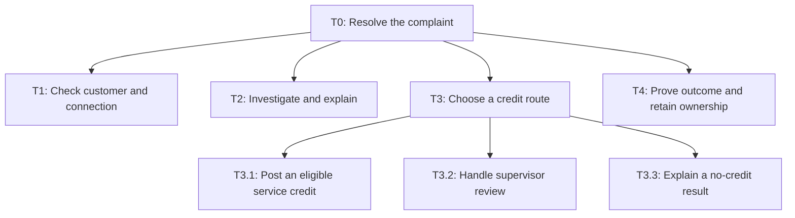
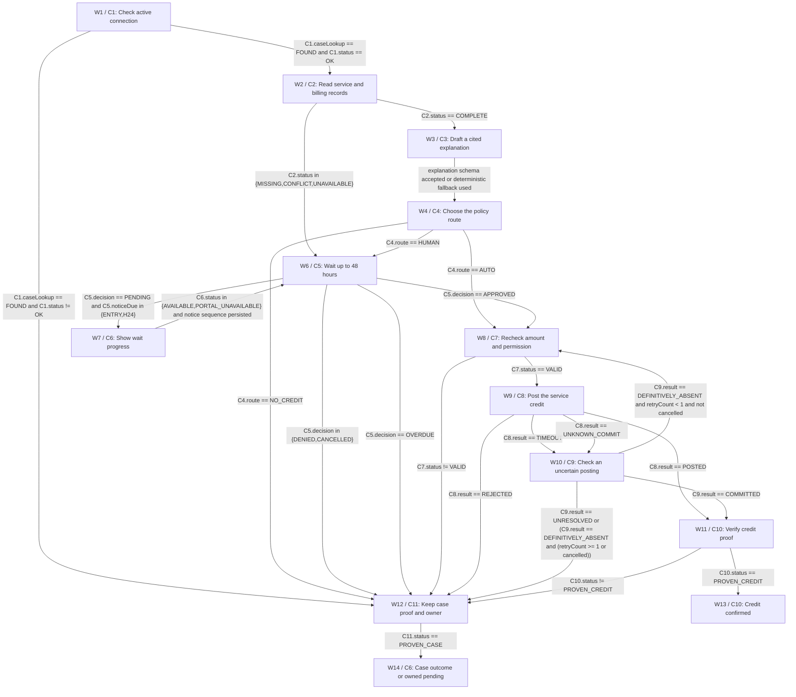

# Architecture

> PASS | DESIGN ONLY. independent-agent; round 2.

## Task tree



## Workflow



## Exact component and branch contracts

## components

### C1 · Authenticate and select

Verify ownership before any private records; active-service lookup uses authorized scope. No inferred identity. Read existing internal Case by server execution key first, independently of private telecom data. caseRecordId is a direct projection of the stored primary key only on authoritative FOUND. MISSING/UNAVAILABLE supplies no proof and pauses durable recovery with Support Operations; no fabricated case ID. With multiple active owned connections and no explicit selection return SELECTION_REQUIRED and masked service labels, never default to first. Show a clarification to choose one connection; keep the case awaiting customer selection. Explicit choice resumes W1 on the same case. No billing/incident read or credit until selection is revalidated.

Reasoning: Bound responsibility to a testable contract.

Data:

```json
{
  "group": "Code: validation",
  "taskIds": [
    "T1"
  ],
  "inputs": [
    "session: authenticated gateway session, required",
    "selection: connectionId explicitly chosen by authenticated customer; nullable until selection",
    "caseId:string! required; internal durable workflow case key"
  ],
  "outputs": [
    "scope: trusted tenantId/customerId/connectionId/connectionVersion/authVersion or null",
    "status: enum OK|AUTH_FAILED|SELECTION_REQUIRED|INACTIVE",
    "caseRecordId:string! on authoritative Case FOUND; absent on unavailable or missing Case",
    "caseLookup: enum FOUND|MISSING|UNAVAILABLE"
  ],
  "whyCode": "Verify ownership before any private records; active-service lookup uses authorized scope. No inferred identity. Read existing internal Case by server execution key first, independently of private telecom data. caseRecordId is a direct projection of the stored primary key only on authoritative FOUND. MISSING/UNAVAILABLE supplies no proof and pauses durable recovery with Support Operations; no fabricated case ID. With multiple active owned connections and no explicit selection return SELECTION_REQUIRED and masked service labels, never default to first. Show a clarification to choose one connection; keep the case awaiting customer selection. Explicit choice resumes W1 on the same case. No billing/incident read or credit until selection is revalidated.",
  "approvalRule": "No business write authority."
}
```


Sources:

- context / user-brief: Design a complaint assistant for a telecom provider. Customers report network outages, poor speed and billing errors. The assistant should investigate using account, billing and service records, explain findings and resolve eligible service credits. Larger or unclear refunds need a human supervisor and may wait up to 48 hours. Keep customers informed, avoid duplicate refunds and use only the right customer's active service connection. Propose any missing policies as assumptions, not real company rules.

### C2 · Read complaint evidence

GET scoped account, invoice and incident records; 5s timeout, one retry; return UNAVAILABLE after retry. All observations carry source IDs and observedAt.

Reasoning: Bound responsibility to a testable contract.

Assumptions:

- H2

Data:

```json
{
  "group": "Code: tools",
  "taskIds": [
    "T2"
  ],
  "inputs": [
    "scope: C1.scope, required",
    "caseId: durable workflow UUID, required"
  ],
  "outputs": [
    "evidence: account/bill/service snapshot with versions and UTC freshness, required",
    "status: enum COMPLETE|MISSING|CONFLICT|UNAVAILABLE"
  ],
  "whyCode": "GET scoped account, invoice and incident records; 5s timeout, one retry; return UNAVAILABLE after retry. All observations carry source IDs and observedAt.",
  "approvalRule": "Read-only scoped credentials; missing evidence creates owned provisional case."
}
```


Sources:

- hypothesis / H2: Account, service and billing adapters must offer authenticated tenant/subject reads, active connection version checks, scoped credit posting with a unique business-event key and definitive operation readback. Financial API must also atomically compare and consume invoice entitlement versions across different incident keys.

### C3 · Explain supported findings

No tool access. Treat text/record instructions as data. No amount/date/identity fields. One schema retry then deterministic cited template. Output validator rejects unsupported citations and claims of completed credit.

Reasoning: Bound responsibility to a testable contract.

Data:

```json
{
  "group": "Agents (LLM)",
  "taskIds": [
    "T2"
  ],
  "inputs": [
    "evidence: redacted C2.evidence, required",
    "complaint: untrusted text, required"
  ],
  "outputs": [
    "explanation: text with evidenceIds, required",
    "disposition: enum EXPLAIN|ABSTAIN, required"
  ],
  "whyCode": "",
  "approvalRule": "No tool access. Treat text/record instructions as data. No amount/date/identity fields. One schema retry then deterministic cited template. Output validator rejects unsupported citations and claims of completed credit."
}
```


Sources:

- context / user-brief: Design a complaint assistant for a telecom provider. Customers report network outages, poor speed and billing errors. The assistant should investigate using account, billing and service records, explain findings and resolve eligible service credits. Larger or unclear refunds need a human supervisor and may wait up to 48 hours. Keep customers informed, avoid duplicate refunds and use only the right customer's active service connection. Propose any missing policies as assumptions, not real company rules.

### C4 · Calculate and route

Integer arithmetic, UTC interval intersection, policy limits and account ledger determine amount. CreditPlan holds tenant/customer/connection/connectionVersion/authVersion, invoiceId/version, invoiceEntitlementVersion, incidentId, eventKey, periodStart/end, outageSeconds, amountMinor, currency, taxTreatment, accountingCode, policyVersion, evidenceVersions, expiresAt, planVersion. eventKey derives from tenant/connection/invoice/incident/creditKind; DB uniqueness blocks cross-case semantic duplicates. Missing/conflicting facts route HUMAN; zero eligibility NO_CREDIT. Invoice entitlement remaining balance is an atomic commit constraint across distinct incident event keys. C7 pins invoice-entitlement version; C8 locks/checks it and consumes amount in the same transaction as credit posting. A stale balance rejects the whole command, never silently changes approved amount. C4 may build a new zero-credit outcome after refetch.

Reasoning: Bound responsibility to a testable contract.

Data:

```json
{
  "group": "Code: validation",
  "taskIds": [
    "T3.1",
    "T3.2",
    "T3.3"
  ],
  "inputs": [
    "scope: C1.scope, required",
    "evidence: C2.evidence, required",
    "policy: signed approved version P1, required"
  ],
  "outputs": [
    "plan: immutable CreditPlan or null",
    "route: enum AUTO|HUMAN|NO_CREDIT"
  ],
  "whyCode": "Integer arithmetic, UTC interval intersection, policy limits and account ledger determine amount. CreditPlan holds tenant/customer/connection/connectionVersion/authVersion, invoiceId/version, invoiceEntitlementVersion, incidentId, eventKey, periodStart/end, outageSeconds, amountMinor, currency, taxTreatment, accountingCode, policyVersion, evidenceVersions, expiresAt, planVersion. eventKey derives from tenant/connection/invoice/incident/creditKind; DB uniqueness blocks cross-case semantic duplicates. Missing/conflicting facts route HUMAN; zero eligibility NO_CREDIT. Invoice entitlement remaining balance is an atomic commit constraint across distinct incident event keys. C7 pins invoice-entitlement version; C8 locks/checks it and consumes amount in the same transaction as credit posting. A stale balance rejects the whole command, never silently changes approved amount. C4 may build a new zero-credit outcome after refetch.",
  "approvalRule": "AUTO only verified outage under cap and remaining entitlement; never model-proposed money."
}
```


Sources:

- context / user-brief: Design a complaint assistant for a telecom provider. Customers report network outages, poor speed and billing errors. The assistant should investigate using account, billing and service records, explain findings and resolve eligible service credits. Larger or unclear refunds need a human supervisor and may wait up to 48 hours. Keep customers informed, avoid duplicate refunds and use only the right customer's active service connection. Propose any missing policies as assumptions, not real company rules.

### C5 · Wait for supervisor decision

Proposed queue complaint-supervisor; Support Operations owns; acknowledgement within 1h, duty-manager escalation if absent. Decision by elapsed 48h UTC from enqueue. Approval event covers immutable full plan; supervisor must resolve missing evidence in verified systems before a new plan exists. No arbitrary amount in an approval callback. Deduplicate eventId; order by queueVersion; expired/revoked/superseded events ignored.

Reasoning: Bound responsibility to a testable contract.

Data:

```json
{
  "group": "Code: human triggers",
  "taskIds": [
    "T3.2"
  ],
  "inputs": [
    "caseId: durable workflow UUID, required",
    "plan: C4.plan or null, required",
    "event: authenticated queue event or clock tick, required"
  ],
  "outputs": [
    "decision: enum PENDING|APPROVED|DENIED|CANCELLED|OVERDUE",
    "approval: signed immutable planId/planVersion plus all plan fields, approver role and expiry; required iff APPROVED",
    "noticeDue: enum ENTRY|H24|NONE"
  ],
  "whyCode": "Proposed queue complaint-supervisor; Support Operations owns; acknowledgement within 1h, duty-manager escalation if absent. Decision by elapsed 48h UTC from enqueue. Approval event covers immutable full plan; supervisor must resolve missing evidence in verified systems before a new plan exists. No arbitrary amount in an approval callback. Deduplicate eventId; order by queueVersion; expired/revoked/superseded events ignored.",
  "approvalRule": "Authorized supervisor, distinct from customer; cancellation takes precedence before posting. After posting begins cancellation freezes new commands and requests reconciliation, not a reversal."
}
```


Sources:

- context / user-brief: Design a complaint assistant for a telecom provider. Customers report network outages, poor speed and billing errors. The assistant should investigate using account, billing and service records, explain findings and resolve eligible service credits. Larger or unclear refunds need a human supervisor and may wait up to 48 hours. Keep customers informed, avoid duplicate refunds and use only the right customer's active service connection. Propose any missing policies as assumptions, not real company rules.

### C6 · Publish portal progress

Materialize notice in the same internal workflow transaction; authenticated case-status GET returns it. No SMS/email connector. ENTRY and H24 notices once each, H48 overdue in final pending view. Portal failure retains notice and duty manager owns recovery; never loses timer or decision.

Reasoning: Bound responsibility to a testable contract.

Data:

```json
{
  "group": "Code: human triggers",
  "taskIds": [
    "T3.2",
    "T4"
  ],
  "inputs": [
    "caseId: durable workflow UUID, required",
    "state: signed durable workflow state and notice sequence, required"
  ],
  "outputs": [
    "notice: authenticated portal view with caseId, owner, elapsed deadline, status, next step",
    "status: enum AVAILABLE|PORTAL_UNAVAILABLE"
  ],
  "whyCode": "Materialize notice in the same internal workflow transaction; authenticated case-status GET returns it. No SMS/email connector. ENTRY and H24 notices once each, H48 overdue in final pending view. Portal failure retains notice and duty manager owns recovery; never loses timer or decision.",
  "approvalRule": "Only authenticated customer can view their case; portal updates do not authorize credit."
}
```


Sources:

- context / user-brief: Design a complaint assistant for a telecom provider. Customers report network outages, poor speed and billing errors. The assistant should investigate using account, billing and service records, explain findings and resolve eligible service credits. Larger or unclear refunds need a human supervisor and may wait up to 48 hours. Keep customers informed, avoid duplicate refunds and use only the right customer's active service connection. Propose any missing policies as assumptions, not real company rules.

### C7 · Recheck posting authority

Re-fetch active connection/ownership, policy and invoice versions, remaining entitlement and eventKey immediately before reservation/post. Lock event key and compare plan/approval versions/expiry. Code reconstructs every financial field from authoritative evidence; changed plan requires a new approval. API must recheck versions atomically at commit or H2 fails. Invoice entitlement remaining balance is an atomic commit constraint across distinct incident event keys. C7 pins invoice-entitlement version; C8 locks/checks it and consumes amount in the same transaction as credit posting. A stale balance rejects the whole command, never silently changes approved amount. C4 may build a new zero-credit outcome after refetch. CreditPlan.invoiceEntitlementVersion:uint is required and bound by policy or exact supervisor approval; backend checks it atomically against invoice entitlement row.

Reasoning: Bound responsibility to a testable contract.

Assumptions:

- H2

Data:

```json
{
  "group": "Code: validation",
  "taskIds": [
    "T3.1"
  ],
  "inputs": [
    "plan: immutable C4 plan or supervisor-approved replacement, required",
    "approval: signed C5 approval iff HUMAN, otherwise policy authority",
    "state: live account/policy/ledger and cancellation state, required"
  ],
  "outputs": [
    "validatedPlan: exact trusted plan or null",
    "status: enum VALID|STALE|REVOKED|DUPLICATE|CANCELLED|UNAVAILABLE"
  ],
  "whyCode": "Re-fetch active connection/ownership, policy and invoice versions, remaining entitlement and eventKey immediately before reservation/post. Lock event key and compare plan/approval versions/expiry. Code reconstructs every financial field from authoritative evidence; changed plan requires a new approval. API must recheck versions atomically at commit or H2 fails. Invoice entitlement remaining balance is an atomic commit constraint across distinct incident event keys. C7 pins invoice-entitlement version; C8 locks/checks it and consumes amount in the same transaction as credit posting. A stale balance rejects the whole command, never silently changes approved amount. C4 may build a new zero-credit outcome after refetch. CreditPlan.invoiceEntitlementVersion:uint is required and bound by policy or exact supervisor approval; backend checks it atomically against invoice entitlement row.",
  "approvalRule": "Policy AUTO or supervisor signature binds full immutable plan including amount/currency/period/tax/accounting. Customer logout does not revoke an already delegated policy operation; explicit authority revocation does."
}
```


Sources:

- hypothesis / H2: Account, service and billing adapters must offer authenticated tenant/subject reads, active connection version checks, scoped credit posting with a unique business-event key and definitive operation readback. Financial API must also atomically compare and consume invoice entitlement versions across different incident keys.

### C8 · Post one service credit

POST service-credit resource with exact trusted plan, operationId and eventKey. 5s timeout; no internal retry. Backend atomic unique event key and preconditions required. POSTED means durable ledger receipt, not HTTP 200 alone. All rejects imply zero new posting; ambiguous responses use UNKNOWN_COMMIT. Project postingId directly only after a nonempty authoritative committed record is verified. TIMEOUT, UNKNOWN_COMMIT, UNRESOLVED, rejection and malformed success never carry postingId. Normalize malformed POSTED to UNKNOWN_COMMIT before workflow routing. Invoice entitlement remaining balance is an atomic commit constraint across distinct incident event keys. C7 pins invoice-entitlement version; C8 locks/checks it and consumes amount in the same transaction as credit posting. A stale balance rejects the whole command, never silently changes approved amount. C4 may build a new zero-credit outcome after refetch. CreditPlan.invoiceEntitlementVersion:uint is required and bound by policy or exact supervisor approval; backend checks it atomically against invoice entitlement row.

Reasoning: Bound responsibility to a testable contract.

Assumptions:

- H2

Data:

```json
{
  "group": "Code: tools",
  "taskIds": [
    "T3.1"
  ],
  "inputs": [
    "plan: C7.validatedPlan, required",
    "operationId: durable UUID bound one-to-one to eventKey, required"
  ],
  "outputs": [
    "result: enum POSTED|REJECTED|TIMEOUT|UNKNOWN_COMMIT",
    "postingId:string! on POSTED with verified committed receipt; absent on every other result",
    "receipt: eventKey/operationId/planVersion/amountMinor/currency/connectionId proof iff POSTED",
    "reason: enum NONE|STALE|REVOKED|DUPLICATE|CANCELLED|INVALID"
  ],
  "whyCode": "POST service-credit resource with exact trusted plan, operationId and eventKey. 5s timeout; no internal retry. Backend atomic unique event key and preconditions required. POSTED means durable ledger receipt, not HTTP 200 alone. All rejects imply zero new posting; ambiguous responses use UNKNOWN_COMMIT. Project postingId directly only after a nonempty authoritative committed record is verified. TIMEOUT, UNKNOWN_COMMIT, UNRESOLVED, rejection and malformed success never carry postingId. Normalize malformed POSTED to UNKNOWN_COMMIT before workflow routing. Invoice entitlement remaining balance is an atomic commit constraint across distinct incident event keys. C7 pins invoice-entitlement version; C8 locks/checks it and consumes amount in the same transaction as credit posting. A stale balance rejects the whole command, never silently changes approved amount. C4 may build a new zero-credit outcome after refetch. CreditPlan.invoiceEntitlementVersion:uint is required and bound by policy or exact supervisor approval; backend checks it atomically against invoice entitlement row.",
  "approvalRule": "Separate credit-only credential for tenant/active connection; no cash refund, invoice edit or model tool grant."
}
```


Sources:

- hypothesis / H2: Account, service and billing adapters must offer authenticated tenant/subject reads, active connection version checks, scoped credit posting with a unique business-event key and definitive operation readback. Financial API must also atomically compare and consume invoice entitlement versions across different incident keys.

### C9 · Reconcile uncertain posting

Read authoritative operation ledger by operationId and eventKey under durable service identity. Query at 5s, 30s and 120s max; COMMITTED verifies receipt, DEFINITIVELY_ABSENT requires final provider guarantee and can re-enter C7 once with same key/operation. Otherwise freeze event key as pending reconciliation for Billing Operations; hourly read-only checks for 24h then duty-manager ownership. Never expire reservation into another writer. Project postingId directly only after a nonempty authoritative committed record is verified. TIMEOUT, UNKNOWN_COMMIT, UNRESOLVED, rejection and malformed success never carry postingId. Normalize malformed POSTED to UNKNOWN_COMMIT before workflow routing.

Reasoning: Bound responsibility to a testable contract.

Assumptions:

- H2

Data:

```json
{
  "group": "Code: tools",
  "taskIds": [
    "T3.1",
    "T4"
  ],
  "inputs": [
    "operationId: C8 operationId, required",
    "eventKey: immutable plan eventKey, required"
  ],
  "outputs": [
    "result: enum COMMITTED|DEFINITIVELY_ABSENT|UNRESOLVED",
    "postingId:string! on COMMITTED with verified committed receipt; absent on every other result",
    "receipt: original financial proof iff COMMITTED"
  ],
  "whyCode": "Read authoritative operation ledger by operationId and eventKey under durable service identity. Query at 5s, 30s and 120s max; COMMITTED verifies receipt, DEFINITIVELY_ABSENT requires final provider guarantee and can re-enter C7 once with same key/operation. Otherwise freeze event key as pending reconciliation for Billing Operations; hourly read-only checks for 24h then duty-manager ownership. Never expire reservation into another writer. Project postingId directly only after a nonempty authoritative committed record is verified. TIMEOUT, UNKNOWN_COMMIT, UNRESOLVED, rejection and malformed success never carry postingId. Normalize malformed POSTED to UNKNOWN_COMMIT before workflow routing.",
  "approvalRule": "Read-only survives customer session expiry; conflicting new intent cannot post while unknown."
}
```


Sources:

- hypothesis / H2: Account, service and billing adapters must offer authenticated tenant/subject reads, active connection version checks, scoped credit posting with a unique business-event key and definitive operation readback. Financial API must also atomically compare and consume invoice entitlement versions across different incident keys.

### C10 · Verify outcome proof

Deterministically reject missing/empty postingId and any uncommitted result. Read authoritative receipt and match tenant/customer/connection/eventKey/operation/planVersion/amount/currency to the exact authorized plan and persisted Case. PROVEN_CREDIT only if committed receipt and direct postingId agree. No timeout supplies proof; mismatch keeps money pending with Billing Operations.

Reasoning: Bound responsibility to a testable contract.

Data:

```json
{
  "group": "Code: validation",
  "taskIds": [
    "T4"
  ],
  "inputs": [
    "postingId:string! required for credit proof; selected direct C8 or C9 projection",
    "case: persisted internal workflow caseId/status/owner, required",
    "receipt: committed C8 or C9 receipt, required"
  ],
  "outputs": [
    "status: enum PROVEN_CREDIT|MISSING_PROOF",
    "summary: customer-safe outcome and next step"
  ],
  "whyCode": "Deterministically reject missing/empty postingId and any uncommitted result. Read authoritative receipt and match tenant/customer/connection/eventKey/operation/planVersion/amount/currency to the exact authorized plan and persisted Case. PROVEN_CREDIT only if committed receipt and direct postingId agree. No timeout supplies proof; mismatch keeps money pending with Billing Operations.",
  "approvalRule": "Only PROVEN_CREDIT may claim credit posted; cancellation after commit is credited-with-review, never silently undone."
}
```


Sources:

- context / user-brief: Design a complaint assistant for a telecom provider. Customers report network outages, poor speed and billing errors. The assistant should investigate using account, billing and service records, explain findings and resolve eligible service credits. Larger or unclear refunds need a human supervisor and may wait up to 48 hours. Keep customers informed, avoid duplicate refunds and use only the right customer's active service connection. Propose any missing policies as assumptions, not real company rules.

### C11 · Verify existing case proof

Reject missing/empty caseRecordId. Read authoritative internal Case row under server execution key and verify its primary key equals C1.caseRecordId, owner/status exist, and authenticated views match customer scope. Missing/unavailable record pauses durable recovery; never claim a case is closed or money posted. PROVEN_CASE can show a no-credit outcome or owned pending state, never CREDIT_CONFIRMED.

Reasoning: Bound responsibility to a testable contract.

Data:

```json
{
  "group": "Code: validation",
  "taskIds": [
    "T3.3",
    "T4"
  ],
  "inputs": [
    "caseRecordId:string! required; direct C1 authoritative case projection",
    "case: persisted internal workflow status/owner/reason, required"
  ],
  "outputs": [
    "status: enum PROVEN_CASE|MISSING_PROOF",
    "summary: customer-safe owned case outcome"
  ],
  "whyCode": "Reject missing/empty caseRecordId. Read authoritative internal Case row under server execution key and verify its primary key equals C1.caseRecordId, owner/status exist, and authenticated views match customer scope. Missing/unavailable record pauses durable recovery; never claim a case is closed or money posted. PROVEN_CASE can show a no-credit outcome or owned pending state, never CREDIT_CONFIRMED.",
  "approvalRule": "No financial authority; no credit-completion output. Missing proof is not a valid final case view."
}
```


Sources:

- context / user-brief: Design a complaint assistant for a telecom provider. Customers report network outages, poor speed and billing errors. The assistant should investigate using account, billing and service records, explain findings and resolve eligible service credits. Larger or unclear refunds need a human supervisor and may wait up to 48 hours. Keep customers informed, avoid duplicate refunds and use only the right customer's active service connection. Propose any missing policies as assumptions, not real company rules.


## workflow

### W1 · Check active connection

{"state": "Persisted CaseState: caseId, tenant scope if authenticated, owner, stateVersion, enqueueAt UTC, noticeMask, retryCount, cancellation flag, eventKey lock, operationId and receipt. Predicate values are typed outputs of the C component in this node; retryCount:uint starts 0 and increments only on W10\u2192W8, cancelled:bool from authenticated case cancellation event; timers from durable UTC scheduler. Cancellation > decision > notice precedence. Durable caseId is allocated before W1; no financial effect.  C1 caseLookup MISSING/UNAVAILABLE pauses the durable case runner for owned storage recovery; it has no executable edge to a completion or business writer. Billing/service reads require explicit active selection. SELECTION_REQUIRED shows masked active-service choices in the owned case view and awaits customer resumption at W1.", "transitions": [{"to": "W2", "when": "C1.caseLookup == FOUND and C1.status == OK", "mode": "exclusive"}, {"to": "W12", "when": "C1.caseLookup == FOUND and C1.status != OK", "mode": "exclusive"}], "failureDisposition": "Persist owned pending case; no blind financial retry; recovery owner Billing Operations for money and Support Operations otherwise.", "timeout": "48 elapsed hours for W6; model 10s per attempt max2; reads 5s max2; C8 5s max1; reconciliation initial 120s window.", "retryPolicy": "Only model/read schema retries once; writer retry only W10 authoritative absent then W8 once. Notice sequence max2; scheduler never resets 48h clock.", "terminalDisposition": ""}

Reasoning: Bound responsibility to a testable contract.

Data:

```json
{
  "componentId": "C1",
  "taskIds": [
    "T1"
  ],
  "next": [
    "W2",
    "W12"
  ],
  "decision": true,
  "example": "CUS1 active CON1, one-day outage: W1→W2→W3→W4→W8→W9→W11→W13."
}
```


Sources:

- context / user-brief: Design a complaint assistant for a telecom provider. Customers report network outages, poor speed and billing errors. The assistant should investigate using account, billing and service records, explain findings and resolve eligible service credits. Larger or unclear refunds need a human supervisor and may wait up to 48 hours. Keep customers informed, avoid duplicate refunds and use only the right customer's active service connection. Propose any missing policies as assumptions, not real company rules.

### W2 · Read service and billing records

{"state": "Persisted CaseState: caseId, tenant scope if authenticated, owner, stateVersion, enqueueAt UTC, noticeMask, retryCount, cancellation flag, eventKey lock, operationId and receipt. Predicate values are typed outputs of the C component in this node; retryCount:uint starts 0 and increments only on W10\u2192W8, cancelled:bool from authenticated case cancellation event; timers from durable UTC scheduler. Cancellation > decision > notice precedence. Durable caseId is allocated before W1; no financial effect. ", "transitions": [{"to": "W3", "when": "C2.status == COMPLETE", "mode": "exclusive"}, {"to": "W6", "when": "C2.status in {MISSING,CONFLICT,UNAVAILABLE}", "mode": "exclusive"}], "failureDisposition": "Persist owned pending case; no blind financial retry; recovery owner Billing Operations for money and Support Operations otherwise.", "timeout": "48 elapsed hours for W6; model 10s per attempt max2; reads 5s max2; C8 5s max1; reconciliation initial 120s window.", "retryPolicy": "Only model/read schema retries once; writer retry only W10 authoritative absent then W8 once. Notice sequence max2; scheduler never resets 48h clock.", "terminalDisposition": ""}

Reasoning: Bound responsibility to a testable contract.

Data:

```json
{
  "componentId": "C2",
  "taskIds": [
    "T2"
  ],
  "next": [
    "W3",
    "W6"
  ],
  "decision": true,
  "example": "Read service and billing records"
}
```


Sources:

- context / user-brief: Design a complaint assistant for a telecom provider. Customers report network outages, poor speed and billing errors. The assistant should investigate using account, billing and service records, explain findings and resolve eligible service credits. Larger or unclear refunds need a human supervisor and may wait up to 48 hours. Keep customers informed, avoid duplicate refunds and use only the right customer's active service connection. Propose any missing policies as assumptions, not real company rules.

### W3 · Draft a cited explanation

{"state": "Persisted CaseState: caseId, tenant scope if authenticated, owner, stateVersion, enqueueAt UTC, noticeMask, retryCount, cancellation flag, eventKey lock, operationId and receipt. Predicate values are typed outputs of the C component in this node; retryCount:uint starts 0 and increments only on W10\u2192W8, cancelled:bool from authenticated case cancellation event; timers from durable UTC scheduler. Cancellation > decision > notice precedence. Durable caseId is allocated before W1; no financial effect. ", "transitions": [{"to": "W4", "when": "explanation schema accepted or deterministic fallback used", "mode": "exclusive"}], "failureDisposition": "Persist owned pending case; no blind financial retry; recovery owner Billing Operations for money and Support Operations otherwise.", "timeout": "48 elapsed hours for W6; model 10s per attempt max2; reads 5s max2; C8 5s max1; reconciliation initial 120s window.", "retryPolicy": "Only model/read schema retries once; writer retry only W10 authoritative absent then W8 once. Notice sequence max2; scheduler never resets 48h clock.", "terminalDisposition": ""}

Reasoning: Bound responsibility to a testable contract.

Data:

```json
{
  "componentId": "C3",
  "taskIds": [
    "T2"
  ],
  "next": [
    "W4"
  ],
  "decision": false,
  "example": "Draft a cited explanation"
}
```


Sources:

- context / user-brief: Design a complaint assistant for a telecom provider. Customers report network outages, poor speed and billing errors. The assistant should investigate using account, billing and service records, explain findings and resolve eligible service credits. Larger or unclear refunds need a human supervisor and may wait up to 48 hours. Keep customers informed, avoid duplicate refunds and use only the right customer's active service connection. Propose any missing policies as assumptions, not real company rules.

### W4 · Choose the policy route

{"state": "Persisted CaseState: caseId, tenant scope if authenticated, owner, stateVersion, enqueueAt UTC, noticeMask, retryCount, cancellation flag, eventKey lock, operationId and receipt. Predicate values are typed outputs of the C component in this node; retryCount:uint starts 0 and increments only on W10\u2192W8, cancelled:bool from authenticated case cancellation event; timers from durable UTC scheduler. Cancellation > decision > notice precedence. Durable caseId is allocated before W1; no financial effect. ", "transitions": [{"to": "W8", "when": "C4.route == AUTO", "mode": "exclusive"}, {"to": "W6", "when": "C4.route == HUMAN", "mode": "exclusive"}, {"to": "W12", "when": "C4.route == NO_CREDIT", "mode": "exclusive"}], "failureDisposition": "Persist owned pending case; no blind financial retry; recovery owner Billing Operations for money and Support Operations otherwise.", "timeout": "48 elapsed hours for W6; model 10s per attempt max2; reads 5s max2; C8 5s max1; reconciliation initial 120s window.", "retryPolicy": "Only model/read schema retries once; writer retry only W10 authoritative absent then W8 once. Notice sequence max2; scheduler never resets 48h clock.", "terminalDisposition": ""}

Reasoning: Bound responsibility to a testable contract.

Data:

```json
{
  "componentId": "C4",
  "taskIds": [
    "T3.1",
    "T3.2",
    "T3.3"
  ],
  "next": [
    "W8",
    "W6",
    "W12"
  ],
  "decision": true,
  "example": "Choose the policy route"
}
```


Sources:

- context / user-brief: Design a complaint assistant for a telecom provider. Customers report network outages, poor speed and billing errors. The assistant should investigate using account, billing and service records, explain findings and resolve eligible service credits. Larger or unclear refunds need a human supervisor and may wait up to 48 hours. Keep customers informed, avoid duplicate refunds and use only the right customer's active service connection. Propose any missing policies as assumptions, not real company rules.

### W6 · Wait up to 48 hours

{"state": "Persisted CaseState: caseId, tenant scope if authenticated, owner, stateVersion, enqueueAt UTC, noticeMask, retryCount, cancellation flag, eventKey lock, operationId and receipt. Predicate values are typed outputs of the C component in this node; retryCount:uint starts 0 and increments only on W10\u2192W8, cancelled:bool from authenticated case cancellation event; timers from durable UTC scheduler. Cancellation > decision > notice precedence. Durable caseId is allocated before W1; no financial effect. While PENDING with noticeDue NONE, scheduler waits without an active self-edge; ENTRY/H24 fire once; at enqueueAt+48h OVERDUE wins. Acknowledge deadline is enqueueAt+1h. After 48h retain supervisor ownership; late approval cannot auto-post.", "transitions": [{"to": "W7", "when": "C5.decision == PENDING and C5.noticeDue in {ENTRY,H24}", "mode": "exclusive"}, {"to": "W8", "when": "C5.decision == APPROVED", "mode": "exclusive"}, {"to": "W12", "when": "C5.decision in {DENIED,CANCELLED}", "mode": "exclusive"}, {"to": "W12", "when": "C5.decision == OVERDUE", "mode": "exclusive"}], "failureDisposition": "Persist owned pending case; no blind financial retry; recovery owner Billing Operations for money and Support Operations otherwise.", "timeout": "48 elapsed hours for W6; model 10s per attempt max2; reads 5s max2; C8 5s max1; reconciliation initial 120s window.", "retryPolicy": "Only model/read schema retries once; writer retry only W10 authoritative absent then W8 once. Notice sequence max2; scheduler never resets 48h clock.", "terminalDisposition": ""}

Reasoning: Bound responsibility to a testable contract.

Data:

```json
{
  "componentId": "C5",
  "taskIds": [
    "T3.2"
  ],
  "next": [
    "W7",
    "W8",
    "W12"
  ],
  "decision": true,
  "example": "Wait up to 48 hours"
}
```


Sources:

- context / user-brief: Design a complaint assistant for a telecom provider. Customers report network outages, poor speed and billing errors. The assistant should investigate using account, billing and service records, explain findings and resolve eligible service credits. Larger or unclear refunds need a human supervisor and may wait up to 48 hours. Keep customers informed, avoid duplicate refunds and use only the right customer's active service connection. Propose any missing policies as assumptions, not real company rules.

### W7 · Show wait progress

{"state": "Persisted CaseState: caseId, tenant scope if authenticated, owner, stateVersion, enqueueAt UTC, noticeMask, retryCount, cancellation flag, eventKey lock, operationId and receipt. Predicate values are typed outputs of the C component in this node; retryCount:uint starts 0 and increments only on W10\u2192W8, cancelled:bool from authenticated case cancellation event; timers from durable UTC scheduler. Cancellation > decision > notice precedence. Durable caseId is allocated before W1; no financial effect. ", "transitions": [{"to": "W6", "when": "C6.status in {AVAILABLE,PORTAL_UNAVAILABLE} and notice sequence persisted", "mode": "exclusive"}], "failureDisposition": "Persist owned pending case; no blind financial retry; recovery owner Billing Operations for money and Support Operations otherwise.", "timeout": "48 elapsed hours for W6; model 10s per attempt max2; reads 5s max2; C8 5s max1; reconciliation initial 120s window.", "retryPolicy": "Only model/read schema retries once; writer retry only W10 authoritative absent then W8 once. Notice sequence max2; scheduler never resets 48h clock.", "terminalDisposition": ""}

Reasoning: Bound responsibility to a testable contract.

Data:

```json
{
  "componentId": "C6",
  "taskIds": [
    "T3.2"
  ],
  "next": [
    "W6"
  ],
  "decision": false,
  "example": "Show wait progress"
}
```


Sources:

- context / user-brief: Design a complaint assistant for a telecom provider. Customers report network outages, poor speed and billing errors. The assistant should investigate using account, billing and service records, explain findings and resolve eligible service credits. Larger or unclear refunds need a human supervisor and may wait up to 48 hours. Keep customers informed, avoid duplicate refunds and use only the right customer's active service connection. Propose any missing policies as assumptions, not real company rules.

### W8 · Recheck amount and permission

{"state": "Persisted CaseState: caseId, tenant scope if authenticated, owner, stateVersion, enqueueAt UTC, noticeMask, retryCount, cancellation flag, eventKey lock, operationId and receipt. Predicate values are typed outputs of the C component in this node; retryCount:uint starts 0 and increments only on W10\u2192W8, cancelled:bool from authenticated case cancellation event; timers from durable UTC scheduler. Cancellation > decision > notice precedence. Durable caseId is allocated before W1; no financial effect. ", "transitions": [{"to": "W9", "when": "C7.status == VALID", "mode": "exclusive"}, {"to": "W12", "when": "C7.status != VALID", "mode": "exclusive"}], "failureDisposition": "Persist owned pending case; no blind financial retry; recovery owner Billing Operations for money and Support Operations otherwise.", "timeout": "48 elapsed hours for W6; model 10s per attempt max2; reads 5s max2; C8 5s max1; reconciliation initial 120s window.", "retryPolicy": "Only model/read schema retries once; writer retry only W10 authoritative absent then W8 once. Notice sequence max2; scheduler never resets 48h clock.", "terminalDisposition": ""}

Reasoning: Bound responsibility to a testable contract.

Data:

```json
{
  "componentId": "C7",
  "taskIds": [
    "T3.1"
  ],
  "next": [
    "W9",
    "W12"
  ],
  "decision": true,
  "example": "Recheck amount and permission"
}
```


Sources:

- context / user-brief: Design a complaint assistant for a telecom provider. Customers report network outages, poor speed and billing errors. The assistant should investigate using account, billing and service records, explain findings and resolve eligible service credits. Larger or unclear refunds need a human supervisor and may wait up to 48 hours. Keep customers informed, avoid duplicate refunds and use only the right customer's active service connection. Propose any missing policies as assumptions, not real company rules.

### W9 · Post the service credit

{"state": "Persisted CaseState: caseId, tenant scope if authenticated, owner, stateVersion, enqueueAt UTC, noticeMask, retryCount, cancellation flag, eventKey lock, operationId and receipt. Predicate values are typed outputs of the C component in this node; retryCount:uint starts 0 and increments only on W10\u2192W8, cancelled:bool from authenticated case cancellation event; timers from durable UTC scheduler. Cancellation > decision > notice precedence. Durable caseId is allocated before W1; no financial effect. ", "transitions": [{"to": "W11", "when": "C8.result == POSTED", "mode": "exclusive"}, {"to": "W12", "when": "C8.result == REJECTED", "mode": "exclusive"}, {"to": "W10", "when": "C8.result == TIMEOUT", "mode": "exclusive"}, {"to": "W10", "when": "C8.result == UNKNOWN_COMMIT", "mode": "exclusive"}], "failureDisposition": "Persist owned pending case; no blind financial retry; recovery owner Billing Operations for money and Support Operations otherwise.", "timeout": "48 elapsed hours for W6; model 10s per attempt max2; reads 5s max2; C8 5s max1; reconciliation initial 120s window.", "retryPolicy": "Only model/read schema retries once; writer retry only W10 authoritative absent then W8 once. Notice sequence max2; scheduler never resets 48h clock.", "terminalDisposition": ""}

Reasoning: Bound responsibility to a testable contract.

Data:

```json
{
  "componentId": "C8",
  "taskIds": [
    "T3.1"
  ],
  "next": [
    "W11",
    "W12",
    "W10"
  ],
  "decision": true,
  "example": "Post the service credit"
}
```


Sources:

- context / user-brief: Design a complaint assistant for a telecom provider. Customers report network outages, poor speed and billing errors. The assistant should investigate using account, billing and service records, explain findings and resolve eligible service credits. Larger or unclear refunds need a human supervisor and may wait up to 48 hours. Keep customers informed, avoid duplicate refunds and use only the right customer's active service connection. Propose any missing policies as assumptions, not real company rules.

### W10 · Check an uncertain posting

{"state": "Persisted CaseState: caseId, tenant scope if authenticated, owner, stateVersion, enqueueAt UTC, noticeMask, retryCount, cancellation flag, eventKey lock, operationId and receipt. Predicate values are typed outputs of the C component in this node; retryCount:uint starts 0 and increments only on W10\u2192W8, cancelled:bool from authenticated case cancellation event; timers from durable UTC scheduler. Cancellation > decision > notice precedence. Durable caseId is allocated before W1; no financial effect. ", "transitions": [{"to": "W11", "when": "C9.result == COMMITTED", "mode": "exclusive"}, {"to": "W8", "when": "C9.result == DEFINITIVELY_ABSENT and retryCount < 1 and not cancelled", "mode": "exclusive"}, {"to": "W12", "when": "C9.result == UNRESOLVED or (C9.result == DEFINITIVELY_ABSENT and (retryCount >= 1 or cancelled))", "mode": "exclusive"}], "failureDisposition": "Persist owned pending case; no blind financial retry; recovery owner Billing Operations for money and Support Operations otherwise.", "timeout": "48 elapsed hours for W6; model 10s per attempt max2; reads 5s max2; C8 5s max1; reconciliation initial 120s window.", "retryPolicy": "Only model/read schema retries once; writer retry only W10 authoritative absent then W8 once. Notice sequence max2; scheduler never resets 48h clock.", "terminalDisposition": ""}

Reasoning: Bound responsibility to a testable contract.

Data:

```json
{
  "componentId": "C9",
  "taskIds": [
    "T3.1",
    "T4"
  ],
  "next": [
    "W11",
    "W8",
    "W12"
  ],
  "decision": true,
  "example": "Check an uncertain posting"
}
```


Sources:

- context / user-brief: Design a complaint assistant for a telecom provider. Customers report network outages, poor speed and billing errors. The assistant should investigate using account, billing and service records, explain findings and resolve eligible service credits. Larger or unclear refunds need a human supervisor and may wait up to 48 hours. Keep customers informed, avoid duplicate refunds and use only the right customer's active service connection. Propose any missing policies as assumptions, not real company rules.

### W11 · Verify credit proof

{"state": "Persisted CaseState: caseId, tenant scope if authenticated, owner, stateVersion, enqueueAt UTC, noticeMask, retryCount, cancellation flag, eventKey lock, operationId and receipt. Predicate values are typed outputs of the C component in this node; retryCount:uint starts 0 and increments only on W10\u2192W8, cancelled:bool from authenticated case cancellation event; timers from durable UTC scheduler. Cancellation > decision > notice precedence. Durable caseId is allocated before W1; no financial effect.  postingId selects C8 on POSTED or C9 on COMMITTED; all other results have no projection and fail proof. C10 must verify nonempty committed receipt before PROVEN_CREDIT.", "transitions": [{"to": "W13", "when": "C10.status == PROVEN_CREDIT", "mode": "exclusive"}, {"to": "W12", "when": "C10.status != PROVEN_CREDIT", "mode": "exclusive"}], "failureDisposition": "Persist owned pending case; no blind financial retry; recovery owner Billing Operations for money and Support Operations otherwise.", "timeout": "48 elapsed hours for W6; model 10s per attempt max2; reads 5s max2; C8 5s max1; reconciliation initial 120s window.", "retryPolicy": "Only model/read schema retries once; writer retry only W10 authoritative absent then W8 once. Notice sequence max2; scheduler never resets 48h clock.", "terminalDisposition": "", "bindings": {"postingId": [{"sourceComponentId": "C8", "sourceField": "postingId"}, {"sourceComponentId": "C9", "sourceField": "postingId"}]}}

Reasoning: Bound responsibility to a testable contract.

Data:

```json
{
  "componentId": "C10",
  "taskIds": [
    "T4"
  ],
  "next": [
    "W13",
    "W12"
  ],
  "decision": true,
  "example": "Verify credit proof"
}
```


Sources:

- context / user-brief: Design a complaint assistant for a telecom provider. Customers report network outages, poor speed and billing errors. The assistant should investigate using account, billing and service records, explain findings and resolve eligible service credits. Larger or unclear refunds need a human supervisor and may wait up to 48 hours. Keep customers informed, avoid duplicate refunds and use only the right customer's active service connection. Propose any missing policies as assumptions, not real company rules.

### W12 · Keep case proof and owner

{"state": "Persisted CaseState: caseId, tenant scope if authenticated, owner, stateVersion, enqueueAt UTC, noticeMask, retryCount, cancellation flag, eventKey lock, operationId and receipt. Predicate values are typed outputs of the C component in this node; retryCount:uint starts 0 and increments only on W10\u2192W8, cancelled:bool from authenticated case cancellation event; timers from durable UTC scheduler. Cancellation > decision > notice precedence. Durable caseId is allocated before W1; no financial effect. Preserve reason AUTH_FAILED/SELECTION_REQUIRED/INACTIVE/NO_CREDIT/DENIED/CANCELLED/STALE/REVOKED/DUPLICATE/OVERDUE/UNAVAILABLE/PENDING_RECONCILIATION/MISSING_PROOF from prior event. If case persistence cannot be read, do not exit: operational alarm and durable transaction recovery; no customer completion. C11 rejects empty/missing direct C1 proof and never reaches W14 on MISSING_PROOF. Case storage recovery remains owned; financial status stays pending if no receipt exists.", "transitions": [{"to": "W14", "when": "C11.status == PROVEN_CASE", "mode": "exclusive"}], "failureDisposition": "MISSING_PROOF pauses durable runner with Support Operations storage incident; do not emit W14 or W13. Restore and re-read authoritative Case before rerunning C11.", "timeout": "48 elapsed hours for W6; model 10s per attempt max2; reads 5s max2; C8 5s max1; reconciliation initial 120s window.", "retryPolicy": "Only model/read schema retries once; writer retry only W10 authoritative absent then W8 once. Notice sequence max2; scheduler never resets 48h clock.", "terminalDisposition": "", "bindings": {"caseRecordId": {"sourceComponentId": "C1", "sourceField": "caseRecordId"}}}

Reasoning: Bound responsibility to a testable contract.

Data:

```json
{
  "componentId": "C11",
  "taskIds": [
    "T3.3",
    "T4"
  ],
  "next": [
    "W14"
  ],
  "decision": false,
  "example": "Keep case proof and owner"
}
```


Sources:

- context / user-brief: Design a complaint assistant for a telecom provider. Customers report network outages, poor speed and billing errors. The assistant should investigate using account, billing and service records, explain findings and resolve eligible service credits. Larger or unclear refunds need a human supervisor and may wait up to 48 hours. Keep customers informed, avoid duplicate refunds and use only the right customer's active service connection. Propose any missing policies as assumptions, not real company rules.

### W13 · Credit confirmed

{"state": "Persisted CaseState: caseId, tenant scope if authenticated, owner, stateVersion, enqueueAt UTC, noticeMask, retryCount, cancellation flag, eventKey lock, operationId and receipt. Predicate values are typed outputs of the C component in this node; retryCount:uint starts 0 and increments only on W10\u2192W8, cancelled:bool from authenticated case cancellation event; timers from durable UTC scheduler. Cancellation > decision > notice precedence. Durable caseId is allocated before W1; no financial effect. ", "transitions": [], "failureDisposition": "Persist owned pending case; no blind financial retry; recovery owner Billing Operations for money and Support Operations otherwise.", "timeout": "48 elapsed hours for W6; model 10s per attempt max2; reads 5s max2; C8 5s max1; reconciliation initial 120s window.", "retryPolicy": "Only model/read schema retries once; writer retry only W10 authoritative absent then W8 once. Notice sequence max2; scheduler never resets 48h clock.", "terminalDisposition": "Proven posted credit with postingId and caseId."}

Reasoning: Bound responsibility to a testable contract.

Data:

```json
{
  "componentId": "C10",
  "taskIds": [
    "T4"
  ],
  "next": [],
  "decision": false,
  "example": "Credit confirmed"
}
```


Sources:

- context / user-brief: Design a complaint assistant for a telecom provider. Customers report network outages, poor speed and billing errors. The assistant should investigate using account, billing and service records, explain findings and resolve eligible service credits. Larger or unclear refunds need a human supervisor and may wait up to 48 hours. Keep customers informed, avoid duplicate refunds and use only the right customer's active service connection. Propose any missing policies as assumptions, not real company rules.

### W14 · Case outcome or owned pending

{"state": "Persisted CaseState: caseId, tenant scope if authenticated, owner, stateVersion, enqueueAt UTC, noticeMask, retryCount, cancellation flag, eventKey lock, operationId and receipt. Predicate values are typed outputs of the C component in this node; retryCount:uint starts 0 and increments only on W10\u2192W8, cancelled:bool from authenticated case cancellation event; timers from durable UTC scheduler. Cancellation > decision > notice precedence. Durable caseId is allocated before W1; no financial effect. View includes caseId, owner and truthful next action. OVERDUE shows missed deadline immediately. PENDING_RECONCILIATION is not closed and retains frozen event key and read-only reconciliation owner. Portal resumes from persisted case after reconnect.", "transitions": [], "failureDisposition": "Persist owned pending case; no blind financial retry; recovery owner Billing Operations for money and Support Operations otherwise.", "timeout": "48 elapsed hours for W6; model 10s per attempt max2; reads 5s max2; C8 5s max1; reconciliation initial 120s window.", "retryPolicy": "Only model/read schema retries once; writer retry only W10 authoritative absent then W8 once. Notice sequence max2; scheduler never resets 48h clock.", "terminalDisposition": "Durable non-credit outcome or owned pending case with reason; unresolved money never called complete."}

Reasoning: Bound responsibility to a testable contract.

Data:

```json
{
  "componentId": "C6",
  "taskIds": [
    "T4"
  ],
  "next": [],
  "decision": false,
  "example": "Case outcome or owned pending"
}
```


Sources:

- context / user-brief: Design a complaint assistant for a telecom provider. Customers report network outages, poor speed and billing errors. The assistant should investigate using account, billing and service records, explain findings and resolve eligible service credits. Larger or unclear refunds need a human supervisor and may wait up to 48 hours. Keep customers informed, avoid duplicate refunds and use only the right customer's active service connection. Propose any missing policies as assumptions, not real company rules.


## framework

### F1 · A durable code workflow

Use one durable code state machine with a bounded explanation model. Code owns route/amount/clock. Planner adds authority risk; request handler cannot own 48h waits. Compare database-backed workers and workflow engine on durable timers, event ordering, retry visibility and operational burden; start database worker plus transactional outbox; choose a workflow engine if replay/recovery support is easier for team.

Reasoning: Bound responsibility to a testable contract.

Assumptions:

- H2

- H4

Data:

```json
{
  "category": "fit",
  "taskIds": [
    "T1",
    "T2",
    "T3.1",
    "T3.2",
    "T4"
  ],
  "choice": "Use one durable code state machine with a bounded explanation model.",
  "alternatives": [
    "Free-running multi-agent planner; synchronous request handler."
  ],
  "tradeoffs": "Code owns route/amount/clock. Planner adds authority risk; request handler cannot own 48h waits. Compare database-backed workers and workflow engine on durable timers, event ordering, retry visibility and operational burden; start database worker plus transactional outbox; choose a workflow engine if replay/recovery support is easier for team.",
  "permission": "none",
  "blastRadius": "One tenant/customer/active connection and original invoice/incident per command; system outage disables automatic credits.",
  "approvalRule": "H1-H4 verified before live data or money; policy or exact supervisor plan at C7/C8.",
  "leastPrivilege": "Scoped reads, credit-only write, separate durable reconciliation identity; portal ownership enforced on every GET.",
  "aws": "Unverified managed candidates in F4; compare timer durability and audit.",
  "gcp": "Unverified managed candidates in F4; same criteria.",
  "azure": "Unverified managed candidates in F4; same criteria.",
  "openSource": "PostgreSQL worker/outbox and encrypted object store; test crash recovery and operations."
}
```


Sources:

- hypothesis / H2: Account, service and billing adapters must offer authenticated tenant/subject reads, active connection version checks, scoped credit posting with a unique business-event key and definitive operation readback. Financial API must also atomically compare and consume invoice entitlement versions across different incident keys.

- hypothesis / H4: Proposed retention is 30 days for redacted model traces and 365 days for financial audit; deployment region, deletion exceptions and customer permissions need privacy review.

### F2 · State and evidence ownership

Relational case store for scope/versions/queue/event keys; immutable approved plans and append-only audit. Billing ledger remains financial truth. Retrieval may help explanation later, but cannot decide entitlement. Inbox events unique by provider eventId; DB compare-and-swap by caseVersion. Outbox and timers resume on worker restart. Local state updates are internal bookkeeping, never telecom account mutations. Portal GET exposes durable workflow notices without email/SMS side effects.

Reasoning: Bound responsibility to a testable contract.

Assumptions:

- H2

- H4

Data:

```json
{
  "category": "architecture",
  "taskIds": [
    "T2",
    "T3.1",
    "T3.2",
    "T4"
  ],
  "choice": "Relational case store for scope/versions/queue/event keys; immutable approved plans and append-only audit. Billing ledger remains financial truth.",
  "alternatives": [
    "Vector store as authority; model conversation as state."
  ],
  "tradeoffs": "Retrieval may help explanation later, but cannot decide entitlement. Inbox events unique by provider eventId; DB compare-and-swap by caseVersion. Outbox and timers resume on worker restart. Local state updates are internal bookkeeping, never telecom account mutations. Portal GET exposes durable workflow notices without email/SMS side effects.",
  "permission": "none",
  "blastRadius": "One tenant/customer/active connection and original invoice/incident per command; system outage disables automatic credits.",
  "approvalRule": "H1-H4 verified before live data or money; policy or exact supervisor plan at C7/C8.",
  "leastPrivilege": "Scoped reads, credit-only write, separate durable reconciliation identity; portal ownership enforced on every GET.",
  "aws": "Unverified managed candidates in F4; compare timer durability and audit.",
  "gcp": "Unverified managed candidates in F4; same criteria.",
  "azure": "Unverified managed candidates in F4; same criteria.",
  "openSource": "PostgreSQL worker/outbox and encrypted object store; test crash recovery and operations."
}
```


Sources:

- hypothesis / H2: Account, service and billing adapters must offer authenticated tenant/subject reads, active connection version checks, scoped credit posting with a unique business-event key and definitive operation readback. Financial API must also atomically compare and consume invoice entitlement versions across different incident keys.

- hypothesis / H4: Proposed retention is 30 days for redacted model traces and 365 days for financial audit; deployment region, deletion exceptions and customer permissions need privacy review.

### F3 · Separate read and credit identities

Gateway checks tenant/customer and active selected connection before reads; credit adapter only posts a scoped service-credit command. Small blast radius; readback service identity may outlive portal session. Every financial writer enforces fresh plan and event key; human approval cannot bypass source evidence or revoked authority. Secrets via deployment secret store, rotation and no model access.

Reasoning: Bound responsibility to a testable contract.

Assumptions:

- H2

- H4

Data:

```json
{
  "category": "permission",
  "taskIds": [
    "T1",
    "T3.1",
    "T4"
  ],
  "choice": "Gateway checks tenant/customer and active selected connection before reads; credit adapter only posts a scoped service-credit command.",
  "alternatives": [
    "One broad billing admin credential."
  ],
  "tradeoffs": "Small blast radius; readback service identity may outlive portal session. Every financial writer enforces fresh plan and event key; human approval cannot bypass source evidence or revoked authority. Secrets via deployment secret store, rotation and no model access.",
  "permission": "write",
  "blastRadius": "One tenant/customer/active connection and original invoice/incident per command; system outage disables automatic credits.",
  "approvalRule": "H1-H4 verified before live data or money; policy or exact supervisor plan at C7/C8.",
  "leastPrivilege": "Scoped reads, credit-only write, separate durable reconciliation identity; portal ownership enforced on every GET.",
  "aws": "Unverified managed candidates in F4; compare timer durability and audit.",
  "gcp": "Unverified managed candidates in F4; same criteria.",
  "azure": "Unverified managed candidates in F4; same criteria.",
  "openSource": "PostgreSQL worker/outbox and encrypted object store; test crash recovery and operations."
}
```


Sources:

- hypothesis / H2: Account, service and billing adapters must offer authenticated tenant/subject reads, active connection version checks, scoped credit posting with a unique business-event key and definitive operation readback. Financial API must also atomically compare and consume invoice entitlement versions across different incident keys.

- hypothesis / H4: Proposed retention is 30 days for redacted model traces and 365 days for financial audit; deployment region, deletion exceptions and customer permissions need privacy review.

### F4 · Data deployment candidates

Choose managed relational DB, encrypted object audit and a secrets service in approved region; provider decision remains H4 spike. AWS: RDS/object storage/secrets candidates; GCP: Cloud SQL/object storage/secret manager candidates; Azure: managed PostgreSQL/blob/key vault candidates; open source: PostgreSQL/S3-compatible storage/Vault candidates. Compare retention, residency, access audit, restore and operator load on identical requirements. These are candidates; no current capability, pricing or compliance claim. Minimize model data to evidence extracts with pseudonymous IDs; never payment details.

Reasoning: Bound responsibility to a testable contract.

Assumptions:

- H2

- H4

Data:

```json
{
  "category": "data",
  "taskIds": [
    "T1",
    "T2",
    "T4"
  ],
  "choice": "Choose managed relational DB, encrypted object audit and a secrets service in approved region; provider decision remains H4 spike.",
  "alternatives": [
    "Cross-region unreviewed replication; embeddings over raw billing records."
  ],
  "tradeoffs": "AWS: RDS/object storage/secrets candidates; GCP: Cloud SQL/object storage/secret manager candidates; Azure: managed PostgreSQL/blob/key vault candidates; open source: PostgreSQL/S3-compatible storage/Vault candidates. Compare retention, residency, access audit, restore and operator load on identical requirements. These are candidates; no current capability, pricing or compliance claim. Minimize model data to evidence extracts with pseudonymous IDs; never payment details.",
  "permission": "read",
  "blastRadius": "One tenant/customer/active connection and original invoice/incident per command; system outage disables automatic credits.",
  "approvalRule": "H1-H4 verified before live data or money; policy or exact supervisor plan at C7/C8.",
  "leastPrivilege": "Scoped reads, credit-only write, separate durable reconciliation identity; portal ownership enforced on every GET.",
  "aws": "Unverified managed candidates in F4; compare timer durability and audit.",
  "gcp": "Unverified managed candidates in F4; same criteria.",
  "azure": "Unverified managed candidates in F4; same criteria.",
  "openSource": "PostgreSQL worker/outbox and encrypted object store; test crash recovery and operations."
}
```


Sources:

- hypothesis / H2: Account, service and billing adapters must offer authenticated tenant/subject reads, active connection version checks, scoped credit posting with a unique business-event key and definitive operation readback. Financial API must also atomically compare and consume invoice entitlement versions across different incident keys.

- hypothesis / H4: Proposed retention is 30 days for redacted model traces and 365 days for financial audit; deployment region, deletion exceptions and customer permissions need privacy review.


## models

### M1 · A small explanation model

Proposed small model drafts evidence-linked explanations only; no financial, date or identity authority. One invocation in W3, at most two attempts; deterministic fallback on invalid/unavailable output. H5 is illustrative budget, not measured usage.

Reasoning: Bound responsibility to a testable contract.

Assumptions:

- H5

Data:

```json
{
  "componentId": "C3",
  "tier": "small",
  "rationale": "One W3 invocation for COMPLETE evidence; upper-bound cost assumes all cases reach W3. Small structured model is proposed; standard tier only if held-out evidence precision beats small after prompt fixes. Reasoning tier rejected: no authority or open planning needed. Max2 attempts; 10s timeout each then cited code template. H5 expected calls 1×(1+0.10)=1.10, worst2. At 2000 input and 300 output tokens, expected per case 1.10×(2000×$1+300×$4)/1e6=$0.00352; worst $0.0064. At 10000 cases/month=$35.20 model-only. Unknown provider prices remain H5 assumptions. Excludes database, tools, humans, network, retries in provider billing beyond declared attempts; 20s peak model budget plus read/post latency, human48h separate.",
  "fineTuneWhen": "Only repeated labelled explanation failures after retrieval/prompt improvements; require held-out precision non-inferiority, zero new authority claims and net cost/latency gain before tuning.",
  "callsPerCase": 1.1,
  "inputTokens": 2000,
  "outputTokens": 300,
  "inputPrice": 1,
  "outputPrice": 4
}
```


Sources:

- hypothesis / H5: Illustrative traffic is 10000 cases/month; one explanation call per case, maximum two attempts. Assume 10% retry rate and 2000 input/300 output tokens at $1/$4 per million tokens.


