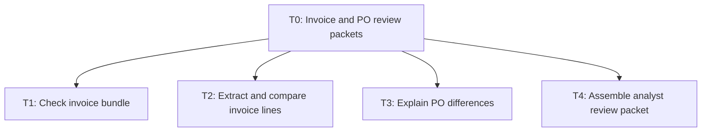
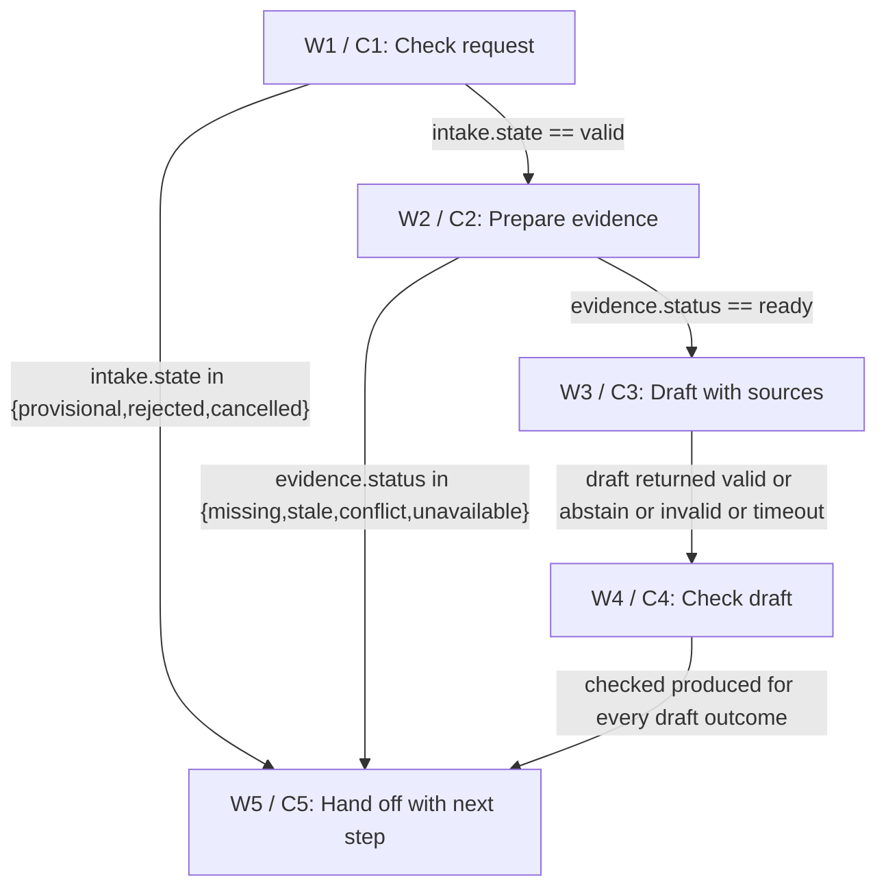

# Architecture

> NEEDS-WORK | DESIGN ONLY. independent-agent; round 1.

## Task tree



## Workflow



## Exact component and branch contracts

## components

### C1 · Check case envelope

Code checks scope, current access, command and version before exposing evidence. Exact duplicate requestId/revision and same frozen source manifest yields intake.state valid with reusedArtifact. W2 supplies existing checked source view; W3 skips model and returns saved draft; W4 rechecks scope/source freshness and receipt. Replacement with changed inputs requires next revision; semantic duplicates are candidates only.

Reasoning: Bound the work and make the result reviewable.

Data:

```json
{
  "group": "Code: validation",
  "taskIds": [
    "T1"
  ],
  "inputs": [
    "request: object; staff principal, scope, requestId, command initial|replace|cancel, expectedRevision",
    "bundle: supplied documents and approved current manifest"
  ],
  "outputs": [
    "intake: object; state valid|provisional|rejected|cancelled, reason, sourceVersion, caseRevision, requestId, artifactId optional"
  ],
  "whyCode": "Code checks scope, current access, command and version before exposing evidence.",
  "approvalRule": "No operational write authority. Staff review the exact version before any action in their own system."
}
```


Sources:

- context / user-brief: Read invoice documents, explain PO mismatches and prepare an AP analyst review packet. No posting, payment or supplier-master updates.

- hypothesis / H1: Read supplied invoices and read-only PO snapshots. Explain line differences for analyst review. Exclude posting, payment, supplier changes, tax advice and approval of invoices.

### C2 · Build trusted evidence view

Parse signed decimal amounts using currency precision from an approved manifest; no float arithmetic. Match unique SKU and explicit PO line reference; ambiguous many-to-one matches abstain. Compare quantity, unit price and line total separately; preserve credits as signed values. No model-generated money enters comparison. OCR creates candidates only; source text and deterministic parsing or analyst verification produce trusted numeric fields. Revisions and document hashes are frozen per packet.

Reasoning: Bound the work and make the result reviewable.

Data:

```json
{
  "group": "Code: tools",
  "taskIds": [
    "T2"
  ],
  "inputs": [
    "intake: validated envelope",
    "bundle: immutable supplied source collection"
  ],
  "outputs": [
    "evidence: object; status ready|missing|stale|conflict|unavailable, source IDs, exact passages, trusted typed facts, reason"
  ],
  "whyCode": "Read-only scoped source access; deterministic numeric/date parsing; timeout 10 seconds with one read retry, then unavailable.",
  "approvalRule": "No operational write authority. Staff review the exact version before any action in their own system."
}
```


Sources:

- context / user-brief: Read invoice documents, explain PO mismatches and prepare an AP analyst review packet. No posting, payment or supplier-master updates.

- hypothesis / H1: Read supplied invoices and read-only PO snapshots. Explain line differences for analyst review. Exclude posting, payment, supplier changes, tax advice and approval of invoices.

### C3 · Draft bounded recommendation

Parse signed decimal amounts using currency precision from an approved manifest; no float arithmetic. Match unique SKU and explicit PO line reference; ambiguous many-to-one matches abstain. Compare quantity, unit price and line total separately; preserve credits as signed values. No model-generated money enters comparison. OCR creates candidates only; source text and deterministic parsing or analyst verification produce trusted numeric fields. Revisions and document hashes are frozen per packet.

Reasoning: Bound the work and make the result reviewable.

Data:

```json
{
  "group": "Agents (LLM)",
  "taskIds": [
    "T3"
  ],
  "inputs": [
    "evidence: validated minimized source view",
    "scope: approved instructions and output schema"
  ],
  "outputs": [
    "draft: object; text, claim citations, disagreement, disposition ready|abstain"
  ],
  "whyCode": "",
  "approvalRule": "No operational write authority. Staff review the exact version before any action in their own system."
}
```


Sources:

- context / user-brief: Read invoice documents, explain PO mismatches and prepare an AP analyst review packet. No posting, payment or supplier-master updates.

- hypothesis / H1: Read supplied invoices and read-only PO snapshots. Explain line differences for analyst review. Exclude posting, payment, supplier changes, tax advice and approval of invoices.

### C4 · Check claims and output proof

Parse signed decimal amounts using currency precision from an approved manifest; no float arithmetic. Match unique SKU and explicit PO line reference; ambiguous many-to-one matches abstain. Compare quantity, unit price and line total separately; preserve credits as signed values. No model-generated money enters comparison. OCR creates candidates only; source text and deterministic parsing or analyst verification produce trusted numeric fields. Revisions and document hashes are frozen per packet. A forged or absent citation yields reason INVALID_CITATION, status needs_human. Frozen source conflict yields EVIDENCE_CONFLICT; missing source yields EVIDENCE_MISSING. Local draftId derives from requestId/revision and source manifest; do not export ready before all required source IDs and artifact receipt exist.

Reasoning: Bound the work and make the result reviewable.

Data:

```json
{
  "group": "Code: validation",
  "taskIds": [
    "T3",
    "T4"
  ],
  "inputs": [
    "draft: candidate or null",
    "evidence: frozen authoritative view",
    "intake: envelope plus fresh scope and revision check"
  ],
  "outputs": [
    "checked: object; status ready|needs_human|rejected|cancelled, artifactId, sourceIds, reason"
  ],
  "whyCode": "Verify exact citations, allowed claims, required fields, freshness and no forbidden action claim. Local artifact receipt is required; no business mutation.",
  "approvalRule": "No operational write authority. Staff review the exact version before any action in their own system."
}
```


Sources:

- context / user-brief: Read invoice documents, explain PO mismatches and prepare an AP analyst review packet. No posting, payment or supplier-master updates.

- hypothesis / H1: Read supplied invoices and read-only PO snapshots. Explain line differences for analyst review. Exclude posting, payment, supplier changes, tax advice and approval of invoices.

### C5 · Prepare human handoff

Accept exactly one tagged handoffInput. W1 exceptions carry intake, W2 exceptions carry evidence plus intake, W4 carries checked plus intake. Create a local receipt even for exceptions; if receipt generation fails, return unconfirmed error in current caller session. No operational success claim. Parse signed decimal amounts using currency precision from an approved manifest; no float arithmetic. Match unique SKU and explicit PO line reference; ambiguous many-to-one matches abstain. Compare quantity, unit price and line total separately; preserve credits as signed values. No model-generated money enters comparison. OCR creates candidates only; source text and deterministic parsing or analyst verification produce trusted numeric fields. Revisions and document hashes are frozen per packet.

Reasoning: Bound the work and make the result reviewable.

Data:

```json
{
  "group": "Code: human triggers",
  "taskIds": [
    "T4"
  ],
  "inputs": [
    "handoffInput: union; checked when W4 ran, otherwise intake exception or evidence exception with requestId, caseRevision, reason, sourceIds and status",
    "owner: proposed role and approved working calendar"
  ],
  "outputs": [
    "handoff: object; owner, status review_ready|provisional|needs_human|needs_staff|needs_analyst|needs_researcher|needs_coordinator|needs_revision|cancelled|rejected, nextStep, reason, artifactId nullable, deadline nullable"
  ],
  "whyCode": "Produce a local review packet and explicit owned next step; no automatic queue message or sending. Human acknowledgement occurs outside this tool.",
  "approvalRule": "No operational write authority. Staff review the exact version before any action in their own system."
}
```


Sources:

- context / user-brief: Read invoice documents, explain PO mismatches and prepare an AP analyst review packet. No posting, payment or supplier-master updates.

- hypothesis / H1: Read supplied invoices and read-only PO snapshots. Explain line differences for analyst review. Exclude posting, payment, supplier changes, tax advice and approval of invoices.


## workflow

### W1 · Check request

{"state": "W1", "transitions": [{"to": "W2", "when": "intake.state == valid", "mode": "exclusive"}, {"to": "W5", "when": "intake.state in {provisional,rejected,cancelled}", "mode": "exclusive"}], "failureDisposition": "Local error receipt; owner retries a new revision after checking source problem. Never claim business success.", "timeout": "30 seconds for draft; 10 seconds per read; all others 5 seconds. Handoff returned in caller session.", "retryPolicy": "One read retry only. One model attempt; invalid or timeout becomes a needs_human packet. No automatic draft regeneration.", "terminalDisposition": "", "bindings": {"intake": "C1.intake; command and authenticated scope set on request", "evidence": "C2.evidence; frozen bundle read result", "draft": "C3.draft; schema validation adds invalid or timeout", "checked": "C4.checked; recheck before ready output", "handoffInput": "C1.intake exception at W1, C2.evidence plus intake exception at W2, or C4.checked at W4; tag selected by predecessor."}, "precedence": "Cancellation then invalid authority then missing evidence then draft. Replacement uses expectedRevision; concurrent stale revision is rejected. Outputs are session artifacts, never a sent reply or approved transaction."}

Reasoning: Bound the work and make the result reviewable.

Data:

```json
{
  "componentId": "C1",
  "taskIds": [
    "T1"
  ],
  "next": [
    "W2",
    "W5"
  ],
  "decision": true,
  "example": "Valid scope → frozen evidence → draft → check → local staff packet; source error skips draft and produces an exception packet."
}
```


Sources:

- context / user-brief: Read invoice documents, explain PO mismatches and prepare an AP analyst review packet. No posting, payment or supplier-master updates.

- hypothesis / H1: Read supplied invoices and read-only PO snapshots. Explain line differences for analyst review. Exclude posting, payment, supplier changes, tax advice and approval of invoices.

### W2 · Prepare evidence

{"state": "W2", "transitions": [{"to": "W3", "when": "evidence.status == ready", "mode": "exclusive"}, {"to": "W5", "when": "evidence.status in {missing,stale,conflict,unavailable}", "mode": "exclusive"}], "failureDisposition": "Local error receipt; owner retries a new revision after checking source problem. Never claim business success.", "timeout": "30 seconds for draft; 10 seconds per read; all others 5 seconds. Handoff returned in caller session.", "retryPolicy": "One read retry only. One model attempt; invalid or timeout becomes a needs_human packet. No automatic draft regeneration.", "terminalDisposition": "", "bindings": {"intake": "C1.intake; command and authenticated scope set on request", "evidence": "C2.evidence; frozen bundle read result", "draft": "C3.draft; schema validation adds invalid or timeout", "checked": "C4.checked; recheck before ready output", "handoffInput": "C1.intake exception at W1, C2.evidence plus intake exception at W2, or C4.checked at W4; tag selected by predecessor."}, "precedence": "Cancellation then invalid authority then missing evidence then draft. Replacement uses expectedRevision; concurrent stale revision is rejected. Outputs are session artifacts, never a sent reply or approved transaction."}

Reasoning: Bound the work and make the result reviewable.

Data:

```json
{
  "componentId": "C2",
  "taskIds": [
    "T2"
  ],
  "next": [
    "W3",
    "W5"
  ],
  "decision": true,
  "example": "Valid scope → frozen evidence → draft → check → local staff packet; source error skips draft and produces an exception packet."
}
```


Sources:

- context / user-brief: Read invoice documents, explain PO mismatches and prepare an AP analyst review packet. No posting, payment or supplier-master updates.

- hypothesis / H1: Read supplied invoices and read-only PO snapshots. Explain line differences for analyst review. Exclude posting, payment, supplier changes, tax advice and approval of invoices.

### W3 · Draft with sources

{"state": "W3", "transitions": [{"to": "W4", "when": "draft returned valid or abstain or invalid or timeout", "mode": "exclusive"}], "failureDisposition": "Local error receipt; owner retries a new revision after checking source problem. Never claim business success.", "timeout": "30 seconds for draft; 10 seconds per read; all others 5 seconds. Handoff returned in caller session.", "retryPolicy": "One read retry only. One model attempt; invalid or timeout becomes a needs_human packet. No automatic draft regeneration.", "terminalDisposition": "", "bindings": {"intake": "C1.intake; command and authenticated scope set on request", "evidence": "C2.evidence; frozen bundle read result", "draft": "C3.draft; schema validation adds invalid or timeout", "checked": "C4.checked; recheck before ready output", "handoffInput": "C1.intake exception at W1, C2.evidence plus intake exception at W2, or C4.checked at W4; tag selected by predecessor."}, "precedence": "Cancellation then invalid authority then missing evidence then draft. Replacement uses expectedRevision; concurrent stale revision is rejected. Outputs are session artifacts, never a sent reply or approved transaction."}

Reasoning: Bound the work and make the result reviewable.

Data:

```json
{
  "componentId": "C3",
  "taskIds": [
    "T3"
  ],
  "next": [
    "W4"
  ],
  "decision": false,
  "example": "Valid scope → frozen evidence → draft → check → local staff packet; source error skips draft and produces an exception packet."
}
```


Sources:

- context / user-brief: Read invoice documents, explain PO mismatches and prepare an AP analyst review packet. No posting, payment or supplier-master updates.

- hypothesis / H1: Read supplied invoices and read-only PO snapshots. Explain line differences for analyst review. Exclude posting, payment, supplier changes, tax advice and approval of invoices.

### W4 · Check draft

{"state": "W4", "transitions": [{"to": "W5", "when": "checked produced for every draft outcome", "mode": "exclusive"}], "failureDisposition": "Local error receipt; owner retries a new revision after checking source problem. Never claim business success.", "timeout": "30 seconds for draft; 10 seconds per read; all others 5 seconds. Handoff returned in caller session.", "retryPolicy": "One read retry only. One model attempt; invalid or timeout becomes a needs_human packet. No automatic draft regeneration.", "terminalDisposition": "", "bindings": {"intake": "C1.intake; command and authenticated scope set on request", "evidence": "C2.evidence; frozen bundle read result", "draft": "C3.draft; schema validation adds invalid or timeout", "checked": "C4.checked; recheck before ready output", "handoffInput": "C1.intake exception at W1, C2.evidence plus intake exception at W2, or C4.checked at W4; tag selected by predecessor."}, "precedence": "Cancellation then invalid authority then missing evidence then draft. Replacement uses expectedRevision; concurrent stale revision is rejected. Outputs are session artifacts, never a sent reply or approved transaction."}

Reasoning: Bound the work and make the result reviewable.

Data:

```json
{
  "componentId": "C4",
  "taskIds": [
    "T3",
    "T4"
  ],
  "next": [
    "W5"
  ],
  "decision": false,
  "example": "Valid scope → frozen evidence → draft → check → local staff packet; source error skips draft and produces an exception packet."
}
```


Sources:

- context / user-brief: Read invoice documents, explain PO mismatches and prepare an AP analyst review packet. No posting, payment or supplier-master updates.

- hypothesis / H1: Read supplied invoices and read-only PO snapshots. Explain line differences for analyst review. Exclude posting, payment, supplier changes, tax advice and approval of invoices.

### W5 · Hand off with next step

{"state": "W5", "transitions": [], "failureDisposition": "Local exception in current caller session; receiving staff owns recovery. No remote write or unknown external commit exists.", "timeout": "30 seconds for draft; 10 seconds per read; all others 5 seconds. Handoff returned in caller session.", "retryPolicy": "One read retry only. One model attempt; invalid or timeout becomes a needs_human packet. No automatic draft regeneration.", "terminalDisposition": "Return local review_ready, provisional, needs_human, rejected or cancelled packet, with owner and nextStep; if artifact receipt unavailable return ARTIFACT_UNCONFIRMED in caller session. No operational completion. Receiving staff review/acknowledge in existing tools; the assistant does not wait for a decision.", "bindings": {"intake": "C1.intake; command and authenticated scope set on request", "evidence": "C2.evidence; frozen bundle read result", "draft": "C3.draft; schema validation adds invalid or timeout", "checked": "C4.checked; recheck before ready output", "handoffInput": "C1.intake exception at W1, C2.evidence plus intake exception at W2, or C4.checked at W4; tag selected by predecessor."}, "precedence": "Cancellation then invalid authority then missing evidence then draft. Replacement uses expectedRevision; concurrent stale revision is rejected. Outputs are session artifacts, never a sent reply or approved transaction."}

Reasoning: Bound the work and make the result reviewable.

Data:

```json
{
  "componentId": "C5",
  "taskIds": [
    "T4"
  ],
  "next": [],
  "decision": false,
  "example": "Valid scope → frozen evidence → draft → check → local staff packet; source error skips draft and produces an exception packet."
}
```


Sources:

- context / user-brief: Read invoice documents, explain PO mismatches and prepare an AP analyst review packet. No posting, payment or supplier-master updates.

- hypothesis / H1: Read supplied invoices and read-only PO snapshots. Explain line differences for analyst review. Exclude posting, payment, supplier changes, tax advice and approval of invoices.


## framework

### F1 · Workflow choice

Workflow choice

Reasoning: Bound the work and make the result reviewable.

Data:

```json
{
  "category": "orchestration",
  "taskIds": [
    "T1",
    "T2",
    "T3",
    "T4"
  ],
  "choice": "A small deterministic state machine with one bounded drafting call.",
  "alternatives": [
    "Free tool-using agent; multi-agent chain."
  ],
  "tradeoffs": "Few states and no operational writes favor a simple flow; more agents add disagreement and latency.",
  "permission": "none",
  "blastRadius": "One scoped case; no operational system changes.",
  "approvalRule": "Staff review output; scope and adapter approval H1-H3 block pilot.",
  "leastPrivilege": "Separate source read principal from model; source allowlist enforced before retrieval; minimize, redact, expire per approved policy.",
  "aws": "Unverified pattern: object storage and relational run index.",
  "gcp": "Unverified pattern: object storage and relational run index.",
  "azure": "Unverified pattern: object storage and relational run index.",
  "openSource": "Unverified pattern: self-hosted object storage and PostgreSQL."
}
```


Sources:

- context / user-brief: Read invoice documents, explain PO mismatches and prepare an AP analyst review packet. No posting, payment or supplier-master updates.

- hypothesis / H1: Read supplied invoices and read-only PO snapshots. Explain line differences for analyst review. Exclude posting, payment, supplier changes, tax advice and approval of invoices.

### F2 · Permissions and data

Permissions and data

Reasoning: Bound the work and make the result reviewable.

Data:

```json
{
  "category": "permission",
  "taskIds": [
    "T1",
    "T2",
    "T3",
    "T4"
  ],
  "choice": "Read-only supplied evidence and local artifact export; no business write credentials.",
  "alternatives": [
    "Connect full operational accounts."
  ],
  "tradeoffs": "A wider connection adds exposure without helping this review-only release.",
  "permission": "read",
  "blastRadius": "One scoped case; no operational system changes.",
  "approvalRule": "Staff review output; scope and adapter approval H1-H3 block pilot.",
  "leastPrivilege": "Separate source read principal from model; source allowlist enforced before retrieval; minimize, redact, expire per approved policy.",
  "aws": "Unverified pattern: object storage and relational run index.",
  "gcp": "Unverified pattern: object storage and relational run index.",
  "azure": "Unverified pattern: object storage and relational run index.",
  "openSource": "Unverified pattern: self-hosted object storage and PostgreSQL."
}
```


Sources:

- context / user-brief: Read invoice documents, explain PO mismatches and prepare an AP analyst review packet. No posting, payment or supplier-master updates.

- hypothesis / H1: Read supplied invoices and read-only PO snapshots. Explain line differences for analyst review. Exclude posting, payment, supplier changes, tax advice and approval of invoices.

### F3 · Storage and deployment options

Storage and deployment options

Reasoning: Bound the work and make the result reviewable.

Data:

```json
{
  "category": "data",
  "taskIds": [
    "T1",
    "T2",
    "T3",
    "T4"
  ],
  "choice": "Choose encrypted existing team storage with access checks and a relational run manifest; verify environment before purchase.",
  "alternatives": [
    "AWS object store plus relational ledger; GCP object store plus relational ledger; Azure object store plus relational ledger; self-hosted object storage plus PostgreSQL. All are unverified candidate patterns."
  ],
  "tradeoffs": "Compare same criteria: scoped reads, region, retention, audit, operations effort and price. Existing team storage wins provisionally; self-hosting adds operational burden. Retrieval indexes never override original sources.",
  "permission": "read",
  "blastRadius": "One scoped case; no operational system changes.",
  "approvalRule": "Staff review output; scope and adapter approval H1-H3 block pilot.",
  "leastPrivilege": "Separate source read principal from model; source allowlist enforced before retrieval; minimize, redact, expire per approved policy.",
  "aws": "Unverified pattern: object storage and relational run index.",
  "gcp": "Unverified pattern: object storage and relational run index.",
  "azure": "Unverified pattern: object storage and relational run index.",
  "openSource": "Unverified pattern: self-hosted object storage and PostgreSQL."
}
```


Sources:

- context / user-brief: Read invoice documents, explain PO mismatches and prepare an AP analyst review packet. No posting, payment or supplier-master updates.

- hypothesis / H1: Read supplied invoices and read-only PO snapshots. Explain line differences for analyst review. Exclude posting, payment, supplier changes, tax advice and approval of invoices.


## models

### M1 · One bounded drafting call

One bounded drafting call

Reasoning: Bound the work and make the result reviewable.

Data:

```json
{
  "componentId": "C3",
  "tier": "standard",
  "rationale": "Proposed standard tier balances evidence following and plain drafting. Small tier may miss contradictions; reasoning tier adds cost without authority benefit. Choose by held-out evidence checks. One W3 invocation, no model retries; expected one call per valid case, maximum one; invalid intake zero. 4000/1e6*1 + 800/1e6*4 = USD 0.0072 per valid case; 100 valid cases/month = USD 0.72/month. These are H4 illustrative prices and volume, not a provider quote. Excludes parsing, storage, tools, hosting and staff time. 30 second deadline; failure yields human packet.",
  "fineTuneWhen": "Only after recurring labelled citation/style failures survive prompt and evidence fixes; require held-out safety non-regression and measured cost/quality benefit.",
  "callsPerCase": 1,
  "inputTokens": 4000,
  "outputTokens": 800,
  "inputPrice": 1,
  "outputPrice": 4
}
```


Sources:

- context / user-brief: Read invoice documents, explain PO mismatches and prepare an AP analyst review packet. No posting, payment or supplier-master updates.

- hypothesis / H1: Read supplied invoices and read-only PO snapshots. Explain line differences for analyst review. Exclude posting, payment, supplier changes, tax advice and approval of invoices.


