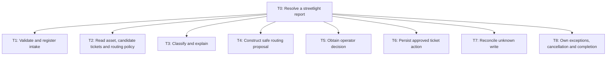
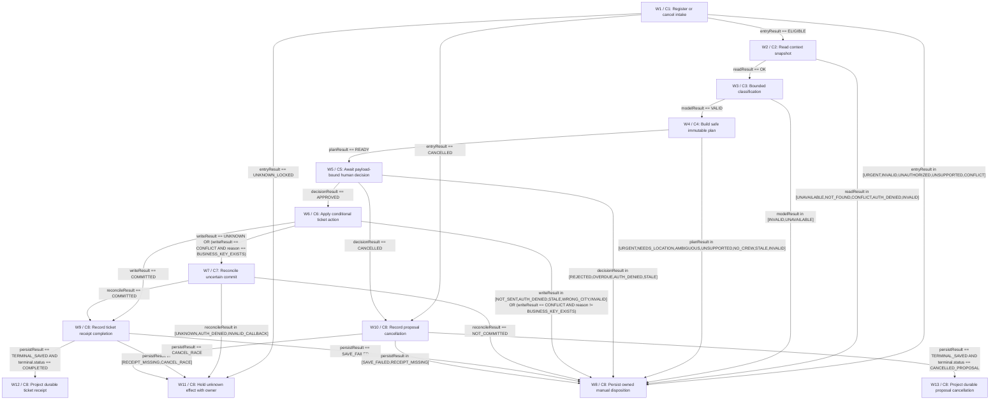

# Streetlight repair intake and operator-assisted routing

> PASS · DESIGN ONLY. Review is a design judgement; no business controls or provider reliability were executed.

Review method: self-review; round 2.

Review dimensions (supplied scores):

- D1: 3/4 — CTX1-CTX6 and T0-T8 specify brief scope, exclusions, provisional intake, conditional ordered path and operator-owned outcomes; no equipment control.
- D2: 3/4 — All 8 task leaves map to C and W nodes plus concrete golden coverage; FM1-FM12 evalIds derived from EV membership, all-category reciprocal links checked. H source passages match ledger.
- D3: 3/4 — W1-W13 have typed enum producers, exclusive conditions, suspended human wait, bounded read/model retries, no blind write retry, W7/W11 persistent read-only reconciliation and W9/W10 finalizer branches before durable W12/W13 projections.
- D4: 3/4 — C1-C8 declare discriminated commands, full canonical payload/digest, exact reasons including WRONG_CITY and INVALID_MODEL_REFERENCE, current-version checks, receipt shape, human ACK/cancel/overdue events and explicit owner/time producers.
- D5: 3/4 — C5/C6 bind city/actor/action/resource/report/policy/crew/version and full digest; API checks live revocation and uniqueness. F4 denies equipment schema/tools/credentials/egress. C1/C8 redaction, scopes, retention and audit are proposed under H6.
- D6: 3/4 — Original brief unchanged. All missing API/policy/provider/pricing/limits are H1-H11 proposals with owners/evidence; no external system or business assertion claimed executed. Ambiguity is owned rather than guessed.
- D7: 3/4 — F1-F5 choose durable code workflow + one bounded judgement, reject autonomous multi-agent dispatch/in-memory chains, compare orchestration on durable wait/retry/replay/operating burden, and label same-category cloud/open-source data options unverified.
- D8: 3/4 — Only C3 is LLM; M1 covers W3 actual invocation and bounded retry. Expected .9*1.05=.945, max2 calls, 2000/300 tokens and illustrative 1/4 USD-million give .6048 expected USD/day at supplied 200/day; fallback, context, latency and tier/fine-tuning conditions explicit.
- D9: 3/4 — FM1-FM12 case-specific effects, S/O/D definitions and all unaccepted risks have controls, metrics, owners and gates. Covers urgent hazards, city/asset conflict, duplicates, stale/revoked authority, tamper, injection, unknown commits, queues/privacy/cancellation/closed tickets.
- D10: 3/4 — 24 complete self-contained golden fixtures EV1-EV18/EV21/EV23-EV27 include positive CREATE/LINK, isolated guards and additional adversarial direct equipment case. All are explicitly listed EV20; EV19 gives component/E2E strata and adjudication; EV22 owner response and telemetry. Business harness still to be built/executed.
- D11: 3/4 — R1/R2 denominators/causal mechanisms and independent guardrails explicit; R3-R6 noncircular shadow/assist/pilot/scale gates, R7 shift-cluster randomized visibility plus continuous/binary power analysis; R8 owns stop and recovery without compensating writes. No residual-risk acceptance invented.
- D12: 3/4 — X1 AC1-AC10 and build instructions retain IDs, state/contract/data ownership, exact error controls, all release fixtures, safety exclusion, monitoring and launch blockers. Export will render canonical source and review; structural check is separately recorded and cannot establish business performance.

Review findings:

- ISSUE1 [major, resolved] workflow/W9: W9/W10 terminal failure dispositions imply alternate states without matching next edges. Add explicit finalizer decision nodes and terminal receipt/cancellation nodes; bind C8 status guard and preserve no-effect cancellation race. Resolved in round 2: see canonical typed contracts, W9/W10/W12/W13 and additional EV23-EV27 included in EV20.
- ISSUE2 [major, resolved] components/C4: Exact reasons required by EV3/EV11 and W8 are not fully declared as typed component outputs. Declare comprehensive reason producers and align negative fixtures with C6 error enum. Resolved in round 2: see canonical typed contracts, W9/W10/W12/W13 and additional EV23-EV27 included in EV20.
- ISSUE3 [major, resolved] evals/EV14: Additional variants in EV2/EV9/EV11/EV14/EV17 are prose assertions rather than fully resolved fixtures. Replace variant assertions with dedicated concrete goldens and include them in reciprocal FM/release links. Resolved in round 2: see canonical typed contracts, W9/W10/W12/W13 and additional EV23-EV27 included in EV20.
- ISSUE4 [minor, resolved] rollout/R1: Current helper requires nonempty experiment on every rollout category, while the output contract permits inapplicable empty strings. Each card now contains a concrete R7 relation; consider documenting this stricter helper rule in the skill. No design blocker remains.

## Task tree



## Workflow



## tasks

### T0 · Resolve a streetlight report

Run intake, retrieve, recommend, validate, obtain decision and persist in that order when eligible; exception/cancel ends the spine through T8. Reconciliation T7 replaces retry when a T6 commit is unknown.

Reasoning: Chosen to make the stated workflow explicit and bounded.

Assumptions:

- H1: Proposed first release ingests text typed or pasted by an operator, plus optional asset ID/address; direct citizen-channel integration, photo interpretation and ticket closure are deferred.

- H3: Each ticket write requires a currently authorized operator approval; tenant is city ID, and operation, resource, report revision, immutable payload digest and policy version are bound to approval.

- H4: Potential exposed wires, fallen poles, sparks or fire enter a staffed urgent manual queue immediately; proposed acknowledgement 2 elapsed minutes and supervisor escalation at 2 minutes; routine exceptions acknowledge within 30 staffed minutes and escalate at 30.

- H10: Proposed operational limits: each read attempt 5 seconds, one read retry; LLM attempt 10 seconds with one retry; ticket write timeout 5 seconds with zero automatic write retry; reconciliation reads at 5, 30 and 120 seconds, then owned unknown hold with 15-minute read-only watchdog. Proposed additional limits: snapshot age at plan creation 60 seconds, plan/approval expiry 5 elapsed minutes, routine nonhuman response p95 30 seconds, and unknown-held >1 hour escalates service manager. These limits require verification, not established policy.

Data:

```json
{
  "parentId": "",
  "mode": "sequence",
  "basis": [
    "Entry T1; T2–T6 only if preceding stage eligible; T7 conditional on T6 unknown; every exit recorded by T8."
  ],
  "examples": [
    "Broken lamp at asset SL-042 becomes operator-approved crew ticket."
  ],
  "autonomy": "bounded assist; operator writes",
  "frequency": "200 reports/day supplied",
  "risk": "high"
}
```


Sources:

- hypothesis / H1: Proposed first release ingests text typed or pasted by an operator, plus optional asset ID/address; direct citizen-channel integration, photo interpretation and ticket closure are deferred.

- hypothesis / H3: Each ticket write requires a currently authorized operator approval; tenant is city ID, and operation, resource, report revision, immutable payload digest and policy version are bound to approval.

- hypothesis / H4: Potential exposed wires, fallen poles, sparks or fire enter a staffed urgent manual queue immediately; proposed acknowledgement 2 elapsed minutes and supervisor escalation at 2 minutes; routine exceptions acknowledge within 30 staffed minutes and escalate at 30.

- hypothesis / H10: Proposed operational limits: each read attempt 5 seconds, one read retry; LLM attempt 10 seconds with one retry; ticket write timeout 5 seconds with zero automatic write retry; reconciliation reads at 5, 30 and 120 seconds, then owned unknown hold with 15-minute read-only watchdog. Proposed additional limits: snapshot age at plan creation 60 seconds, plan/approval expiry 5 elapsed minutes, routine nonhuman response p95 30 seconds, and unknown-held >1 hour escalates service manager. These limits require verification, not established policy.

### T1 · Validate and register intake

Authenticate city/operator, deduplicate exact intake delivery, validate command/revision, minimize data and apply deterministic urgent indicators before any dependency call.

Reasoning: Chosen to make the stated workflow explicit and bounded.

Assumptions:

- H1: Proposed first release ingests text typed or pasted by an operator, plus optional asset ID/address; direct citizen-channel integration, photo interpretation and ticket closure are deferred.

- H3: Each ticket write requires a currently authorized operator approval; tenant is city ID, and operation, resource, report revision, immutable payload digest and policy version are bound to approval.

- H4: Potential exposed wires, fallen poles, sparks or fire enter a staffed urgent manual queue immediately; proposed acknowledgement 2 elapsed minutes and supervisor escalation at 2 minutes; routine exceptions acknowledge within 30 staffed minutes and escalate at 30.

- H10: Proposed operational limits: each read attempt 5 seconds, one read retry; LLM attempt 10 seconds with one retry; ticket write timeout 5 seconds with zero automatic write retry; reconciliation reads at 5, 30 and 120 seconds, then owned unknown hold with 15-minute read-only watchdog. Proposed additional limits: snapshot age at plan creation 60 seconds, plan/approval expiry 5 elapsed minutes, routine nonhuman response p95 30 seconds, and unknown-held >1 hour escalates service manager. These limits require verification, not established policy.

Data:

```json
{
  "parentId": "T0",
  "mode": "leaf",
  "basis": [
    "City from verified session, never text; accept missing location provisionally."
  ],
  "examples": [
    "Sparks near pole: urgent queue even with no asset ID."
  ],
  "autonomy": "code validates; no dispatch",
  "frequency": "every intake",
  "risk": "high"
}
```


Sources:

- hypothesis / H1: Proposed first release ingests text typed or pasted by an operator, plus optional asset ID/address; direct citizen-channel integration, photo interpretation and ticket closure are deferred.

- hypothesis / H3: Each ticket write requires a currently authorized operator approval; tenant is city ID, and operation, resource, report revision, immutable payload digest and policy version are bound to approval.

- hypothesis / H4: Potential exposed wires, fallen poles, sparks or fire enter a staffed urgent manual queue immediately; proposed acknowledgement 2 elapsed minutes and supervisor escalation at 2 minutes; routine exceptions acknowledge within 30 staffed minutes and escalate at 30.

- hypothesis / H10: Proposed operational limits: each read attempt 5 seconds, one read retry; LLM attempt 10 seconds with one retry; ticket write timeout 5 seconds with zero automatic write retry; reconciliation reads at 5, 30 and 120 seconds, then owned unknown hold with 15-minute read-only watchdog. Proposed additional limits: snapshot age at plan creation 60 seconds, plan/approval expiry 5 elapsed minutes, routine nonhuman response p95 30 seconds, and unknown-held >1 hour escalates service manager. These limits require verification, not established policy.

### T2 · Read asset, candidate tickets and routing policy

Read same-city GIS asset evidence, current/open/recent tickets and crew policy; correlate exact asset and geography with evidence.

Reasoning: Chosen to make the stated workflow explicit and bounded.

Assumptions:

- H1: Proposed first release ingests text typed or pasted by an operator, plus optional asset ID/address; direct citizen-channel integration, photo interpretation and ticket closure are deferred.

- H3: Each ticket write requires a currently authorized operator approval; tenant is city ID, and operation, resource, report revision, immutable payload digest and policy version are bound to approval.

- H4: Potential exposed wires, fallen poles, sparks or fire enter a staffed urgent manual queue immediately; proposed acknowledgement 2 elapsed minutes and supervisor escalation at 2 minutes; routine exceptions acknowledge within 30 staffed minutes and escalate at 30.

- H10: Proposed operational limits: each read attempt 5 seconds, one read retry; LLM attempt 10 seconds with one retry; ticket write timeout 5 seconds with zero automatic write retry; reconciliation reads at 5, 30 and 120 seconds, then owned unknown hold with 15-minute read-only watchdog. Proposed additional limits: snapshot age at plan creation 60 seconds, plan/approval expiry 5 elapsed minutes, routine nonhuman response p95 30 seconds, and unknown-held >1 hour escalates service manager. These limits require verification, not established policy.

Data:

```json
{
  "parentId": "T0",
  "mode": "leaf",
  "basis": [
    "Read failure or conflicting location is owned; never assume no ticket on timeout."
  ],
  "examples": [
    "SL-042 has existing open ticket TK-88."
  ],
  "autonomy": "read only",
  "frequency": "eligible intake",
  "risk": "medium"
}
```


Sources:

- hypothesis / H1: Proposed first release ingests text typed or pasted by an operator, plus optional asset ID/address; direct citizen-channel integration, photo interpretation and ticket closure are deferred.

- hypothesis / H3: Each ticket write requires a currently authorized operator approval; tenant is city ID, and operation, resource, report revision, immutable payload digest and policy version are bound to approval.

- hypothesis / H4: Potential exposed wires, fallen poles, sparks or fire enter a staffed urgent manual queue immediately; proposed acknowledgement 2 elapsed minutes and supervisor escalation at 2 minutes; routine exceptions acknowledge within 30 staffed minutes and escalate at 30.

- hypothesis / H10: Proposed operational limits: each read attempt 5 seconds, one read retry; LLM attempt 10 seconds with one retry; ticket write timeout 5 seconds with zero automatic write retry; reconciliation reads at 5, 30 and 120 seconds, then owned unknown hold with 15-minute read-only watchdog. Proposed additional limits: snapshot age at plan creation 60 seconds, plan/approval expiry 5 elapsed minutes, routine nonhuman response p95 30 seconds, and unknown-held >1 hour escalates service manager. These limits require verification, not established policy.

### T3 · Classify and explain

One LLM extracts fault enum and cited spans, urgency signal, candidate rationale and abstention. It cannot create IDs, set permissions or choose executable tools.

Reasoning: Chosen to make the stated workflow explicit and bounded.

Assumptions:

- H1: Proposed first release ingests text typed or pasted by an operator, plus optional asset ID/address; direct citizen-channel integration, photo interpretation and ticket closure are deferred.

- H3: Each ticket write requires a currently authorized operator approval; tenant is city ID, and operation, resource, report revision, immutable payload digest and policy version are bound to approval.

- H4: Potential exposed wires, fallen poles, sparks or fire enter a staffed urgent manual queue immediately; proposed acknowledgement 2 elapsed minutes and supervisor escalation at 2 minutes; routine exceptions acknowledge within 30 staffed minutes and escalate at 30.

- H10: Proposed operational limits: each read attempt 5 seconds, one read retry; LLM attempt 10 seconds with one retry; ticket write timeout 5 seconds with zero automatic write retry; reconciliation reads at 5, 30 and 120 seconds, then owned unknown hold with 15-minute read-only watchdog. Proposed additional limits: snapshot age at plan creation 60 seconds, plan/approval expiry 5 elapsed minutes, routine nonhuman response p95 30 seconds, and unknown-held >1 hour escalates service manager. These limits require verification, not established policy.

Data:

```json
{
  "parentId": "T0",
  "mode": "leaf",
  "basis": [
    "Schema validation; reference only supplied snapshot IDs; evidence conflicts force human handling."
  ],
  "examples": [
    "Text says flashing intermittently -> flicker; quote exact span."
  ],
  "autonomy": "recommendation only",
  "frequency": "H8 planning 90%",
  "risk": "high"
}
```


Sources:

- hypothesis / H1: Proposed first release ingests text typed or pasted by an operator, plus optional asset ID/address; direct citizen-channel integration, photo interpretation and ticket closure are deferred.

- hypothesis / H3: Each ticket write requires a currently authorized operator approval; tenant is city ID, and operation, resource, report revision, immutable payload digest and policy version are bound to approval.

- hypothesis / H4: Potential exposed wires, fallen poles, sparks or fire enter a staffed urgent manual queue immediately; proposed acknowledgement 2 elapsed minutes and supervisor escalation at 2 minutes; routine exceptions acknowledge within 30 staffed minutes and escalate at 30.

- hypothesis / H10: Proposed operational limits: each read attempt 5 seconds, one read retry; LLM attempt 10 seconds with one retry; ticket write timeout 5 seconds with zero automatic write retry; reconciliation reads at 5, 30 and 120 seconds, then owned unknown hold with 15-minute read-only watchdog. Proposed additional limits: snapshot age at plan creation 60 seconds, plan/approval expiry 5 elapsed minutes, routine nonhuman response p95 30 seconds, and unknown-held >1 hour escalates service manager. These limits require verification, not established policy.

### T4 · Construct safe routing proposal

Code maps asset/category to a current eligible crew, validates candidates, forms an immutable CREATE or operator-selected LINK plan.

Reasoning: Chosen to make the stated workflow explicit and bounded.

Assumptions:

- H1: Proposed first release ingests text typed or pasted by an operator, plus optional asset ID/address; direct citizen-channel integration, photo interpretation and ticket closure are deferred.

- H3: Each ticket write requires a currently authorized operator approval; tenant is city ID, and operation, resource, report revision, immutable payload digest and policy version are bound to approval.

- H4: Potential exposed wires, fallen poles, sparks or fire enter a staffed urgent manual queue immediately; proposed acknowledgement 2 elapsed minutes and supervisor escalation at 2 minutes; routine exceptions acknowledge within 30 staffed minutes and escalate at 30.

- H10: Proposed operational limits: each read attempt 5 seconds, one read retry; LLM attempt 10 seconds with one retry; ticket write timeout 5 seconds with zero automatic write retry; reconciliation reads at 5, 30 and 120 seconds, then owned unknown hold with 15-minute read-only watchdog. Proposed additional limits: snapshot age at plan creation 60 seconds, plan/approval expiry 5 elapsed minutes, routine nonhuman response p95 30 seconds, and unknown-held >1 hour escalates service manager. These limits require verification, not established policy.

Data:

```json
{
  "parentId": "T0",
  "mode": "leaf",
  "basis": [
    "No arbitrary coordinate-to-asset coercion; fuzzy candidates require human selection; hazard always manual."
  ],
  "examples": [
    "New lamp-out at SL-042 -> CREW-NORTH under policy P7."
  ],
  "autonomy": "code recommendation",
  "frequency": "successful classification",
  "risk": "high"
}
```


Sources:

- hypothesis / H1: Proposed first release ingests text typed or pasted by an operator, plus optional asset ID/address; direct citizen-channel integration, photo interpretation and ticket closure are deferred.

- hypothesis / H3: Each ticket write requires a currently authorized operator approval; tenant is city ID, and operation, resource, report revision, immutable payload digest and policy version are bound to approval.

- hypothesis / H4: Potential exposed wires, fallen poles, sparks or fire enter a staffed urgent manual queue immediately; proposed acknowledgement 2 elapsed minutes and supervisor escalation at 2 minutes; routine exceptions acknowledge within 30 staffed minutes and escalate at 30.

- hypothesis / H10: Proposed operational limits: each read attempt 5 seconds, one read retry; LLM attempt 10 seconds with one retry; ticket write timeout 5 seconds with zero automatic write retry; reconciliation reads at 5, 30 and 120 seconds, then owned unknown hold with 15-minute read-only watchdog. Proposed additional limits: snapshot age at plan creation 60 seconds, plan/approval expiry 5 elapsed minutes, routine nonhuman response p95 30 seconds, and unknown-held >1 hour escalates service manager. These limits require verification, not established policy.

### T5 · Obtain operator decision

Show report, evidence, candidate status and route. Capture payload-bound approval or cancel/reject; supervisor handles unknowns and overdue.

Reasoning: Chosen to make the stated workflow explicit and bounded.

Assumptions:

- H1: Proposed first release ingests text typed or pasted by an operator, plus optional asset ID/address; direct citizen-channel integration, photo interpretation and ticket closure are deferred.

- H3: Each ticket write requires a currently authorized operator approval; tenant is city ID, and operation, resource, report revision, immutable payload digest and policy version are bound to approval.

- H4: Potential exposed wires, fallen poles, sparks or fire enter a staffed urgent manual queue immediately; proposed acknowledgement 2 elapsed minutes and supervisor escalation at 2 minutes; routine exceptions acknowledge within 30 staffed minutes and escalate at 30.

- H10: Proposed operational limits: each read attempt 5 seconds, one read retry; LLM attempt 10 seconds with one retry; ticket write timeout 5 seconds with zero automatic write retry; reconciliation reads at 5, 30 and 120 seconds, then owned unknown hold with 15-minute read-only watchdog. Proposed additional limits: snapshot age at plan creation 60 seconds, plan/approval expiry 5 elapsed minutes, routine nonhuman response p95 30 seconds, and unknown-held >1 hour escalates service manager. These limits require verification, not established policy.

Data:

```json
{
  "parentId": "T0",
  "mode": "leaf",
  "basis": [
    "No silent approval; changed text, target or crew requires new plan and approval."
  ],
  "examples": [
    "Operator chooses LINK to same-asset TK-88 and signs exact plan."
  ],
  "autonomy": "human approval",
  "frequency": "every proposed ticket mutation",
  "risk": "high"
}
```


Sources:

- hypothesis / H1: Proposed first release ingests text typed or pasted by an operator, plus optional asset ID/address; direct citizen-channel integration, photo interpretation and ticket closure are deferred.

- hypothesis / H3: Each ticket write requires a currently authorized operator approval; tenant is city ID, and operation, resource, report revision, immutable payload digest and policy version are bound to approval.

- hypothesis / H4: Potential exposed wires, fallen poles, sparks or fire enter a staffed urgent manual queue immediately; proposed acknowledgement 2 elapsed minutes and supervisor escalation at 2 minutes; routine exceptions acknowledge within 30 staffed minutes and escalate at 30.

- hypothesis / H10: Proposed operational limits: each read attempt 5 seconds, one read retry; LLM attempt 10 seconds with one retry; ticket write timeout 5 seconds with zero automatic write retry; reconciliation reads at 5, 30 and 120 seconds, then owned unknown hold with 15-minute read-only watchdog. Proposed additional limits: snapshot age at plan creation 60 seconds, plan/approval expiry 5 elapsed minutes, routine nonhuman response p95 30 seconds, and unknown-held >1 hour escalates service manager. These limits require verification, not established policy.

### T6 · Persist approved ticket action

Create ticket or attach intake to existing ticket using action API checks, city/report uniqueness and durable receipt. No equipment access.

Reasoning: Chosen to make the stated workflow explicit and bounded.

Assumptions:

- H1: Proposed first release ingests text typed or pasted by an operator, plus optional asset ID/address; direct citizen-channel integration, photo interpretation and ticket closure are deferred.

- H3: Each ticket write requires a currently authorized operator approval; tenant is city ID, and operation, resource, report revision, immutable payload digest and policy version are bound to approval.

- H4: Potential exposed wires, fallen poles, sparks or fire enter a staffed urgent manual queue immediately; proposed acknowledgement 2 elapsed minutes and supervisor escalation at 2 minutes; routine exceptions acknowledge within 30 staffed minutes and escalate at 30.

- H10: Proposed operational limits: each read attempt 5 seconds, one read retry; LLM attempt 10 seconds with one retry; ticket write timeout 5 seconds with zero automatic write retry; reconciliation reads at 5, 30 and 120 seconds, then owned unknown hold with 15-minute read-only watchdog. Proposed additional limits: snapshot age at plan creation 60 seconds, plan/approval expiry 5 elapsed minutes, routine nonhuman response p95 30 seconds, and unknown-held >1 hour escalates service manager. These limits require verification, not established policy.

Data:

```json
{
  "parentId": "T0",
  "mode": "leaf",
  "basis": [
    "Fresh authority/policy/resource/version; digest-bound payload; unknown response blocks reissue."
  ],
  "examples": [
    "CREATE returns ticket TK-101 and operation OP-9 receipt."
  ],
  "autonomy": "operator-approved code write",
  "frequency": "approved cases only",
  "risk": "high"
}
```


Sources:

- hypothesis / H1: Proposed first release ingests text typed or pasted by an operator, plus optional asset ID/address; direct citizen-channel integration, photo interpretation and ticket closure are deferred.

- hypothesis / H3: Each ticket write requires a currently authorized operator approval; tenant is city ID, and operation, resource, report revision, immutable payload digest and policy version are bound to approval.

- hypothesis / H4: Potential exposed wires, fallen poles, sparks or fire enter a staffed urgent manual queue immediately; proposed acknowledgement 2 elapsed minutes and supervisor escalation at 2 minutes; routine exceptions acknowledge within 30 staffed minutes and escalate at 30.

- hypothesis / H10: Proposed operational limits: each read attempt 5 seconds, one read retry; LLM attempt 10 seconds with one retry; ticket write timeout 5 seconds with zero automatic write retry; reconciliation reads at 5, 30 and 120 seconds, then owned unknown hold with 15-minute read-only watchdog. Proposed additional limits: snapshot age at plan creation 60 seconds, plan/approval expiry 5 elapsed minutes, routine nonhuman response p95 30 seconds, and unknown-held >1 hour escalates service manager. These limits require verification, not established policy.

### T7 · Reconcile unknown write

Read operation and report-uniqueness index; recover durable committed receipt, definite not-committed proof or retain owned unknown hold.

Reasoning: Chosen to make the stated workflow explicit and bounded.

Assumptions:

- H1: Proposed first release ingests text typed or pasted by an operator, plus optional asset ID/address; direct citizen-channel integration, photo interpretation and ticket closure are deferred.

- H3: Each ticket write requires a currently authorized operator approval; tenant is city ID, and operation, resource, report revision, immutable payload digest and policy version are bound to approval.

- H4: Potential exposed wires, fallen poles, sparks or fire enter a staffed urgent manual queue immediately; proposed acknowledgement 2 elapsed minutes and supervisor escalation at 2 minutes; routine exceptions acknowledge within 30 staffed minutes and escalate at 30.

- H10: Proposed operational limits: each read attempt 5 seconds, one read retry; LLM attempt 10 seconds with one retry; ticket write timeout 5 seconds with zero automatic write retry; reconciliation reads at 5, 30 and 120 seconds, then owned unknown hold with 15-minute read-only watchdog. Proposed additional limits: snapshot age at plan creation 60 seconds, plan/approval expiry 5 elapsed minutes, routine nonhuman response p95 30 seconds, and unknown-held >1 hour escalates service manager. These limits require verification, not established policy.

Data:

```json
{
  "parentId": "T0",
  "mode": "leaf",
  "basis": [
    "No second write until authoritative outcome; callbacks deduplicated; recovery independent of expired operator session."
  ],
  "examples": [
    "Write timed out but OP-9 committed -> recover TK-101 without CREATE retry."
  ],
  "autonomy": "read only recovery",
  "frequency": "unknown write response only",
  "risk": "high"
}
```


Sources:

- hypothesis / H1: Proposed first release ingests text typed or pasted by an operator, plus optional asset ID/address; direct citizen-channel integration, photo interpretation and ticket closure are deferred.

- hypothesis / H3: Each ticket write requires a currently authorized operator approval; tenant is city ID, and operation, resource, report revision, immutable payload digest and policy version are bound to approval.

- hypothesis / H4: Potential exposed wires, fallen poles, sparks or fire enter a staffed urgent manual queue immediately; proposed acknowledgement 2 elapsed minutes and supervisor escalation at 2 minutes; routine exceptions acknowledge within 30 staffed minutes and escalate at 30.

- hypothesis / H10: Proposed operational limits: each read attempt 5 seconds, one read retry; LLM attempt 10 seconds with one retry; ticket write timeout 5 seconds with zero automatic write retry; reconciliation reads at 5, 30 and 120 seconds, then owned unknown hold with 15-minute read-only watchdog. Proposed additional limits: snapshot age at plan creation 60 seconds, plan/approval expiry 5 elapsed minutes, routine nonhuman response p95 30 seconds, and unknown-held >1 hour escalates service manager. These limits require verification, not established policy.

### T8 · Own exceptions, cancellation and completion

Persist durable status, owner, due time and audit. Cancel only uncommitted proposal; while unknown freeze changed intent and record cancel pending reconciliation.

Reasoning: Chosen to make the stated workflow explicit and bounded.

Assumptions:

- H1: Proposed first release ingests text typed or pasted by an operator, plus optional asset ID/address; direct citizen-channel integration, photo interpretation and ticket closure are deferred.

- H3: Each ticket write requires a currently authorized operator approval; tenant is city ID, and operation, resource, report revision, immutable payload digest and policy version are bound to approval.

- H4: Potential exposed wires, fallen poles, sparks or fire enter a staffed urgent manual queue immediately; proposed acknowledgement 2 elapsed minutes and supervisor escalation at 2 minutes; routine exceptions acknowledge within 30 staffed minutes and escalate at 30.

- H10: Proposed operational limits: each read attempt 5 seconds, one read retry; LLM attempt 10 seconds with one retry; ticket write timeout 5 seconds with zero automatic write retry; reconciliation reads at 5, 30 and 120 seconds, then owned unknown hold with 15-minute read-only watchdog. Proposed additional limits: snapshot age at plan creation 60 seconds, plan/approval expiry 5 elapsed minutes, routine nonhuman response p95 30 seconds, and unknown-held >1 hour escalates service manager. These limits require verification, not established policy.

Data:

```json
{
  "parentId": "T0",
  "mode": "leaf",
  "basis": [
    "Every path ends receipt, explicit cancelled proposal, owned manual queue or owned unknown hold."
  ],
  "examples": [
    "Unreadable location remains NEEDS_LOCATION with supervisor due time."
  ],
  "autonomy": "human disposition with code timers",
  "frequency": "every terminal path",
  "risk": "high"
}
```


Sources:

- hypothesis / H1: Proposed first release ingests text typed or pasted by an operator, plus optional asset ID/address; direct citizen-channel integration, photo interpretation and ticket closure are deferred.

- hypothesis / H3: Each ticket write requires a currently authorized operator approval; tenant is city ID, and operation, resource, report revision, immutable payload digest and policy version are bound to approval.

- hypothesis / H4: Potential exposed wires, fallen poles, sparks or fire enter a staffed urgent manual queue immediately; proposed acknowledgement 2 elapsed minutes and supervisor escalation at 2 minutes; routine exceptions acknowledge within 30 staffed minutes and escalate at 30.

- hypothesis / H10: Proposed operational limits: each read attempt 5 seconds, one read retry; LLM attempt 10 seconds with one retry; ticket write timeout 5 seconds with zero automatic write retry; reconciliation reads at 5, 30 and 120 seconds, then owned unknown hold with 15-minute read-only watchdog. Proposed additional limits: snapshot age at plan creation 60 seconds, plan/approval expiry 5 elapsed minutes, routine nonhuman response p95 30 seconds, and unknown-held >1 hour escalates service manager. These limits require verification, not established policy.

### A1 · City and current actor authority

Verified city identity service/session and live policy evaluator; never report text

Reasoning: Chosen to make the stated workflow explicit and bounded.

Assumptions:

- H2: A city-scoped ticket ledger, GIS asset registry and versioned crew routing table can provide read APIs; create-ticket and attach-report commands require a verified adapter.

- H3: Each ticket write requires a currently authorized operator approval; tenant is city ID, and operation, resource, report revision, immutable payload digest and policy version are bound to approval.

- H7: Proposed routing uses a versioned GIS boundary, asset ownership, fault category and crew capability/on-duty table; unresolved boundary, unavailable crew or conflicting asset evidence goes to supervisor.

Data:

```json
{
  "taskIds": [
    "T1",
    "T5",
    "T6"
  ],
  "sourceSystem": "Verified city identity service/session and live policy evaluator; never report text",
  "loaded": "session start"
}
```


Sources:

- hypothesis / H2: A city-scoped ticket ledger, GIS asset registry and versioned crew routing table can provide read APIs; create-ticket and attach-report commands require a verified adapter.

- hypothesis / H3: Each ticket write requires a currently authorized operator approval; tenant is city ID, and operation, resource, report revision, immutable payload digest and policy version are bound to approval.

- hypothesis / H7: Proposed routing uses a versioned GIS boundary, asset ownership, fault category and crew capability/on-duty table; unresolved boundary, unavailable crew or conflicting asset evidence goes to supervisor.

### A2 · Report facts and asset evidence

Immutable local intake revision, optional operator asset ID, authoritative GIS geometry/version; caller location is evidence only

Reasoning: Chosen to make the stated workflow explicit and bounded.

Assumptions:

- H2: A city-scoped ticket ledger, GIS asset registry and versioned crew routing table can provide read APIs; create-ticket and attach-report commands require a verified adapter.

- H3: Each ticket write requires a currently authorized operator approval; tenant is city ID, and operation, resource, report revision, immutable payload digest and policy version are bound to approval.

- H7: Proposed routing uses a versioned GIS boundary, asset ownership, fault category and crew capability/on-duty table; unresolved boundary, unavailable crew or conflicting asset evidence goes to supervisor.

Data:

```json
{
  "taskIds": [
    "T1",
    "T2",
    "T3",
    "T4"
  ],
  "sourceSystem": "Immutable local intake revision, optional operator asset ID, authoritative GIS geometry/version; caller location is evidence only",
  "loaded": "on demand"
}
```


Sources:

- hypothesis / H2: A city-scoped ticket ledger, GIS asset registry and versioned crew routing table can provide read APIs; create-ticket and attach-report commands require a verified adapter.

- hypothesis / H3: Each ticket write requires a currently authorized operator approval; tenant is city ID, and operation, resource, report revision, immutable payload digest and policy version are bound to approval.

- hypothesis / H7: Proposed routing uses a versioned GIS boundary, asset ownership, fault category and crew capability/on-duty table; unresolved boundary, unavailable crew or conflicting asset evidence goes to supervisor.

### A3 · Ticket and operation state

Authoritative city ticket ledger, ticket versions, report uniqueness index and operation idempotency readback

Reasoning: Chosen to make the stated workflow explicit and bounded.

Assumptions:

- H2: A city-scoped ticket ledger, GIS asset registry and versioned crew routing table can provide read APIs; create-ticket and attach-report commands require a verified adapter.

- H3: Each ticket write requires a currently authorized operator approval; tenant is city ID, and operation, resource, report revision, immutable payload digest and policy version are bound to approval.

- H7: Proposed routing uses a versioned GIS boundary, asset ownership, fault category and crew capability/on-duty table; unresolved boundary, unavailable crew or conflicting asset evidence goes to supervisor.

Data:

```json
{
  "taskIds": [
    "T2",
    "T4",
    "T6",
    "T7"
  ],
  "sourceSystem": "Authoritative city ticket ledger, ticket versions, report uniqueness index and operation idempotency readback",
  "loaded": "on demand"
}
```


Sources:

- hypothesis / H2: A city-scoped ticket ledger, GIS asset registry and versioned crew routing table can provide read APIs; create-ticket and attach-report commands require a verified adapter.

- hypothesis / H3: Each ticket write requires a currently authorized operator approval; tenant is city ID, and operation, resource, report revision, immutable payload digest and policy version are bound to approval.

- hypothesis / H7: Proposed routing uses a versioned GIS boundary, asset ownership, fault category and crew capability/on-duty table; unresolved boundary, unavailable crew or conflicting asset evidence goes to supervisor.

### A4 · Routing policy and crew eligibility

Maintenance-lead published policy/version, on-duty table/version, city calendar and current authorization

Reasoning: Chosen to make the stated workflow explicit and bounded.

Assumptions:

- H2: A city-scoped ticket ledger, GIS asset registry and versioned crew routing table can provide read APIs; create-ticket and attach-report commands require a verified adapter.

- H3: Each ticket write requires a currently authorized operator approval; tenant is city ID, and operation, resource, report revision, immutable payload digest and policy version are bound to approval.

- H7: Proposed routing uses a versioned GIS boundary, asset ownership, fault category and crew capability/on-duty table; unresolved boundary, unavailable crew or conflicting asset evidence goes to supervisor.

Data:

```json
{
  "taskIds": [
    "T2",
    "T4",
    "T5",
    "T6"
  ],
  "sourceSystem": "Maintenance-lead published policy/version, on-duty table/version, city calendar and current authorization",
  "loaded": "on demand"
}
```


Sources:

- hypothesis / H2: A city-scoped ticket ledger, GIS asset registry and versioned crew routing table can provide read APIs; create-ticket and attach-report commands require a verified adapter.

- hypothesis / H3: Each ticket write requires a currently authorized operator approval; tenant is city ID, and operation, resource, report revision, immutable payload digest and policy version are bound to approval.

- hypothesis / H7: Proposed routing uses a versioned GIS boundary, asset ownership, fault category and crew capability/on-duty table; unresolved boundary, unavailable crew or conflicting asset evidence goes to supervisor.

### A5 · Approval, payload and recovery ownership

Immutable plan store + canonical digest, signed decision record, operation journal, queue/timer ledger

Reasoning: Chosen to make the stated workflow explicit and bounded.

Assumptions:

- H2: A city-scoped ticket ledger, GIS asset registry and versioned crew routing table can provide read APIs; create-ticket and attach-report commands require a verified adapter.

- H3: Each ticket write requires a currently authorized operator approval; tenant is city ID, and operation, resource, report revision, immutable payload digest and policy version are bound to approval.

- H7: Proposed routing uses a versioned GIS boundary, asset ownership, fault category and crew capability/on-duty table; unresolved boundary, unavailable crew or conflicting asset evidence goes to supervisor.

Data:

```json
{
  "taskIds": [
    "T5",
    "T6",
    "T7",
    "T8"
  ],
  "sourceSystem": "Immutable plan store + canonical digest, signed decision record, operation journal, queue/timer ledger",
  "loaded": "on demand"
}
```


Sources:

- hypothesis / H2: A city-scoped ticket ledger, GIS asset registry and versioned crew routing table can provide read APIs; create-ticket and attach-report commands require a verified adapter.

- hypothesis / H3: Each ticket write requires a currently authorized operator approval; tenant is city ID, and operation, resource, report revision, immutable payload digest and policy version are bound to approval.

- hypothesis / H7: Proposed routing uses a versioned GIS boundary, asset ownership, fault category and crew capability/on-duty table; unresolved boundary, unavailable crew or conflicting asset evidence goes to supervisor.


## components

### C1 · Intake and scope gate

Local commands SUBMIT {intakeId,revision,text,assetId?,address?} and CANCEL_PROPOSAL {caseId,expectedCaseVersion}; command replaces entire payload. City/actor come from verified identity. Reject unknown keys, >12000 text chars and non-text formats to owned queue. Missing location is allowed provisionally. Same city/intakeId/revision is exactly-once local ingest. Conflicting revision enters owned conflict. Redact contacts before model; untrusted text is data. Preserve original in restricted local store. Fast hazard patterns raise urgency and cannot be downgraded. receivedAt is trusted server ingestion time preserved on replay, never caller time.

Reasoning: Chosen to make the stated workflow explicit and bounded.

Assumptions:

- H1: Proposed first release ingests text typed or pasted by an operator, plus optional asset ID/address; direct citizen-channel integration, photo interpretation and ticket closure are deferred.

- H3: Each ticket write requires a currently authorized operator approval; tenant is city ID, and operation, resource, report revision, immutable payload digest and policy version are bound to approval.

- H6: Proposed data policy: redact reporter contact before LLM use; raw local intake expires after 30 days, recommendation snapshots after 90 days, minimal audit receipts after 365 days; residency and legal retention require city approval.

Data:

```json
{
  "group": "Code: validation",
  "taskIds": [
    "T1"
  ],
  "inputs": [
    "session:{cityId:string,actorId:string,sessionId:string,roles:string[],expiresAt:UTC}; required verified",
    "command:SUBMIT|CANCEL_PROPOSAL discriminated union; required",
    "case?:{caseId:string,version:int,status:enum}; required for CANCEL_PROPOSAL"
  ],
  "outputs": [
    "intake:{caseId:string,cityId:string,intakeId:string,revision:int,receivedAt:UTC,redactedText:string,assetId?:string,address?:string,deterministicHazard:boolean}; on SUBMIT success",
    "entryResult:ELIGIBLE|URGENT|CANCELLED|UNKNOWN_LOCKED|INVALID|UNAUTHORIZED|UNSUPPORTED|CONFLICT; required",
    "errorReason?:INVALID_FORMAT|WRONG_CITY|STALE_REVISION|COMMIT_UNKNOWN|AUTH_DENIED; required on noneligible",
    "caseVersion:int; status receipt:string; durable local persistence required",
    "reason:string enum=NONE|URGENT_INDICATOR|INVALID_FORMAT|AUTH_DENIED|WRONG_CITY|STALE_REVISION|COMMIT_UNKNOWN|UNSUPPORTED_FORMAT|INTAKE_CONFLICT|CANCELLED_BEFORE_SEND; required; deterministic producer"
  ],
  "whyCode": "Identity, payload validation, revisions, redaction and exact ingest uniqueness are deterministic.",
  "approvalRule": "Local storage only under verified city actor; no external write."
}
```


Sources:

- hypothesis / H1: Proposed first release ingests text typed or pasted by an operator, plus optional asset ID/address; direct citizen-channel integration, photo interpretation and ticket closure are deferred.

- hypothesis / H3: Each ticket write requires a currently authorized operator approval; tenant is city ID, and operation, resource, report revision, immutable payload digest and policy version are bound to approval.

- hypothesis / H6: Proposed data policy: redact reporter contact before LLM use; raw local intake expires after 30 days, recommendation snapshots after 90 days, minimal audit receipts after 365 days; residency and legal retention require city approval.

### C2 · Authoritative context read adapter

Proposed GET context(cityId,caseId,assetId?,address?,reportRevision) returns asset evidence, same-city candidate tickets and policy/crew snapshots. Exact asset + bounded same-street search; at most 20 candidates, no cross-city retrieval. No ticket result is valid only after successful search. Read-attempt 5s, one retry with same keys. Ambiguous geocode remains ambiguous; address text never authorizes a city/asset. Adapter API availability is unverified.

Reasoning: Chosen to make the stated workflow explicit and bounded.

Assumptions:

- H2: A city-scoped ticket ledger, GIS asset registry and versioned crew routing table can provide read APIs; create-ticket and attach-report commands require a verified adapter.

- H7: Proposed routing uses a versioned GIS boundary, asset ownership, fault category and crew capability/on-duty table; unresolved boundary, unavailable crew or conflicting asset evidence goes to supervisor.

- H10: Proposed operational limits: each read attempt 5 seconds, one read retry; LLM attempt 10 seconds with one retry; ticket write timeout 5 seconds with zero automatic write retry; reconciliation reads at 5, 30 and 120 seconds, then owned unknown hold with 15-minute read-only watchdog. Proposed additional limits: snapshot age at plan creation 60 seconds, plan/approval expiry 5 elapsed minutes, routine nonhuman response p95 30 seconds, and unknown-held >1 hour escalates service manager. These limits require verification, not established policy.

Data:

```json
{
  "group": "Code: tools",
  "taskIds": [
    "T2"
  ],
  "inputs": [
    "intake:C1.intake; required",
    "claims:{cityId:string,serviceScope:context.read}; required"
  ],
  "outputs": [
    "readResult:OK|UNAVAILABLE|NOT_FOUND|CONFLICT|AUTH_DENIED|INVALID; required after bounded retry",
    "snapshot?:{cityId:string,asset:{id,owner,geometryVersion,locationEvidence}?,tickets:[{id,assetId,status,version}],routing:{policyId,version,crewVersion,rules,crews},observedAt:UTC}; required on OK",
    "conflictReason?:ASSET_ADDRESS_MISMATCH|MULTIPLE_ASSETS; if CONFLICT",
    "reason:string enum=NONE|CONTEXT_UNAVAILABLE|ASSET_NOT_FOUND|ASSET_ADDRESS_MISMATCH|MULTIPLE_ASSETS|AUTH_DENIED|INVALID_CONTEXT; required"
  ],
  "whyCode": "Retrieval, tenant filtering, timeout and version attribution must be deterministic.",
  "approvalRule": "City-scoped read-only service credential; no telemetry/equipment credentials."
}
```


Sources:

- hypothesis / H2: A city-scoped ticket ledger, GIS asset registry and versioned crew routing table can provide read APIs; create-ticket and attach-report commands require a verified adapter.

- hypothesis / H7: Proposed routing uses a versioned GIS boundary, asset ownership, fault category and crew capability/on-duty table; unresolved boundary, unavailable crew or conflicting asset evidence goes to supervisor.

- hypothesis / H10: Proposed operational limits: each read attempt 5 seconds, one read retry; LLM attempt 10 seconds with one retry; ticket write timeout 5 seconds with zero automatic write retry; reconciliation reads at 5, 30 and 120 seconds, then owned unknown hold with 15-minute read-only watchdog. Proposed additional limits: snapshot age at plan creation 60 seconds, plan/approval expiry 5 elapsed minutes, routine nonhuman response p95 30 seconds, and unknown-held >1 hour escalates service manager. These limits require verification, not established policy.

### C3 · Bounded text triage judgement

Classify fault from text and supplied evidence, flag hazard and explain same-asset candidate relevance. No browsing or tool invocation. Report text and ticket descriptions are untrusted content and cannot change system rules. Return schema, citations and abstain; ignore instructions embedded in content. Conflicting evidence or absent usable location is not solved by guess. One retry for transport/invalid shape on identical snapshot; then manual.

Reasoning: Chosen to make the stated workflow explicit and bounded.

Assumptions:

- H1: Proposed first release ingests text typed or pasted by an operator, plus optional asset ID/address; direct citizen-channel integration, photo interpretation and ticket closure are deferred.

- H8: Illustrative planning: 90% of reports reach the single LLM component, 5% of those need one format/transient retry, 2000 input and 300 output tokens/call, USD 1/input-million and 4/output-million; provider and actual prices remain unselected.

- H10: Proposed operational limits: each read attempt 5 seconds, one read retry; LLM attempt 10 seconds with one retry; ticket write timeout 5 seconds with zero automatic write retry; reconciliation reads at 5, 30 and 120 seconds, then owned unknown hold with 15-minute read-only watchdog. Proposed additional limits: snapshot age at plan creation 60 seconds, plan/approval expiry 5 elapsed minutes, routine nonhuman response p95 30 seconds, and unknown-held >1 hour escalates service manager. These limits require verification, not established policy.

Data:

```json
{
  "group": "Agents (LLM)",
  "taskIds": [
    "T3"
  ],
  "inputs": [
    "intake:redacted C1.intake; required",
    "snapshot:C2.snapshot; required",
    "allowedCategories:[lamp_out,flicker,day_burning,physical_damage,other,unknown]; fixed"
  ],
  "outputs": [
    "modelResult:VALID|INVALID|UNAVAILABLE; required by wrapper",
    "recommendation?:{category:allowedCategory,urgency:ROUTINE|POTENTIAL_HAZARD,evidence:[{field,quote}],candidateRationales:[{ticketId,reason}],abstain:boolean,reason?:string}; required if VALID",
    "attempts:int[1..2]; wrapper-produced; no model authority fields allowed",
    "reason:string enum=NONE|MODEL_INVALID|MODEL_UNAVAILABLE; wrapper-produced and required"
  ],
  "whyCode": "",
  "approvalRule": "Recommendation only; operator confirmation plus C6 checks required for every ticket mutation."
}
```


Sources:

- hypothesis / H1: Proposed first release ingests text typed or pasted by an operator, plus optional asset ID/address; direct citizen-channel integration, photo interpretation and ticket closure are deferred.

- hypothesis / H8: Illustrative planning: 90% of reports reach the single LLM component, 5% of those need one format/transient retry, 2000 input and 300 output tokens/call, USD 1/input-million and 4/output-million; provider and actual prices remain unselected.

- hypothesis / H10: Proposed operational limits: each read attempt 5 seconds, one read retry; LLM attempt 10 seconds with one retry; ticket write timeout 5 seconds with zero automatic write retry; reconciliation reads at 5, 30 and 120 seconds, then owned unknown hold with 15-minute read-only watchdog. Proposed additional limits: snapshot age at plan creation 60 seconds, plan/approval expiry 5 elapsed minutes, routine nonhuman response p95 30 seconds, and unknown-held >1 hour escalates service manager. These limits require verification, not established policy.

### C4 · Route resolver and immutable plan validator

Code checks model evidence quotes against input and candidate IDs against snapshot. Any hazard from C1 or C3 wins precedence; no automatic down-ranking. Missing/contradictory location, abstain, other/unknown category, unavailable crew, stale snapshots or semantic duplicates require owned operator review. With exact asset and routine category map policy rules to one eligible crew. Present CREATE draft and candidate LINK choices; when operator selects LINK construct a new immutable plan. CREATE creates one new ticket; LINK appends a report reference only to an open same-asset ticket, preserves existing assignment. Closed tickets and different faults need supervisor deciding CREATE under current policy. No fuzzy merging. Payload uses canonical UTF-8 JSON, sorted object keys, compact separators, integers/strings, no floats, SHA-256 digest.

Reasoning: Chosen to make the stated workflow explicit and bounded.

Assumptions:

- H3: Each ticket write requires a currently authorized operator approval; tenant is city ID, and operation, resource, report revision, immutable payload digest and policy version are bound to approval.

- H5: Suggested duplicates require operator selection of an existing ticket on the same asset; fuzzy similarity never merges or suppresses reports. Existing ticket links do not change crew assignment or close work.

- H7: Proposed routing uses a versioned GIS boundary, asset ownership, fault category and crew capability/on-duty table; unresolved boundary, unavailable crew or conflicting asset evidence goes to supervisor.

Data:

```json
{
  "group": "Code: validation",
  "taskIds": [
    "T4"
  ],
  "inputs": [
    "intake:C1.intake; snapshot:C2.snapshot; recommendation:C3.recommendation; all required",
    "selection?:{kind:CREATE}|{kind:LINK,ticketId:string}; chosen by operator if candidate exists",
    "now:UTC from trusted server clock; required; snapshotMaxAgeSeconds:int=60 proposed"
  ],
  "outputs": [
    "planResult:READY|URGENT|NEEDS_LOCATION|AMBIGUOUS|UNSUPPORTED|NO_CREW|STALE|INVALID; required",
    "plan?:{planId:string,version:int,cityId:string,caseId:string,caseVersion:int,reportRevision:int,policyVersion:string,crewVersion:string,payload:CreatePayload|LinkPayload,payloadDigest:hex,createdAt:UTC,expiresAt:UTC}; if READY",
    "CreatePayload:{kind:CREATE,cityId,caseId,intakeId,reportRevision,assetId,category,crewId,policyVersion,crewVersion}; all required",
    "LinkPayload:{kind:LINK,cityId,caseId,intakeId,reportRevision,assetId,ticketId,expectedTicketVersion:int,policyVersion,crewVersion}; all required; crewId/category forbidden",
    "reason:string enum=NONE|POTENTIAL_HAZARD|NEEDS_LOCATION|AMBIGUOUS_ASSET|AMBIGUOUS_DUPLICATE|UNSUPPORTED_CATEGORY|NO_CREW|STALE_SNAPSHOT|INVALID_MODEL_REFERENCE|INVALID_EVIDENCE|INVALID_PAYLOAD; required"
  ],
  "whyCode": "Policy mapping, precedence, digest and allowed payload shape cannot depend on model discretion.",
  "approvalRule": "Plan is a recommendation. Plan expires after 5 elapsed minutes (H3 proposed), or any case/policy/crew change; new selection needs new approval."
}
```


Sources:

- hypothesis / H3: Each ticket write requires a currently authorized operator approval; tenant is city ID, and operation, resource, report revision, immutable payload digest and policy version are bound to approval.

- hypothesis / H5: Suggested duplicates require operator selection of an existing ticket on the same asset; fuzzy similarity never merges or suppresses reports. Existing ticket links do not change crew assignment or close work.

- hypothesis / H7: Proposed routing uses a versioned GIS boundary, asset ownership, fault category and crew capability/on-duty table; unresolved boundary, unavailable crew or conflicting asset evidence goes to supervisor.

### C5 · Operator decision queue

Persist proposal in city routine review queue; assigned operator ACK deadline 30 staffed minutes then supervisor takes ownership. Hazard is separate urgent manual queue; no approval path auto-dispatches hazard. Events ACK, APPROVE, REJECT, CANCEL, OVERDUE are signed by identity service and server timed. APPROVE binds exact immutable plan/digest plus actor, city, action, resource (asset for CREATE, ticket for LINK), report revision, policy/crew versions, expiresAt and decisionId. Show all action-critical fields and provenance. Any edit produces a new plan/approval. Reject/cancel retains intake audit; no citizen message. A timer job survives caller closure. Routine acknowledgement due time starts at durable queueCreatedAt; plan expiry uses trusted createdAt. Acknowledgement neither authorizes a write nor resets plan expiry.

Reasoning: Chosen to make the stated workflow explicit and bounded.

Assumptions:

- H3: Each ticket write requires a currently authorized operator approval; tenant is city ID, and operation, resource, report revision, immutable payload digest and policy version are bound to approval.

- H4: Potential exposed wires, fallen poles, sparks or fire enter a staffed urgent manual queue immediately; proposed acknowledgement 2 elapsed minutes and supervisor escalation at 2 minutes; routine exceptions acknowledge within 30 staffed minutes and escalate at 30.

Data:

```json
{
  "group": "Code: human triggers",
  "taskIds": [
    "T5"
  ],
  "inputs": [
    "plan:C4.plan; required",
    "event:{kind:ACK|APPROVE|REJECT|CANCEL|OVERDUE,caseId,expectedCaseVersion,actorId?,planId?,planVersion?,payloadDigest?,decisionId?,serverAt:UTC}; APPROVE requires all optional identity/plan fields",
    "currentClaims:{cityId,actorId,roles,revoked:boolean}; live on APPROVE"
  ],
  "outputs": [
    "decisionResult:APPROVED|REJECTED|CANCELLED|OVERDUE|AUTH_DENIED|STALE|WAITING; required",
    "approval?:{approvalId,decisionId,actorId,cityId,planId,planVersion,payloadDigest,action,resourceId,reportRevision,policyVersion,crewVersion,issuedAt,expiresAt}; required on APPROVED",
    "queueReceipt:{queueId,caseId,ownerRole,queueCreatedAt,ackDueAt,status,caseVersion}; durable on every result",
    "reason:string enum=NONE|OPERATOR_REJECTED|APPROVAL_OVERDUE|AUTH_DENIED|STALE_APPROVAL|CANCELLED_BEFORE_SEND; required"
  ],
  "whyCode": "Human events, deadlines and authority binding require deterministic validation.",
  "approvalRule": "APPROVE only current city operator role under H3; supervisor can review but cannot override equipment exclusion or API guards."
}
```


Sources:

- hypothesis / H3: Each ticket write requires a currently authorized operator approval; tenant is city ID, and operation, resource, report revision, immutable payload digest and policy version are bound to approval.

- hypothesis / H4: Potential exposed wires, fallen poles, sparks or fire enter a staffed urgent manual queue immediately; proposed acknowledgement 2 elapsed minutes and supervisor escalation at 2 minutes; routine exceptions acknowledge within 30 staffed minutes and escalate at 30.

### C6 · Conditional ticket writer

Proposed POST /city/{cityId}/ticket-actions accepts {operationId,businessKey,planId,planVersion,approvalId}; fetches immutable plan, recomputes digest and validates full payload and live operator authority, current case/revision, city/resource, policyVersion, crewVersion, crew eligibility and ticket version/status (LINK). businessKey=cityId:intakeId:reportRevision, unique across CREATE and LINK, so same report cannot be applied twice. Atomically reserve businessKey and operationId in authoritative ledger before mutation; conditional write/unique constraint closes race. CREATE duplicate same asset/time is not alone denial: operator must resolve existing open tickets from fresh search; C6 rejects NEW_CANDIDATE if snapshot changed. Commit proof is operationId, ticketId, linkId if LINK, resulting ticketVersion, payloadDigest and durable ledger sequence. 5s timeout; never blind write retry. Local dispatch journal marks MAY_HAVE_SENT before network call. Credential is ticket create/attach only; equipment destinations blocked by network and allowlist. BUSINESS_KEY_EXISTS returns the existing operation pointer and its immutable winning intent; wrapper journals that operation as MAY_HAVE_SENT for readback. A mismatched losing plan is not claimed as applied. Recovered original receipt is labelled EXISTING_ACTION_RECOVERED and supervisor owns any conflicting desired change.

Reasoning: Chosen to make the stated workflow explicit and bounded.

Assumptions:

- H2: A city-scoped ticket ledger, GIS asset registry and versioned crew routing table can provide read APIs; create-ticket and attach-report commands require a verified adapter.

- H3: Each ticket write requires a currently authorized operator approval; tenant is city ID, and operation, resource, report revision, immutable payload digest and policy version are bound to approval.

- H5: Suggested duplicates require operator selection of an existing ticket on the same asset; fuzzy similarity never merges or suppresses reports. Existing ticket links do not change crew assignment or close work.

- H10: Proposed operational limits: each read attempt 5 seconds, one read retry; LLM attempt 10 seconds with one retry; ticket write timeout 5 seconds with zero automatic write retry; reconciliation reads at 5, 30 and 120 seconds, then owned unknown hold with 15-minute read-only watchdog. Proposed additional limits: snapshot age at plan creation 60 seconds, plan/approval expiry 5 elapsed minutes, routine nonhuman response p95 30 seconds, and unknown-held >1 hour escalates service manager. These limits require verification, not established policy.

Data:

```json
{
  "group": "Code: tools",
  "taskIds": [
    "T6"
  ],
  "inputs": [
    "request:{operationId:string,businessKey:string,planId:string,planVersion:int,approvalId:string}; required",
    "plan/approval:immutable records fetched by ID; required; whole canonical payload binding",
    "live:{actorAuthorized:boolean,caseVersion:int,reportRevision:int,policyVersion:string,crewVersion:string,ticketVersion?:int,ticketStatus?:enum}; API-produced, LINK conditionals required"
  ],
  "outputs": [
    "writeResult:COMMITTED|NOT_SENT|AUTH_DENIED|STALE|WRONG_CITY|INVALID|CONFLICT|UNKNOWN; required",
    "reason?:AUTH_REVOKED|DIGEST_MISMATCH|STALE_POLICY|STALE_CASE|STALE_TICKET|NO_CREW|NEW_CANDIDATE|BUSINESS_KEY_EXISTS|INVALID_PAYLOAD|TIMEOUT|WRONG_CITY; required except COMMITTED",
    "receipt?:{operationId,ticketId,linkId?:string,ticketVersion:int,payloadDigest,ledgerSequence:int}; required COMMITTED; linkId required LINK",
    "journal:{operationId,businessKey,state:NOT_SENT|MAY_HAVE_SENT|COMMITTED|NOT_COMMITTED,ownerRole,caseVersion}; durable before/after attempt",
    "priorOperation?:{operationId,businessKey,cityId,planId,payloadDigest}; required on BUSINESS_KEY_EXISTS; authoritative winning operation pointer, never caller-supplied"
  ],
  "whyCode": "All authorization, versions, uniqueness, commit proof and errors must be enforced at the authoritative action API; UI checks are insufficient.",
  "approvalRule": "No ticket write before verified adapter supports these guarantees (H2/H3). API checks authority afresh at commit, including revocation after approval."
}
```


Sources:

- hypothesis / H2: A city-scoped ticket ledger, GIS asset registry and versioned crew routing table can provide read APIs; create-ticket and attach-report commands require a verified adapter.

- hypothesis / H3: Each ticket write requires a currently authorized operator approval; tenant is city ID, and operation, resource, report revision, immutable payload digest and policy version are bound to approval.

- hypothesis / H5: Suggested duplicates require operator selection of an existing ticket on the same asset; fuzzy similarity never merges or suppresses reports. Existing ticket links do not change crew assignment or close work.

- hypothesis / H10: Proposed operational limits: each read attempt 5 seconds, one read retry; LLM attempt 10 seconds with one retry; ticket write timeout 5 seconds with zero automatic write retry; reconciliation reads at 5, 30 and 120 seconds, then owned unknown hold with 15-minute read-only watchdog. Proposed additional limits: snapshot age at plan creation 60 seconds, plan/approval expiry 5 elapsed minutes, routine nonhuman response p95 30 seconds, and unknown-held >1 hour escalates service manager. These limits require verification, not established policy.

### C7 · Read-only commit reconciler

Proposed GET operation(cityId,operationId,businessKey) with service reconciliation identity independent of caller session. Read at 5/30/120s; durable callback and watchdog use same operation/city/digest, deduplicate callback eventId. Returns COMMITTED with receipt, NOT_COMMITTED only with authoritative final noncommit + released uniqueness reservation, UNKNOWN, or AUTH_DENIED. Not-found alone is UNKNOWN until ledger proves final noncommit. 15-minute watchdog retries read-only after unknown hold and alerts IT; no elapsed timeout means permission to write again. Changed intent/cancel is recorded but frozen while unknown. On receipt, cancel becomes follow-up-required; ticket cancellation/correction is outside scope and separately authorized manually. For BUSINESS_KEY_EXISTS recover the authoritative winning operation/plan/digest, not the losing proposal; any different intended action remains unapplied with supervisor follow-up.

Reasoning: Chosen to make the stated workflow explicit and bounded.

Assumptions:

- H2: A city-scoped ticket ledger, GIS asset registry and versioned crew routing table can provide read APIs; create-ticket and attach-report commands require a verified adapter.

- H3: Each ticket write requires a currently authorized operator approval; tenant is city ID, and operation, resource, report revision, immutable payload digest and policy version are bound to approval.

- H10: Proposed operational limits: each read attempt 5 seconds, one read retry; LLM attempt 10 seconds with one retry; ticket write timeout 5 seconds with zero automatic write retry; reconciliation reads at 5, 30 and 120 seconds, then owned unknown hold with 15-minute read-only watchdog. Proposed additional limits: snapshot age at plan creation 60 seconds, plan/approval expiry 5 elapsed minutes, routine nonhuman response p95 30 seconds, and unknown-held >1 hour escalates service manager. These limits require verification, not established policy.

Data:

```json
{
  "group": "Code: tools",
  "taskIds": [
    "T7"
  ],
  "inputs": [
    "journal:C6.journal with state=MAY_HAVE_SENT; required",
    "reconcileIdentity:{cityId,scope:operations.read,expiresAt}; service credential refresh independent of operator",
    "callback?:{eventId,operationId,cityId,payloadDigest,receipt,signature}; verify and dedup if supplied"
  ],
  "outputs": [
    "reconcileResult:COMMITTED|NOT_COMMITTED|UNKNOWN|AUTH_DENIED|INVALID_CALLBACK; required",
    "receipt:C6.receipt; required COMMITTED, must match city/businessKey/digest",
    "recovery:{attempt:int[1..3],cancelRequested:boolean,ownerRole:string,nextReadAt?:UTC,status:RECOVERED|SAFE_NOT_COMMITTED|UNKNOWN_HELD}; durable"
  ],
  "whyCode": "Unknown external effect requires durable readback rather than a second possibly duplicate write.",
  "approvalRule": "Read-only scoped recovery credential; follow-up writes require new plan and approval after final noncommit proof."
}
```


Sources:

- hypothesis / H2: A city-scoped ticket ledger, GIS asset registry and versioned crew routing table can provide read APIs; create-ticket and attach-report commands require a verified adapter.

- hypothesis / H3: Each ticket write requires a currently authorized operator approval; tenant is city ID, and operation, resource, report revision, immutable payload digest and policy version are bound to approval.

- hypothesis / H10: Proposed operational limits: each read attempt 5 seconds, one read retry; LLM attempt 10 seconds with one retry; ticket write timeout 5 seconds with zero automatic write retry; reconciliation reads at 5, 30 and 120 seconds, then owned unknown hold with 15-minute read-only watchdog. Proposed additional limits: snapshot age at plan creation 60 seconds, plan/approval expiry 5 elapsed minutes, routine nonhuman response p95 30 seconds, and unknown-held >1 hour escalates service manager. These limits require verification, not established policy.

### C8 · Case journal, owner timers and status projection

Durable local transaction saves terminal status plus reason, ownerRole, ackDueAt/nextReadAt, operation linkage, receipt and audit. Statuses: COMPLETED, CANCELLED_PROPOSAL, OWNED_MANUAL, UNKNOWN_HELD. COMPLETED requires actual C6/C7 receipt and means ticket action recorded, never equipment repaired. Urgent and ordinary queue entries notify only internal configured console; out-of-hours delivery contract must be verified before launch. Owner ACK does not close case. Timer persists after operator logout, overdue changes owner to duty supervisor, then at another 2 urgent elapsed/30 routine staffed minutes escalate service manager console. Reconciliation outage also escalates IT operations. Manual outcomes are recorded resolution events; cannot fabricate ticket receipt. Unknown holds freeze fresh writes for same businessKey; watchdog creates W7 read-only reconciliation instance, never restarts W1. Before-send cancellation wins if CAS before journal MAY_HAVE_SENT; after that freeze and reconcile. Input reason mapping is exact upstream C1/C2/C3/C4/C5/C6 reason string; C7 NOT_COMMITTED maps WRITE_NOT_COMMITTED, UNKNOWN maps COMMIT_UNKNOWN, AUTH_DENIED maps RECOVERY_AUTH_DENIED, INVALID_CALLBACK maps INVALID_CALLBACK. W9/W10 explicitly dispatch failed finalization; their terminal projection nodes are idempotent no-op reads of already saved status. Urgent ackDueAt is intake.receivedAt + 2 elapsed minutes even when model/retrieval took time; routine due is queueCreatedAt + 30 staffed minutes using the frozen calendar version. Retention worker runs daily with data-owner-approved versioned H6 policy; removes restricted raw data at day 30 and recommendation snapshots at day 90, minimizes audit until day 365, emits deletion receipts. Unresolved operation IDs, immutable action payload/digest, approvals and receipt proof are not automatically purged while UNKNOWN_HELD; retention exception is visible to data owner for review. This evidence contains no reporter contact; real backup/legal-hold deletion behavior remains H6 verification dependency.

Reasoning: Chosen to make the stated workflow explicit and bounded.

Assumptions:

- H3: Each ticket write requires a currently authorized operator approval; tenant is city ID, and operation, resource, report revision, immutable payload digest and policy version are bound to approval.

- H4: Potential exposed wires, fallen poles, sparks or fire enter a staffed urgent manual queue immediately; proposed acknowledgement 2 elapsed minutes and supervisor escalation at 2 minutes; routine exceptions acknowledge within 30 staffed minutes and escalate at 30.

- H6: Proposed data policy: redact reporter contact before LLM use; raw local intake expires after 30 days, recommendation snapshots after 90 days, minimal audit receipts after 365 days; residency and legal retention require city approval.

- H10: Proposed operational limits: each read attempt 5 seconds, one read retry; LLM attempt 10 seconds with one retry; ticket write timeout 5 seconds with zero automatic write retry; reconciliation reads at 5, 30 and 120 seconds, then owned unknown hold with 15-minute read-only watchdog. Proposed additional limits: snapshot age at plan creation 60 seconds, plan/approval expiry 5 elapsed minutes, routine nonhuman response p95 30 seconds, and unknown-held >1 hour escalates service manager. These limits require verification, not established policy.

Data:

```json
{
  "group": "Code: human triggers",
  "taskIds": [
    "T8"
  ],
  "inputs": [
    "event:{caseId,expectedCaseVersion,disposition:COMPLETED|CANCELLED_PROPOSAL|OWNED_MANUAL|UNKNOWN_HELD,reason,ownerRole,operationId?,receipt?,urgency,cancelRequested}; required shape by disposition",
    "trustedClock:UTC; staffedCalendar:{id,version,intervals}; required",
    "case and operation journal current versions; required",
    "timing:{intakeReceivedAt:UTC,queueCreatedAt:UTC}; server-owned required for queue; retentionPolicy?:{version,approved:boolean,rawDays,snapshotDays,auditDays,legalHold}; required for scheduled purge"
  ],
  "outputs": [
    "terminal:{caseId,caseVersion,status:COMPLETED|CANCELLED_PROPOSAL|OWNED_MANUAL|UNKNOWN_HELD,reason,ownerRole,queueId?,ackDueAt?,nextReadAt?,receiptId?}; persisted",
    "timerResult:ACKNOWLEDGED|OVERDUE|ESCALATED|RECOVERY_SCHEDULED|NONE; durable",
    "audit:{actor,cityId,eventId,occurredAt,oldVersion,newVersion,operationId?,digest?,receiptId?}; append-only minimized",
    "persistResult:TERMINAL_SAVED|RECEIPT_MISSING|CANCEL_RACE|SAVE_FAILED; required. terminal required only TERMINAL_SAVED; other results retain safe pending journal and owner; retry local persistence transaction by event ID only.",
    "deletionReceipt?:{jobId,policyVersion,objectIds:string[],deletedAt:UTC,exceptionIds:string[]}; required retention job; no raw report text"
  ],
  "whyCode": "Owned status, conditional updates, clocks, durable receipts and escalation must remain deterministic and visible.",
  "approvalRule": "Local case access restricted by city/role. No work-order closure or equipment command. Real internal alert delivery is H4 integration dependency."
}
```


Sources:

- hypothesis / H3: Each ticket write requires a currently authorized operator approval; tenant is city ID, and operation, resource, report revision, immutable payload digest and policy version are bound to approval.

- hypothesis / H4: Potential exposed wires, fallen poles, sparks or fire enter a staffed urgent manual queue immediately; proposed acknowledgement 2 elapsed minutes and supervisor escalation at 2 minutes; routine exceptions acknowledge within 30 staffed minutes and escalate at 30.

- hypothesis / H6: Proposed data policy: redact reporter contact before LLM use; raw local intake expires after 30 days, recommendation snapshots after 90 days, minimal audit receipts after 365 days; residency and legal retention require city approval.

- hypothesis / H10: Proposed operational limits: each read attempt 5 seconds, one read retry; LLM attempt 10 seconds with one retry; ticket write timeout 5 seconds with zero automatic write retry; reconciliation reads at 5, 30 and 120 seconds, then owned unknown hold with 15-minute read-only watchdog. Proposed additional limits: snapshot age at plan creation 60 seconds, plan/approval expiry 5 elapsed minutes, routine nonhuman response p95 30 seconds, and unknown-held >1 hour escalates service manager. These limits require verification, not established policy.


## workflow

### W1 · Register or cancel intake

{"state":"ENTRY","guardBindings":{"entryResult":"C1.entryResult enum; priority CANCEL_PROPOSAL evaluated against journal state before other branches"},"transitions":[{"to":"W2","when":"entryResult == ELIGIBLE","mode":"exclusive"},{"to":"W10","when":"entryResult == CANCELLED","mode":"exclusive"},{"to":"W11","when":"entryResult == UNKNOWN_LOCKED","mode":"exclusive"},{"to":"W8","when":"entryResult in [URGENT,INVALID,UNAUTHORIZED,UNSUPPORTED,CONFLICT]","mode":"exclusive"}],"failureDisposition":"Local save failure: return intake unavailable, no accepted-case claim; restricted incident ledger owned by IT.","timeout":"local 2s budget; failure shown to operator","retryPolicy":"0; exact delivery replay returns same case","terminalDisposition":""}

Reasoning: Chosen to make the stated workflow explicit and bounded.

Assumptions:

- H3: Each ticket write requires a currently authorized operator approval; tenant is city ID, and operation, resource, report revision, immutable payload digest and policy version are bound to approval.

- H4: Potential exposed wires, fallen poles, sparks or fire enter a staffed urgent manual queue immediately; proposed acknowledgement 2 elapsed minutes and supervisor escalation at 2 minutes; routine exceptions acknowledge within 30 staffed minutes and escalate at 30.

- H10: Proposed operational limits: each read attempt 5 seconds, one read retry; LLM attempt 10 seconds with one retry; ticket write timeout 5 seconds with zero automatic write retry; reconciliation reads at 5, 30 and 120 seconds, then owned unknown hold with 15-minute read-only watchdog. Proposed additional limits: snapshot age at plan creation 60 seconds, plan/approval expiry 5 elapsed minutes, routine nonhuman response p95 30 seconds, and unknown-held >1 hour escalates service manager. These limits require verification, not established policy.

Data:

```json
{
  "componentId": "C1",
  "taskIds": [
    "T1"
  ],
  "next": [
    "W2",
    "W10",
    "W11",
    "W8"
  ],
  "decision": true,
  "example": "SL-042 normal text -> W2; fallen pole -> W8 urgent queue."
}
```


Sources:

- hypothesis / H3: Each ticket write requires a currently authorized operator approval; tenant is city ID, and operation, resource, report revision, immutable payload digest and policy version are bound to approval.

- hypothesis / H4: Potential exposed wires, fallen poles, sparks or fire enter a staffed urgent manual queue immediately; proposed acknowledgement 2 elapsed minutes and supervisor escalation at 2 minutes; routine exceptions acknowledge within 30 staffed minutes and escalate at 30.

- hypothesis / H10: Proposed operational limits: each read attempt 5 seconds, one read retry; LLM attempt 10 seconds with one retry; ticket write timeout 5 seconds with zero automatic write retry; reconciliation reads at 5, 30 and 120 seconds, then owned unknown hold with 15-minute read-only watchdog. Proposed additional limits: snapshot age at plan creation 60 seconds, plan/approval expiry 5 elapsed minutes, routine nonhuman response p95 30 seconds, and unknown-held >1 hour escalates service manager. These limits require verification, not established policy.

### W2 · Read context snapshot

{"state":"READ_CONTEXT","guardBindings":{"readResult":"C2.readResult enum after retry"},"transitions":[{"to":"W3","when":"readResult == OK","mode":"exclusive"},{"to":"W8","when":"readResult in [UNAVAILABLE,NOT_FOUND,CONFLICT,AUTH_DENIED,INVALID]","mode":"exclusive"}],"failureDisposition":"Read failure never treated as empty ticket list.","timeout":"5s/attempt","retryPolicy":"1 read retry; at most 10s total then owned manual","terminalDisposition":""}

Reasoning: Chosen to make the stated workflow explicit and bounded.

Assumptions:

- H3: Each ticket write requires a currently authorized operator approval; tenant is city ID, and operation, resource, report revision, immutable payload digest and policy version are bound to approval.

- H4: Potential exposed wires, fallen poles, sparks or fire enter a staffed urgent manual queue immediately; proposed acknowledgement 2 elapsed minutes and supervisor escalation at 2 minutes; routine exceptions acknowledge within 30 staffed minutes and escalate at 30.

- H10: Proposed operational limits: each read attempt 5 seconds, one read retry; LLM attempt 10 seconds with one retry; ticket write timeout 5 seconds with zero automatic write retry; reconciliation reads at 5, 30 and 120 seconds, then owned unknown hold with 15-minute read-only watchdog. Proposed additional limits: snapshot age at plan creation 60 seconds, plan/approval expiry 5 elapsed minutes, routine nonhuman response p95 30 seconds, and unknown-held >1 hour escalates service manager. These limits require verification, not established policy.

Data:

```json
{
  "componentId": "C2",
  "taskIds": [
    "T2"
  ],
  "next": [
    "W3",
    "W8"
  ],
  "decision": true,
  "example": "Search unavailable -> W8 reason CONTEXT_UNAVAILABLE."
}
```


Sources:

- hypothesis / H3: Each ticket write requires a currently authorized operator approval; tenant is city ID, and operation, resource, report revision, immutable payload digest and policy version are bound to approval.

- hypothesis / H4: Potential exposed wires, fallen poles, sparks or fire enter a staffed urgent manual queue immediately; proposed acknowledgement 2 elapsed minutes and supervisor escalation at 2 minutes; routine exceptions acknowledge within 30 staffed minutes and escalate at 30.

- hypothesis / H10: Proposed operational limits: each read attempt 5 seconds, one read retry; LLM attempt 10 seconds with one retry; ticket write timeout 5 seconds with zero automatic write retry; reconciliation reads at 5, 30 and 120 seconds, then owned unknown hold with 15-minute read-only watchdog. Proposed additional limits: snapshot age at plan creation 60 seconds, plan/approval expiry 5 elapsed minutes, routine nonhuman response p95 30 seconds, and unknown-held >1 hour escalates service manager. These limits require verification, not established policy.

### W3 · Bounded classification

{"state":"CLASSIFY","guardBindings":{"modelResult":"C3.wrapper modelResult after at most 2 attempts"},"transitions":[{"to":"W4","when":"modelResult == VALID","mode":"exclusive"},{"to":"W8","when":"modelResult in [INVALID,UNAVAILABLE]","mode":"exclusive"}],"failureDisposition":"Invalid schema or unknown IDs cannot reach writer.","timeout":"10s/attempt","retryPolicy":"1 identical-input retry for invalid format/transient; no recursive calls","terminalDisposition":""}

Reasoning: Chosen to make the stated workflow explicit and bounded.

Assumptions:

- H3: Each ticket write requires a currently authorized operator approval; tenant is city ID, and operation, resource, report revision, immutable payload digest and policy version are bound to approval.

- H4: Potential exposed wires, fallen poles, sparks or fire enter a staffed urgent manual queue immediately; proposed acknowledgement 2 elapsed minutes and supervisor escalation at 2 minutes; routine exceptions acknowledge within 30 staffed minutes and escalate at 30.

- H10: Proposed operational limits: each read attempt 5 seconds, one read retry; LLM attempt 10 seconds with one retry; ticket write timeout 5 seconds with zero automatic write retry; reconciliation reads at 5, 30 and 120 seconds, then owned unknown hold with 15-minute read-only watchdog. Proposed additional limits: snapshot age at plan creation 60 seconds, plan/approval expiry 5 elapsed minutes, routine nonhuman response p95 30 seconds, and unknown-held >1 hour escalates service manager. These limits require verification, not established policy.

Data:

```json
{
  "componentId": "C3",
  "taskIds": [
    "T3"
  ],
  "next": [
    "W4",
    "W8"
  ],
  "decision": true,
  "example": "Flicker with quoted span -> W4."
}
```


Sources:

- hypothesis / H3: Each ticket write requires a currently authorized operator approval; tenant is city ID, and operation, resource, report revision, immutable payload digest and policy version are bound to approval.

- hypothesis / H4: Potential exposed wires, fallen poles, sparks or fire enter a staffed urgent manual queue immediately; proposed acknowledgement 2 elapsed minutes and supervisor escalation at 2 minutes; routine exceptions acknowledge within 30 staffed minutes and escalate at 30.

- hypothesis / H10: Proposed operational limits: each read attempt 5 seconds, one read retry; LLM attempt 10 seconds with one retry; ticket write timeout 5 seconds with zero automatic write retry; reconciliation reads at 5, 30 and 120 seconds, then owned unknown hold with 15-minute read-only watchdog. Proposed additional limits: snapshot age at plan creation 60 seconds, plan/approval expiry 5 elapsed minutes, routine nonhuman response p95 30 seconds, and unknown-held >1 hour escalates service manager. These limits require verification, not established policy.

### W4 · Build safe immutable plan

{"state":"PLAN","guardBindings":{"planResult":"C4.planResult enum; URGENT precedence before other validations"},"transitions":[{"to":"W5","when":"planResult == READY","mode":"exclusive"},{"to":"W8","when":"planResult in [URGENT,NEEDS_LOCATION,AMBIGUOUS,UNSUPPORTED,NO_CREW,STALE,INVALID]","mode":"exclusive"}],"failureDisposition":"Missing location and candidate conflict persist visible owned queue.","timeout":"local 2s","retryPolicy":"0; revised operator selection creates new plan and restarts W4 only after fresh W2 snapshot","terminalDisposition":""}

Reasoning: Chosen to make the stated workflow explicit and bounded.

Assumptions:

- H3: Each ticket write requires a currently authorized operator approval; tenant is city ID, and operation, resource, report revision, immutable payload digest and policy version are bound to approval.

- H4: Potential exposed wires, fallen poles, sparks or fire enter a staffed urgent manual queue immediately; proposed acknowledgement 2 elapsed minutes and supervisor escalation at 2 minutes; routine exceptions acknowledge within 30 staffed minutes and escalate at 30.

- H10: Proposed operational limits: each read attempt 5 seconds, one read retry; LLM attempt 10 seconds with one retry; ticket write timeout 5 seconds with zero automatic write retry; reconciliation reads at 5, 30 and 120 seconds, then owned unknown hold with 15-minute read-only watchdog. Proposed additional limits: snapshot age at plan creation 60 seconds, plan/approval expiry 5 elapsed minutes, routine nonhuman response p95 30 seconds, and unknown-held >1 hour escalates service manager. These limits require verification, not established policy.

Data:

```json
{
  "componentId": "C4",
  "taskIds": [
    "T4"
  ],
  "next": [
    "W5",
    "W8"
  ],
  "decision": true,
  "example": "Hazard output -> W8; deterministic hazard always wins."
}
```


Sources:

- hypothesis / H3: Each ticket write requires a currently authorized operator approval; tenant is city ID, and operation, resource, report revision, immutable payload digest and policy version are bound to approval.

- hypothesis / H4: Potential exposed wires, fallen poles, sparks or fire enter a staffed urgent manual queue immediately; proposed acknowledgement 2 elapsed minutes and supervisor escalation at 2 minutes; routine exceptions acknowledge within 30 staffed minutes and escalate at 30.

- hypothesis / H10: Proposed operational limits: each read attempt 5 seconds, one read retry; LLM attempt 10 seconds with one retry; ticket write timeout 5 seconds with zero automatic write retry; reconciliation reads at 5, 30 and 120 seconds, then owned unknown hold with 15-minute read-only watchdog. Proposed additional limits: snapshot age at plan creation 60 seconds, plan/approval expiry 5 elapsed minutes, routine nonhuman response p95 30 seconds, and unknown-held >1 hour escalates service manager. These limits require verification, not established policy.

### W5 · Await payload-bound human decision

{"state":"WAIT_APPROVAL","guardBindings":{"decisionResult":"C5.decisionResult; WAITING resumes same durable wait until event/deadline"},"transitions":[{"to":"W6","when":"decisionResult == APPROVED","mode":"exclusive"},{"to":"W10","when":"decisionResult == CANCELLED","mode":"exclusive"},{"to":"W8","when":"decisionResult in [REJECTED,OVERDUE,AUTH_DENIED,STALE]","mode":"exclusive"}],"failureDisposition":"WAITING is persisted suspension, not a transition. ACK extends no approval expiry.","timeout":"30 staffed minutes ACK deadline; plan expiry 5 elapsed minutes independently enforced","retryPolicy":"0 automatic approval; OVERDUE yields W8","terminalDisposition":""}

Reasoning: Chosen to make the stated workflow explicit and bounded.

Assumptions:

- H3: Each ticket write requires a currently authorized operator approval; tenant is city ID, and operation, resource, report revision, immutable payload digest and policy version are bound to approval.

- H4: Potential exposed wires, fallen poles, sparks or fire enter a staffed urgent manual queue immediately; proposed acknowledgement 2 elapsed minutes and supervisor escalation at 2 minutes; routine exceptions acknowledge within 30 staffed minutes and escalate at 30.

- H10: Proposed operational limits: each read attempt 5 seconds, one read retry; LLM attempt 10 seconds with one retry; ticket write timeout 5 seconds with zero automatic write retry; reconciliation reads at 5, 30 and 120 seconds, then owned unknown hold with 15-minute read-only watchdog. Proposed additional limits: snapshot age at plan creation 60 seconds, plan/approval expiry 5 elapsed minutes, routine nonhuman response p95 30 seconds, and unknown-held >1 hour escalates service manager. These limits require verification, not established policy.

Data:

```json
{
  "componentId": "C5",
  "taskIds": [
    "T5"
  ],
  "next": [
    "W6",
    "W10",
    "W8"
  ],
  "decision": true,
  "example": "APPROVE PL-1 digest -> W6; edit -> stale plan, W8."
}
```


Sources:

- hypothesis / H3: Each ticket write requires a currently authorized operator approval; tenant is city ID, and operation, resource, report revision, immutable payload digest and policy version are bound to approval.

- hypothesis / H4: Potential exposed wires, fallen poles, sparks or fire enter a staffed urgent manual queue immediately; proposed acknowledgement 2 elapsed minutes and supervisor escalation at 2 minutes; routine exceptions acknowledge within 30 staffed minutes and escalate at 30.

- hypothesis / H10: Proposed operational limits: each read attempt 5 seconds, one read retry; LLM attempt 10 seconds with one retry; ticket write timeout 5 seconds with zero automatic write retry; reconciliation reads at 5, 30 and 120 seconds, then owned unknown hold with 15-minute read-only watchdog. Proposed additional limits: snapshot age at plan creation 60 seconds, plan/approval expiry 5 elapsed minutes, routine nonhuman response p95 30 seconds, and unknown-held >1 hour escalates service manager. These limits require verification, not established policy.

### W6 · Apply conditional ticket action

{"state":"WRITE","guardBindings":{"writeResult":"C6.writeResult; any timeout or unparseable response after MAY_HAVE_SENT maps UNKNOWN, including post-cancel","reason":"C6.reason typed enum; BUSINESS_KEY_EXISTS includes authoritative priorOperation pointer"},"transitions":[{"to":"W9","when":"writeResult == COMMITTED","mode":"exclusive"},{"to":"W7","when":"writeResult == UNKNOWN OR (writeResult == CONFLICT AND reason == BUSINESS_KEY_EXISTS)","mode":"exclusive"},{"to":"W8","when":"writeResult in [NOT_SENT,AUTH_DENIED,STALE,WRONG_CITY,INVALID] OR (writeResult == CONFLICT AND reason != BUSINESS_KEY_EXISTS)","mode":"exclusive"}],"failureDisposition":"No retry of ticket action after uncertain send. Failed known outcomes keep explicit reason; known business-key existing receipt must be recovered via W7, not overwritten.","timeout":"5s","retryPolicy":"0 write retries; same operation replay only allowed by API idempotency proof, implementation defaults to readback","terminalDisposition":""}

Reasoning: Chosen to make the stated workflow explicit and bounded.

Assumptions:

- H3: Each ticket write requires a currently authorized operator approval; tenant is city ID, and operation, resource, report revision, immutable payload digest and policy version are bound to approval.

- H4: Potential exposed wires, fallen poles, sparks or fire enter a staffed urgent manual queue immediately; proposed acknowledgement 2 elapsed minutes and supervisor escalation at 2 minutes; routine exceptions acknowledge within 30 staffed minutes and escalate at 30.

- H10: Proposed operational limits: each read attempt 5 seconds, one read retry; LLM attempt 10 seconds with one retry; ticket write timeout 5 seconds with zero automatic write retry; reconciliation reads at 5, 30 and 120 seconds, then owned unknown hold with 15-minute read-only watchdog. Proposed additional limits: snapshot age at plan creation 60 seconds, plan/approval expiry 5 elapsed minutes, routine nonhuman response p95 30 seconds, and unknown-held >1 hour escalates service manager. These limits require verification, not established policy.

Data:

```json
{
  "componentId": "C6",
  "taskIds": [
    "T6"
  ],
  "next": [
    "W9",
    "W7",
    "W8"
  ],
  "decision": true,
  "example": "Timeout after MAY_HAVE_SENT -> W7."
}
```


Sources:

- hypothesis / H3: Each ticket write requires a currently authorized operator approval; tenant is city ID, and operation, resource, report revision, immutable payload digest and policy version are bound to approval.

- hypothesis / H4: Potential exposed wires, fallen poles, sparks or fire enter a staffed urgent manual queue immediately; proposed acknowledgement 2 elapsed minutes and supervisor escalation at 2 minutes; routine exceptions acknowledge within 30 staffed minutes and escalate at 30.

- hypothesis / H10: Proposed operational limits: each read attempt 5 seconds, one read retry; LLM attempt 10 seconds with one retry; ticket write timeout 5 seconds with zero automatic write retry; reconciliation reads at 5, 30 and 120 seconds, then owned unknown hold with 15-minute read-only watchdog. Proposed additional limits: snapshot age at plan creation 60 seconds, plan/approval expiry 5 elapsed minutes, routine nonhuman response p95 30 seconds, and unknown-held >1 hour escalates service manager. These limits require verification, not established policy.

### W7 · Reconcile uncertain commit

{"state":"RECONCILE","guardBindings":{"reconcileResult":"C7 enum after bounded read schedule; callback invalidity cannot substitute for final authoritative committed proof"},"transitions":[{"to":"W9","when":"reconcileResult == COMMITTED","mode":"exclusive"},{"to":"W8","when":"reconcileResult == NOT_COMMITTED","mode":"exclusive"},{"to":"W11","when":"reconcileResult in [UNKNOWN,AUTH_DENIED,INVALID_CALLBACK]","mode":"exclusive"}],"failureDisposition":"Invalid callback has no effect; continue scheduled authoritative reads, then UNKNOWN_HELD. NOT_COMMITTED requires final proof and a new separately approved attempt, never an automatic action.","timeout":"reads at 5,30,120 seconds from write timeout","retryPolicy":"3 reads per instance; watchdog only read-only W7 resume every 15m while unresolved","terminalDisposition":""}

Reasoning: Chosen to make the stated workflow explicit and bounded.

Assumptions:

- H3: Each ticket write requires a currently authorized operator approval; tenant is city ID, and operation, resource, report revision, immutable payload digest and policy version are bound to approval.

- H4: Potential exposed wires, fallen poles, sparks or fire enter a staffed urgent manual queue immediately; proposed acknowledgement 2 elapsed minutes and supervisor escalation at 2 minutes; routine exceptions acknowledge within 30 staffed minutes and escalate at 30.

- H10: Proposed operational limits: each read attempt 5 seconds, one read retry; LLM attempt 10 seconds with one retry; ticket write timeout 5 seconds with zero automatic write retry; reconciliation reads at 5, 30 and 120 seconds, then owned unknown hold with 15-minute read-only watchdog. Proposed additional limits: snapshot age at plan creation 60 seconds, plan/approval expiry 5 elapsed minutes, routine nonhuman response p95 30 seconds, and unknown-held >1 hour escalates service manager. These limits require verification, not established policy.

Data:

```json
{
  "componentId": "C7",
  "taskIds": [
    "T7"
  ],
  "next": [
    "W9",
    "W8",
    "W11"
  ],
  "decision": true,
  "example": "Operation OP-9 recovered after operator session expiry -> W9."
}
```


Sources:

- hypothesis / H3: Each ticket write requires a currently authorized operator approval; tenant is city ID, and operation, resource, report revision, immutable payload digest and policy version are bound to approval.

- hypothesis / H4: Potential exposed wires, fallen poles, sparks or fire enter a staffed urgent manual queue immediately; proposed acknowledgement 2 elapsed minutes and supervisor escalation at 2 minutes; routine exceptions acknowledge within 30 staffed minutes and escalate at 30.

- hypothesis / H10: Proposed operational limits: each read attempt 5 seconds, one read retry; LLM attempt 10 seconds with one retry; ticket write timeout 5 seconds with zero automatic write retry; reconciliation reads at 5, 30 and 120 seconds, then owned unknown hold with 15-minute read-only watchdog. Proposed additional limits: snapshot age at plan creation 60 seconds, plan/approval expiry 5 elapsed minutes, routine nonhuman response p95 30 seconds, and unknown-held >1 hour escalates service manager. These limits require verification, not established policy.

### W8 · Persist owned manual disposition

{"state":"OWNED_MANUAL","guardBindings":{"reason":"upstream enum/reason mapped to case.reason:string","urgency":"C1.deterministicHazard OR C3.urgency POTENTIAL_HAZARD; missing upstream => routine except deterministic hazard"},"transitions":[],"failureDisposition":"If local queue save fails, do not claim handoff; block new intake and display IT incident + operator manual fallback.","timeout":"2s local persistence","retryPolicy":"0 effect retry beyond transactional event-id dedup","terminalDisposition":"Durable OWNED_MANUAL with owner, reason, calendar-bound due time, visible queue and escalation; manual resubmission requires new revision/plan/approval after any operation lock clears."}

Reasoning: Chosen to make the stated workflow explicit and bounded.

Assumptions:

- H3: Each ticket write requires a currently authorized operator approval; tenant is city ID, and operation, resource, report revision, immutable payload digest and policy version are bound to approval.

- H4: Potential exposed wires, fallen poles, sparks or fire enter a staffed urgent manual queue immediately; proposed acknowledgement 2 elapsed minutes and supervisor escalation at 2 minutes; routine exceptions acknowledge within 30 staffed minutes and escalate at 30.

- H10: Proposed operational limits: each read attempt 5 seconds, one read retry; LLM attempt 10 seconds with one retry; ticket write timeout 5 seconds with zero automatic write retry; reconciliation reads at 5, 30 and 120 seconds, then owned unknown hold with 15-minute read-only watchdog. Proposed additional limits: snapshot age at plan creation 60 seconds, plan/approval expiry 5 elapsed minutes, routine nonhuman response p95 30 seconds, and unknown-held >1 hour escalates service manager. These limits require verification, not established policy.

Data:

```json
{
  "componentId": "C8",
  "taskIds": [
    "T8"
  ],
  "next": [],
  "decision": false,
  "example": "NEEDS_LOCATION case owned by supervisor, no external write."
}
```


Sources:

- hypothesis / H3: Each ticket write requires a currently authorized operator approval; tenant is city ID, and operation, resource, report revision, immutable payload digest and policy version are bound to approval.

- hypothesis / H4: Potential exposed wires, fallen poles, sparks or fire enter a staffed urgent manual queue immediately; proposed acknowledgement 2 elapsed minutes and supervisor escalation at 2 minutes; routine exceptions acknowledge within 30 staffed minutes and escalate at 30.

- hypothesis / H10: Proposed operational limits: each read attempt 5 seconds, one read retry; LLM attempt 10 seconds with one retry; ticket write timeout 5 seconds with zero automatic write retry; reconciliation reads at 5, 30 and 120 seconds, then owned unknown hold with 15-minute read-only watchdog. Proposed additional limits: snapshot age at plan creation 60 seconds, plan/approval expiry 5 elapsed minutes, routine nonhuman response p95 30 seconds, and unknown-held >1 hour escalates service manager. These limits require verification, not established policy.

### W9 · Record ticket receipt completion

{"state":"FINALIZE_RECEIPT","guardBindings":{"persistResult":"C8.persistResult after receipt/city/digest checks and local transaction","terminal.status":"C8.terminal.status only when TERMINAL_SAVED","receipt":"C6/C7 durable matching receipt; required; no absence means completion","cancelRequested":"C8 journal boolean at finalization; if committed sets FOLLOWUP_REQUIRED without reversal"},"transitions":[{"to":"W12","when":"persistResult == TERMINAL_SAVED AND terminal.status == COMPLETED","mode":"exclusive"},{"to":"W11","when":"persistResult in [RECEIPT_MISSING,CANCEL_RACE]","mode":"exclusive"},{"to":"W8","when":"persistResult == SAVE_FAILED","mode":"exclusive"}],"failureDisposition":"Missing/mismatched receipt -> W11 owned unknown; local save failure -> W8 owned incident fallback. No completion emitted before persisted receipt.","timeout":"2s local persistence","retryPolicy":"transaction event-id dedup only; durable operation receipt can be recovered on restart","terminalDisposition":""}

Reasoning: Chosen to make the stated workflow explicit and bounded.

Assumptions:

- H3: Each ticket write requires a currently authorized operator approval; tenant is city ID, and operation, resource, report revision, immutable payload digest and policy version are bound to approval.

- H4: Potential exposed wires, fallen poles, sparks or fire enter a staffed urgent manual queue immediately; proposed acknowledgement 2 elapsed minutes and supervisor escalation at 2 minutes; routine exceptions acknowledge within 30 staffed minutes and escalate at 30.

- H10: Proposed operational limits: each read attempt 5 seconds, one read retry; LLM attempt 10 seconds with one retry; ticket write timeout 5 seconds with zero automatic write retry; reconciliation reads at 5, 30 and 120 seconds, then owned unknown hold with 15-minute read-only watchdog. Proposed additional limits: snapshot age at plan creation 60 seconds, plan/approval expiry 5 elapsed minutes, routine nonhuman response p95 30 seconds, and unknown-held >1 hour escalates service manager. These limits require verification, not established policy.

Data:

```json
{
  "componentId": "C8",
  "taskIds": [
    "T8"
  ],
  "next": [
    "W12",
    "W11",
    "W8"
  ],
  "decision": true,
  "example": "CREATE OP-9 ticket TK-101 receipt -> COMPLETED; lamp remains unverified."
}
```


Sources:

- hypothesis / H3: Each ticket write requires a currently authorized operator approval; tenant is city ID, and operation, resource, report revision, immutable payload digest and policy version are bound to approval.

- hypothesis / H4: Potential exposed wires, fallen poles, sparks or fire enter a staffed urgent manual queue immediately; proposed acknowledgement 2 elapsed minutes and supervisor escalation at 2 minutes; routine exceptions acknowledge within 30 staffed minutes and escalate at 30.

- hypothesis / H10: Proposed operational limits: each read attempt 5 seconds, one read retry; LLM attempt 10 seconds with one retry; ticket write timeout 5 seconds with zero automatic write retry; reconciliation reads at 5, 30 and 120 seconds, then owned unknown hold with 15-minute read-only watchdog. Proposed additional limits: snapshot age at plan creation 60 seconds, plan/approval expiry 5 elapsed minutes, routine nonhuman response p95 30 seconds, and unknown-held >1 hour escalates service manager. These limits require verification, not established policy.

### W10 · Record proposal cancellation

{"state":"FINALIZE_CANCEL","guardBindings":{"persistResult":"C8 cancellation CAS result; TERMINAL_SAVED only before any MAY_HAVE_SENT","terminal.status":"C8.terminal.status only when saved"},"transitions":[{"to":"W13","when":"persistResult == TERMINAL_SAVED AND terminal.status == CANCELLED_PROPOSAL","mode":"exclusive"},{"to":"W11","when":"persistResult == CANCEL_RACE","mode":"exclusive"},{"to":"W8","when":"persistResult in [SAVE_FAILED,RECEIPT_MISSING]","mode":"exclusive"}],"failureDisposition":"Lost cancellation CAS -> W11; local save failure -> W8 incident fallback. No external-cancellation claim.","timeout":"2s local persistence","retryPolicy":"transaction dedup only","terminalDisposition":""}

Reasoning: Chosen to make the stated workflow explicit and bounded.

Assumptions:

- H3: Each ticket write requires a currently authorized operator approval; tenant is city ID, and operation, resource, report revision, immutable payload digest and policy version are bound to approval.

- H4: Potential exposed wires, fallen poles, sparks or fire enter a staffed urgent manual queue immediately; proposed acknowledgement 2 elapsed minutes and supervisor escalation at 2 minutes; routine exceptions acknowledge within 30 staffed minutes and escalate at 30.

- H10: Proposed operational limits: each read attempt 5 seconds, one read retry; LLM attempt 10 seconds with one retry; ticket write timeout 5 seconds with zero automatic write retry; reconciliation reads at 5, 30 and 120 seconds, then owned unknown hold with 15-minute read-only watchdog. Proposed additional limits: snapshot age at plan creation 60 seconds, plan/approval expiry 5 elapsed minutes, routine nonhuman response p95 30 seconds, and unknown-held >1 hour escalates service manager. These limits require verification, not established policy.

Data:

```json
{
  "componentId": "C8",
  "taskIds": [
    "T8"
  ],
  "next": [
    "W13",
    "W11",
    "W8"
  ],
  "decision": true,
  "example": "Cancel in W5 before send -> cancelled proposal."
}
```


Sources:

- hypothesis / H3: Each ticket write requires a currently authorized operator approval; tenant is city ID, and operation, resource, report revision, immutable payload digest and policy version are bound to approval.

- hypothesis / H4: Potential exposed wires, fallen poles, sparks or fire enter a staffed urgent manual queue immediately; proposed acknowledgement 2 elapsed minutes and supervisor escalation at 2 minutes; routine exceptions acknowledge within 30 staffed minutes and escalate at 30.

- hypothesis / H10: Proposed operational limits: each read attempt 5 seconds, one read retry; LLM attempt 10 seconds with one retry; ticket write timeout 5 seconds with zero automatic write retry; reconciliation reads at 5, 30 and 120 seconds, then owned unknown hold with 15-minute read-only watchdog. Proposed additional limits: snapshot age at plan creation 60 seconds, plan/approval expiry 5 elapsed minutes, routine nonhuman response p95 30 seconds, and unknown-held >1 hour escalates service manager. These limits require verification, not established policy.

### W11 · Hold unknown effect with owner

{"state":"UNKNOWN_HELD","guardBindings":{"operationId":"C6.journal persisted before send","nextReadAt":"C8 trustedClock + H10 interval; C7 service credential is independent of operator session"},"transitions":[],"failureDisposition":"Recovery authority unavailable => IT owner alert and same write lock remains.","timeout":"2s local persistence","retryPolicy":"15-minute durable watchdog creates only W7 read instance; no second write; no expiry on unknown lock","terminalDisposition":"UNKNOWN_HELD durable supervisor/IT ownership, operationId, nextReadAt and immutable intent; cancellation stored as pending and changed intent frozen."}

Reasoning: Chosen to make the stated workflow explicit and bounded.

Assumptions:

- H3: Each ticket write requires a currently authorized operator approval; tenant is city ID, and operation, resource, report revision, immutable payload digest and policy version are bound to approval.

- H4: Potential exposed wires, fallen poles, sparks or fire enter a staffed urgent manual queue immediately; proposed acknowledgement 2 elapsed minutes and supervisor escalation at 2 minutes; routine exceptions acknowledge within 30 staffed minutes and escalate at 30.

- H10: Proposed operational limits: each read attempt 5 seconds, one read retry; LLM attempt 10 seconds with one retry; ticket write timeout 5 seconds with zero automatic write retry; reconciliation reads at 5, 30 and 120 seconds, then owned unknown hold with 15-minute read-only watchdog. Proposed additional limits: snapshot age at plan creation 60 seconds, plan/approval expiry 5 elapsed minutes, routine nonhuman response p95 30 seconds, and unknown-held >1 hour escalates service manager. These limits require verification, not established policy.

Data:

```json
{
  "componentId": "C8",
  "taskIds": [
    "T8"
  ],
  "next": [],
  "decision": false,
  "example": "No OP-9 final proof after 3 reads -> hold; future watchdog reconciles."
}
```


Sources:

- hypothesis / H3: Each ticket write requires a currently authorized operator approval; tenant is city ID, and operation, resource, report revision, immutable payload digest and policy version are bound to approval.

- hypothesis / H4: Potential exposed wires, fallen poles, sparks or fire enter a staffed urgent manual queue immediately; proposed acknowledgement 2 elapsed minutes and supervisor escalation at 2 minutes; routine exceptions acknowledge within 30 staffed minutes and escalate at 30.

- hypothesis / H10: Proposed operational limits: each read attempt 5 seconds, one read retry; LLM attempt 10 seconds with one retry; ticket write timeout 5 seconds with zero automatic write retry; reconciliation reads at 5, 30 and 120 seconds, then owned unknown hold with 15-minute read-only watchdog. Proposed additional limits: snapshot age at plan creation 60 seconds, plan/approval expiry 5 elapsed minutes, routine nonhuman response p95 30 seconds, and unknown-held >1 hour escalates service manager. These limits require verification, not established policy.

### W12 · Project durable ticket receipt

{"state":"COMPLETED","guardBindings":{"terminal":"C8 already persisted terminal by eventId and case version"},"transitions":[],"failureDisposition":"Projection read unavailable: show pending status and IT incident, never fabricate completion/cancellation. Durable underlying status recoverable by case read.","timeout":"2s local read","retryPolicy":"one local read retry; no ticket mutation","terminalDisposition":"COMPLETED only for matching persisted ticket/link receipt; if cancelRequested true display FOLLOWUP_REQUIRED and supervisor owner, never mark equipment repaired."}

Reasoning: Chosen to make the stated workflow explicit and bounded.

Assumptions:

- H3: Each ticket write requires a currently authorized operator approval; tenant is city ID, and operation, resource, report revision, immutable payload digest and policy version are bound to approval.

- H4: Potential exposed wires, fallen poles, sparks or fire enter a staffed urgent manual queue immediately; proposed acknowledgement 2 elapsed minutes and supervisor escalation at 2 minutes; routine exceptions acknowledge within 30 staffed minutes and escalate at 30.

- H10: Proposed operational limits: each read attempt 5 seconds, one read retry; LLM attempt 10 seconds with one retry; ticket write timeout 5 seconds with zero automatic write retry; reconciliation reads at 5, 30 and 120 seconds, then owned unknown hold with 15-minute read-only watchdog. Proposed additional limits: snapshot age at plan creation 60 seconds, plan/approval expiry 5 elapsed minutes, routine nonhuman response p95 30 seconds, and unknown-held >1 hour escalates service manager. These limits require verification, not established policy.

Data:

```json
{
  "componentId": "C8",
  "taskIds": [
    "T8"
  ],
  "next": [],
  "decision": false,
  "example": "Read saved TK-101 receipt and present ticket action recorded."
}
```


Sources:

- hypothesis / H3: Each ticket write requires a currently authorized operator approval; tenant is city ID, and operation, resource, report revision, immutable payload digest and policy version are bound to approval.

- hypothesis / H4: Potential exposed wires, fallen poles, sparks or fire enter a staffed urgent manual queue immediately; proposed acknowledgement 2 elapsed minutes and supervisor escalation at 2 minutes; routine exceptions acknowledge within 30 staffed minutes and escalate at 30.

- hypothesis / H10: Proposed operational limits: each read attempt 5 seconds, one read retry; LLM attempt 10 seconds with one retry; ticket write timeout 5 seconds with zero automatic write retry; reconciliation reads at 5, 30 and 120 seconds, then owned unknown hold with 15-minute read-only watchdog. Proposed additional limits: snapshot age at plan creation 60 seconds, plan/approval expiry 5 elapsed minutes, routine nonhuman response p95 30 seconds, and unknown-held >1 hour escalates service manager. These limits require verification, not established policy.

### W13 · Project durable proposal cancellation

{"state":"CANCELLED_PROPOSAL","guardBindings":{"terminal":"C8 already persisted terminal by eventId and case version"},"transitions":[],"failureDisposition":"Projection read unavailable: show pending status and IT incident, never fabricate completion/cancellation. Durable underlying status recoverable by case read.","timeout":"2s local read","retryPolicy":"one local read retry; no ticket mutation","terminalDisposition":"CANCELLED_PROPOSAL only after saved no-send CAS; original intake audit retained."}

Reasoning: Chosen to make the stated workflow explicit and bounded.

Assumptions:

- H3: Each ticket write requires a currently authorized operator approval; tenant is city ID, and operation, resource, report revision, immutable payload digest and policy version are bound to approval.

- H4: Potential exposed wires, fallen poles, sparks or fire enter a staffed urgent manual queue immediately; proposed acknowledgement 2 elapsed minutes and supervisor escalation at 2 minutes; routine exceptions acknowledge within 30 staffed minutes and escalate at 30.

- H10: Proposed operational limits: each read attempt 5 seconds, one read retry; LLM attempt 10 seconds with one retry; ticket write timeout 5 seconds with zero automatic write retry; reconciliation reads at 5, 30 and 120 seconds, then owned unknown hold with 15-minute read-only watchdog. Proposed additional limits: snapshot age at plan creation 60 seconds, plan/approval expiry 5 elapsed minutes, routine nonhuman response p95 30 seconds, and unknown-held >1 hour escalates service manager. These limits require verification, not established policy.

Data:

```json
{
  "componentId": "C8",
  "taskIds": [
    "T8"
  ],
  "next": [],
  "decision": false,
  "example": "No action sent; show proposal cancelled."
}
```


Sources:

- hypothesis / H3: Each ticket write requires a currently authorized operator approval; tenant is city ID, and operation, resource, report revision, immutable payload digest and policy version are bound to approval.

- hypothesis / H4: Potential exposed wires, fallen poles, sparks or fire enter a staffed urgent manual queue immediately; proposed acknowledgement 2 elapsed minutes and supervisor escalation at 2 minutes; routine exceptions acknowledge within 30 staffed minutes and escalate at 30.

- hypothesis / H10: Proposed operational limits: each read attempt 5 seconds, one read retry; LLM attempt 10 seconds with one retry; ticket write timeout 5 seconds with zero automatic write retry; reconciliation reads at 5, 30 and 120 seconds, then owned unknown hold with 15-minute read-only watchdog. Proposed additional limits: snapshot age at plan creation 60 seconds, plan/approval expiry 5 elapsed minutes, routine nonhuman response p95 30 seconds, and unknown-held >1 hour escalates service manager. These limits require verification, not established policy.


## framework

### F1 · Pattern and boundary

Choose a durable code workflow with one bounded classification LLM and operator confirmation. Five operators/200 daily reports justify reliability and search assistance before more autonomy.

Reasoning: Chosen to make the stated workflow explicit and bounded.

Assumptions:

- H2: A city-scoped ticket ledger, GIS asset registry and versioned crew routing table can provide read APIs; create-ticket and attach-report commands require a verified adapter.

- H3: Each ticket write requires a currently authorized operator approval; tenant is city ID, and operation, resource, report revision, immutable payload digest and policy version are bound to approval.

Data:

```json
{
  "category": "fit",
  "taskIds": [
    "T0"
  ],
  "choice": "Choose a durable code workflow with one bounded classification LLM and operator confirmation. Five operators/200 daily reports justify reliability and search assistance before more autonomy.",
  "alternatives": [
    "Rejected autonomous multi-agent dispatch: unnecessary authority, harder replay and more calls.",
    "Code-only rules remain fallback and comparison: reliable known categories but less useful for varied text."
  ],
  "tradeoffs": "One model call handles judgement; code owns policy and effects. Replace LLM with code-only if held-out routing gains do not justify cost/latency.",
  "permission": "none",
  "blastRadius": "One city and one report-revision business key per write; no device or infrastructure control.",
  "approvalRule": "All ticket actions require C5 approval and fresh C6 API checks; no design approval grants operational authority.",
  "leastPrivilege": "Separate context-read, ticket-create/attach and operation-read identities; no shared broad admin or equipment credential.",
  "aws": "",
  "gcp": "",
  "azure": "",
  "openSource": ""
}
```


Sources:

- hypothesis / H2: A city-scoped ticket ledger, GIS asset registry and versioned crew routing table can provide read APIs; create-ticket and attach-report commands require a verified adapter.

- hypothesis / H3: Each ticket write requires a currently authorized operator approval; tenant is city ID, and operation, resource, report revision, immutable payload digest and policy version are bound to approval.

### F2 · State and ownership

Choose transactional relational case/plan/approval/outbox journal with persisted timer jobs, W1–W11 and CAS versions. Authoritative city ticket system owns actual tickets; local store owns proposals, approvals and pending/recovery status.

Reasoning: Chosen to make the stated workflow explicit and bounded.

Assumptions:

- H2: A city-scoped ticket ledger, GIS asset registry and versioned crew routing table can provide read APIs; create-ticket and attach-report commands require a verified adapter.

- H3: Each ticket write requires a currently authorized operator approval; tenant is city ID, and operation, resource, report revision, immutable payload digest and policy version are bound to approval.

Data:

```json
{
  "category": "architecture",
  "taskIds": [
    "T0"
  ],
  "choice": "Choose transactional relational case/plan/approval/outbox journal with persisted timer jobs, W1–W11 and CAS versions. Authoritative city ticket system owns actual tickets; local store owns proposals, approvals and pending/recovery status.",
  "alternatives": [
    "Rejected in-memory chat chain: loses human waits and unknown-commit ownership."
  ],
  "tradeoffs": "Simple deploy footprint but requires robust timer worker, backups, recovery drills and adapter proof. Search snapshots are never authoritative for commit.",
  "permission": "none",
  "blastRadius": "One city and one report-revision business key per write; no device or infrastructure control.",
  "approvalRule": "All ticket actions require C5 approval and fresh C6 API checks; no design approval grants operational authority.",
  "leastPrivilege": "Separate context-read, ticket-create/attach and operation-read identities; no shared broad admin or equipment credential.",
  "aws": "",
  "gcp": "",
  "azure": "",
  "openSource": ""
}
```


Sources:

- hypothesis / H2: A city-scoped ticket ledger, GIS asset registry and versioned crew routing table can provide read APIs; create-ticket and attach-report commands require a verified adapter.

- hypothesis / H3: Each ticket write requires a currently authorized operator approval; tenant is city ID, and operation, resource, report revision, immutable payload digest and policy version are bound to approval.

### F3 · Orchestration comparison

Choose a small code state machine + relational job queue initially. Criteria are durable human wait, retry visibility, replay, operating burden and city team maintainability.

Reasoning: Chosen to make the stated workflow explicit and bounded.

Assumptions:

- H2: A city-scoped ticket ledger, GIS asset registry and versioned crew routing table can provide read APIs; create-ticket and attach-report commands require a verified adapter.

- H3: Each ticket write requires a currently authorized operator approval; tenant is city ID, and operation, resource, report revision, immutable payload digest and policy version are bound to approval.

Data:

```json
{
  "category": "orchestration",
  "taskIds": [
    "T0"
  ],
  "choice": "Choose a small code state machine + relational job queue initially. Criteria are durable human wait, retry visibility, replay, operating burden and city team maintainability.",
  "alternatives": [
    "Candidate durable workflow engine: investigate managed or open-source workflow engine if timer/recovery load outgrows SQL queue; verify actual product capabilities.",
    "Candidate graph-agent library: useful for model experiments but does not remove need for durable transaction/approval ledger."
  ],
  "tradeoffs": "Code queue: fewer moving parts, recovery logic owned by IT. Workflow engine: evaluate durable timers/replay on same fixtures and operating burden in spike. Graph library: evaluate same durability needs before selection; no current vendor capability claim. No framework/provider chosen by brand.",
  "permission": "none",
  "blastRadius": "One city and one report-revision business key per write; no device or infrastructure control.",
  "approvalRule": "All ticket actions require C5 approval and fresh C6 API checks; no design approval grants operational authority.",
  "leastPrivilege": "Separate context-read, ticket-create/attach and operation-read identities; no shared broad admin or equipment credential.",
  "aws": "",
  "gcp": "",
  "azure": "",
  "openSource": ""
}
```


Sources:

- hypothesis / H2: A city-scoped ticket ledger, GIS asset registry and versioned crew routing table can provide read APIs; create-ticket and attach-report commands require a verified adapter.

- hypothesis / H3: Each ticket write requires a currently authorized operator approval; tenant is city ID, and operation, resource, report revision, immutable payload digest and policy version are bound to approval.

### F4 · Tool permissions and equipment exclusion

Allow C2 city data reads; C6 only create-ticket/attach-report; C7 operation reads; C1/C4/C5/C8 local case writes. Deny arbitrary URLs, shell/tools from model, direct equipment endpoints, ticket closure and bulk routing.

Reasoning: Chosen to make the stated workflow explicit and bounded.

Assumptions:

- H2: A city-scoped ticket ledger, GIS asset registry and versioned crew routing table can provide read APIs; create-ticket and attach-report commands require a verified adapter.

- H3: Each ticket write requires a currently authorized operator approval; tenant is city ID, and operation, resource, report revision, immutable payload digest and policy version are bound to approval.

Data:

```json
{
  "category": "permission",
  "taskIds": [
    "T1",
    "T2",
    "T5",
    "T6",
    "T7",
    "T8"
  ],
  "choice": "Allow C2 city data reads; C6 only create-ticket/attach-report; C7 operation reads; C1/C4/C5/C8 local case writes. Deny arbitrary URLs, shell/tools from model, direct equipment endpoints, ticket closure and bulk routing.",
  "alternatives": [
    "Rejected broad municipal administrator token for integration convenience."
  ],
  "tradeoffs": "Adapter-side and egress policy controls are required. Prove attempted equipment action rejected before any network call. Credentials held server-side secret store, rotated under city security owner.",
  "permission": "write",
  "blastRadius": "One city and one report-revision business key per write; no device or infrastructure control.",
  "approvalRule": "All ticket actions require C5 approval and fresh C6 API checks; no design approval grants operational authority.",
  "leastPrivilege": "Separate context-read, ticket-create/attach and operation-read identities; no shared broad admin or equipment credential.",
  "aws": "",
  "gcp": "",
  "azure": "",
  "openSource": ""
}
```


Sources:

- hypothesis / H2: A city-scoped ticket ledger, GIS asset registry and versioned crew routing table can provide read APIs; create-ticket and attach-report commands require a verified adapter.

- hypothesis / H3: Each ticket write requires a currently authorized operator approval; tenant is city ID, and operation, resource, report revision, immutable payload digest and policy version are bound to approval.

### F5 · Data minimization and platform options

Prefer city-managed relational database, encrypted object store for restricted original reports, indexed city-scoped asset/ticket snapshots, and city identity/secret infrastructure already supported by IT. Unverified candidates only; no hosting decision or spend. Store contact separately; LLM receives redacted text, asset IDs and minimal candidates. Delete under H6 after approval; backups and legal holds need verified retention behavior. Audit stores IDs/digests/decisions/receipt, not unrestricted prompt text. Proposed roles: operator city cases; supervisor city queue; IT minimized diagnostic metadata; data owner retention exports.

Reasoning: Chosen to make the stated workflow explicit and bounded.

Assumptions:

- H2: A city-scoped ticket ledger, GIS asset registry and versioned crew routing table can provide read APIs; create-ticket and attach-report commands require a verified adapter.

- H6: Proposed data policy: redact reporter contact before LLM use; raw local intake expires after 30 days, recommendation snapshots after 90 days, minimal audit receipts after 365 days; residency and legal retention require city approval.

Data:

```json
{
  "category": "data",
  "taskIds": [
    "T0"
  ],
  "choice": "Prefer city-managed relational database, encrypted object store for restricted original reports, indexed city-scoped asset/ticket snapshots, and city identity/secret infrastructure already supported by IT. Unverified candidates only; no hosting decision or spend. Store contact separately; LLM receives redacted text, asset IDs and minimal candidates. Delete under H6 after approval; backups and legal holds need verified retention behavior. Audit stores IDs/digests/decisions/receipt, not unrestricted prompt text. Proposed roles: operator city cases; supervisor city queue; IT minimized diagnostic metadata; data owner retention exports.",
  "alternatives": [
    "Rejected global vector index mixing cities and raw personal details.",
    "Candidate semantic index only for candidate search; no authority to suppress reports or merge tickets."
  ],
  "tradeoffs": "Relational ledger gives transaction/version ownership; object storage for restricted originals separates access. Hosting options below use same categories—case ledger, restricted originals, secrets/identity—and require equivalent residency, backup and restore tests.",
  "permission": "read",
  "blastRadius": "One city and one report-revision business key per write; no device or infrastructure control.",
  "approvalRule": "All ticket actions require C5 approval and fresh C6 API checks; no design approval grants operational authority.",
  "leastPrivilege": "Separate context-read, ticket-create/attach and operation-read identities; no shared broad admin or equipment credential.",
  "aws": "Unverified candidates: managed relational service + object storage + secrets/IAM; validate city residency, recovery, identity and price.",
  "gcp": "Unverified candidates: managed relational service + object storage + secrets/identity; validate identical residency, recovery, identity and price criteria.",
  "azure": "Unverified candidates: managed relational service + blob storage + vault/identity; validate identical criteria.",
  "openSource": "Candidate PostgreSQL + restricted encrypted file/object store + city identity/secret manager. More operating/backup burden; same isolation and retention tests required."
}
```


Sources:

- hypothesis / H2: A city-scoped ticket ledger, GIS asset registry and versioned crew routing table can provide read APIs; create-ticket and attach-report commands require a verified adapter.

- hypothesis / H6: Proposed data policy: redact reporter contact before LLM use; raw local intake expires after 30 days, recommendation snapshots after 90 days, minimal audit receipts after 365 days; residency and legal retention require city approval.


## models

### M1 · Single bounded classification allocation

Illustrative budget only. W3 invokes C3 once for eligible report; same-node wrapper retries at most once. H8 expected calls/report=0.90*(1+0.05)=0.945; worst case 2 calls/report. 200 reports/day -> 189 expected calls/day, maximum 400. At 2000 input and 300 output tokens/call, cost/call=(2000*1+300*4)/1e6=$0.0032; expected $0.003024/report, $0.6048/day and $18.144 per illustrative 30 operating days; worst $1.28/day. Excludes retrieval, hosting, integration, audit, eval calls, operator labor and long context. Enforce 2000-token working input budget by restricting candidates; oversized context -> human, not silent truncation of critical facts. At most 20s model time after retry, plus up to 10s read; proposed routine system response p95 <=30s excluding human wait, to be measured.

Reasoning: Chosen to make the stated workflow explicit and bounded.

Assumptions:

- H8: Illustrative planning: 90% of reports reach the single LLM component, 5% of those need one format/transient retry, 2000 input and 300 output tokens/call, USD 1/input-million and 4/output-million; provider and actual prices remain unselected.

- H9: Proposed gates: zero unauthorized/wrong-city/equipment operations and zero duplicate records in synthetic controls; urgent recall at least 99% on adjudicated offline set; routine routing agreement at least 95%; active handling-time reduction target 20% relative to baseline.

- H10: Proposed operational limits: each read attempt 5 seconds, one read retry; LLM attempt 10 seconds with one retry; ticket write timeout 5 seconds with zero automatic write retry; reconciliation reads at 5, 30 and 120 seconds, then owned unknown hold with 15-minute read-only watchdog. Proposed additional limits: snapshot age at plan creation 60 seconds, plan/approval expiry 5 elapsed minutes, routine nonhuman response p95 30 seconds, and unknown-held >1 hour escalates service manager. These limits require verification, not established policy.

Data:

```json
{
  "componentId": "C3",
  "tier": "standard",
  "rationale": "Choose standard structured text model initially for ambiguity/citation/abstention. Small tier is rejected until held-out hazard recall and cross-language tests pass; reasoning tier rejected unless it delivers material held-out gain at acceptable latency/cost. No provider or current price claim. Same privacy, output schema and code controls apply to all tiers.",
  "fineTuneWhen": "Only after recurring adjudicated failures persist after prompt/context fixes, sufficient city-approved labels and held-out quality/urgency/nonregression plus latency/cost benefit; no raw-contact training.",
  "callsPerCase": 0.945,
  "inputTokens": 2000,
  "outputTokens": 300,
  "inputPrice": 1,
  "outputPrice": 4
}
```


Sources:

- hypothesis / H8: Illustrative planning: 90% of reports reach the single LLM component, 5% of those need one format/transient retry, 2000 input and 300 output tokens/call, USD 1/input-million and 4/output-million; provider and actual prices remain unselected.

- hypothesis / H9: Proposed gates: zero unauthorized/wrong-city/equipment operations and zero duplicate records in synthetic controls; urgent recall at least 99% on adjudicated offline set; routine routing agreement at least 95%; active handling-time reduction target 20% relative to baseline.

- hypothesis / H10: Proposed operational limits: each read attempt 5 seconds, one read retry; LLM attempt 10 seconds with one retry; ticket write timeout 5 seconds with zero automatic write retry; reconciliation reads at 5, 30 and 120 seconds, then owned unknown hold with 15-minute read-only watchdog. Proposed additional limits: snapshot age at plan creation 60 seconds, plan/approval expiry 5 elapsed minutes, routine nonhuman response p95 30 seconds, and unknown-held >1 hour escalates service manager. These limits require verification, not established policy.


