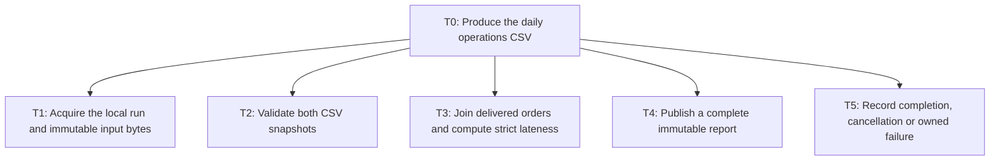
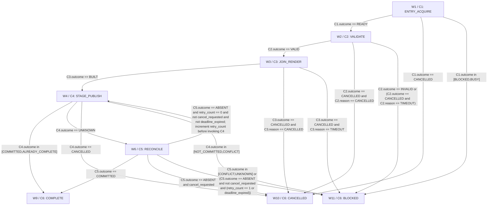

# Daily UTC delivery lateness CSV report

> PASS · DESIGN ONLY. Review is a design judgement; no business controls or provider reliability were executed.

Review method: self-review; round 3.

Review dimensions (supplied scores):

- D1: 3/4 — CTX1-CTX4/T0-T5 bound a daily join/export with exact exclusions and owned cancellation/failure.
- D2: 3/4 — Every leaf maps to C/W/EV; the generated all-category FM↔EV relation is reciprocal; H1-H8 distinguish assumptions from the unchanged brief.
- D3: 3/4 — W1-W11/C4/C5: exhaustive outcomes, one proven-absent retry with distinct staging path; post-start cancellation always readback; exact final proof before completion.
- D4: 3/4 — C1-C6 and CTX4: exact typed manifest/config/run-key canonical object fields, contracts and errors; full stored manifest equality and local human disposition.
- D5: 3/4 — C2/C3 own dates/IDs; F4 local allowlists and C4 fresh checks; manifest proof and H7 minimized retention. H6 platform behavior remains unverified.
- D6: 3/4 — H1-H8 mark source format, window, volumes, owners, policy and filesystem behavior as proposed launch dependencies; no vendor/current-fact claims.
- D7: 3/4 — F1-F5 choose code/local filesystem over LLM/database/cloud and compare deployment alternatives on identical criteria without claiming integrations.
- D8: 4/4 — Models.items is empty with an explicit zero-LLM budget; runtime/storage/human costs excluded as unmeasured.
- D9: 3/4 — FM1-FM9 are case-specific with S/O/D and owners; local unknown commits, injection, conflicts, failure visibility and privacy have explicit tests.
- D10: 3/4 — EV1-EV29 self-contained concrete fixtures; EV30 component/property layers, EV31 monitor and EV32 exact golden membership. Business harness is future work.; Actual independent fixture-label arithmetic audit inspected EV1/EV2/EV6/EV19/EV24/EV29 expected CSV rows: all passed; this is not execution of the future business harness.
- D11: 3/4 — R1-R6 define denominator-based KPIs, source-baseline dependency, noncircular shadow/assist gates, continuous paired effort experiment and manual stop/restore.
- D12: 3/4 — X1/CTX4/C1/C4/C5 propagate repairs; actual helper validation exited 0 with zero errors/warnings. Same-folder export round 1 succeeded; final export inspection is recorded separately in check-evidence.

Review findings:

- ISSUE1 [major, resolved] export/X1: Actual helper validate and same-folder export both exited 0; round-1 evidence is saved. Semantic payload review then found two material implementation ambiguities below.
- ISSUE2 [major, resolved] components/C4: CTX4/C1/C4 did not give one exact typed manifest object or exact config-digest key set, yet C4 delegated the manifest to CTX4. Different implementers could serialize different identity/config/count fields. Specify exact fields/canonical JSON and validate full stored binding before a no-op/completion. Repaired: CTX4 specifies exact manifest shape and canonical config/run-key bytes; C1/C4/C5/X1 propagate the binding.
- ISSUE3 [major, resolved] workflow/W6: C4 reused one staging path across its allowed retry after proven absence, so an orphan first-attempt staging directory could block EV15 despite the designed retry. Also EV27 expected explicit reconciliation for a signal after rename start without an explicit C4 output rule. Give attempt-specific stage paths and a precise post-start cancellation outcome. Repaired: C4 uses -a0/-a1 staging paths, fresh retry staging, owned cleanup, and explicit UNKNOWN on post-start cancellation; C5/X1 agree.

## Task tree



## Workflow



## tasks

### T0 · Produce the daily operations CSV

Acquire and snapshot → validate → join/classify → publish → record a local outcome. On failure or cancellation stop publication and emit an owned local outcome.

Reasoning: Top-level ordering prevents a partially validated report being consumed.

Assumptions:

- H1: proposed assumption; full statement, owner and verification plan are in the top-level ledger.

- H3: proposed assumption; full statement, owner and verification plan are in the top-level ledger.

- H4: proposed assumption; full statement, owner and verification plan are in the top-level ledger.

- H5: proposed assumption; full statement, owner and verification plan are in the top-level ledger.

- H6: proposed assumption; full statement, owner and verification plan are in the top-level ledger.

- H8: proposed assumption; full statement, owner and verification plan are in the top-level ledger.

Data:

```json
{
  "parentId": "",
  "mode": "sequence",
  "basis": [
    "Acquire and snapshot → validate → join/classify → publish → record a local outcome. On failure or cancellation stop publication and emit an owned local outcome."
  ],
  "examples": [
    "T1 then T2 then T3 then T4 then T5"
  ],
  "autonomy": "Deterministic local code; no LLM or external action. The operator supplies permitted local paths; business implementation is not executed by this design exercise.",
  "frequency": "Once per UTC day proposed in H5; bounded manual backfill allowed.",
  "risk": "low"
}
```


Sources:

- context / user-brief: Design a small daily report that joins two CSV files by order ID. One has promised-delivery timestamps and the other actual-delivery timestamps, both ISO UTC. Flag delivered orders more than 24 hours late and export a CSV for the operations team. No emails, remote updates, forecasting or conversational interface.

- hypothesis / H1: The proposed CSV contract is UTF-8 with optional BOM, comma delimiter and one header; promised columns are order_id,promised_delivery_utc and actual columns are order_id,actual_delivery_utc. Extra columns are ignored. IDs are case-sensitive ASCII [A-Za-z0-9][A-Za-z0-9_-]{0,63}, unique within each file; empty or padded IDs are errors.

- hypothesis / H3: The daily report covers actual deliveries in the previous UTC calendar day by default, with an explicit --report-date override for backfills. It contains all delivered rows in that day, not only late rows; a boolean identifies lateness.

- hypothesis / H4: Accepted timestamps use YYYY-MM-DDTHH:MM:SS[.ffffff]Z or +00:00, with 1-6 fractional digits, valid Gregorian dates and seconds 00-59. Empty actual means undelivered; non-UTC offsets, missing promised values, leap seconds and greater precision fail validation.

- hypothesis / H5: Proposed operational budget is at most 100,000 rows and 50 MiB per file, 120 seconds per run, and a once-daily invocation at 08:00 UTC after exports are ready. Operations reviews local status by 10:00 UTC and acknowledges failures by 12:00 UTC; after that the operations lead manually escalates.

- hypothesis / H6: Run on one trusted local host/account with two allowlisted input roots, a dedicated output root and same-filesystem staging. Only the job may mutate its output root; no symlinks are permitted in resolved input/output paths. An operator grants these local capabilities in configuration.

- hypothesis / H8: A date with an existing valid completed report is immutable: identical input/config returns ALREADY_COMPLETE; changed input/config returns CONFLICT. Corrections require the owner to archive the old date directory outside this job and rerun; no replacement action is implemented.

### T1 · Acquire the local run and immutable input bytes

Resolve configured paths and permissions; derive UTC window, reject current/future date, acquire exclusive per-date directory lock, bound sizes and read immutable bytes. Record hashes after reading; do not reread changing files.

Reasoning: Fixed bytes bind every later step to the same evidence.

Assumptions:

- H1: proposed assumption; full statement, owner and verification plan are in the top-level ledger.

- H3: proposed assumption; full statement, owner and verification plan are in the top-level ledger.

- H4: proposed assumption; full statement, owner and verification plan are in the top-level ledger.

- H5: proposed assumption; full statement, owner and verification plan are in the top-level ledger.

- H6: proposed assumption; full statement, owner and verification plan are in the top-level ledger.

- H8: proposed assumption; full statement, owner and verification plan are in the top-level ledger.

Data:

```json
{
  "parentId": "T0",
  "mode": "leaf",
  "basis": [
    "Resolve configured paths and permissions; derive UTC window, reject current/future date, acquire exclusive per-date directory lock, bound sizes and read immutable bytes. Record hashes after reading; do not reread changing files."
  ],
  "examples": [
    "2026-10-27 selects [2026-10-27T00:00:00Z,2026-10-28T00:00:00Z)."
  ],
  "autonomy": "Deterministic local code; no LLM or external action. The operator supplies permitted local paths; business implementation is not executed by this design exercise.",
  "frequency": "Once per UTC day proposed in H5; bounded manual backfill allowed.",
  "risk": "medium"
}
```


Sources:

- context / user-brief: Design a small daily report that joins two CSV files by order ID. One has promised-delivery timestamps and the other actual-delivery timestamps, both ISO UTC. Flag delivered orders more than 24 hours late and export a CSV for the operations team. No emails, remote updates, forecasting or conversational interface.

- hypothesis / H1: The proposed CSV contract is UTF-8 with optional BOM, comma delimiter and one header; promised columns are order_id,promised_delivery_utc and actual columns are order_id,actual_delivery_utc. Extra columns are ignored. IDs are case-sensitive ASCII [A-Za-z0-9][A-Za-z0-9_-]{0,63}, unique within each file; empty or padded IDs are errors.

- hypothesis / H3: The daily report covers actual deliveries in the previous UTC calendar day by default, with an explicit --report-date override for backfills. It contains all delivered rows in that day, not only late rows; a boolean identifies lateness.

- hypothesis / H4: Accepted timestamps use YYYY-MM-DDTHH:MM:SS[.ffffff]Z or +00:00, with 1-6 fractional digits, valid Gregorian dates and seconds 00-59. Empty actual means undelivered; non-UTC offsets, missing promised values, leap seconds and greater precision fail validation.

- hypothesis / H5: Proposed operational budget is at most 100,000 rows and 50 MiB per file, 120 seconds per run, and a once-daily invocation at 08:00 UTC after exports are ready. Operations reviews local status by 10:00 UTC and acknowledges failures by 12:00 UTC; after that the operations lead manually escalates.

- hypothesis / H6: Run on one trusted local host/account with two allowlisted input roots, a dedicated output root and same-filesystem staging. Only the job may mutate its output root; no symlinks are permitted in resolved input/output paths. An operator grants these local capabilities in configuration.

- hypothesis / H8: A date with an existing valid completed report is immutable: identical input/config returns ALREADY_COMPLETE; changed input/config returns CONFLICT. Corrections require the owner to archive the old date directory outside this job and rerun; no replacement action is implemented.

### T2 · Validate both CSV snapshots

Parse the entire files using H1/H4, enforce required unique headers and ID uniqueness and ensure delivered actual IDs have promised rows. Reject all malformed or contradictory inputs with exact reason and row number.

Reasoning: Whole-batch validation prevents silent omissions.

Assumptions:

- H1: proposed assumption; full statement, owner and verification plan are in the top-level ledger.

- H3: proposed assumption; full statement, owner and verification plan are in the top-level ledger.

- H4: proposed assumption; full statement, owner and verification plan are in the top-level ledger.

- H5: proposed assumption; full statement, owner and verification plan are in the top-level ledger.

- H6: proposed assumption; full statement, owner and verification plan are in the top-level ledger.

- H8: proposed assumption; full statement, owner and verification plan are in the top-level ledger.

Data:

```json
{
  "parentId": "T0",
  "mode": "leaf",
  "basis": [
    "Parse the entire files using H1/H4, enforce required unique headers and ID uniqueness and ensure delivered actual IDs have promised rows. Reject all malformed or contradictory inputs with exact reason and row number."
  ],
  "examples": [
    "Duplicate O100 in actual returns DUPLICATE_ID and no CSV."
  ],
  "autonomy": "Deterministic local code; no LLM or external action. The operator supplies permitted local paths; business implementation is not executed by this design exercise.",
  "frequency": "Once per UTC day proposed in H5; bounded manual backfill allowed.",
  "risk": "high"
}
```


Sources:

- context / user-brief: Design a small daily report that joins two CSV files by order ID. One has promised-delivery timestamps and the other actual-delivery timestamps, both ISO UTC. Flag delivered orders more than 24 hours late and export a CSV for the operations team. No emails, remote updates, forecasting or conversational interface.

- hypothesis / H1: The proposed CSV contract is UTF-8 with optional BOM, comma delimiter and one header; promised columns are order_id,promised_delivery_utc and actual columns are order_id,actual_delivery_utc. Extra columns are ignored. IDs are case-sensitive ASCII [A-Za-z0-9][A-Za-z0-9_-]{0,63}, unique within each file; empty or padded IDs are errors.

- hypothesis / H3: The daily report covers actual deliveries in the previous UTC calendar day by default, with an explicit --report-date override for backfills. It contains all delivered rows in that day, not only late rows; a boolean identifies lateness.

- hypothesis / H4: Accepted timestamps use YYYY-MM-DDTHH:MM:SS[.ffffff]Z or +00:00, with 1-6 fractional digits, valid Gregorian dates and seconds 00-59. Empty actual means undelivered; non-UTC offsets, missing promised values, leap seconds and greater precision fail validation.

- hypothesis / H5: Proposed operational budget is at most 100,000 rows and 50 MiB per file, 120 seconds per run, and a once-daily invocation at 08:00 UTC after exports are ready. Operations reviews local status by 10:00 UTC and acknowledges failures by 12:00 UTC; after that the operations lead manually escalates.

- hypothesis / H6: Run on one trusted local host/account with two allowlisted input roots, a dedicated output root and same-filesystem staging. Only the job may mutate its output root; no symlinks are permitted in resolved input/output paths. An operator grants these local capabilities in configuration.

- hypothesis / H8: A date with an existing valid completed report is immutable: identical input/config returns ALREADY_COMPLETE; changed input/config returns CONFLICT. Corrections require the owner to archive the old date directory outside this job and rerun; no replacement action is implemented.

### T3 · Join delivered orders and compute strict lateness

Exact string join, then daily-window filtering; compute signed microseconds without floats; build sorted rows, counts and deterministic CSV bytes.

Reasoning: Dates and joins require code rather than judgement.

Assumptions:

- H1: proposed assumption; full statement, owner and verification plan are in the top-level ledger.

- H3: proposed assumption; full statement, owner and verification plan are in the top-level ledger.

- H4: proposed assumption; full statement, owner and verification plan are in the top-level ledger.

- H5: proposed assumption; full statement, owner and verification plan are in the top-level ledger.

- H6: proposed assumption; full statement, owner and verification plan are in the top-level ledger.

- H8: proposed assumption; full statement, owner and verification plan are in the top-level ledger.

Data:

```json
{
  "parentId": "T0",
  "mode": "leaf",
  "basis": [
    "Exact string join, then daily-window filtering; compute signed microseconds without floats; build sorted rows, counts and deterministic CSV bytes."
  ],
  "examples": [
    "Actual 2026-10-27T12:00:00.000001Z minus promised 2026-10-26T12:00:00Z is late; exactly 24h is false."
  ],
  "autonomy": "Deterministic local code; no LLM or external action. The operator supplies permitted local paths; business implementation is not executed by this design exercise.",
  "frequency": "Once per UTC day proposed in H5; bounded manual backfill allowed.",
  "risk": "high"
}
```


Sources:

- context / user-brief: Design a small daily report that joins two CSV files by order ID. One has promised-delivery timestamps and the other actual-delivery timestamps, both ISO UTC. Flag delivered orders more than 24 hours late and export a CSV for the operations team. No emails, remote updates, forecasting or conversational interface.

- hypothesis / H1: The proposed CSV contract is UTF-8 with optional BOM, comma delimiter and one header; promised columns are order_id,promised_delivery_utc and actual columns are order_id,actual_delivery_utc. Extra columns are ignored. IDs are case-sensitive ASCII [A-Za-z0-9][A-Za-z0-9_-]{0,63}, unique within each file; empty or padded IDs are errors.

- hypothesis / H3: The daily report covers actual deliveries in the previous UTC calendar day by default, with an explicit --report-date override for backfills. It contains all delivered rows in that day, not only late rows; a boolean identifies lateness.

- hypothesis / H4: Accepted timestamps use YYYY-MM-DDTHH:MM:SS[.ffffff]Z or +00:00, with 1-6 fractional digits, valid Gregorian dates and seconds 00-59. Empty actual means undelivered; non-UTC offsets, missing promised values, leap seconds and greater precision fail validation.

- hypothesis / H5: Proposed operational budget is at most 100,000 rows and 50 MiB per file, 120 seconds per run, and a once-daily invocation at 08:00 UTC after exports are ready. Operations reviews local status by 10:00 UTC and acknowledges failures by 12:00 UTC; after that the operations lead manually escalates.

- hypothesis / H6: Run on one trusted local host/account with two allowlisted input roots, a dedicated output root and same-filesystem staging. Only the job may mutate its output root; no symlinks are permitted in resolved input/output paths. An operator grants these local capabilities in configuration.

- hypothesis / H8: A date with an existing valid completed report is immutable: identical input/config returns ALREADY_COMPLETE; changed input/config returns CONFLICT. Corrections require the owner to archive the old date directory outside this job and rerun; no replacement action is implemented.

### T4 · Publish a complete immutable report

Under the date lock, compare any existing completed date directory. Stage CSV and COMPLETE manifest, fsync files and staging directory, then rename date directory and fsync parent. Reconcile uncertain publication before any retry.

Reasoning: A report is consumable only with durable checksum proof.

Assumptions:

- H1: proposed assumption; full statement, owner and verification plan are in the top-level ledger.

- H3: proposed assumption; full statement, owner and verification plan are in the top-level ledger.

- H4: proposed assumption; full statement, owner and verification plan are in the top-level ledger.

- H5: proposed assumption; full statement, owner and verification plan are in the top-level ledger.

- H6: proposed assumption; full statement, owner and verification plan are in the top-level ledger.

- H8: proposed assumption; full statement, owner and verification plan are in the top-level ledger.

Data:

```json
{
  "parentId": "T0",
  "mode": "leaf",
  "basis": [
    "Under the date lock, compare any existing completed date directory. Stage CSV and COMPLETE manifest, fsync files and staging directory, then rename date directory and fsync parent. Reconcile uncertain publication before any retry."
  ],
  "examples": [
    "A crash after directory rename is reconciled as COMPLETE if final hashes match."
  ],
  "autonomy": "Deterministic local code; no LLM or external action. The operator supplies permitted local paths; business implementation is not executed by this design exercise.",
  "frequency": "Once per UTC day proposed in H5; bounded manual backfill allowed.",
  "risk": "high"
}
```


Sources:

- context / user-brief: Design a small daily report that joins two CSV files by order ID. One has promised-delivery timestamps and the other actual-delivery timestamps, both ISO UTC. Flag delivered orders more than 24 hours late and export a CSV for the operations team. No emails, remote updates, forecasting or conversational interface.

- hypothesis / H1: The proposed CSV contract is UTF-8 with optional BOM, comma delimiter and one header; promised columns are order_id,promised_delivery_utc and actual columns are order_id,actual_delivery_utc. Extra columns are ignored. IDs are case-sensitive ASCII [A-Za-z0-9][A-Za-z0-9_-]{0,63}, unique within each file; empty or padded IDs are errors.

- hypothesis / H3: The daily report covers actual deliveries in the previous UTC calendar day by default, with an explicit --report-date override for backfills. It contains all delivered rows in that day, not only late rows; a boolean identifies lateness.

- hypothesis / H4: Accepted timestamps use YYYY-MM-DDTHH:MM:SS[.ffffff]Z or +00:00, with 1-6 fractional digits, valid Gregorian dates and seconds 00-59. Empty actual means undelivered; non-UTC offsets, missing promised values, leap seconds and greater precision fail validation.

- hypothesis / H5: Proposed operational budget is at most 100,000 rows and 50 MiB per file, 120 seconds per run, and a once-daily invocation at 08:00 UTC after exports are ready. Operations reviews local status by 10:00 UTC and acknowledges failures by 12:00 UTC; after that the operations lead manually escalates.

- hypothesis / H6: Run on one trusted local host/account with two allowlisted input roots, a dedicated output root and same-filesystem staging. Only the job may mutate its output root; no symlinks are permitted in resolved input/output paths. An operator grants these local capabilities in configuration.

- hypothesis / H8: A date with an existing valid completed report is immutable: identical input/config returns ALREADY_COMPLETE; changed input/config returns CONFLICT. Corrections require the owner to archive the old date directory outside this job and rerun; no replacement action is implemented.

### T5 · Record completion, cancellation or owned failure

Write local status safely; release acquired lock on normal exit. Operations inspects the local result each day. Failure gets proposed owner, acknowledgement deadline, next action and visible state. Unknown publication and stale locks require manual inspection.

Reasoning: No email or remote update is introduced to handle failures.

Assumptions:

- H1: proposed assumption; full statement, owner and verification plan are in the top-level ledger.

- H3: proposed assumption; full statement, owner and verification plan are in the top-level ledger.

- H4: proposed assumption; full statement, owner and verification plan are in the top-level ledger.

- H5: proposed assumption; full statement, owner and verification plan are in the top-level ledger.

- H6: proposed assumption; full statement, owner and verification plan are in the top-level ledger.

- H8: proposed assumption; full statement, owner and verification plan are in the top-level ledger.

Data:

```json
{
  "parentId": "T0",
  "mode": "leaf",
  "basis": [
    "Write local status safely; release acquired lock on normal exit. Operations inspects the local result each day. Failure gets proposed owner, acknowledgement deadline, next action and visible state. Unknown publication and stale locks require manual inspection."
  ],
  "examples": [
    "BLOCKED/INPUT_INVALID: owner fixes CSV export and reruns; no final report is produced."
  ],
  "autonomy": "Deterministic local code; no LLM or external action. The operator supplies permitted local paths; business implementation is not executed by this design exercise.",
  "frequency": "Once per UTC day proposed in H5; bounded manual backfill allowed.",
  "risk": "medium"
}
```


Sources:

- context / user-brief: Design a small daily report that joins two CSV files by order ID. One has promised-delivery timestamps and the other actual-delivery timestamps, both ISO UTC. Flag delivered orders more than 24 hours late and export a CSV for the operations team. No emails, remote updates, forecasting or conversational interface.

- hypothesis / H1: The proposed CSV contract is UTF-8 with optional BOM, comma delimiter and one header; promised columns are order_id,promised_delivery_utc and actual columns are order_id,actual_delivery_utc. Extra columns are ignored. IDs are case-sensitive ASCII [A-Za-z0-9][A-Za-z0-9_-]{0,63}, unique within each file; empty or padded IDs are errors.

- hypothesis / H3: The daily report covers actual deliveries in the previous UTC calendar day by default, with an explicit --report-date override for backfills. It contains all delivered rows in that day, not only late rows; a boolean identifies lateness.

- hypothesis / H4: Accepted timestamps use YYYY-MM-DDTHH:MM:SS[.ffffff]Z or +00:00, with 1-6 fractional digits, valid Gregorian dates and seconds 00-59. Empty actual means undelivered; non-UTC offsets, missing promised values, leap seconds and greater precision fail validation.

- hypothesis / H5: Proposed operational budget is at most 100,000 rows and 50 MiB per file, 120 seconds per run, and a once-daily invocation at 08:00 UTC after exports are ready. Operations reviews local status by 10:00 UTC and acknowledges failures by 12:00 UTC; after that the operations lead manually escalates.

- hypothesis / H6: Run on one trusted local host/account with two allowlisted input roots, a dedicated output root and same-filesystem staging. Only the job may mutate its output root; no symlinks are permitted in resolved input/output paths. An operator grants these local capabilities in configuration.

- hypothesis / H8: A date with an existing valid completed report is immutable: identical input/config returns ALREADY_COMPLETE; changed input/config returns CONFLICT. Corrections require the owner to archive the old date directory outside this job and rerun; no replacement action is implemented.

### A1 · Immutable CSV evidence

Two operator-provided local CSV files; exact content hashes produced by C1.

Reasoning: Bind the required evidence to the leaves that use it.

Assumptions:

- H6: proposed assumption; full statement, owner and verification plan are in the top-level ledger.

Data:

```json
{
  "taskIds": [
    "T1",
    "T2",
    "T3"
  ],
  "sourceSystem": "Two operator-provided local CSV files; exact content hashes produced by C1.",
  "loaded": "session start"
}
```


Sources:

- context / user-brief: Design a small daily report that joins two CSV files by order ID. One has promised-delivery timestamps and the other actual-delivery timestamps, both ISO UTC. Flag delivered orders more than 24 hours late and export a CSV for the operations team. No emails, remote updates, forecasting or conversational interface.

- hypothesis / H6: Run on one trusted local host/account with two allowlisted input roots, a dedicated output root and same-filesystem staging. Only the job may mutate its output root; no symlinks are permitted in resolved input/output paths. An operator grants these local capabilities in configuration.

### A2 · Run policy and report identity

Versioned local config: schema_version=delivery-report-v1, threshold_microseconds=86400000000, UTC report date, allowlisted roots and H1/H4 parser profile; no live remote policy.

Reasoning: Bind the required evidence to the leaves that use it.

Assumptions:

- H6: proposed assumption; full statement, owner and verification plan are in the top-level ledger.

Data:

```json
{
  "taskIds": [
    "T1",
    "T3",
    "T4"
  ],
  "sourceSystem": "Versioned local config: schema_version=delivery-report-v1, threshold_microseconds=86400000000, UTC report date, allowlisted roots and H1/H4 parser profile; no live remote policy.",
  "loaded": "session start"
}
```


Sources:

- context / user-brief: Design a small daily report that joins two CSV files by order ID. One has promised-delivery timestamps and the other actual-delivery timestamps, both ISO UTC. Flag delivered orders more than 24 hours late and export a CSV for the operations team. No emails, remote updates, forecasting or conversational interface.

- hypothesis / H6: Run on one trusted local host/account with two allowlisted input roots, a dedicated output root and same-filesystem staging. Only the job may mutate its output root; no symlinks are permitted in resolved input/output paths. An operator grants these local capabilities in configuration.

### A3 · Durable publication and failure state

Dedicated local output root, per-date lock, staging directory, committed manifest/CSV and status record; C4/C5 produce record evidence.

Reasoning: Bind the required evidence to the leaves that use it.

Assumptions:

- H6: proposed assumption; full statement, owner and verification plan are in the top-level ledger.

Data:

```json
{
  "taskIds": [
    "T4",
    "T5"
  ],
  "sourceSystem": "Dedicated local output root, per-date lock, staging directory, committed manifest/CSV and status record; C4/C5 produce record evidence.",
  "loaded": "session start"
}
```


Sources:

- context / user-brief: Design a small daily report that joins two CSV files by order ID. One has promised-delivery timestamps and the other actual-delivery timestamps, both ISO UTC. Flag delivered orders more than 24 hours late and export a CSV for the operations team. No emails, remote updates, forecasting or conversational interface.

- hypothesis / H6: Run on one trusted local host/account with two allowlisted input roots, a dedicated output root and same-filesystem staging. Only the job may mutate its output root; no symlinks are permitted in resolved input/output paths. An operator grants these local capabilities in configuration.


## components

### C1 · Run controller and immutable read

CLI run --promised PATH --actual PATH [--report-date D] --out ROOT. Reject future/current day; fail rather than use partial reads. Before and after reading verify same inode/size/mtime_ns; change gives INPUT_IO. Hash exact bytes in memory. Lock mkdir is exclusive; never break an existing lock automatically. SHA256 run_key is hash of compact sorted-key UTF-8 JSON {schema_version,report_date,config_digest,promised_sha256,actual_sha256}; canonical JSON has no spaces. config_digest hashes parser/limits/output/threshold settings, excluding absolute paths. Cancellation checked at bounded row batches and immediately before publication; lock metadata contains pid, start time and run key when known. Whole-run deadline 120s; no read retries. Exact digest key sets/serialization are CTX4; schema_version versions all parser/ID/output behavior. config_digest excludes allowlisted paths and includes only schema_version,threshold_microseconds,max_rows,max_bytes_per_file,deadline_seconds with native JSON numeric types.

Reasoning: Dates, hashes, identity and locks are exact deterministic operations; no natural-language interpretation is needed.

Assumptions:

- H1: proposed assumption; full statement, owner and verification plan are in the top-level ledger.

- H4: proposed assumption; full statement, owner and verification plan are in the top-level ledger.

- H5: proposed assumption; full statement, owner and verification plan are in the top-level ledger.

- H6: proposed assumption; full statement, owner and verification plan are in the top-level ledger.

- H7: proposed assumption; full statement, owner and verification plan are in the top-level ledger.

- H8: proposed assumption; full statement, owner and verification plan are in the top-level ledger.

Data:

```json
{
  "group": "Code: tools",
  "taskIds": [
    "T1"
  ],
  "inputs": [
    "command: required object {promised_path:absolute path,actual_path:absolute path,output_root:absolute path,report_date:YYYY-MM-DD optional default yesterday UTC}",
    "config: required immutable {schema_version:string,threshold_microseconds:int=86400000000,allowlisted_roots:array[path],max_rows:int=100000,max_bytes_per_file:int=52428800,deadline_seconds:int=120}",
    "clock.now_utc:required aware UTC datetime; signal.cancel_requested:required boolean, initially false"
  ],
  "outputs": [
    "outcome:enum READY|BLOCKED|BUSY|CANCELLED; reason:enum NONE|INVALID_DATE|PATH_DENIED|INPUT_IO|FILE_TOO_LARGE|OUTPUT_IO|LOCK_BUSY|CANCELLED|TIMEOUT",
    "snapshot when READY:required {promised_bytes:bytes,actual_bytes:bytes,promised_sha256:hex64,actual_sha256:hex64,config_digest:hex64,run_key:hex64,report_date:date,window_start:UTC datetime,window_end:UTC datetime,lock_path:path,deadline:monotonic time}",
    "lock_acquired:required boolean; retry_count:required int=0; error:optional {file_role:enum promised|actual|output,row_number:optional int}; no row contents"
  ],
  "whyCode": "Dates, hashes, identity and locks are exact deterministic operations; no natural-language interpretation is needed.",
  "approvalRule": "Operator-configured local filesystem permission only; no runtime approval conversation. Recheck local path/capability before reads/writes. No external action is authorized by this design."
}
```


Sources:

- context / user-brief: Design a small daily report that joins two CSV files by order ID. One has promised-delivery timestamps and the other actual-delivery timestamps, both ISO UTC. Flag delivered orders more than 24 hours late and export a CSV for the operations team. No emails, remote updates, forecasting or conversational interface.

- hypothesis / H1: The proposed CSV contract is UTF-8 with optional BOM, comma delimiter and one header; promised columns are order_id,promised_delivery_utc and actual columns are order_id,actual_delivery_utc. Extra columns are ignored. IDs are case-sensitive ASCII [A-Za-z0-9][A-Za-z0-9_-]{0,63}, unique within each file; empty or padded IDs are errors.

- hypothesis / H4: Accepted timestamps use YYYY-MM-DDTHH:MM:SS[.ffffff]Z or +00:00, with 1-6 fractional digits, valid Gregorian dates and seconds 00-59. Empty actual means undelivered; non-UTC offsets, missing promised values, leap seconds and greater precision fail validation.

- hypothesis / H5: Proposed operational budget is at most 100,000 rows and 50 MiB per file, 120 seconds per run, and a once-daily invocation at 08:00 UTC after exports are ready. Operations reviews local status by 10:00 UTC and acknowledges failures by 12:00 UTC; after that the operations lead manually escalates.

- hypothesis / H6: Run on one trusted local host/account with two allowlisted input roots, a dedicated output root and same-filesystem staging. Only the job may mutate its output root; no symlinks are permitted in resolved input/output paths. An operator grants these local capabilities in configuration.

- hypothesis / H7: Keep committed CSVs, manifests and local failure records for 30 days. Do not copy raw input files; persist hashes, counts and error row numbers without row contents. Delete expired files locally only through a separate operator-maintained procedure.

- hypothesis / H8: A date with an existing valid completed report is immutable: identical input/config returns ALREADY_COMPLETE; changed input/config returns CONFLICT. Corrections require the owner to archive the old date directory outside this job and rerun; no replacement action is implemented.

### C2 · CSV integrity validator

CSV parser strict mode, utf-8-sig decode and exact header names; header order may vary and extra columns are ignored, but repeated headers/row-width mismatches fail. Reject all IDs outside H1 and duplicate IDs including identical rows. Validate all promised timestamps and nonblank actual timestamps before filtering. Blank actual is null, not parse failure. Delivered actual IDs absent in promised yield MISSING_PROMISE. Promised-only rows are allowed. Invalid time/date/precision => INVALID_TIMESTAMP; parsed nonzero offset => NON_UTC. No normalization of IDs. All errors terminate the batch; no fallback parser or row skipping. Zero retries.

Reasoning: Typed parsing and one-to-one constraints protect join identity and exact threshold arithmetic.

Assumptions:

- H1: proposed assumption; full statement, owner and verification plan are in the top-level ledger.

- H4: proposed assumption; full statement, owner and verification plan are in the top-level ledger.

- H5: proposed assumption; full statement, owner and verification plan are in the top-level ledger.

- H6: proposed assumption; full statement, owner and verification plan are in the top-level ledger.

- H7: proposed assumption; full statement, owner and verification plan are in the top-level ledger.

- H8: proposed assumption; full statement, owner and verification plan are in the top-level ledger.

Data:

```json
{
  "group": "Code: validation",
  "taskIds": [
    "T2"
  ],
  "inputs": [
    "snapshot:required C1 READY snapshot",
    "cancel_requested:required boolean; deadline:required monotonic time"
  ],
  "outputs": [
    "outcome:enum VALID|INVALID|CANCELLED; reason:enum NONE|CSV_PARSE|ENCODING|MISSING_HEADER|DUPLICATE_HEADER|ROW_SHAPE|ROW_LIMIT|INVALID_ID|DUPLICATE_ID|MISSING_PROMISE|INVALID_TIMESTAMP|NON_UTC|CANCELLED|TIMEOUT",
    "validated when VALID:required {promised:map[string,int microseconds since epoch],actual:map[string,int microseconds since epoch|null],raw_count_promised:int,raw_count_actual:int}",
    "error when INVALID:required {reason:enum as above,file_role:enum promised|actual,row_number:int}; row 1 means header; no raw field value"
  ],
  "whyCode": "Typed parsing and one-to-one constraints protect join identity and exact threshold arithmetic.",
  "approvalRule": "Operator-configured local filesystem permission only; no runtime approval conversation. Recheck local path/capability before reads/writes. No external action is authorized by this design."
}
```


Sources:

- context / user-brief: Design a small daily report that joins two CSV files by order ID. One has promised-delivery timestamps and the other actual-delivery timestamps, both ISO UTC. Flag delivered orders more than 24 hours late and export a CSV for the operations team. No emails, remote updates, forecasting or conversational interface.

- hypothesis / H1: The proposed CSV contract is UTF-8 with optional BOM, comma delimiter and one header; promised columns are order_id,promised_delivery_utc and actual columns are order_id,actual_delivery_utc. Extra columns are ignored. IDs are case-sensitive ASCII [A-Za-z0-9][A-Za-z0-9_-]{0,63}, unique within each file; empty or padded IDs are errors.

- hypothesis / H4: Accepted timestamps use YYYY-MM-DDTHH:MM:SS[.ffffff]Z or +00:00, with 1-6 fractional digits, valid Gregorian dates and seconds 00-59. Empty actual means undelivered; non-UTC offsets, missing promised values, leap seconds and greater precision fail validation.

- hypothesis / H5: Proposed operational budget is at most 100,000 rows and 50 MiB per file, 120 seconds per run, and a once-daily invocation at 08:00 UTC after exports are ready. Operations reviews local status by 10:00 UTC and acknowledges failures by 12:00 UTC; after that the operations lead manually escalates.

- hypothesis / H6: Run on one trusted local host/account with two allowlisted input roots, a dedicated output root and same-filesystem staging. Only the job may mutate its output root; no symlinks are permitted in resolved input/output paths. An operator grants these local capabilities in configuration.

- hypothesis / H7: Keep committed CSVs, manifests and local failure records for 30 days. Do not copy raw input files; persist hashes, counts and error row numbers without row contents. Delete expired files locally only through a separate operator-maintained procedure.

- hypothesis / H8: A date with an existing valid completed report is immutable: identical input/config returns ALREADY_COMPLETE; changed input/config returns CONFLICT. Corrections require the owner to archive the old date directory outside this job and rerun; no replacement action is implemented.

### C3 · Exact join and renderer

For each actual-map ID with nonnull timestamp use matching promised timestamp; include iff start<=actual<end. Calculate signed delta as int microseconds; flag delta>86400000000. Decimal seconds formatting has exactly six digits, including negative values; never round before comparison. Canonical timestamps use six fractional digits and Z. Sort ASCII order IDs, UTF-8 no BOM and CRLF including final record; all columns deterministic. Blank-actual records count as excluded_undelivered; promised-only_rows counts promised IDs absent from actual map. Empty valid input produces just the header. Check deadline/cancel every 1000 rows. No retries.

Reasoning: A code-only join and integer arithmetic are simpler and testable at the microsecond boundary.

Assumptions:

- H1: proposed assumption; full statement, owner and verification plan are in the top-level ledger.

- H4: proposed assumption; full statement, owner and verification plan are in the top-level ledger.

- H5: proposed assumption; full statement, owner and verification plan are in the top-level ledger.

- H6: proposed assumption; full statement, owner and verification plan are in the top-level ledger.

- H7: proposed assumption; full statement, owner and verification plan are in the top-level ledger.

- H8: proposed assumption; full statement, owner and verification plan are in the top-level ledger.

Data:

```json
{
  "group": "Code: validation",
  "taskIds": [
    "T3"
  ],
  "inputs": [
    "validated:required C2 VALID maps",
    "window_start/window_end:required integer UTC epoch microseconds from C1",
    "threshold_microseconds:required int=86400000000",
    "cancel_requested:required boolean; deadline:required monotonic time"
  ],
  "outputs": [
    "outcome:enum BUILT|CANCELLED; reason:enum NONE|CANCELLED|TIMEOUT",
    "report when BUILT:required {csv_bytes:bytes,report_sha256:hex64,rows:int,flagged_rows:int,excluded_undelivered:int,excluded_out_of_window:int,promised_only_rows:int}"
  ],
  "whyCode": "A code-only join and integer arithmetic are simpler and testable at the microsecond boundary.",
  "approvalRule": "Operator-configured local filesystem permission only; no runtime approval conversation. Recheck local path/capability before reads/writes. No external action is authorized by this design."
}
```


Sources:

- context / user-brief: Design a small daily report that joins two CSV files by order ID. One has promised-delivery timestamps and the other actual-delivery timestamps, both ISO UTC. Flag delivered orders more than 24 hours late and export a CSV for the operations team. No emails, remote updates, forecasting or conversational interface.

- hypothesis / H1: The proposed CSV contract is UTF-8 with optional BOM, comma delimiter and one header; promised columns are order_id,promised_delivery_utc and actual columns are order_id,actual_delivery_utc. Extra columns are ignored. IDs are case-sensitive ASCII [A-Za-z0-9][A-Za-z0-9_-]{0,63}, unique within each file; empty or padded IDs are errors.

- hypothesis / H4: Accepted timestamps use YYYY-MM-DDTHH:MM:SS[.ffffff]Z or +00:00, with 1-6 fractional digits, valid Gregorian dates and seconds 00-59. Empty actual means undelivered; non-UTC offsets, missing promised values, leap seconds and greater precision fail validation.

- hypothesis / H5: Proposed operational budget is at most 100,000 rows and 50 MiB per file, 120 seconds per run, and a once-daily invocation at 08:00 UTC after exports are ready. Operations reviews local status by 10:00 UTC and acknowledges failures by 12:00 UTC; after that the operations lead manually escalates.

- hypothesis / H6: Run on one trusted local host/account with two allowlisted input roots, a dedicated output root and same-filesystem staging. Only the job may mutate its output root; no symlinks are permitted in resolved input/output paths. An operator grants these local capabilities in configuration.

- hypothesis / H7: Keep committed CSVs, manifests and local failure records for 30 days. Do not copy raw input files; persist hashes, counts and error row numbers without row contents. Delete expired files locally only through a separate operator-maintained procedure.

- hypothesis / H8: A date with an existing valid completed report is immutable: identical input/config returns ALREADY_COMPLETE; changed input/config returns CONFLICT. Corrections require the owner to archive the old date directory outside this job and rerun; no replacement action is implemented.

### C4 · Atomic local publisher

Final directory ROOT/YYYY-MM-DD contains report.csv and manifest.json. Under acquired per-date lock, existing COMPLETE manifest with same run_key and matching CSV hash => ALREADY_COMPLETE; any differing or incomplete final directory => CONFLICT. Stage at ROOT/.staging-<date>-<run_key>-<pid>-a<retry_count>; create files exclusively, fsync each and directory. Manifest schema is in CTX4; input counts are C2/C3 outputs. Recheck output-root permission and lock ownership before rename. Publish by same-filesystem directory rename then fsync output root; any exception after rename begins => UNKNOWN and C5 reconciliation, never immediate retry. Before rename, cancellation deletes staging and returns CANCELLED; failures known before rename return NOT_COMMITTED. After rename begins defer cancellation until reconciliation determines whether published. Stage no later than deadline; uncertain timeout is UNKNOWN. No network, input mutation or automatic overwrite. The exact typed manifest/canonical JSON is CTX4. Before ALREADY_COMPLETE verify all stored date/schema/config/input hashes and derived counts against the current expected manifest, plus actual report hash; any discrepancy is CONFLICT. A retry uses its fresh -a1 directory; best-effort remove the owned prior -a0 stage after ABSENT proof, but cleanup failure never authorizes reading/reusing that stage. No automatic deletion of another run stage. Any cancellation signal received after rename begins makes C4 return UNKNOWN, even if rename appears successful, so W6 proves COMMITTED or ABSENT before selecting terminal; no post-start CANCELLED outcome bypasses readback.

Reasoning: Atomic publication with content identity prevents partial reports, duplicate runs and false completion.

Assumptions:

- H1: proposed assumption; full statement, owner and verification plan are in the top-level ledger.

- H4: proposed assumption; full statement, owner and verification plan are in the top-level ledger.

- H5: proposed assumption; full statement, owner and verification plan are in the top-level ledger.

- H6: proposed assumption; full statement, owner and verification plan are in the top-level ledger.

- H7: proposed assumption; full statement, owner and verification plan are in the top-level ledger.

- H8: proposed assumption; full statement, owner and verification plan are in the top-level ledger.

Data:

```json
{
  "group": "Code: tools",
  "taskIds": [
    "T4"
  ],
  "inputs": [
    "snapshot:required C1 snapshot; report:required C3 BUILT report",
    "retry_count:required int in 0..1; cancel_requested:required boolean",
    "capability:required output-root permission from local execution account, rechecked before staging and rename; date lock still held"
  ],
  "outputs": [
    "outcome:enum COMMITTED|ALREADY_COMPLETE|NOT_COMMITTED|UNKNOWN|CONFLICT|CANCELLED; reason:enum NONE|PERMISSION_DENIED|STAGE_IO|PUBLISH_AMBIGUOUS|EXISTING_CONFLICT|CANCELLED|TIMEOUT",
    "proof when COMMITTED or ALREADY_COMPLETE:required {final_dir:absolute path,manifest_path:absolute path,run_key:hex64,report_sha256:hex64,manifest_status:COMPLETE}",
    "candidate_final_dir:required absolute path; cleanup_warning:optional enum STAGING_CLEANUP_FAILED|LOCK_CLEANUP_FAILED"
  ],
  "whyCode": "Atomic publication with content identity prevents partial reports, duplicate runs and false completion.",
  "approvalRule": "Operator-configured local filesystem permission only; no runtime approval conversation. Recheck local path/capability before reads/writes. No external action is authorized by this design."
}
```


Sources:

- context / user-brief: Design a small daily report that joins two CSV files by order ID. One has promised-delivery timestamps and the other actual-delivery timestamps, both ISO UTC. Flag delivered orders more than 24 hours late and export a CSV for the operations team. No emails, remote updates, forecasting or conversational interface.

- hypothesis / H1: The proposed CSV contract is UTF-8 with optional BOM, comma delimiter and one header; promised columns are order_id,promised_delivery_utc and actual columns are order_id,actual_delivery_utc. Extra columns are ignored. IDs are case-sensitive ASCII [A-Za-z0-9][A-Za-z0-9_-]{0,63}, unique within each file; empty or padded IDs are errors.

- hypothesis / H4: Accepted timestamps use YYYY-MM-DDTHH:MM:SS[.ffffff]Z or +00:00, with 1-6 fractional digits, valid Gregorian dates and seconds 00-59. Empty actual means undelivered; non-UTC offsets, missing promised values, leap seconds and greater precision fail validation.

- hypothesis / H5: Proposed operational budget is at most 100,000 rows and 50 MiB per file, 120 seconds per run, and a once-daily invocation at 08:00 UTC after exports are ready. Operations reviews local status by 10:00 UTC and acknowledges failures by 12:00 UTC; after that the operations lead manually escalates.

- hypothesis / H6: Run on one trusted local host/account with two allowlisted input roots, a dedicated output root and same-filesystem staging. Only the job may mutate its output root; no symlinks are permitted in resolved input/output paths. An operator grants these local capabilities in configuration.

- hypothesis / H7: Keep committed CSVs, manifests and local failure records for 30 days. Do not copy raw input files; persist hashes, counts and error row numbers without row contents. Delete expired files locally only through a separate operator-maintained procedure.

- hypothesis / H8: A date with an existing valid completed report is immutable: identical input/config returns ALREADY_COMPLETE; changed input/config returns CONFLICT. Corrections require the owner to archive the old date directory outside this job and rerun; no replacement action is implemented.

### C5 · Read-only publication reconciler

Read final manifest and CSV under held lock. COMPLETE + expected run_key + actual CSV SHA256 match => COMMITTED. No final directory => ABSENT; readable nonmatching/incomplete final => CONFLICT; read failure or reconciliation deadline => UNKNOWN. One reconciliation attempt, no write. ABSENT may authorize one C4 retry only if retry_count==0 and cancellation/deadline have not fired; increment before retry. Any unresolved ambiguity blocks owned outcome; an expired caller or stale lock never authorizes another publication. Matching proof also requires every expected manifest field from CTX4 (date/schema/config/input hashes and counts), not only status/run_key/output hash; mismatch yields CONFLICT. Read-only C5 never repairs or deletes a final directory.

Reasoning: Read-only evidence distinguishes a committed report from a safe retry and from unresolved ambiguity.

Assumptions:

- H1: proposed assumption; full statement, owner and verification plan are in the top-level ledger.

- H4: proposed assumption; full statement, owner and verification plan are in the top-level ledger.

- H5: proposed assumption; full statement, owner and verification plan are in the top-level ledger.

- H6: proposed assumption; full statement, owner and verification plan are in the top-level ledger.

- H7: proposed assumption; full statement, owner and verification plan are in the top-level ledger.

- H8: proposed assumption; full statement, owner and verification plan are in the top-level ledger.

Data:

```json
{
  "group": "Code: validation",
  "taskIds": [
    "T4"
  ],
  "inputs": [
    "candidate_final_dir:required absolute path; expected_run_key:required hex64; expected_report_sha256:required hex64",
    "read_capability:required within configured output root; retry_count:int 0..1; reconcile deadline:monotonic time now+5s"
  ],
  "outputs": [
    "outcome:enum COMMITTED|ABSENT|CONFLICT|UNKNOWN; reason:enum NONE|FINAL_ABSENT|FINAL_MISMATCH|READBACK_IO|TIMEOUT",
    "proof when COMMITTED:required same proof shape as C4; observed_final_state:required enum MATCH|ABSENT|MISMATCH|UNREADABLE"
  ],
  "whyCode": "Read-only evidence distinguishes a committed report from a safe retry and from unresolved ambiguity.",
  "approvalRule": "Operator-configured local filesystem permission only; no runtime approval conversation. Recheck local path/capability before reads/writes. No external action is authorized by this design."
}
```


Sources:

- context / user-brief: Design a small daily report that joins two CSV files by order ID. One has promised-delivery timestamps and the other actual-delivery timestamps, both ISO UTC. Flag delivered orders more than 24 hours late and export a CSV for the operations team. No emails, remote updates, forecasting or conversational interface.

- hypothesis / H1: The proposed CSV contract is UTF-8 with optional BOM, comma delimiter and one header; promised columns are order_id,promised_delivery_utc and actual columns are order_id,actual_delivery_utc. Extra columns are ignored. IDs are case-sensitive ASCII [A-Za-z0-9][A-Za-z0-9_-]{0,63}, unique within each file; empty or padded IDs are errors.

- hypothesis / H4: Accepted timestamps use YYYY-MM-DDTHH:MM:SS[.ffffff]Z or +00:00, with 1-6 fractional digits, valid Gregorian dates and seconds 00-59. Empty actual means undelivered; non-UTC offsets, missing promised values, leap seconds and greater precision fail validation.

- hypothesis / H5: Proposed operational budget is at most 100,000 rows and 50 MiB per file, 120 seconds per run, and a once-daily invocation at 08:00 UTC after exports are ready. Operations reviews local status by 10:00 UTC and acknowledges failures by 12:00 UTC; after that the operations lead manually escalates.

- hypothesis / H6: Run on one trusted local host/account with two allowlisted input roots, a dedicated output root and same-filesystem staging. Only the job may mutate its output root; no symlinks are permitted in resolved input/output paths. An operator grants these local capabilities in configuration.

- hypothesis / H7: Keep committed CSVs, manifests and local failure records for 30 days. Do not copy raw input files; persist hashes, counts and error row numbers without row contents. Delete expired files locally only through a separate operator-maintained procedure.

- hypothesis / H8: A date with an existing valid completed report is immutable: identical input/config returns ALREADY_COMPLETE; changed input/config returns CONFLICT. Corrections require the owner to archive the old date directory outside this job and rerun; no replacement action is implemented.

### C6 · Local outcome recorder

Append a unique per-invocation local JSON status under ROOT/status (exclusive create + fsync), storing report date, run_key when known, terminal/reason, proof, proposed owner, ack_due_utc and manual next action. COMPLETE exits 0 only with C4/C5 proof; BLOCKED exits 2, CANCELLED exits 130. If status write fails emit structured stderr and status_proof=STDERR_ONLY; this does not convert a proved committed report to failure. Remove owned lock at normal exit; cleanup failure is visible stderr/status warning. Hard crash may leave stale lock: operator confirms no running process and read-only checks final manifest before manual lock removal. Operations checks local statuses by 10:00 UTC, acknowledges failure in a separate local operating log by 12:00 UTC, then manually escalates to lead if overdue. No automatic messaging and no indefinite waiting loop.

Reasoning: A file/exit-code handoff handles exceptions without adding a conversational or remote interface.

Assumptions:

- H1: proposed assumption; full statement, owner and verification plan are in the top-level ledger.

- H4: proposed assumption; full statement, owner and verification plan are in the top-level ledger.

- H5: proposed assumption; full statement, owner and verification plan are in the top-level ledger.

- H6: proposed assumption; full statement, owner and verification plan are in the top-level ledger.

- H7: proposed assumption; full statement, owner and verification plan are in the top-level ledger.

- H8: proposed assumption; full statement, owner and verification plan are in the top-level ledger.

Data:

```json
{
  "group": "Code: human triggers",
  "taskIds": [
    "T5"
  ],
  "inputs": [
    "terminal:required enum COMPLETE|BLOCKED|CANCELLED",
    "reason:required enum READY|ALREADY_COMPLETE|INPUT_INVALID|INPUT_IO|OUTPUT_IO|BUSY|CONFLICT|PUBLICATION_UNKNOWN|TIMEOUT|CANCELLED",
    "proof:required on COMPLETE, otherwise absent; lock_acquired:required bool",
    "owner_role:required proposed Operations report owner; acknowledgement_due:required next 12:00 UTC following this run"
  ],
  "outputs": [
    "state:enum COMPLETE|BLOCKED|CANCELLED; exit_code:int enum 0|2|130; status_path:optional absolute path",
    "status_proof:enum DURABLE|STDERR_ONLY; lock_status:enum RELEASED|NOT_HELD|CLEANUP_FAILED"
  ],
  "whyCode": "A file/exit-code handoff handles exceptions without adding a conversational or remote interface.",
  "approvalRule": "Operator-configured local filesystem permission only; no runtime approval conversation. Recheck local path/capability before reads/writes. No external action is authorized by this design."
}
```


Sources:

- context / user-brief: Design a small daily report that joins two CSV files by order ID. One has promised-delivery timestamps and the other actual-delivery timestamps, both ISO UTC. Flag delivered orders more than 24 hours late and export a CSV for the operations team. No emails, remote updates, forecasting or conversational interface.

- hypothesis / H1: The proposed CSV contract is UTF-8 with optional BOM, comma delimiter and one header; promised columns are order_id,promised_delivery_utc and actual columns are order_id,actual_delivery_utc. Extra columns are ignored. IDs are case-sensitive ASCII [A-Za-z0-9][A-Za-z0-9_-]{0,63}, unique within each file; empty or padded IDs are errors.

- hypothesis / H4: Accepted timestamps use YYYY-MM-DDTHH:MM:SS[.ffffff]Z or +00:00, with 1-6 fractional digits, valid Gregorian dates and seconds 00-59. Empty actual means undelivered; non-UTC offsets, missing promised values, leap seconds and greater precision fail validation.

- hypothesis / H5: Proposed operational budget is at most 100,000 rows and 50 MiB per file, 120 seconds per run, and a once-daily invocation at 08:00 UTC after exports are ready. Operations reviews local status by 10:00 UTC and acknowledges failures by 12:00 UTC; after that the operations lead manually escalates.

- hypothesis / H6: Run on one trusted local host/account with two allowlisted input roots, a dedicated output root and same-filesystem staging. Only the job may mutate its output root; no symlinks are permitted in resolved input/output paths. An operator grants these local capabilities in configuration.

- hypothesis / H7: Keep committed CSVs, manifests and local failure records for 30 days. Do not copy raw input files; persist hashes, counts and error row numbers without row contents. Delete expired files locally only through a separate operator-maintained procedure.

- hypothesis / H8: A date with an existing valid completed report is immutable: identical input/config returns ALREADY_COMPLETE; changed input/config returns CONFLICT. Corrections require the owner to archive the old date directory outside this job and rerun; no replacement action is implemented.


## workflow

### W1 · ENTRY_ACQUIRE

{"state":"ENTRY_ACQUIRE","transitions":[{"to":"W2","when":"C1.outcome == READY","mode":"exclusive"},{"to":"W10","when":"C1.outcome == CANCELLED","mode":"exclusive"},{"to":"W11","when":"C1.outcome in [BLOCKED,BUSY]","mode":"exclusive"}],"failureDisposition":"All outcomes are enumerated below; unhandled internal exceptions go to W11 as BLOCKED/OUTPUT_IO without a success claim.","timeout":"C1-C4 share C1.deadline (120s); C5 has one additional 5s read-only reconciliation budget; C6 attempts local status once then stderr.","retryPolicy":"Zero except W6\u2192W4 after ABSENT, maximum one retry, bounded by deadline and cancellation.","terminalDisposition":"","guardBindings":"C1.outcome enum READY|BLOCKED|BUSY|CANCELLED; C2.outcome VALID|INVALID|CANCELLED; C3.outcome BUILT|CANCELLED; C4.outcome COMMITTED|ALREADY_COMPLETE|NOT_COMMITTED|UNKNOWN|CONFLICT|CANCELLED; C5.outcome COMMITTED|ABSENT|CONFLICT|UNKNOWN. C1 creates retry_count:int=0; orchestrator increments on W6\u2192W4. cancel_requested:boolean comes only from SIGINT/SIGTERM; deadline_expired:boolean compares monotonic clock with C1.deadline. Exact outcome switches below are exhaustive and exclusive; no guard depends on model text. "}

Reasoning: Explicit outcome switches and bounded readback preserve local report integrity.

Assumptions:

- H5: proposed assumption; full statement, owner and verification plan are in the top-level ledger.

- H6: proposed assumption; full statement, owner and verification plan are in the top-level ledger.

- H8: proposed assumption; full statement, owner and verification plan are in the top-level ledger.

Data:

```json
{
  "componentId": "C1",
  "taskIds": [
    "T1"
  ],
  "next": [
    "W2",
    "W10",
    "W11"
  ],
  "decision": true,
  "example": "Valid two-file command for 2026-10-27 acquires the date lock then W2."
}
```


Sources:

- context / user-brief: Design a small daily report that joins two CSV files by order ID. One has promised-delivery timestamps and the other actual-delivery timestamps, both ISO UTC. Flag delivered orders more than 24 hours late and export a CSV for the operations team. No emails, remote updates, forecasting or conversational interface.

- hypothesis / H5: Proposed operational budget is at most 100,000 rows and 50 MiB per file, 120 seconds per run, and a once-daily invocation at 08:00 UTC after exports are ready. Operations reviews local status by 10:00 UTC and acknowledges failures by 12:00 UTC; after that the operations lead manually escalates.

- hypothesis / H6: Run on one trusted local host/account with two allowlisted input roots, a dedicated output root and same-filesystem staging. Only the job may mutate its output root; no symlinks are permitted in resolved input/output paths. An operator grants these local capabilities in configuration.

- hypothesis / H8: A date with an existing valid completed report is immutable: identical input/config returns ALREADY_COMPLETE; changed input/config returns CONFLICT. Corrections require the owner to archive the old date directory outside this job and rerun; no replacement action is implemented.

### W2 · VALIDATE

{"state":"VALIDATE","transitions":[{"to":"W3","when":"C2.outcome == VALID","mode":"exclusive"},{"to":"W10","when":"C2.outcome == CANCELLED and C2.reason == CANCELLED","mode":"exclusive"},{"to":"W11","when":"C2.outcome == INVALID or (C2.outcome == CANCELLED and C2.reason == TIMEOUT)","mode":"exclusive"}],"failureDisposition":"All outcomes are enumerated below; unhandled internal exceptions go to W11 as BLOCKED/OUTPUT_IO without a success claim.","timeout":"C1-C4 share C1.deadline (120s); C5 has one additional 5s read-only reconciliation budget; C6 attempts local status once then stderr.","retryPolicy":"Zero except W6\u2192W4 after ABSENT, maximum one retry, bounded by deadline and cancellation.","terminalDisposition":"","guardBindings":"C1.outcome enum READY|BLOCKED|BUSY|CANCELLED; C2.outcome VALID|INVALID|CANCELLED; C3.outcome BUILT|CANCELLED; C4.outcome COMMITTED|ALREADY_COMPLETE|NOT_COMMITTED|UNKNOWN|CONFLICT|CANCELLED; C5.outcome COMMITTED|ABSENT|CONFLICT|UNKNOWN. C1 creates retry_count:int=0; orchestrator increments on W6\u2192W4. cancel_requested:boolean comes only from SIGINT/SIGTERM; deadline_expired:boolean compares monotonic clock with C1.deadline. Exact outcome switches below are exhaustive and exclusive; no guard depends on model text. "}

Reasoning: Explicit outcome switches and bounded readback preserve local report integrity.

Assumptions:

- H5: proposed assumption; full statement, owner and verification plan are in the top-level ledger.

- H6: proposed assumption; full statement, owner and verification plan are in the top-level ledger.

- H8: proposed assumption; full statement, owner and verification plan are in the top-level ledger.

Data:

```json
{
  "componentId": "C2",
  "taskIds": [
    "T2"
  ],
  "next": [
    "W3",
    "W10",
    "W11"
  ],
  "decision": true,
  "example": "Duplicate order_id O1 returns INVALID/DUPLICATE_ID → W11/INPUT_INVALID."
}
```


Sources:

- context / user-brief: Design a small daily report that joins two CSV files by order ID. One has promised-delivery timestamps and the other actual-delivery timestamps, both ISO UTC. Flag delivered orders more than 24 hours late and export a CSV for the operations team. No emails, remote updates, forecasting or conversational interface.

- hypothesis / H5: Proposed operational budget is at most 100,000 rows and 50 MiB per file, 120 seconds per run, and a once-daily invocation at 08:00 UTC after exports are ready. Operations reviews local status by 10:00 UTC and acknowledges failures by 12:00 UTC; after that the operations lead manually escalates.

- hypothesis / H6: Run on one trusted local host/account with two allowlisted input roots, a dedicated output root and same-filesystem staging. Only the job may mutate its output root; no symlinks are permitted in resolved input/output paths. An operator grants these local capabilities in configuration.

- hypothesis / H8: A date with an existing valid completed report is immutable: identical input/config returns ALREADY_COMPLETE; changed input/config returns CONFLICT. Corrections require the owner to archive the old date directory outside this job and rerun; no replacement action is implemented.

### W3 · JOIN_RENDER

{"state":"JOIN_RENDER","transitions":[{"to":"W4","when":"C3.outcome == BUILT","mode":"exclusive"},{"to":"W10","when":"C3.outcome == CANCELLED and C3.reason == CANCELLED","mode":"exclusive"},{"to":"W11","when":"C3.outcome == CANCELLED and C3.reason == TIMEOUT","mode":"exclusive"}],"failureDisposition":"All outcomes are enumerated below; unhandled internal exceptions go to W11 as BLOCKED/OUTPUT_IO without a success claim.","timeout":"C1-C4 share C1.deadline (120s); C5 has one additional 5s read-only reconciliation budget; C6 attempts local status once then stderr.","retryPolicy":"Zero except W6\u2192W4 after ABSENT, maximum one retry, bounded by deadline and cancellation.","terminalDisposition":"","guardBindings":"C1.outcome enum READY|BLOCKED|BUSY|CANCELLED; C2.outcome VALID|INVALID|CANCELLED; C3.outcome BUILT|CANCELLED; C4.outcome COMMITTED|ALREADY_COMPLETE|NOT_COMMITTED|UNKNOWN|CONFLICT|CANCELLED; C5.outcome COMMITTED|ABSENT|CONFLICT|UNKNOWN. C1 creates retry_count:int=0; orchestrator increments on W6\u2192W4. cancel_requested:boolean comes only from SIGINT/SIGTERM; deadline_expired:boolean compares monotonic clock with C1.deadline. Exact outcome switches below are exhaustive and exclusive; no guard depends on model text. "}

Reasoning: Explicit outcome switches and bounded readback preserve local report integrity.

Assumptions:

- H5: proposed assumption; full statement, owner and verification plan are in the top-level ledger.

- H6: proposed assumption; full statement, owner and verification plan are in the top-level ledger.

- H8: proposed assumption; full statement, owner and verification plan are in the top-level ledger.

Data:

```json
{
  "componentId": "C3",
  "taskIds": [
    "T3"
  ],
  "next": [
    "W4",
    "W10",
    "W11"
  ],
  "decision": true,
  "example": "Exactly 24h produces false then W4."
}
```


Sources:

- context / user-brief: Design a small daily report that joins two CSV files by order ID. One has promised-delivery timestamps and the other actual-delivery timestamps, both ISO UTC. Flag delivered orders more than 24 hours late and export a CSV for the operations team. No emails, remote updates, forecasting or conversational interface.

- hypothesis / H5: Proposed operational budget is at most 100,000 rows and 50 MiB per file, 120 seconds per run, and a once-daily invocation at 08:00 UTC after exports are ready. Operations reviews local status by 10:00 UTC and acknowledges failures by 12:00 UTC; after that the operations lead manually escalates.

- hypothesis / H6: Run on one trusted local host/account with two allowlisted input roots, a dedicated output root and same-filesystem staging. Only the job may mutate its output root; no symlinks are permitted in resolved input/output paths. An operator grants these local capabilities in configuration.

- hypothesis / H8: A date with an existing valid completed report is immutable: identical input/config returns ALREADY_COMPLETE; changed input/config returns CONFLICT. Corrections require the owner to archive the old date directory outside this job and rerun; no replacement action is implemented.

### W4 · STAGE_PUBLISH

{"state":"STAGE_PUBLISH","transitions":[{"to":"W9","when":"C4.outcome in [COMMITTED,ALREADY_COMPLETE]","mode":"exclusive"},{"to":"W6","when":"C4.outcome == UNKNOWN","mode":"exclusive"},{"to":"W10","when":"C4.outcome == CANCELLED","mode":"exclusive"},{"to":"W11","when":"C4.outcome in [NOT_COMMITTED,CONFLICT]","mode":"exclusive"}],"failureDisposition":"All outcomes are enumerated below; unhandled internal exceptions go to W11 as BLOCKED/OUTPUT_IO without a success claim.","timeout":"C1-C4 share C1.deadline (120s); C5 has one additional 5s read-only reconciliation budget; C6 attempts local status once then stderr.","retryPolicy":"Zero except W6\u2192W4 after ABSENT, maximum one retry, bounded by deadline and cancellation.","terminalDisposition":"","guardBindings":"C1.outcome enum READY|BLOCKED|BUSY|CANCELLED; C2.outcome VALID|INVALID|CANCELLED; C3.outcome BUILT|CANCELLED; C4.outcome COMMITTED|ALREADY_COMPLETE|NOT_COMMITTED|UNKNOWN|CONFLICT|CANCELLED; C5.outcome COMMITTED|ABSENT|CONFLICT|UNKNOWN. C1 creates retry_count:int=0; orchestrator increments on W6\u2192W4. cancel_requested:boolean comes only from SIGINT/SIGTERM; deadline_expired:boolean compares monotonic clock with C1.deadline. Exact outcome switches below are exhaustive and exclusive; no guard depends on model text. "}

Reasoning: Explicit outcome switches and bounded readback preserve local report integrity.

Assumptions:

- H5: proposed assumption; full statement, owner and verification plan are in the top-level ledger.

- H6: proposed assumption; full statement, owner and verification plan are in the top-level ledger.

- H8: proposed assumption; full statement, owner and verification plan are in the top-level ledger.

Data:

```json
{
  "componentId": "C4",
  "taskIds": [
    "T4"
  ],
  "next": [
    "W9",
    "W6",
    "W10",
    "W11"
  ],
  "decision": true,
  "example": "Rename succeeds but fsync result is unknown → W6; never blind retry."
}
```


Sources:

- context / user-brief: Design a small daily report that joins two CSV files by order ID. One has promised-delivery timestamps and the other actual-delivery timestamps, both ISO UTC. Flag delivered orders more than 24 hours late and export a CSV for the operations team. No emails, remote updates, forecasting or conversational interface.

- hypothesis / H5: Proposed operational budget is at most 100,000 rows and 50 MiB per file, 120 seconds per run, and a once-daily invocation at 08:00 UTC after exports are ready. Operations reviews local status by 10:00 UTC and acknowledges failures by 12:00 UTC; after that the operations lead manually escalates.

- hypothesis / H6: Run on one trusted local host/account with two allowlisted input roots, a dedicated output root and same-filesystem staging. Only the job may mutate its output root; no symlinks are permitted in resolved input/output paths. An operator grants these local capabilities in configuration.

- hypothesis / H8: A date with an existing valid completed report is immutable: identical input/config returns ALREADY_COMPLETE; changed input/config returns CONFLICT. Corrections require the owner to archive the old date directory outside this job and rerun; no replacement action is implemented.

### W6 · RECONCILE

{"state":"RECONCILE","transitions":[{"to":"W9","when":"C5.outcome == COMMITTED","mode":"exclusive"},{"to":"W4","when":"C5.outcome == ABSENT and retry_count == 0 and not cancel_requested and not deadline_expired; increment retry_count before invoking C4","mode":"exclusive"},{"to":"W10","when":"C5.outcome == ABSENT and cancel_requested","mode":"exclusive"},{"to":"W11","when":"C5.outcome in [CONFLICT,UNKNOWN] or (C5.outcome == ABSENT and not cancel_requested and (retry_count == 1 or deadline_expired))","mode":"exclusive"}],"failureDisposition":"All outcomes are enumerated below; unhandled internal exceptions go to W11 as BLOCKED/OUTPUT_IO without a success claim.","timeout":"C1-C4 share C1.deadline (120s); C5 has one additional 5s read-only reconciliation budget; C6 attempts local status once then stderr.","retryPolicy":"Zero except W6\u2192W4 after ABSENT, maximum one retry, bounded by deadline and cancellation.","terminalDisposition":"","guardBindings":"C1.outcome enum READY|BLOCKED|BUSY|CANCELLED; C2.outcome VALID|INVALID|CANCELLED; C3.outcome BUILT|CANCELLED; C4.outcome COMMITTED|ALREADY_COMPLETE|NOT_COMMITTED|UNKNOWN|CONFLICT|CANCELLED; C5.outcome COMMITTED|ABSENT|CONFLICT|UNKNOWN. C1 creates retry_count:int=0; orchestrator increments on W6\u2192W4. cancel_requested:boolean comes only from SIGINT/SIGTERM; deadline_expired:boolean compares monotonic clock with C1.deadline. Exact outcome switches below are exhaustive and exclusive; no guard depends on model text. Cancellation after publication begins is deferred until final state known: COMMITTED still wins; ABSENT+CANCEL gives CANCELLED; UNKNOWN remains BLOCKED/PUBLICATION_UNKNOWN."}

Reasoning: Explicit outcome switches and bounded readback preserve local report integrity.

Assumptions:

- H5: proposed assumption; full statement, owner and verification plan are in the top-level ledger.

- H6: proposed assumption; full statement, owner and verification plan are in the top-level ledger.

- H8: proposed assumption; full statement, owner and verification plan are in the top-level ledger.

Data:

```json
{
  "componentId": "C5",
  "taskIds": [
    "T4"
  ],
  "next": [
    "W9",
    "W4",
    "W10",
    "W11"
  ],
  "decision": true,
  "example": "Post-rename timeout plus matching final hash → W9; absent final permits one bounded retry."
}
```


Sources:

- context / user-brief: Design a small daily report that joins two CSV files by order ID. One has promised-delivery timestamps and the other actual-delivery timestamps, both ISO UTC. Flag delivered orders more than 24 hours late and export a CSV for the operations team. No emails, remote updates, forecasting or conversational interface.

- hypothesis / H5: Proposed operational budget is at most 100,000 rows and 50 MiB per file, 120 seconds per run, and a once-daily invocation at 08:00 UTC after exports are ready. Operations reviews local status by 10:00 UTC and acknowledges failures by 12:00 UTC; after that the operations lead manually escalates.

- hypothesis / H6: Run on one trusted local host/account with two allowlisted input roots, a dedicated output root and same-filesystem staging. Only the job may mutate its output root; no symlinks are permitted in resolved input/output paths. An operator grants these local capabilities in configuration.

- hypothesis / H8: A date with an existing valid completed report is immutable: identical input/config returns ALREADY_COMPLETE; changed input/config returns CONFLICT. Corrections require the owner to archive the old date directory outside this job and rerun; no replacement action is implemented.

### W9 · COMPLETE

{"state":"COMPLETE","transitions":[],"failureDisposition":"All outcomes are enumerated below; unhandled internal exceptions go to W11 as BLOCKED/OUTPUT_IO without a success claim.","timeout":"C1-C4 share C1.deadline (120s); C5 has one additional 5s read-only reconciliation budget; C6 attempts local status once then stderr.","retryPolicy":"Zero except W6\u2192W4 after ABSENT, maximum one retry, bounded by deadline and cancellation.","terminalDisposition":"COMPLETE with required proof; C6 status write failure yields STDERR_ONLY and a warning; never invents a report proof.","guardBindings":"C1.outcome enum READY|BLOCKED|BUSY|CANCELLED; C2.outcome VALID|INVALID|CANCELLED; C3.outcome BUILT|CANCELLED; C4.outcome COMMITTED|ALREADY_COMPLETE|NOT_COMMITTED|UNKNOWN|CONFLICT|CANCELLED; C5.outcome COMMITTED|ABSENT|CONFLICT|UNKNOWN. C1 creates retry_count:int=0; orchestrator increments on W6\u2192W4. cancel_requested:boolean comes only from SIGINT/SIGTERM; deadline_expired:boolean compares monotonic clock with C1.deadline. Exact outcome switches below are exhaustive and exclusive; no guard depends on model text. The reason is READY for new/reconciled commit or ALREADY_COMPLETE for identical rerun."}

Reasoning: Explicit outcome switches and bounded readback preserve local report integrity.

Assumptions:

- H5: proposed assumption; full statement, owner and verification plan are in the top-level ledger.

- H6: proposed assumption; full statement, owner and verification plan are in the top-level ledger.

- H8: proposed assumption; full statement, owner and verification plan are in the top-level ledger.

Data:

```json
{
  "componentId": "C6",
  "taskIds": [
    "T5"
  ],
  "next": [],
  "decision": false,
  "example": "C4/C5 proof is persisted; exit 0 with final manifest path."
}
```


Sources:

- context / user-brief: Design a small daily report that joins two CSV files by order ID. One has promised-delivery timestamps and the other actual-delivery timestamps, both ISO UTC. Flag delivered orders more than 24 hours late and export a CSV for the operations team. No emails, remote updates, forecasting or conversational interface.

- hypothesis / H5: Proposed operational budget is at most 100,000 rows and 50 MiB per file, 120 seconds per run, and a once-daily invocation at 08:00 UTC after exports are ready. Operations reviews local status by 10:00 UTC and acknowledges failures by 12:00 UTC; after that the operations lead manually escalates.

- hypothesis / H6: Run on one trusted local host/account with two allowlisted input roots, a dedicated output root and same-filesystem staging. Only the job may mutate its output root; no symlinks are permitted in resolved input/output paths. An operator grants these local capabilities in configuration.

- hypothesis / H8: A date with an existing valid completed report is immutable: identical input/config returns ALREADY_COMPLETE; changed input/config returns CONFLICT. Corrections require the owner to archive the old date directory outside this job and rerun; no replacement action is implemented.

### W10 · CANCELLED

{"state":"CANCELLED","transitions":[],"failureDisposition":"All outcomes are enumerated below; unhandled internal exceptions go to W11 as BLOCKED/OUTPUT_IO without a success claim.","timeout":"C1-C4 share C1.deadline (120s); C5 has one additional 5s read-only reconciliation budget; C6 attempts local status once then stderr.","retryPolicy":"Zero except W6\u2192W4 after ABSENT, maximum one retry, bounded by deadline and cancellation.","terminalDisposition":"CANCELLED; final absent has been proved if publication was attempted; owned lock released where possible.","guardBindings":"C1.outcome enum READY|BLOCKED|BUSY|CANCELLED; C2.outcome VALID|INVALID|CANCELLED; C3.outcome BUILT|CANCELLED; C4.outcome COMMITTED|ALREADY_COMPLETE|NOT_COMMITTED|UNKNOWN|CONFLICT|CANCELLED; C5.outcome COMMITTED|ABSENT|CONFLICT|UNKNOWN. C1 creates retry_count:int=0; orchestrator increments on W6\u2192W4. cancel_requested:boolean comes only from SIGINT/SIGTERM; deadline_expired:boolean compares monotonic clock with C1.deadline. Exact outcome switches below are exhaustive and exclusive; no guard depends on model text. Before publication, no final report created by this attempt. Post-start cancellation routes via W6. Signal-free timeout routes W11/TIMEOUT."}

Reasoning: Explicit outcome switches and bounded readback preserve local report integrity.

Assumptions:

- H5: proposed assumption; full statement, owner and verification plan are in the top-level ledger.

- H6: proposed assumption; full statement, owner and verification plan are in the top-level ledger.

- H8: proposed assumption; full statement, owner and verification plan are in the top-level ledger.

Data:

```json
{
  "componentId": "C6",
  "taskIds": [
    "T5"
  ],
  "next": [],
  "decision": false,
  "example": "SIGINT before rename yields no final report, a local status and exit 130."
}
```


Sources:

- context / user-brief: Design a small daily report that joins two CSV files by order ID. One has promised-delivery timestamps and the other actual-delivery timestamps, both ISO UTC. Flag delivered orders more than 24 hours late and export a CSV for the operations team. No emails, remote updates, forecasting or conversational interface.

- hypothesis / H5: Proposed operational budget is at most 100,000 rows and 50 MiB per file, 120 seconds per run, and a once-daily invocation at 08:00 UTC after exports are ready. Operations reviews local status by 10:00 UTC and acknowledges failures by 12:00 UTC; after that the operations lead manually escalates.

- hypothesis / H6: Run on one trusted local host/account with two allowlisted input roots, a dedicated output root and same-filesystem staging. Only the job may mutate its output root; no symlinks are permitted in resolved input/output paths. An operator grants these local capabilities in configuration.

- hypothesis / H8: A date with an existing valid completed report is immutable: identical input/config returns ALREADY_COMPLETE; changed input/config returns CONFLICT. Corrections require the owner to archive the old date directory outside this job and rerun; no replacement action is implemented.

### W11 · BLOCKED

{"state":"BLOCKED","transitions":[],"failureDisposition":"All outcomes are enumerated below; unhandled internal exceptions go to W11 as BLOCKED/OUTPUT_IO without a success claim.","timeout":"C1-C4 share C1.deadline (120s); C5 has one additional 5s read-only reconciliation budget; C6 attempts local status once then stderr.","retryPolicy":"Zero except W6\u2192W4 after ABSENT, maximum one retry, bounded by deadline and cancellation.","terminalDisposition":"BLOCKED with reason and proposed owner; exit 2. Publication ambiguity retains run identity for manual read-only inspection and forbids another blind write.","guardBindings":"C1.outcome enum READY|BLOCKED|BUSY|CANCELLED; C2.outcome VALID|INVALID|CANCELLED; C3.outcome BUILT|CANCELLED; C4.outcome COMMITTED|ALREADY_COMPLETE|NOT_COMMITTED|UNKNOWN|CONFLICT|CANCELLED; C5.outcome COMMITTED|ABSENT|CONFLICT|UNKNOWN. C1 creates retry_count:int=0; orchestrator increments on W6\u2192W4. cancel_requested:boolean comes only from SIGINT/SIGTERM; deadline_expired:boolean compares monotonic clock with C1.deadline. Exact outcome switches below are exhaustive and exclusive; no guard depends on model text. Reason mapping: C1 PATH_DENIED/OUTPUT_IO\u2192OUTPUT_IO, INPUT_IO/FILE_TOO_LARGE/INVALID_DATE\u2192INPUT_IO, BUSY\u2192BUSY; C2 INVALID\u2192INPUT_INVALID; deadline\u2192TIMEOUT; C4 NOT_COMMITTED\u2192OUTPUT_IO, CONFLICT\u2192CONFLICT; C5 CONFLICT\u2192CONFLICT, UNKNOWN\u2192PUBLICATION_UNKNOWN, exhausted ABSENT\u2192OUTPUT_IO. Local status is the handoff, not a remote queue."}

Reasoning: Explicit outcome switches and bounded readback preserve local report integrity.

Assumptions:

- H5: proposed assumption; full statement, owner and verification plan are in the top-level ledger.

- H6: proposed assumption; full statement, owner and verification plan are in the top-level ledger.

- H8: proposed assumption; full statement, owner and verification plan are in the top-level ledger.

Data:

```json
{
  "componentId": "C6",
  "taskIds": [
    "T5"
  ],
  "next": [],
  "decision": false,
  "example": "Malformed timestamp yields INPUT_INVALID status, no CSV and exit 2."
}
```


Sources:

- context / user-brief: Design a small daily report that joins two CSV files by order ID. One has promised-delivery timestamps and the other actual-delivery timestamps, both ISO UTC. Flag delivered orders more than 24 hours late and export a CSV for the operations team. No emails, remote updates, forecasting or conversational interface.

- hypothesis / H5: Proposed operational budget is at most 100,000 rows and 50 MiB per file, 120 seconds per run, and a once-daily invocation at 08:00 UTC after exports are ready. Operations reviews local status by 10:00 UTC and acknowledges failures by 12:00 UTC; after that the operations lead manually escalates.

- hypothesis / H6: Run on one trusted local host/account with two allowlisted input roots, a dedicated output root and same-filesystem staging. Only the job may mutate its output root; no symlinks are permitted in resolved input/output paths. An operator grants these local capabilities in configuration.

- hypothesis / H8: A date with an existing valid completed report is immutable: identical input/config returns ALREADY_COMPLETE; changed input/config returns CONFLICT. Corrections require the owner to archive the old date directory outside this job and rerun; no replacement action is implemented.


## framework

### F1 · Code workflow fit

A deterministic Python CLI is the complete first release; zero agent framework and zero model calls.

Reasoning: Choose only capabilities required by the brief; external products remain unverified candidates.

Assumptions:

- H1: proposed assumption; full statement, owner and verification plan are in the top-level ledger.

- H4: proposed assumption; full statement, owner and verification plan are in the top-level ledger.

Data:

```json
{
  "category": "fit",
  "taskIds": [
    "T1",
    "T2",
    "T3",
    "T4",
    "T5"
  ],
  "choice": "A deterministic Python CLI is the complete first release; zero agent framework and zero model calls.",
  "alternatives": [
    "Rejected LLM/multi-agent system: adds parsing uncertainty, credentials, cost and orchestration with no judgement task."
  ],
  "tradeoffs": "Both options assessed on exact join/date correctness, local deployment, retries/audit and operating burden; code directly satisfies every criterion. No vendor capability claim is needed.",
  "permission": "none",
  "blastRadius": "No external systems.",
  "approvalRule": "Use locally granted path capabilities; no account connection or remote write. Proposed owners confirm launch prerequisites, not this design review.",
  "leastPrivilege": "Read-only configured input roots; create/write/delete staging and own lock/status only inside dedicated output root; never alter inputs or existing committed date reports. No network capability or secrets.",
  "aws": "If future hosting is requested: private object/file storage plus a scheduled container, unverified candidate requiring equivalent immutable-pair, atomic-publication, permission and retention tests; no current integration.",
  "gcp": "If future hosting is requested: private object/file storage plus a scheduled container, unverified candidate on the same criteria; no current integration.",
  "azure": "If future hosting is requested: private object/file storage plus a scheduled container, unverified candidate on the same criteria; no current integration.",
  "openSource": "Chosen: Python 3 standard library csv, datetime, decimal/integer formatting, hashlib, json, pathlib/os; local filesystem. Existing local scheduler optional after deployment verification; no paid SDK or LLM service."
}
```


Sources:

- context / user-brief: Design a small daily report that joins two CSV files by order ID. One has promised-delivery timestamps and the other actual-delivery timestamps, both ISO UTC. Flag delivered orders more than 24 hours late and export a CSV for the operations team. No emails, remote updates, forecasting or conversational interface.

- hypothesis / H1: The proposed CSV contract is UTF-8 with optional BOM, comma delimiter and one header; promised columns are order_id,promised_delivery_utc and actual columns are order_id,actual_delivery_utc. Extra columns are ignored. IDs are case-sensitive ASCII [A-Za-z0-9][A-Za-z0-9_-]{0,63}, unique within each file; empty or padded IDs are errors.

- hypothesis / H4: Accepted timestamps use YYYY-MM-DDTHH:MM:SS[.ffffff]Z or +00:00, with 1-6 fractional digits, valid Gregorian dates and seconds 00-59. Empty actual means undelivered; non-UTC offsets, missing promised values, leap seconds and greater precision fail validation.

### F2 · One-host durable batch architecture

C1→C2→C3→C4 with C5 reconciliation and C6 local terminal status. Per-date exclusive lock, content-bound run identity and immutable report directory.

Reasoning: Choose only capabilities required by the brief; external products remain unverified candidates.

Assumptions:

- H6: proposed assumption; full statement, owner and verification plan are in the top-level ledger.

- H8: proposed assumption; full statement, owner and verification plan are in the top-level ledger.

Data:

```json
{
  "category": "architecture",
  "taskIds": [
    "T1",
    "T2",
    "T3",
    "T4",
    "T5"
  ],
  "choice": "C1→C2→C3→C4 with C5 reconciliation and C6 local terminal status. Per-date exclusive lock, content-bound run identity and immutable report directory.",
  "alternatives": [
    "Rejected database/workflow service for this small local report: extra infrastructure and operational state without a remote or long-running approval requirement."
  ],
  "tradeoffs": "Local filesystem behavior is a launch dependency; a future distributed execution would require a new concurrency/publication design.",
  "permission": "write",
  "blastRadius": "Only the configured local report root.",
  "approvalRule": "Use locally granted path capabilities; no account connection or remote write. Proposed owners confirm launch prerequisites, not this design review.",
  "leastPrivilege": "Read-only configured input roots; create/write/delete staging and own lock/status only inside dedicated output root; never alter inputs or existing committed date reports. No network capability or secrets.",
  "aws": "If future hosting is requested: private object/file storage plus a scheduled container, unverified candidate requiring equivalent immutable-pair, atomic-publication, permission and retention tests; no current integration.",
  "gcp": "If future hosting is requested: private object/file storage plus a scheduled container, unverified candidate on the same criteria; no current integration.",
  "azure": "If future hosting is requested: private object/file storage plus a scheduled container, unverified candidate on the same criteria; no current integration.",
  "openSource": "Chosen: Python 3 standard library csv, datetime, decimal/integer formatting, hashlib, json, pathlib/os; local filesystem. Existing local scheduler optional after deployment verification; no paid SDK or LLM service."
}
```


Sources:

- context / user-brief: Design a small daily report that joins two CSV files by order ID. One has promised-delivery timestamps and the other actual-delivery timestamps, both ISO UTC. Flag delivered orders more than 24 hours late and export a CSV for the operations team. No emails, remote updates, forecasting or conversational interface.

- hypothesis / H6: Run on one trusted local host/account with two allowlisted input roots, a dedicated output root and same-filesystem staging. Only the job may mutate its output root; no symlinks are permitted in resolved input/output paths. An operator grants these local capabilities in configuration.

- hypothesis / H8: A date with an existing valid completed report is immutable: identical input/config returns ALREADY_COMPLETE; changed input/config returns CONFLICT. Corrections require the owner to archive the old date directory outside this job and rerun; no replacement action is implemented.

### F3 · Schedule and bounded orchestration

Invoke CLI manually first; use an existing local daily scheduler at proposed 08:00 UTC after export availability is verified. One run bounded to 120s plus 5s ambiguous-commit readback.

Reasoning: Choose only capabilities required by the brief; external products remain unverified candidates.

Assumptions:

- H5: proposed assumption; full statement, owner and verification plan are in the top-level ledger.

Data:

```json
{
  "category": "orchestration",
  "taskIds": [
    "T1",
    "T2",
    "T3",
    "T4",
    "T5"
  ],
  "choice": "Invoke CLI manually first; use an existing local daily scheduler at proposed 08:00 UTC after export availability is verified. One run bounded to 120s plus 5s ambiguous-commit readback.",
  "alternatives": [
    "Rejected cron-like remote service provisioning: outside design scope and not necessary for a small local job."
  ],
  "tradeoffs": "Manual invocation and an existing scheduler have the same validation, locks, exact data and publication rules; scheduling only changes trigger ownership. No automation is created in this exercise.",
  "permission": "none",
  "blastRadius": "One run for one completed UTC date.",
  "approvalRule": "Use locally granted path capabilities; no account connection or remote write. Proposed owners confirm launch prerequisites, not this design review.",
  "leastPrivilege": "Read-only configured input roots; create/write/delete staging and own lock/status only inside dedicated output root; never alter inputs or existing committed date reports. No network capability or secrets.",
  "aws": "If future hosting is requested: private object/file storage plus a scheduled container, unverified candidate requiring equivalent immutable-pair, atomic-publication, permission and retention tests; no current integration.",
  "gcp": "If future hosting is requested: private object/file storage plus a scheduled container, unverified candidate on the same criteria; no current integration.",
  "azure": "If future hosting is requested: private object/file storage plus a scheduled container, unverified candidate on the same criteria; no current integration.",
  "openSource": "Chosen: Python 3 standard library csv, datetime, decimal/integer formatting, hashlib, json, pathlib/os; local filesystem. Existing local scheduler optional after deployment verification; no paid SDK or LLM service."
}
```


Sources:

- context / user-brief: Design a small daily report that joins two CSV files by order ID. One has promised-delivery timestamps and the other actual-delivery timestamps, both ISO UTC. Flag delivered orders more than 24 hours late and export a CSV for the operations team. No emails, remote updates, forecasting or conversational interface.

- hypothesis / H5: Proposed operational budget is at most 100,000 rows and 50 MiB per file, 120 seconds per run, and a once-daily invocation at 08:00 UTC after exports are ready. Operations reviews local status by 10:00 UTC and acknowledges failures by 12:00 UTC; after that the operations lead manually escalates.

### F4 · Filesystem authority and inert inputs

Treat CSV content as untrusted data; strict parser/ID profile, no eval or shell interpolation. Resolve paths against allowlisted roots, forbid symlinks, fresh capability checks and exclusive creation.

Reasoning: Choose only capabilities required by the brief; external products remain unverified candidates.

Assumptions:

- H1: proposed assumption; full statement, owner and verification plan are in the top-level ledger.

- H2: proposed assumption; full statement, owner and verification plan are in the top-level ledger.

- H6: proposed assumption; full statement, owner and verification plan are in the top-level ledger.

Data:

```json
{
  "category": "permission",
  "taskIds": [
    "T1",
    "T2",
    "T3",
    "T4",
    "T5"
  ],
  "choice": "Treat CSV content as untrusted data; strict parser/ID profile, no eval or shell interpolation. Resolve paths against allowlisted roots, forbid symlinks, fresh capability checks and exclusive creation.",
  "alternatives": [
    "Rejected processing arbitrary paths and preserving formula-like IDs directly in spreadsheet CSV: unclear scope and formula risk."
  ],
  "tradeoffs": "The narrow ID profile is a confirmable source-contract dependency. Wrong-namespace/stale snapshot risk still needs the source-owner procedure; hashes establish byte identity, not business provenance.",
  "permission": "write",
  "blastRadius": "Input bytes read only; local output and status contain order identifiers and timestamps.",
  "approvalRule": "Use locally granted path capabilities; no account connection or remote write. Proposed owners confirm launch prerequisites, not this design review.",
  "leastPrivilege": "Read-only configured input roots; create/write/delete staging and own lock/status only inside dedicated output root; never alter inputs or existing committed date reports. No network capability or secrets.",
  "aws": "If future hosting is requested: private object/file storage plus a scheduled container, unverified candidate requiring equivalent immutable-pair, atomic-publication, permission and retention tests; no current integration.",
  "gcp": "If future hosting is requested: private object/file storage plus a scheduled container, unverified candidate on the same criteria; no current integration.",
  "azure": "If future hosting is requested: private object/file storage plus a scheduled container, unverified candidate on the same criteria; no current integration.",
  "openSource": "Chosen: Python 3 standard library csv, datetime, decimal/integer formatting, hashlib, json, pathlib/os; local filesystem. Existing local scheduler optional after deployment verification; no paid SDK or LLM service."
}
```


Sources:

- context / user-brief: Design a small daily report that joins two CSV files by order ID. One has promised-delivery timestamps and the other actual-delivery timestamps, both ISO UTC. Flag delivered orders more than 24 hours late and export a CSV for the operations team. No emails, remote updates, forecasting or conversational interface.

- hypothesis / H1: The proposed CSV contract is UTF-8 with optional BOM, comma delimiter and one header; promised columns are order_id,promised_delivery_utc and actual columns are order_id,actual_delivery_utc. Extra columns are ignored. IDs are case-sensitive ASCII [A-Za-z0-9][A-Za-z0-9_-]{0,63}, unique within each file; empty or padded IDs are errors.

- hypothesis / H2: Operations supplies two complete snapshots from the same order namespace and consistent export cutoff after the requested day ends. CSVs have no authoritative dataset/as-of metadata; the job cannot independently prove their business freshness or shared provenance.

- hypothesis / H6: Run on one trusted local host/account with two allowlisted input roots, a dedicated output root and same-filesystem staging. Only the job may mutate its output root; no symlinks are permitted in resolved input/output paths. An operator grants these local capabilities in configuration.

### F5 · Minimized data and retention

Memory-only snapshots; retain output CSV, hashes, count/manifest and error codes/row numbers locally for proposed 30 days. No customer names, addresses or raw rows in logs.

Reasoning: Choose only capabilities required by the brief; external products remain unverified candidates.

Assumptions:

- H5: proposed assumption; full statement, owner and verification plan are in the top-level ledger.

- H7: proposed assumption; full statement, owner and verification plan are in the top-level ledger.

Data:

```json
{
  "category": "data",
  "taskIds": [
    "T1",
    "T2",
    "T3",
    "T4",
    "T5"
  ],
  "choice": "Memory-only snapshots; retain output CSV, hashes, count/manifest and error codes/row numbers locally for proposed 30 days. No customer names, addresses or raw rows in logs.",
  "alternatives": [
    "Rejected cloud warehouse/vector store: no retrieval or analytics need and extra data movement."
  ],
  "tradeoffs": "Memory/row limits are provisional; real export profiling and retention approval remain launch gates. All cloud alternatives face the same access, schema, provenance, durability, deletion and observability criteria; no price or reliability assumptions are asserted.",
  "permission": "write",
  "blastRadius": "A single operator-controlled filesystem; no upload.",
  "approvalRule": "Use locally granted path capabilities; no account connection or remote write. Proposed owners confirm launch prerequisites, not this design review.",
  "leastPrivilege": "Read-only configured input roots; create/write/delete staging and own lock/status only inside dedicated output root; never alter inputs or existing committed date reports. No network capability or secrets.",
  "aws": "If future hosting is requested: private object/file storage plus a scheduled container, unverified candidate requiring equivalent immutable-pair, atomic-publication, permission and retention tests; no current integration.",
  "gcp": "If future hosting is requested: private object/file storage plus a scheduled container, unverified candidate on the same criteria; no current integration.",
  "azure": "If future hosting is requested: private object/file storage plus a scheduled container, unverified candidate on the same criteria; no current integration.",
  "openSource": "Chosen: Python 3 standard library csv, datetime, decimal/integer formatting, hashlib, json, pathlib/os; local filesystem. Existing local scheduler optional after deployment verification; no paid SDK or LLM service."
}
```


Sources:

- context / user-brief: Design a small daily report that joins two CSV files by order ID. One has promised-delivery timestamps and the other actual-delivery timestamps, both ISO UTC. Flag delivered orders more than 24 hours late and export a CSV for the operations team. No emails, remote updates, forecasting or conversational interface.

- hypothesis / H5: Proposed operational budget is at most 100,000 rows and 50 MiB per file, 120 seconds per run, and a once-daily invocation at 08:00 UTC after exports are ready. Operations reviews local status by 10:00 UTC and acknowledges failures by 12:00 UTC; after that the operations lead manually escalates.

- hypothesis / H7: Keep committed CSVs, manifests and local failure records for 30 days. Do not copy raw input files; persist hashes, counts and error row numbers without row contents. Delete expired files locally only through a separate operator-maintained procedure.


## models

Stage assumptions:

- Zero LLM components and zero model calls/tokens/prices: all leaves are deterministic code. No fine-tuning, prompt budget, LLM retry, provider account or model spend is applicable. Runtime/storage/operator costs are unmeasured and excluded; zero LLM usage is not a claim of zero operating cost.

